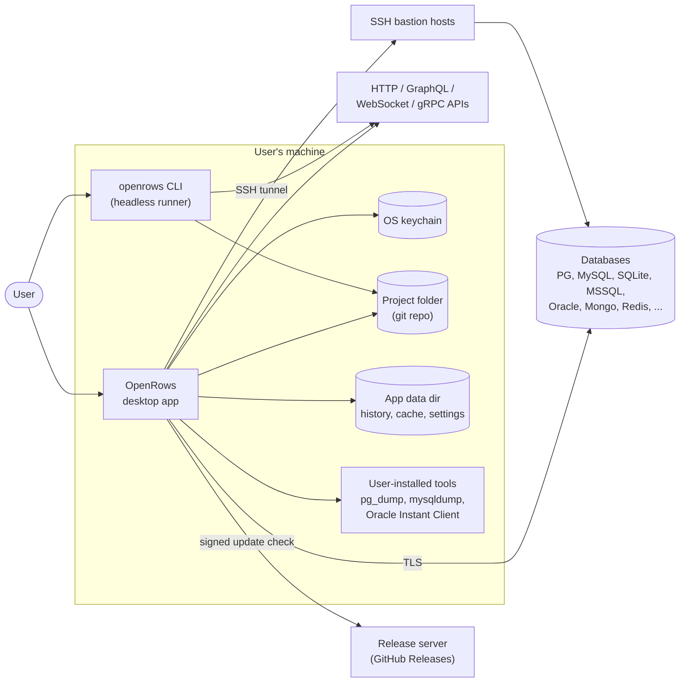
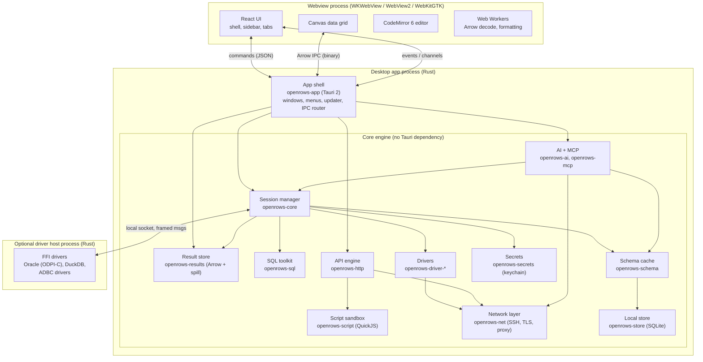
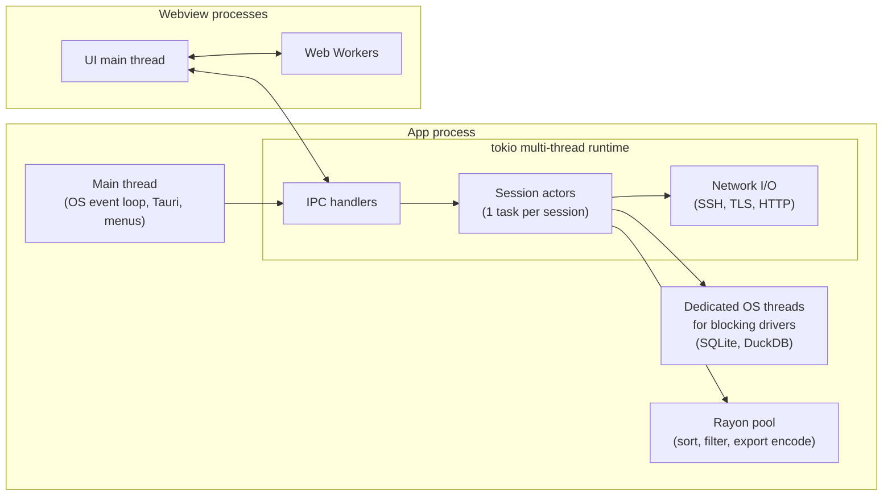
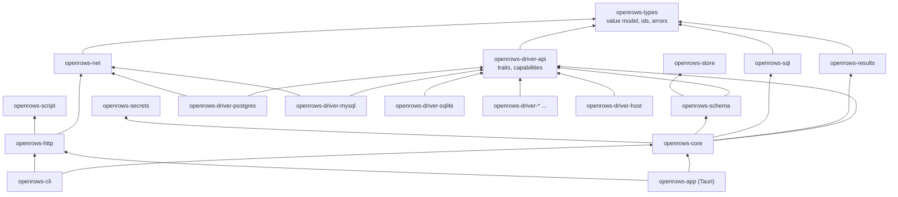
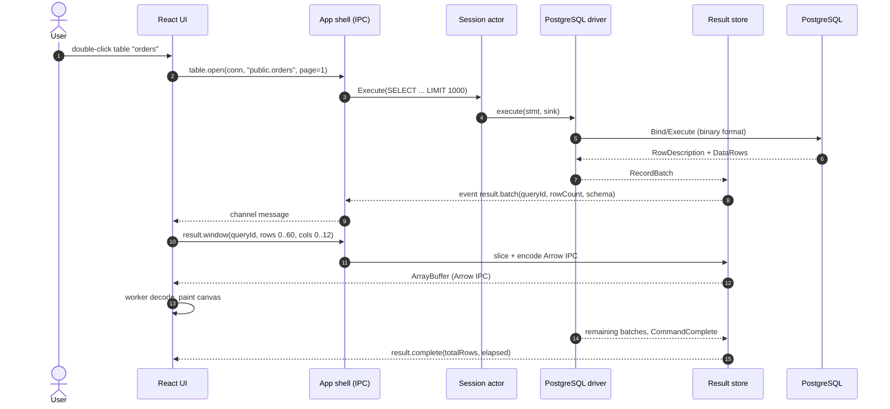
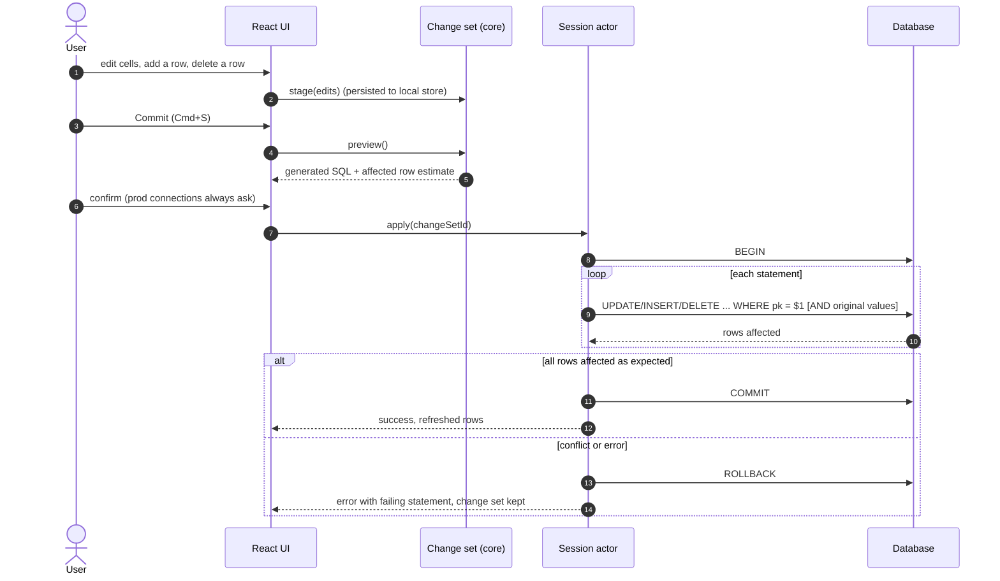

# 03 — Architecture Overview

## 1. Architectural drivers

The shape of the system follows from a handful of requirements:

| Driver | Consequence |
| --- | --- |
| Native-class speed with a web-tech UI | All heavy work in Rust; UI is a thin viewport that pulls only what it displays. |
| Many database paradigms (SQL, document, KV, wide-column, search) | One driver contract with capability flags; a shared value model; paradigm-specific views built on shared primitives. |
| Results of unbounded size | Results stored columnar (Arrow) in the core, spilled to disk past a budget; UI fetches windows. |
| Robustness | Actor-per-session isolation, panic containment, cancellation everywhere, optional out-of-process host for FFI drivers. |
| Cross-platform, macOS first | Tauri 2 + system webview; platform specifics isolated behind small traits. |
| Headless reuse (CLI, tests) | Core has zero dependency on Tauri; the app is just one front-end. |

## 2. System context

Nothing in this diagram is a server we operate, except the static release feed.

## 3. Containers

### 3.1 Responsibilities

| Container | Owns | Does not own |
| --- | --- | --- |
| **App shell** (`openrows-app`) | Tauri setup, window lifecycle, native menus, IPC command registration, capability permissions, updater, mapping IPC to core APIs | Any database or HTTP logic |
| **Core engine** | Connections, sessions, query execution, result storage, schema caching, HTTP engine, scripting, secrets, persistence | UI concerns, rendering, Tauri types |
| **Webview UI** | Presentation, interaction, layout, ephemeral view state | Long-lived data, credentials, protocol logic |
| **Driver host** (optional) | Running C/C++ driver libraries out of process so a segfault cannot take down the app | Anything else |

## 4. Process and thread model

Rules:

1. **The OS main thread never waits on I/O.** Tauri command handlers are `async` and hop onto the tokio runtime.
2. **One actor per session.** A session (a live database connection) is owned by a single tokio task that processes commands from an `mpsc` queue. This serialises access to the connection without locks and makes state transitions explicit. See [04-core-engine.md](04-core-engine.md#3-session-actors).
3. **Blocking drivers get their own thread**, not the shared `spawn_blocking` pool, so a long SQLite query cannot starve unrelated work and so thread-affine libraries keep their thread.
4. **CPU-heavy work** (client-side sort of 5 M rows, Parquet encoding) runs on a bounded Rayon pool, never on the tokio workers.
5. **The UI main thread only renders and handles input.** Arrow decoding, JSON pretty-printing of large values, and diff computation go to Web Workers.

## 5. Crate and package map

Dependency rules (enforced in CI with `cargo-deny` bans and a custom check):

- `openrows-types` depends on nothing internal.
- Drivers depend only on `openrows-driver-api`, `openrows-types`, `openrows-net`. Drivers never depend on each other or on `openrows-core`.
- Nothing in `crates/` depends on Tauri. Only `apps/desktop/src-tauri` does.
- Each driver is behind a Cargo feature so slim builds (e.g. the CLI) can exclude drivers.

The front-end packages mirror this: `@openrows/ipc` (generated bindings) ← `@openrows/grid`, `@openrows/editor`, `@openrows/ui` ← `apps/desktop/src`.

## 6. Key flows

### 6.1 Open a table

### 6.2 Commit an edit

## 7. Technology choices

| Concern | Choice | Why | Alternatives considered |
| --- | --- | --- | --- |
| App shell | Tauri 2 | Small binaries, system webview, Rust back end, mature plugin set, multi-window | Electron (memory/size), native per OS (3× UI cost), Flutter (weaker text/editor ecosystem) |
| Async runtime | tokio | De-facto standard; all chosen drivers support it | async-std (declining) |
| Result format | Apache Arrow (`arrow-rs`, `apache-arrow` JS) | Columnar, zero-copy slicing, typed, cross-language, Parquet export for free | JSON (slow, large), custom binary (more code to own) |
| SQL parsing | `sqlparser-rs` + fallback tokenizer | Multi-dialect, Apache-2.0, widely used | Tree-sitter grammars (good for highlighting, weaker AST), hand-written |
| Editor | CodeMirror 6 | Lighter than Monaco, modular, excellent large-doc performance, mobile-friendly IME | Monaco (heavy, VS Code-centric) |
| Data grid | Canvas renderer (see ADR-0004) | DOM grids cannot sustain 60 fps at 1 M rows with rich cells | DOM virtualisation libraries |
| UI framework | React 19 + TypeScript + Vite | Ecosystem, hiring, tooling; compiler-based memoisation | Svelte/Solid (smaller ecosystem for complex widgets) |
| Styling | CSS variables design tokens + CSS modules; Radix primitives for accessible behaviour | Theming, no runtime CSS-in-JS cost | Tailwind (fine, but tokens + modules keep markup cleaner for dense UI) |
| State | Zustand (UI state), TanStack Query (IPC-backed data) | Small, explicit, good DevTools | Redux (boilerplate) |
| IPC bindings | `tauri-specta` → TypeScript | One source of truth for types | Hand-written types |
| Local store | SQLite via `rusqlite` (WAL, FTS5) | Embedded, robust, searchable history | sled/redb (no SQL/FTS) |
| SSH | `russh` | Pure Rust, async, agent + jump support | libssh2 bindings (C, blocking) |
| TLS | `rustls` + `rustls-platform-verifier` | Memory-safe, uses OS trust store | OpenSSL (packaging pain on macOS/Windows) |
| Secrets | `keyring` crate (+ `security-framework` for macOS extras) | Cross-platform keychain access | Own encrypted vault (key management burden) |
| HTTP engine | `hyper` 1.x with custom connector, `reqwest` for simple paths | Need per-phase timings, HTTP/2, proxy, client certs | curl bindings (C dependency) |
| gRPC | `tonic` + `prost-reflect` | Dynamic messages from reflection or `.proto` | grpcurl sidecar |
| Scripting | QuickJS via `rquickjs` | Small, embeddable, sandboxable with memory/time limits | Boa (slower), V8 (huge), Deno core (heavy) |
| Logging | `tracing` + rolling file appender | Structured, spans across async | log/env_logger |

Each non-obvious choice has an ADR in [adr/](adr/README.md).

## 8. Cross-cutting concerns map

| Concern | Document |
| --- | --- |
| Security & secrets | [12-security.md](12-security.md) |
| Performance budgets | [13-performance.md](13-performance.md) |
| Errors, reconnection, logs | [14-reliability-and-observability.md](14-reliability-and-observability.md) |
| Persistence & migrations | [15-storage-and-persistence.md](15-storage-and-persistence.md) |
| Platform specifics | [16-platform-and-distribution.md](16-platform-and-distribution.md) |

## 9. Implemented (M2-01c): installed host boundary

The desktop manages a lazy `openrows_host_client::DriverHostRuntime` alongside
the existing sessions. It resolves the unsuffixed helper beside `current_exe`,
uses private 0700 rendezvous directories under the app cache's `hosts/`, and
shares 256 MiB per-host / 512 MiB aggregate admission and profile/driver crash
circuits. No helper starts during app setup. The desktop now depends on the
Tauri-free client/protocol, with no native hosted engine dependency.

Tauri stages/bundles a real production helper for each target. The closed
`HostDriverId` is the only argument; the diagnostic Probe has no database
capabilities. SQLite remains a test feature. M2-04 adds DuckDB's ID, host-only
registry/contract and parent metadata adapter; there is no hosted driver in the
picker yet. Installed/signing evidence and platform gaps are in [ADR-0010](adr/0010-driver-host-process.md).
