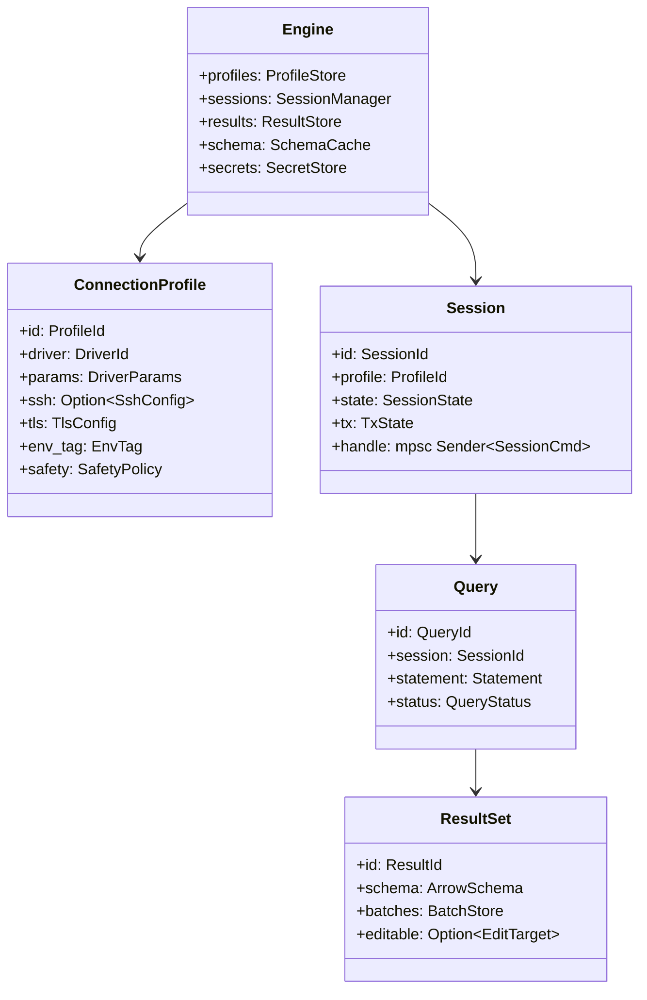
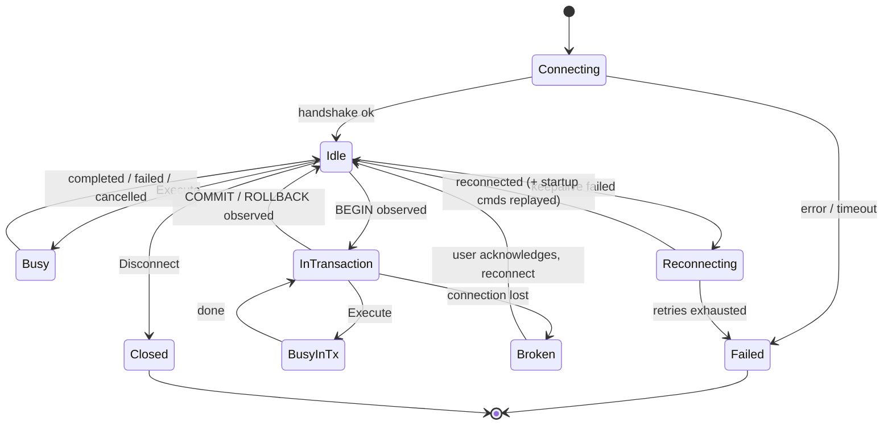
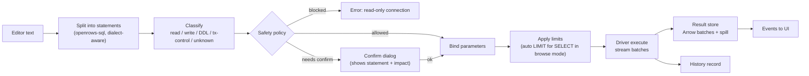

# 04 — Core Engine

The core engine is a set of Rust crates with no UI or Tauri dependency. The desktop app, the CLI and the test harness all drive it through the same public API (`openrows-core::Engine`).

## 1. Concepts



| Term | Meaning |
| --- | --- |
| **Profile** | Saved, non-secret description of how to connect. Secrets referenced by key, stored in keychain. |
| **Session** | One live connection to a database, owned by one actor. A tab may own a session or borrow the shared one. |
| **Query** | One statement execution on a session. Has a lifecycle and a cancel handle. |
| **Result set** | Columnar data produced by a query, stored in the result store, addressed by `ResultId`. |
| **Change set** | Staged edits against an editable result set or table. |

## 2. Engine API surface (sketch)

```rust
pub struct Engine { /* ... */ }

impl Engine {
    pub async fn open(cfg: EngineConfig) -> Result<Self>;

    // Profiles
    pub fn profiles(&self) -> &ProfileStore;

    // Sessions
    pub async fn connect(&self, profile: ProfileId, opts: ConnectOpts) -> Result<SessionId>;
    pub async fn disconnect(&self, session: SessionId) -> Result<()>;
    pub fn session_events(&self, session: SessionId) -> broadcast::Receiver<SessionEvent>;

    // Queries
    pub async fn execute(&self, session: SessionId, req: ExecuteRequest) -> Result<QueryHandle>;
    pub async fn cancel(&self, query: QueryId) -> Result<CancelOutcome>;

    // Results
    pub fn result(&self, id: ResultId) -> Option<ResultView>;

    // Schema
    pub async fn schema(&self, session: SessionId, path: ObjectPath, depth: Depth) -> Result<SchemaNode>;

    // Editing
    pub fn change_sets(&self) -> &ChangeSetStore;
    pub async fn apply(&self, session: SessionId, cs: ChangeSetId) -> Result<ApplyReport>;
}
```

`QueryHandle` exposes a stream of `QueryEvent`s (`Started`, `Batch { result, rows }`, `Notice`, `RowsAffected`, `Completed`, `Failed`, `Cancelled`) so any front-end can render progress.

## 3. Session actors

Every session is a tokio task that owns the driver connection exclusively.



```rust
enum SessionCmd {
    Execute { req: ExecuteRequest, reply: oneshot::Sender<Result<QueryHandle>> },
    Introspect { req: IntrospectRequest, reply: oneshot::Sender<Result<SchemaNode>> },
    Apply { cs: ChangeSet, reply: oneshot::Sender<Result<ApplyReport>> },
    Ping { reply: oneshot::Sender<Result<Duration>> },
    Close,
}
```

Why actors:

- **No shared mutable connection.** Drivers can be `!Sync`; the actor is the only owner.
- **Serialized semantics.** Databases process one statement at a time per connection anyway; the queue makes that explicit and lets the UI show "queued" state.
- **Out-of-band cancel.** The `CancelHandle` is obtained from the driver *before* the statement starts and stored outside the actor, so cancel never waits behind the running query.
- **Panic containment.** If a driver panics, only that task dies. The `SessionManager` observes the `JoinError`, marks the session `Failed`, emits an event, and the rest of the app continues (NFR-REL-02).

### 3.1 Session allocation per tab

A profile can have several sessions. Policy (configurable per profile):

| Mode | Behaviour | Default for |
| --- | --- | --- |
| **Shared** | One metadata session + one shared query session for all tabs. Lowest server footprint. | SQLite, DuckDB, Redis |
| **Per tab** (lazy) | Metadata session + one session per editor tab created on first run. Long query in tab A never blocks tab B or the schema tree. | PostgreSQL, MySQL, SQL Server, Oracle, ClickHouse |
| **Pooled** | Driver-native pool (e.g. MongoDB driver's internal pool). | MongoDB, Cassandra, DynamoDB, Elasticsearch |

Max sessions per profile defaults to 4 (configurable) to respect server `max_connections`. When a tab opens a transaction its session is **pinned** to that tab until commit/rollback; the tab header shows a transaction badge.

### 3.2 Keepalive and idle handling

- Idle sessions ping at `keepalive_interval` (default 30 s; driver-specific cheap ping: `SELECT 1`, `PING`, `COM_PING`, `hello`).
- Idle sessions closed after `idle_timeout` (default 15 min) except the metadata session; transparently reopened on next use.
- TCP keepalive and SSH keepalive also enabled to detect half-open connections through NAT.

## 4. Query execution pipeline



Details:

1. **Splitting** respects dialect quoting: PostgreSQL dollar quotes, MySQL `DELIMITER`, SQL Server `GO` batch separator, Oracle PL/SQL blocks (`/` terminator), comments, nested block comments. The splitter is a hand-written lexer per dialect family (fast, never fails); `sqlparser-rs` is used afterwards for classification and editability, and its failure is non-fatal.
2. **Classification** drives safe mode. Statements the parser cannot classify are treated as `unknown` = write for safety purposes.
3. **Dangerous statement detection:** `DELETE`/`UPDATE` without `WHERE`, `DROP`, `TRUNCATE`, `ALTER ... DROP` trigger a confirmation on any connection where "confirm dangerous statements" is enabled (default on).
4. **Auto-limit** applies only to table-browse queries the app generates, never silently to user SQL. User queries are streamed and the grid fetches windows; the result store protects memory instead.
5. **Multi-statement runs** produce one result tab per result-producing statement. Execution stops on first error unless the user chose "continue on error".

### 4.1 Current implementation: `openrows-sql` (D-02, slice of M1-15)

Splitting and current-statement detection are described in [09 §2.1](09-query-editor.md#21-current-implementation-d-02-slice-of-m1-15). Classification is `classify(statement_text, Dialect::Postgres) -> Classification { kind, dangerous }` with `kind ∈ {Read, Write, Ddl, TxControl, Unknown}`; `is_write()` is true for `Write`, `Ddl` and `Unknown`.

- **No `sqlparser` dependency yet.** The classifier is token-based over the splitter's lexer, so it works on incomplete SQL, cannot fail, and needs no parser fallback. `sqlparser-rs` may still be added later for editability analysis; its failure must stay non-fatal.
- Leading comments, whitespace and `(` are skipped; then the first keyword decides, followed by an escalation scan for `Read` statements and a dangerous-DML scan for all statements except plain `EXPLAIN`.
- Anything not recognised is `Unknown` (treated as a write).

| Statement | Kind | Dangerous |
| --- | --- | --- |
| `SELECT`, `VALUES`, `TABLE`, `SHOW`, `FETCH`, `MOVE`, `CLOSE`, `LISTEN`, `UNLISTEN`, `DEALLOCATE` | Read | — |
| …but containing `INTO`, `FOR UPDATE/NO KEY UPDATE/SHARE/KEY SHARE`, a nested `(INSERT/UPDATE/DELETE/MERGE`, or a known side-effecting built-in call (`nextval`, `setval`, `set_config`, `pg_terminate_backend`, `lo_*`, `dblink*`, `pg_advisory*`, …) | Write | if nested unbounded DML |
| `WITH … <body>` | class of the body, escalated as above (data-modifying CTEs → Write) | if any `DELETE`/`UPDATE` (main or CTE) has no `WHERE` at its level |
| `EXPLAIN [options] stmt` without `ANALYZE` (or `ANALYZE false/off/0`) | Read | no (nothing executes) |
| `EXPLAIN ANALYZE stmt`, `EXPLAIN (ANALYZE[, …]) stmt` | class of `stmt` | as `stmt` |
| `INSERT`, `UPDATE`, `DELETE`, `MERGE`, `VACUUM`, `ANALYZE`, `CLUSTER`, `REINDEX`, `REFRESH`, `LOCK`, `NOTIFY`, `CHECKPOINT` | Write | `DELETE`/`UPDATE` without `WHERE` (`WHERE CURRENT OF` counts as bounded) |
| `TRUNCATE` | Write | yes |
| `COPY … TO STDOUT` / `COPY (query) TO STDOUT` | Read (escalated if the query is DML) | if the query is unbounded DML |
| `COPY … FROM …`, `COPY … TO 'file'`, `COPY … TO PROGRAM` | Write | — |
| `CREATE`, `COMMENT`, `GRANT`, `REVOKE`, `SECURITY LABEL`, `IMPORT FOREIGN SCHEMA`, `REASSIGN` | Ddl | if a nested unbounded DML (e.g. `CREATE RULE … DO (DELETE …)`) |
| `ALTER …` | Ddl | if it contains `DROP` anywhere (`DROP COLUMN`, `DROP NOT NULL`, …) |
| `DROP …` | Ddl | yes |
| `BEGIN`, `START TRANSACTION`, `COMMIT`, `END`, `ROLLBACK`, `ABORT`, `SAVEPOINT`, `RELEASE`, `PREPARE TRANSACTION`, `SET TRANSACTION` / `SET SESSION CHARACTERISTICS` | TxControl | — |
| …with `READ WRITE` | Unknown | — |
| `SET`/`RESET` of a harmless setting (`search_path`, `TIME ZONE`, `statement_timeout`, `application_name`, …; allowlist in `classify/session.rs`) | Read | — |
| any other `SET`/`RESET` (`ROLE`, `SESSION AUTHORIZATION`, `default_transaction_read_only`, custom `x.y`, `RESET ALL`) | Unknown | — |
| `PREPARE name AS stmt`, `DECLARE … CURSOR … FOR query` | class of the inner statement | as inner |
| `CALL`, `DO`, `EXECUTE`, `DISCARD`, `LOAD`, empty input, anything else | Unknown | — |
| Any statement still holding a `;` (kept by an unbalanced `(`) | never Read (Unknown unless escalated to Write) | if an unbounded `DELETE`/`UPDATE` follows the `;` |

Known limits: user-defined volatile functions in a `SELECT` cannot be detected without the catalog, so read-only connections must also be enforced server-side (read-only transaction); `WHERE true` counts as bounded; psql meta-commands (`\gexec`) are not understood.

## 5. Value model

All drivers convert native values into a shared type system that maps 1:1 onto Arrow types. This is what lets one grid, one exporter and one editor serve every database.

| Logical type | Arrow type | Examples | Notes |
| --- | --- | --- | --- |
| Null | any (validity bitmap) | `NULL` | Rendered distinctly from empty string. |
| Bool | `Boolean` | PG `bool`, MySQL `tinyint(1)` (heuristic, overridable) | |
| Int8/16/32/64, UInt* | `Int*`/`UInt*` | | Unsigned kept unsigned (MySQL). |
| Float32/64 | `Float32/64` | | Display keeps full round-trip precision. |
| Decimal | `Decimal128(p,s)` when p ≤ 38, else `Utf8` with decimal tag | PG `numeric`, Oracle `NUMBER` | Never converted to float. Arbitrary precision preserved as text. |
| Text | `Utf8` / `LargeUtf8` | | Invalid UTF-8 from server becomes Binary with a flag. |
| Binary | `Binary` / `LargeBinary` | `bytea`, `BLOB` | |
| Date, Time, Timestamp(tz?) | `Date32`, `Time64(µs)`, `Timestamp(µs, tz)` | | Out-of-range (PG `infinity`, year 0) stored as tagged text. |
| Interval | `Interval(MonthDayNano)` | | |
| UUID | `FixedSizeBinary(16)` + extension tag | | |
| JSON | `Utf8` + `openrows.json` extension | PG `json/jsonb`, MySQL `JSON` | |
| Array | `List<T>` | PG arrays | |
| Composite / Document | `Utf8` (canonical JSON/EJSON) + extension tag | Mongo documents, PG composite | Also offered as tree in document view. |
| Geometry | `Binary` (WKB) + `openrows.geo` tag | PostGIS, MySQL spatial | Rendered as WKT in grid; map preview in inspector (P2). |
| Unknown | `Utf8` (server text representation) + original type name | Exotic extension types | Never fail a query because we don't know a type. |

Every column carries metadata: source type name, nullability, source table/column (when known), and whether it is part of the edit key. That metadata travels in the Arrow schema's field metadata.

**Rule:** a value that cannot be represented exactly is never silently coerced. It falls back to its textual form with the original type name attached.

## 6. Cancellation and timeouts

| Mechanism | Used for |
| --- | --- |
| `CancelHandle::cancel()` (driver-specific, out-of-band) | User clicks Stop. |
| Statement timeout (client-side `tokio::time::timeout` + server-side where available, e.g. PG `statement_timeout`) | Configurable per profile. |
| Connect timeout | Each stage (DNS, TCP, SSH, TLS, auth) has its own timeout so diagnostics can say which stage hung. |
| `CancellationToken` tree | Closing a tab cancels its queries; closing a window cancels its tabs; quitting cancels everything and waits up to 2 s for graceful close. |

If the driver cannot cancel server-side, Stop drops the client stream, marks the session as `Busy (draining)`, and offers "Close connection" so the user is never stuck.

## 7. Error model

```rust
pub struct OdbError {
    pub kind: ErrorKind,          // Connect, Auth, Tls, Ssh, Syntax, Permission, Constraint, Timeout, Cancelled, Network, Driver, Internal
    pub message: String,          // human message, already redacted
    pub db_code: Option<String>,  // SQLSTATE / vendor code
    pub position: Option<SourcePos>, // for syntax errors → editor squiggle
    pub detail: Option<String>,
    pub hint: Option<String>,
    pub retryable: bool,
}
```

- Database-reported positions are mapped back to the editor through the statement's offset in the original buffer.
- `Internal` errors carry a correlation id that also appears in logs, so a bug report can be matched without exposing query text.

## 8. Transactions

- **Auto-commit** by default (matching most clients' user expectations).
- **Manual commit mode** per tab: the tab sends `BEGIN` implicitly before the first statement; toolbar shows Commit / Rollback buttons and a live "uncommitted" timer.
- The engine tracks transaction state from driver signals (PG `ReadyForQuery` status byte, MySQL server status flags, SQL Server `@@TRANCOUNT` after batches) rather than parsing SQL, so `BEGIN` inside user SQL is detected reliably.
- Closing a tab with an open transaction prompts: Commit / Rollback / Cancel.

## 9. Concurrency limits and back-pressure

- Each running query writes into the result store through a bounded channel. If the store's memory budget is reached and spilling is slower than the network, the driver stream is paused (natural TCP back-pressure), never buffered unboundedly.
- Global limits: max concurrent queries (default 16), max concurrent introspection tasks per session (1), max export jobs (4).

## 10. Implementation notes (M1-01 session manager slice)

`crates/openrows-core` implements the session actor runtime from §3, §6 and §7. It does not depend on Tauri. Transactions, reconnect, keepalive, timeouts and the result store are not implemented yet.

| Piece | As built |
| --- | --- |
| `SessionManager` | `open(connect_future)` starts one tokio task (the actor) per session. The actor awaits the driver's connect future, so the session is `Connecting` until the handshake finishes. `execute(session, sql)` returns a `QueryHandle` straight away. `close(session)` cancels the session's queries, closes the connection and forgets the session. `subscribe()` broadcasts `SessionEvent` state changes. `state(session)` reads the current state without messaging the actor. |
| Command queue | Each session has a bounded `mpsc` queue of 32 commands (`Execute`, `Close`). When the queue is full, `execute` returns `QueueFull` instead of waiting. `Close` replies on a `oneshot`. Query progress uses an unbounded per-query event channel. This channel stays small because the sink coalesces `Progress` and the UI pulls rows through windows. |
| States | `Connecting → Idle ↔ Busy → Closed / Failed`. Terminal states are never left. A server, decode or unsupported error leaves the session `Idle`, because the driver has drained to `ReadyForQuery`. Transport and protocol errors move it to `Failed`. |
| Cancellation | Uses a `tokio_util` `CancellationToken` tree: manager root → session → query. `QueryHandle::canceller()` can be cloned and fires without waiting for the actor. A queued query never starts and ends with `Cancelled`. For a running query, the actor races the driver future against the token. On cancel it spawns the driver's `CancelHandle::cancel()`, which is obtained before execution; for PostgreSQL this sends `CancelRequest` on a new socket. The actor then waits up to 2 s for the driver to drain. If the driver has no cancel handle, or the grace period runs out, the actor drops the connection and the session becomes `Failed`. |
| Panic isolation | A supervisor task awaits each actor's `JoinHandle`. On a panic it marks only that session `Failed`, sends `Failed { kind: Internal }` to the running query and broadcasts a `SessionEvent`. Other sessions and the manager keep working (NFR-REL-02). |
| Errors | `CoreError { kind, message, db_code }` is a cloneable subset of `OdbError`. `ErrorKind` maps every `DriverError` variant, plus `UnknownSession`, `SessionClosed`, `QueueFull` and `Internal`. Position, detail, hint and correlation id come later. |
| Events | `QueryEvent` follows docs/06 §4: `Started`, `ResultBegin`, `Progress` (at most 10 Hz), `ResultEnd { truncated }`, `RowsAffected` (taken from DML command tags when no result set opened), `Notice`, then exactly one of `Completed`, `Failed` or `Cancelled`. |
| Result sink | Batches go to the `BatchSink` trait (`begin`, `push → SinkFlow`, `end`), keyed by `ResultId`. When the sink returns `Stop`, the stream is truncated. Since D-07, `openrows_results::ResultStore` implements it (see [06 §9](06-ipc-and-result-pipeline.md#9-implementation-notes-d-07-query-execution-and-results)). |

Driver API changes for this slice: `Session::cancel_handle()` (default `None`), the `CancelHandle` trait, and `ResultSink::notice()` with `NoticeLevel` (default no-op). The PostgreSQL driver records `BackendKeyData` and forwards `NoticeResponse` during execution.

Tests: `cargo nextest run -p openrows-core` uses a scripted fake session. It covers ordered events, progress coalescing, truncation, rows affected, notices, server and transport errors, Busy state, cancel within 200 ms, cancel of queued queries, cancel without driver support, close, a full queue, connect failure, and driver panics while running or connecting. `just test-pg` also runs `crates/openrows-core/tests/postgres.rs` against a real server: a 100 000-row stream, a `RAISE WARNING` notice, cancelling `pg_sleep(30)`, and reusing the session afterwards.
