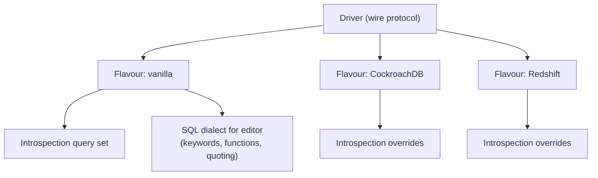
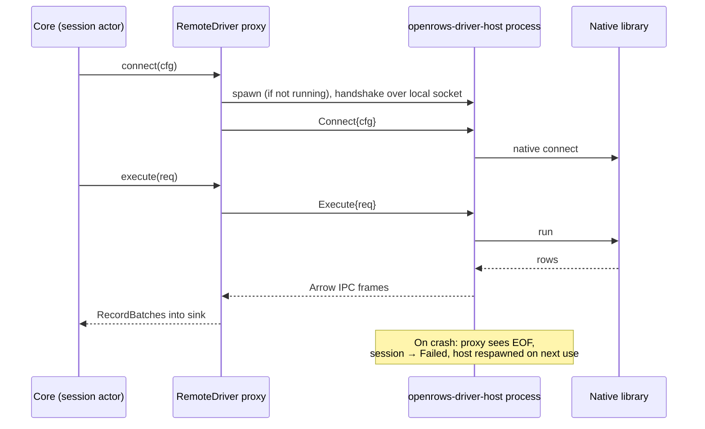

# 05 — Database Drivers

## 1. Goals

- Support every major database family through **one contract** so the grid, editor, exporter and safety features work everywhere.
- Prefer **pure-Rust, async, permissively licensed** client libraries. Avoid bundling proprietary or copyleft client libraries.
- Let drivers declare what they can do (**capabilities**) so the UI adapts instead of special-casing database names.
- Make adding a driver mechanical: implement traits, pass the conformance suite.

## 2. Driver contract

```rust
#[async_trait]
pub trait Driver: Send + Sync + 'static {
    fn id(&self) -> DriverId;                       // "postgres", "mysql", ...
    fn info(&self) -> &DriverInfo;                  // display name, icon id, URL schemes, default port
    fn capabilities(&self) -> &Capabilities;
    fn params_schema(&self) -> &ParamsSchema;       // drives the connection form UI
    fn parse_url(&self, url: &str) -> Result<DriverParams>;
    async fn connect(&self, cfg: ConnectConfig, net: &NetContext) -> Result<Box<dyn Connection>>;
}

#[async_trait]
pub trait Connection: Send {
    fn server_info(&self) -> &ServerInfo;            // product, version, flavour (e.g. CockroachDB on PG wire)
    fn cancel_handle(&self) -> Option<Arc<dyn CancelHandle>>;
    async fn execute(&mut self, req: ExecuteRequest, sink: &mut dyn ResultSink) -> Result<ExecSummary>;
    async fn ping(&mut self) -> Result<()>;
    async fn close(self: Box<Self>) -> Result<()>;

    // Optional facets — return None when unsupported
    fn introspector(&mut self) -> Option<&mut dyn Introspector> { None }
    fn row_editor(&mut self) -> Option<&mut dyn RowEditor> { None }
    fn explainer(&mut self) -> Option<&mut dyn Explainer> { None }
    fn admin(&mut self) -> Option<&mut dyn Admin> { None }
    fn bulk_loader(&mut self) -> Option<&mut dyn BulkLoader> { None }
    fn kv(&mut self) -> Option<&mut dyn KeyValueOps> { None }        // Redis
    fn documents(&mut self) -> Option<&mut dyn DocumentOps> { None } // MongoDB
}

pub trait ResultSink: Send {
    fn begin_result(&mut self, schema: SchemaRef, edit: Option<EditTarget>) -> Result<()>;
    fn push_batch(&mut self, batch: RecordBatch) -> SinkFlow;      // Continue | Pause | Stop
    fn end_result(&mut self, summary: ResultSummary) -> Result<()>;
    fn notice(&mut self, n: Notice);
}
```

Drivers build Arrow `RecordBatch`es directly with typed builders (no intermediate `Vec<Value>`), targeting ~64 k cells or 4 MB per batch, whichever comes first, and always flushing the first batch early (after ≤ 200 rows) so the UI can paint quickly.

The M0-S3 draft in `crates/openrows-driver-api` implements only the streaming core of this contract: `Session` (`execute`, `close`; `Send`, not `Sync`, owned by one actor per ADR-0007), a minimal `ResultSink` (`begin_result`, `push_batch` → `Continue | Stop`), `ExecSummary`, a typed `DriverError` and `BatchPolicy`. `BatchPolicy` caps the first batch at min(200 rows, 64 Ki cells). Later batches hold ⌊65 536 / columns⌋ rows, or flush once 4 MiB of wire bytes has been decoded. Capabilities, cancel, notices, introspection and editing facets remain M1-10 work. See [§11](#11-m0-s3-postgresql-streaming-spike).

### 2.1 Capabilities

```rust
pub struct Capabilities {
    pub paradigm: Paradigm,              // Relational | Document | KeyValue | WideColumn | Search | Analytical
    pub query_language: QueryLanguage,   // Sql(Dialect) | Mql | RedisCmd | Cql | PartiQl | EsDsl
    pub transactions: TxSupport,         // None | Single | Full { savepoints }
    pub server_cancel: bool,
    pub explain: ExplainSupport,         // None | Text | Json | Analyze
    pub editable_results: bool,
    pub schemas: bool,                   // namespaces inside a database
    pub multiple_databases: bool,
    pub streaming: bool,                 // true streaming vs. buffered pages
    pub bulk_load: bool,
    pub ssh_tunnel: bool,
    pub tls: bool,
    pub process_list: bool,
    pub object_kinds: &'static [ObjectKind],
}
```

The UI reads capabilities to decide which toolbar buttons, tree nodes and editors appear.

## 3. Support tiers

| Tier | Meaning | Release gate |
| --- | --- | --- |
| **Tier 1** | Full feature set, every conformance test, tested against all supported server versions on every PR. | Ships in first alpha. |
| **Tier 2** | Full browse/query/edit/export; some advanced features (admin, explain visualiser) may lag. Integration-tested nightly. | Ships by 1.0. |
| **Tier 3** | Browse/query/export; editing where the model allows; tested nightly on latest server version. | Ships by 1.0, may be marked beta. |
| **Bridge** | Via ADBC or JDBC-free bridges; capabilities as exposed by the bridge driver. | Post-1.0. |

## 4. Per-database strategy

| Database | Family / wire | Rust library | Licence | Tier | Notes |
| --- | --- | --- | --- | --- | --- |
| PostgreSQL 12–17+ | PG wire v3 | `tokio-postgres` (+ `postgres-types`, own binary decoders into Arrow); M0-S3 prototype uses `postgres-protocol` directly, see [§11](#11-m0-s3-postgresql-streaming-spike) | MIT/Apache | 1 | Binary format for known types, text fallback; `COPY` for import/export; cancel via `CancelToken`; `EXPLAIN (FORMAT JSON)`. |
| CockroachDB, YugabyteDB, Neon, Supabase, Timescale, AlloyDB, Aurora PG | PG wire | same driver, **flavour** profile | — | 1 (PG-compatible), flavour quirks Tier 2 | Flavour detected from `version()` / `SHOW` settings; introspection queries adapted per flavour. |
| Amazon Redshift | PG wire (old protocol subset) | same driver, Redshift flavour | — | 3 | Different catalog, no cancel token in some setups. |
| MySQL 5.7, 8.0, 8.4 | MySQL protocol | own client on `mysql_common` packets and auth plugins (D-12, see §13; `mysql_async` was the plan) | MIT/Apache | 1 | Streaming rows into Arrow; cancel via `KILL QUERY <id>` on side connection; column metadata gives `org_table` for editability. |
| MariaDB 10.6+ / 11.x, TiDB, Vitess/PlanetScale, Aurora MySQL | MySQL protocol | same, flavour profile | — | 1 / 2 | Flavour detected from version string and variables. |
| SQLite 3 | in-process | `rusqlite` (bundled SQLite, `column_decltype` feature; `column_metadata` when result editing needs it) | MIT | 1 | Runs on a dedicated thread; `sqlite3_interrupt` for cancel; WAL-friendly read sessions; open read-only option. |
| libSQL / Turso | in-process + remote (Hrana over HTTP/WebSocket) | `libsql` | MIT | 2 | Remote embedded replicas optional. |
| SQL Server 2017+ / Azure SQL | TDS | `tiberius` | MIT/Apache | 2 | `rustls` TLS; Azure AD token auth (P2); cancel via TDS attention where supported, else `KILL` on side connection; `GO` batch separator handled by splitter. |
| ClickHouse | HTTP interface (and native later) | own client on `hyper` using `FORMAT ArrowStream` | — | 2 | Server streams Arrow directly → near-zero decode cost. Cancel via `KILL QUERY WHERE query_id = …` using client-generated `query_id`. |
| DuckDB | in-process | `duckdb` crate (C++ library) | MIT | 2 | Native Arrow output. FFI → eligible for out-of-process driver host. |
| MongoDB 5.0+ | OP_MSG | official `mongodb` crate | Apache-2.0 | 2 | Shell-like query parser in `openrows-sql/mql`; documents → JSON column + flattened tabular view; `killOp` for cancel. |
| Redis 6+ / Valkey / KeyDB / Dragonfly | RESP2/RESP3 | `redis` crate | BSD-3 | 2 | `SCAN`-based key browser (never `KEYS *`); type-aware editors; cluster and sentinel support. |
| Oracle 19c+ | OCI | `oracle` crate (ODPI-C, loads **user-installed** Instant Client at runtime) | UPL/Apache | 3 | Not bundled; app detects/locates Instant Client and guides installation. Runs in driver host. |
| Cassandra 4+ / ScyllaDB | CQL native protocol | `scylla` crate | MIT/Apache | 3 | Paging via paging state; editing by full primary key only. |
| DynamoDB | AWS JSON API | `aws-sdk-dynamodb` | Apache-2.0 | 3 | PartiQL editor + Scan/Query builder; AWS profile/SSO credentials; consumed-capacity display. |
| Elasticsearch 7/8, OpenSearch 2 | REST | own client on `hyper` | — | 3 | JSON DSL editor and SQL endpoint where enabled; index browser. |
| Snowflake, BigQuery, Databricks, others | ADBC | `adbc_core` driver manager + vendor ADBC drivers | Apache-2.0 (manager) | Bridge | Post-1.0; drivers user-installed or downloaded from official sources with consent. |

Library choices are validated in Milestone 0 spikes (see [19-roadmap.md](19-roadmap.md)); swapping a library touches only that driver crate.

## 5. Dialects and flavours



- A **flavour** is detected after connect and selects: introspection query variants, keyword/function lists for autocomplete, DDL generation quirks, and capability adjustments (e.g. CockroachDB lacks some catalog views).
- Introspection SQL lives in versioned `.sql` resource files inside each driver crate, not in Rust string literals, so it is reviewable and testable on its own.

## 6. Introspection contract

```rust
#[async_trait]
pub trait Introspector {
    async fn list(&mut self, parent: &ObjectPath, kinds: &[ObjectKind]) -> Result<Vec<ObjectSummary>>;
    async fn describe(&mut self, path: &ObjectPath) -> Result<ObjectDetail>;  // columns, indexes, FKs, ...
    async fn ddl(&mut self, path: &ObjectPath) -> Result<String>;
    async fn search_index(&mut self, scope: &ObjectPath) -> Result<Vec<SearchEntry>>; // bulk names for fuzzy search
    async fn fingerprint(&mut self, scope: &ObjectPath) -> Result<Option<String>>;    // cheap change detection
}
```

- `list` is called lazily on tree expand.
- `search_index` fetches names of all objects in one query (bounded) for fuzzy search and autocomplete.
- `fingerprint` lets the cache know whether to refetch (e.g. PG: hash over `pg_class.oid, relname, relkind` max xmin; MySQL: `information_schema.TABLES.UPDATE_TIME`/`CREATE_TIME` aggregates). Drivers without a cheap fingerprint return `None` and the cache uses TTL. See [10-schema-and-data-editing.md](10-schema-and-data-editing.md).

## 7. Editing contract

```rust
pub struct EditTarget {
    pub table: ObjectPath,
    pub key_columns: Vec<ColumnRef>,     // PK or unique not-null
    pub column_map: Vec<Option<ColumnRef>>, // result column index → table column (None = computed, not editable)
}

#[async_trait]
pub trait RowEditor {
    fn render(&self, cs: &ChangeSet, target: &EditTarget) -> Result<Vec<Statement>>; // pure, for preview
    async fn apply(&mut self, stmts: Vec<Statement>, opts: ApplyOpts) -> Result<ApplyReport>;
}
```

How drivers determine `EditTarget` for an arbitrary query:

| Database | Source of column→table mapping |
| --- | --- |
| PostgreSQL | `RowDescription` table OID + attribute number per column → catalog lookup for PK. |
| MySQL/MariaDB | Column definition `org_table`, `org_name`, flags (`PRI_KEY_FLAG`). |
| SQLite | `sqlite3_column_table_name` / `sqlite3_column_origin_name` (with `column_metadata` feature) + `rowid` fallback for rowid tables. |
| SQL Server | `sp_describe_first_result_set` with `@browse_information_mode = 1`. |
| Others | Editable only for app-generated table-browse queries where the target is known. |

If all non-computed columns map to one table and that table has a usable key present in the result (or the driver can add it invisibly for browse queries), the result is editable. Otherwise the grid is read-only and shows why.

## 8. Conformance suite

A shared test crate (`openrows-driver-conformance`) parameterised by driver. Every driver must pass the applicable groups:

| Group | Examples |
| --- | --- |
| Connect | URL parsing round-trips, bad password → `Auth` error kind, wrong port → `Connect`, TLS required/failed paths, SSH tunnel path. |
| Types | Round-trip of every logical type including NULL, extremes, unicode, invalid UTF-8, precision-sensitive decimals, timezone edge cases. |
| Streaming | 1 M-row query streams with bounded memory; first batch latency; pause/resume back-pressure. |
| Cancel | Long query cancelled within 1 s; session usable afterwards. |
| Transactions | Commit, rollback, state tracking when user types `BEGIN`. |
| Introspection | Golden snapshots of a fixture schema per server version. |
| Editing | Insert/update/delete with composite keys, NULL in keys rejected, conflict detection, rollback on partial failure. |
| Errors | Syntax error position mapping, constraint violation codes. |

## 9. Out-of-process driver host

Drivers built on C/C++ libraries (Oracle via ODPI-C, DuckDB, ADBC drivers) can crash the process on bugs we cannot catch. These drivers can run inside `openrows-driver-host`, a small helper executable:



- Transport: Unix domain socket (macOS/Linux) / named pipe (Windows); frames are length-prefixed `postcard`-encoded control messages plus raw Arrow IPC payloads.
- Because the `Driver` trait is already message-shaped (requests in, batches out), `RemoteDriver` implements the same trait; the rest of the engine cannot tell the difference.
- Default: in-process for pure-Rust drivers; out-of-process for FFI drivers. Users can override per driver.

## 10. Non-SQL paradigms in a shared UI

| Paradigm | Primary view | Tabular projection | Editor language |
| --- | --- | --- | --- |
| Document (MongoDB) | Document list with tree/JSON view per document | Top-level fields flattened into columns (union of keys over the sampled window), nested values as JSON cells | MQL (`db.coll.find({...}).sort(...)`) parsed into driver commands — no JS execution |
| Key-value (Redis) | Key browser (SCAN with pattern, type filter), value editor by type (string, hash, list, set, zset, stream, JSON) | Hash/zset/list rendered as two-column grids | Redis command console with command-aware autocomplete |
| Wide-column (Cassandra) | Table grid | Native | CQL |
| Search (Elasticsearch) | Hits grid + raw JSON | `_source` flattened | JSON DSL, SQL endpoint |
| Key-value/document (DynamoDB) | Item grid | Attributes flattened | PartiQL, Scan/Query builder |

## 11. M0-S3 PostgreSQL streaming spike

`crates/openrows-driver-postgres` started as this prototype and became the dogfood driver in D-04 (§12). The spike covered plain-TCP connect (cleartext, MD5 and SCRAM-SHA-256 without channel binding) and parameterless statements over the extended protocol. Results are decoded from `DataRow` cells straight into pre-sized Arrow builders. The spike had no TLS, cancel, bind parameters, notices or flavour detection.

**Library finding.** `tokio-postgres` 0.7 always binds every result column in binary format: `encode_bind_raw` passes the single result-format code `1`. Its public API cannot request text for some columns, so the docs/04 §5 rule "unknown type → server text plus type name" is impossible with it. `Row` also allocates per row. The spike therefore drives the wire protocol with `postgres-protocol` (same upstream project and licence, and the layer `tokio-postgres` itself uses). It sends `Parse`/`Describe`/`Sync`, picks a format code per column (binary for known types, text otherwise), then sends `Bind`/`Execute`/`Sync`. Each `DataRow` is decoded in place from the shared read buffer. Names of non-built-in types come from one cached `format_type` lookup per session. M1-11 decides between this approach (adding rustls TLS from M1-06, the cancel request and notices) and contributing per-column result formats upstream.

| PostgreSQL type | Arrow type | Field metadata |
| --- | --- | --- |
| `int2` / `int4` / `int8` | `Int16` / `Int32` / `Int64` | `openrows.source_type` on every field |
| `float4` / `float8` | `Float32` / `Float64` | |
| `bool` | `Boolean` | |
| `text`, `varchar`, `bpchar`, `name` | `Utf8` | |
| `bytea` | `Binary` | |
| `timestamp` / `timestamptz` | `Timestamp(µs)` / `Timestamp(µs, "UTC")` | |
| `date` | `Date32` | |
| `uuid` | `FixedSizeBinary(16)` | `ARROW:extension:name = arrow.uuid` |
| `numeric(p, s)`, 0 ≤ s ≤ p ≤ 38 | `Decimal128(p, s)` | |
| other `numeric` | `Utf8`, exact canonical text | `openrows.decimal` |
| `json` / `jsonb` | `Utf8` (jsonb version byte stripped) | `openrows.json` |
| anything else | `Utf8`, server text format | source type from `format_type`, e.g. `integer[]`, `interval` |

**Open points found by the spike.** Some values have no exact form in their column's Arrow type: ±infinity timestamps and dates, `NaN` in a constrained `numeric`, and timestamps after 294247-01-10. PostgreSQL accepts timestamps up to 294276 AD, but Arrow µs-since-1970 `i64` ends there. The spike failed these with `DriverError::Decode`; D-04 replaced that with the tagged-text fallback in §12. The driver still has no row cap, `Pause`, or COPY path.

Evidence on a Mac mini M4, release profile: Criterion decodes 63–330 M cells/s per core at the mean's upper 95% bound (budget 1 M, NFR-PERF-05), and a 200-row × 20-column first batch takes 0.036 ms (budget 5 ms). A `dhat` test counts zero heap allocations while decoding 54 912 primitive cells. Against real PostgreSQL 12.22, 17.11 and 18.6 (`just test-pg <version>`), the first batch reached the sink 0.14–0.15 ms after the first `DataRow` and 0.87–1.79 ms after `execute()` for a 200 000-row heap scan. Numbers and commands are in [13 §4](13-performance.md#4-benchmark-suite).

## 12. D-04 PostgreSQL driver (dogfood slice of M1-11)

D-04 makes the §11 driver usable against local PostgreSQL. TLS is D-11; bind parameters, introspection and the full M1-10 contract come later.

**Connect API.** `PgSession::connect(&PgConfig)` is unchanged and uses default options. `PgSession::connect_with(&PgConfig, &ConnectOptions)` takes everything else:

| Type | Fields |
| --- | --- |
| `PgConfig` | `host` (name, IP, or a Unix socket directory starting with `/`), `port`, `user`, `password: Option<String>`, `database` (empty lets the server use the role name). No `Debug`, because it holds the password. |
| `ConnectOptions` (`Default`) | `application_name` (default `openrows`), `ssl_mode: SslMode` (default `Prefer`), `timeouts: ConnectTimeouts`, `startup_commands: Vec<String>`. |
| `ConnectTimeouts` (`Default`, docs/14 §4) | `dns` 5 s, `tcp` 10 s (all resolved addresses together), `auth` 15 s (startup message to the first `ReadyForQuery`, plus the server-info query). A timeout is `DriverError::Network` with `io::ErrorKind::TimedOut` and a message that names the stage, for example `TCP connect timed out after 10s`. |
| `SslMode` | libpq `sslmode` values. `Disable` and `Allow` connect in plaintext. `Prefer` also connects in plaintext and reports `TlsStatus::PlaintextFallback`. `Require`, `VerifyCa` and `VerifyFull` fail before any I/O with `DriverError::Unsupported` saying TLS arrives with D-11. The store's `TlsMode` maps 1:1. |

Startup commands (FR-CONN-10) run in order after the server-info query. Each entry is sent as one simple query, so it may hold several `;`-separated statements. A failing command fails the connect with `DriverError::Server`, and its message starts with `startup command <n>:`. A host starting with `/` connects to `<host>/.s.PGSQL.<port>` (Unix only; this path has no container test). The cancel request reuses the same target. A server error during SCRAM (wrong password) is now `DriverError::Auth` instead of `Protocol`.

**Server info.** `PgSession::server_info() -> &ServerInfo` returns:

- `server_version`: the `server_version` parameter status.
- `version`: the full `version()` text.
- `database`, `user`: `current_database()` and `current_user`.
- `flavour` and `product()`: `PostgreSQL` or `CockroachDB`.
- `tls`: a `TlsStatus`.

One extra round trip fetches the identity and probes `pg_extension` for `timescaledb`, `neon` and `supabase_vault`. Flavour detection order: `version()` naming CockroachDB, then the Timescale extension, then Supabase (extension or a `.supabase.co`/`.supabase.com` host), then Neon (extension or a `.neon.tech` host), else `Postgres`. If a compatible server rejects the query, connect still succeeds: the requested database and user are used and `version` is empty. To show server info in Test connection through the session manager, read it inside the `open` connect future before boxing the session.

**Tagged-text fallback (docs/04 §5).** The fallback works per column, for the rest of the result. Timestamp, timestamptz, date and `numeric(p, s)` columns decode typed. The first value with no exact Arrow form (±infinity, a timestamp past 294247-01-10, `NaN`) switches that column to `Utf8`. The decoder converts the values already buffered in the open batch to text, and every later value of that column is written as text too. The field keeps `openrows.source_type` (for example `timestamptz`) and gains `openrows.text_fallback = "true"`. The text matches PostgreSQL's ISO output (`infinity`, `2024-05-06 07:08:09.5`, `0044-03-15 BC`, `12.50`, `NaN`), except that timestamptz is always rendered in UTC with `+00`. Other columns keep their types.

The driver publishes a result's schema with its first batch (at most 200 rows), not at `Describe`. A fallback inside the first batch therefore never changes a schema the sink has seen. A result with no rows is published at `CommandComplete`. When a fallback happens after the first batch, the result store needs one schema per result, so the remaining rows continue in a new result with the switched schema. The sink gets a second `begin_result` and a warning notice explaining why. No query fails and no value is coerced. A per-value representation (a sparse override column or a union) would avoid the split, but every consumer would have to understand it. Revisit this if the split shows up in dogfooding.

**Tests.** Unit tests cover ISO formatting (infinity, BC, the PostgreSQL maximum timestamp, fractions), typed-to-text conversion, decoder switching in the first and later batches, flavour detection, `sslmode` mapping, stage timeouts and simple-query rows. `just test-pg` adds a connect test (application name, server info, multi-statement startup commands), `sslmode=disable` with an empty database name, typed connect failures (TLS mode, failing startup command, wrong password, refused port), fallback round trips for every fallible type, and a fallback after the first batch that continues in a second result.

## 13. D-12 MySQL/MariaDB and SQLite (dogfood slices of M1-12 and M1-13)

**Driver contract.** `openrows-driver-api` now holds what every engine shares: `ConnectRequest` (a server or file `Endpoint`, user, password, `SslMode` and `TlsFiles`, an optional route `Dialer`, `ConnectTimeouts`), `ConnectTrace`/`ConnectStage`/`TlsStatus` for Test connection, and a `Driver` trait (`product`, `dialect`, `home_database`, `connect`, `table_ddl`, `supports_alter`, `alter_sql`). A driver returns a `Connection`: a `Session` plus a `Catalog` facet (databases, schemas, objects, search index, columns, structure, detail) and an `Editor` facet (row key, exact-text snapshot, one-transaction commits). The app's registry (`connections/drivers.rs`) is the only place that names driver crates; metadata, user, edit and test sessions are all `Box<dyn Connection>`. Safety classification, statement splitting, table-browse SQL and edit SQL use the engine's `openrows_sql::Dialect` (`Postgres`, `MySql`, `Sqlite`). PostgreSQL keeps its API; `PgDriver` adapts it.

**MySQL/MariaDB (`openrows-driver-mysql`).** Library choice: `mysql_async` was planned, but its rustls feature pulls `webpki-roots` (CDLA-Permissive-2.0, not on the docs/22 allowlist) and verifies only against Mozilla roots, and it cannot run over a caller-supplied stream, so an SSH tunnel would need a local TCP listener (docs/12 §4.2 forbids that). The driver therefore speaks the protocol itself on any `openrows-net` stream and uses `mysql_common` (MIT/Apache) for packet parsing and its sans-IO auth plugins (`caching_sha2_password` including the RSA key exchange over plaintext, `mysql_native_password`). TLS is an `SSLRequest` packet followed by the same rustls handshake, verifier, CA file and client certificate as PostgreSQL, with libpq `sslmode` semantics (`prefer` falls back to plaintext and says so; `allow` retries with TLS after a refused plaintext login). Hosts starting with `/` are socket files. `cleartext` password plugins are refused without TLS.

| Topic | Behaviour |
| --- | --- |
| Statements | One statement per call: `CLIENT_MULTI_STATEMENTS` and `LOCAL INFILE` are never negotiated, so the safety classifier sees everything that runs. Bound parameters use server-side prepared statements (prepare, execute, close). Stored procedures return several result sets; each starts a new result. |
| Results | Text and binary rows feed one decoder (binary values are first rendered as the server's text, so both protocols decode alike): integers `Int64` (unsigned `BIGINT` `UInt64`), `YEAR` `Int16`, `FLOAT`/`DOUBLE`, `BIT` `UInt64`, text and `ENUM`/`SET` `Utf8`, binary strings `Binary`, `JSON` `Utf8` tagged `openrows.json`. Temporal and decimal values are typed with the PostgreSQL conventions (table below). The schema is published with the first batch (200 rows); a value with no exact Arrow form switches its column to tagged text exactly as in §12, including the split into a second result (with a warning notice) when it happens after the first batch. |

| MySQL/MariaDB type | Arrow type | Field metadata | Tagged-text fallback (`openrows.text_fallback`, server text) |
| --- | --- | --- | --- |
| `DATE` | `Date32` | | zero or partial dates (`0000-00-00`, `2024-00-15`), year 0 |
| `DATETIME(fsp)` | `Timestamp(µs)`, no zone | `openrows.fraction_digits = fsp` | zero or partial dates |
| `TIMESTAMP(fsp)` | `Timestamp(µs)`, no zone: the session time zone's wall-clock time as the server prints it | `openrows.fraction_digits = fsp` | zero timestamps |
| `TIME(fsp)` | `Time64(µs)` | `openrows.fraction_digits = fsp` | negative values and 24 h or more (`-838:59:59` … `838:59:59`) |
| `YEAR` | `Int16` | | never (`0000` is 0) |
| `DECIMAL(p, s)`, p ≤ 38 | `Decimal128(p, s)`; p from the column length minus point and sign | | a value with more digits than `p`/`s` (never rounded) |
| `DECIMAL(p, s)`, p > 38 | `Utf8`, exact text | `openrows.decimal` | — |

`TIMESTAMP` carries no zone because the session zone may be `SYSTEM` with daylight saving, where a wall-clock time cannot be turned back into one UTC instant; the value is exactly what `SELECT` prints, and edits, filters and copies round-trip it in the same session zone. `openrows.fraction_digits` lets the grid pad fractions to the column's precision (`07:08:09.500` for `DATETIME(3)`), so displayed key values equal the `CAST(… AS CHAR)` text that edit snapshots and guards compare.
| Warnings | A non-zero warning count runs `SHOW WARNINGS`; each row becomes a notice (`Note` informational, others warnings). |
| Cancel | `KILL QUERY <id>` from a side connection with the same login and route; the session stays usable. |
| Errors | Login refusals (1044, 1045, 1130, 1251, 1698, 1862, 3118, 4151) are `Auth`; everything else is `Server` with the packet's SQLSTATE and `(MySQL error N)` in the message. |
| Identity | `SELECT DATABASE(), CURRENT_USER(), VERSION(), @@version_comment`: product `MySQL` or `MariaDB`, flavour `TiDB`, `PlanetScale` or `Vitess`. Home database `information_schema`. |
| Catalog | `information_schema` with bound names; a database is one schema (itself). Table detail adds keys, foreign keys, indexes, triggers, sizes and `SHOW CREATE TABLE` for the DDL view. |
| Edits | Key: `PRIMARY`, else a unique index over `NOT NULL` columns without prefixes. Snapshots read `CAST(col AS CHAR)`; guards compare `CAST(col AS CHAR) COLLATE utf8mb4_bin <=> ?`, byte-exact and NULL-safe. `CLIENT_FOUND_ROWS` makes an `UPDATE` that writes the same values still count its row. One `START TRANSACTION … COMMIT`; any failure or guard miss rolls back (`40001`), a lost `COMMIT` reply is `08007`. DDL commits implicitly per statement in MySQL; structure changes are not generated yet. |

**SQLite (`openrows-driver-sqlite`).** `rusqlite` 0.40 with the bundled SQLite (the version the local store already uses). A file opens read-only, read-write, or with create (only when the profile asked for a new file); a missing or non-database file fails the Open step (`58030`). Extension loading stays off; a 5 s busy timeout waits for other writers. Each connection lives on its own thread; statements stream back through a bounded channel. Column types follow the declared affinity and the values of each batch (only integers `Int64`, reals `Float64`, text `Utf8`, blobs `Binary`); mixed columns keep every value as exact tagged text (`openrows.text_fallback`), and a type change after the first batch starts a new result. Cancel is `sqlite3_interrupt` (`57014`). Result codes map to SQLSTATE-style codes (`23505` unique/primary key, `23503` foreign key, `23502` not null, `23514` check, `25006` read-only, `42601` syntax, `42P01`, `42703`). The catalog lists `main` as the database and the attached databases as schemas (`temp` hidden), tables and views, `PRAGMA table_xinfo`/`index_list`/`foreign_key_list` details, triggers, and the stored `CREATE` statements as the DDL. Edits use the primary key (else a unique `NOT NULL` index), `CAST(col AS TEXT)` snapshots, `CAST(col AS TEXT) COLLATE BINARY IS ?n` guards and one `BEGIN IMMEDIATE` transaction. `SQLite` has no `DEFAULT` in `UPDATE` and no built-in `REGEXP`; both are refused with a message.

**Gaps.** Structure changes (`alter_sql`) are PostgreSQL-only; MySQL and SQLite show their structure read-only. MySQL temporal and decimal values are text, not typed Arrow. No conformance suite yet (§8), no MySQL 9.x/TiDB runs, no SQLite in-memory databases, rowid editing or `ATTACH` UI, and the SSH route for MySQL is covered by the shared route code rather than a MySQL container test.

**Tests.** `openrows-sql`: lexing, splitting (`DELIMITER`, routine and trigger bodies), classification and generated SQL for both dialects, plus a property test. `openrows-driver-sqlite`: temp-file tests for streaming, binding, cancel, read-only, catalog and edits (normal `just test`). `openrows-driver-mysql`: unit tests for framing, rows, decoding (temporal and decimal parsing and printing, precision from the column length, fallback in and after the first batch) and errors; `just test-mysql` runs connect/TLS, typed results in both protocols (temporal, decimal, `YEAR`, zero dates, `TIME` outside a day, `DECIMAL(65, 30)`), a zero date after the first batch, procedures and warnings, cancel, errors, catalog and edit tests (including rows keyed by `DATETIME(3)` and `DECIMAL`) against `mysql:8.4` and `mariadb:11.4`.
