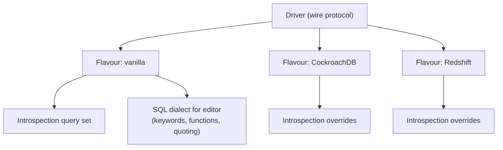
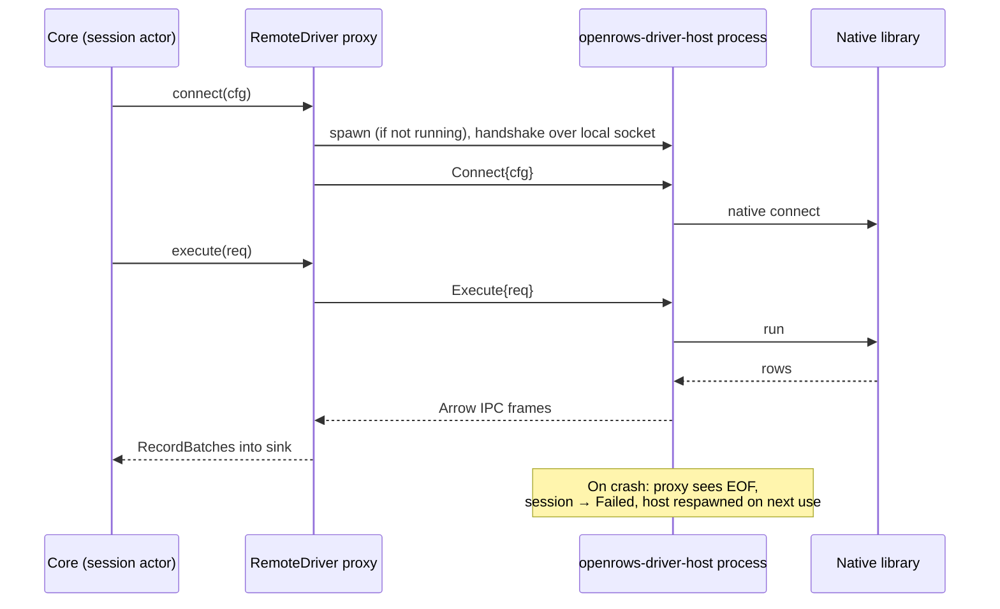

# 05 — Database Drivers

## 1. Goals

- Support every major database family through **one contract** so the grid, editor, exporter and safety features work everywhere.
- Prefer **pure-Rust, async, permissively licensed** client libraries. Avoid bundling proprietary or copyleft client libraries.
- Let drivers declare what they can do (**capabilities**) so the UI adapts instead of special-casing database names.
- Make adding a driver mechanical: implement traits, pass the conformance suite.

## 2. Driver contract

```rust
#[async_trait]
pub trait Driver: Send + Sync + 'static {
    fn id(&self) -> DriverId;                       // "postgres", "mysql", ...
    fn info(&self) -> &DriverInfo;                  // display name, icon id, URL schemes, default port
    fn capabilities(&self) -> &Capabilities;
    fn params_schema(&self) -> &ParamsSchema;       // drives the connection form UI
    fn parse_url(&self, url: &str) -> Result<DriverParams>;
    async fn connect(&self, cfg: ConnectConfig, net: &NetContext) -> Result<Box<dyn Connection>>;
}

#[async_trait]
pub trait Connection: Send {
    fn server_info(&self) -> &ServerInfo;            // product, version, flavour (e.g. CockroachDB on PG wire)
    fn cancel_handle(&self) -> Option<Arc<dyn CancelHandle>>;
    async fn execute(&mut self, req: ExecuteRequest, sink: &mut dyn ResultSink) -> Result<ExecSummary>;
    async fn ping(&mut self) -> Result<()>;
    async fn close(self: Box<Self>) -> Result<()>;

    // Optional facets — return None when unsupported
    fn introspector(&mut self) -> Option<&mut dyn Introspector> { None }
    fn row_editor(&mut self) -> Option<&mut dyn RowEditor> { None }
    fn explainer(&mut self) -> Option<&mut dyn Explainer> { None }
    fn admin(&mut self) -> Option<&mut dyn Admin> { None }
    fn bulk_loader(&mut self) -> Option<&mut dyn BulkLoader> { None }
    fn kv(&mut self) -> Option<&mut dyn KeyValueOps> { None }        // Redis
    fn documents(&mut self) -> Option<&mut dyn DocumentOps> { None } // MongoDB
}

pub trait ResultSink: Send {
    fn begin_result(&mut self, schema: SchemaRef, edit: Option<EditTarget>) -> Result<()>;
    fn push_batch(&mut self, batch: RecordBatch) -> SinkFlow;      // Continue | Pause | Stop
    fn end_result(&mut self, summary: ResultSummary) -> Result<()>;
    fn notice(&mut self, n: Notice);
}
```

Drivers build Arrow `RecordBatch`es directly with typed builders (no intermediate `Vec<Value>`), targeting ~64 k cells or 4 MB per batch, whichever comes first, and always flushing the first batch early (after ≤ 200 rows) so the UI can paint quickly.

The M0-S3 draft in `crates/openrows-driver-api` implements only the streaming core of this contract: `Session` (`execute`, `close`; `Send`, not `Sync`, owned by one actor per ADR-0007), a minimal `ResultSink` (`begin_result`, `push_batch` → `Continue | Stop`), `ExecSummary`, a typed `DriverError` and `BatchPolicy`. `BatchPolicy` caps the first batch at min(200 rows, 64 Ki cells). Later batches hold ⌊65 536 / columns⌋ rows, or flush once 4 MiB of wire bytes has been decoded. Cancel, notices, introspection and editing facets followed in M1-01 and D-06–D-12, capabilities in M1-10 (§2.1). See [§11](#11-m0-s3-postgresql-streaming-spike).

### 2.1 Capabilities

```rust
pub struct Capabilities {
    pub paradigm: Paradigm,              // Relational | Document | KeyValue | WideColumn | Search | Analytical
    pub query_language: QueryLanguage,   // Sql(Dialect) | Mql | RedisCmd | Cql | PartiQl | EsDsl
    pub transactions: TxSupport,         // None | Single | Full { savepoints }
    pub server_cancel: bool,
    pub explain: ExplainSupport,         // None | Text | Json | Analyze
    pub editable_results: bool,
    pub schemas: bool,                   // namespaces inside a database
    pub multiple_databases: bool,
    pub streaming: bool,                 // true streaming vs. buffered pages
    pub bulk_load: bool,
    pub ssh_tunnel: bool,
    pub tls: bool,
    pub process_list: bool,
    pub object_kinds: &'static [ObjectKind],
}
```

The UI reads capabilities to decide which toolbar buttons, tree nodes and editors appear.

**Implemented (M1-10).** `openrows-driver-api` ships the subset the current drivers need, as `Driver::capabilities() -> Capabilities`: a `Location` (`Server` or `File`), the claimed `Feature`s and the `ObjectKind`s the catalog lists. Features: `Cancel`, `BindParameters`, `MultipleDatabases`, `Schemas`, `Catalog`, `RowEdits`, `StructureChanges`, `TransactionalDdl`, `Tls`, `Routes`. A list of features instead of booleans keeps the struct `Copy` and lets a new feature be added without touching every driver. The paradigm, query language, explain and admin entries arrive with the first driver that needs them (Tier 2). Each driver declares its set in its own `capabilities.rs`:

**Bulk load (M2-11).** `Feature::BulkLoad` means `Connection::bulk_loader` offers the `BulkLoader` facet: append text rows to one table inside the caller's transaction on the engine's fastest path. PostgreSQL streams `COPY … FROM STDIN (FORMAT csv)`; SQLite reuses one cached prepared `INSERT` per row. MySQL/MariaDB claim no fast path and import through multi-row parameterised `INSERT`s (`openrows-import`); `LOAD DATA LOCAL INFILE` is not used because it needs `local_infile` enabled on server and client and lets the server ask the client for files. Imports with a conflict policy (skip or upsert) always use batched `INSERT … ON CONFLICT` / `ON DUPLICATE KEY UPDATE`.

| Driver | Location | Features | Object kinds |
| --- | --- | --- | --- |
| PostgreSQL | Server | all ten | all seven |
| MySQL/MariaDB | Server | all but `Schemas`, `StructureChanges`, `TransactionalDdl` | table, view, function, procedure, sequence (MariaDB) |
| SQLite | File | `Cancel`, `BindParameters`, `Schemas`, `Catalog`, `RowEdits`, `TransactionalDdl` | table, view |
| ClickHouse | Server | `Cancel`, `BindParameters`, `MultipleDatabases`, `Catalog`, `Tls`, `Routes`, `ProcessList`, `StartupCommands` | table, view, materialized view, SQL user-defined function |

## 3. Support tiers

| Tier | Meaning | Release gate |
| --- | --- | --- |
| **Tier 1** | Full feature set, every conformance test, tested against all supported server versions on every PR. | Ships in first alpha. |
| **Tier 2** | Full browse/query/edit/export; some advanced features (admin, explain visualiser) may lag. Integration-tested nightly. | Ships by 1.0. |
| **Tier 3** | Browse/query/export; editing where the model allows; tested nightly on latest server version. | Ships by 1.0, may be marked beta. |
| **Bridge** | Via ADBC or JDBC-free bridges; capabilities as exposed by the bridge driver. | Post-1.0. |

## 4. Per-database strategy

| Database | Family / wire | Rust library | Licence | Tier | Notes |
| --- | --- | --- | --- | --- | --- |
| PostgreSQL 12–17+ | PG wire v3 | `tokio-postgres` (+ `postgres-types`, own binary decoders into Arrow); M0-S3 prototype uses `postgres-protocol` directly, see [§11](#11-m0-s3-postgresql-streaming-spike) | MIT/Apache | 1 | Binary format for known types, text fallback; `COPY` for import/export; cancel via `CancelToken`; `EXPLAIN (FORMAT JSON)`. |
| CockroachDB, YugabyteDB, Neon, Supabase, Timescale, AlloyDB, Aurora PG | PG wire | same driver, **flavour** profile | — | 1 (PG-compatible), flavour quirks Tier 2 | Flavour detected from `version()` / `SHOW` settings; introspection queries adapted per flavour. |
| Amazon Redshift | PG wire (old protocol subset) | same driver, Redshift flavour | — | 3 | Different catalog, no cancel token in some setups. |
| MySQL 5.7, 8.0, 8.4 | MySQL protocol | own client on `mysql_common` packets and auth plugins (D-12, see §13; `mysql_async` was the plan) | MIT/Apache | 1 | Streaming rows into Arrow; cancel via `KILL QUERY <id>` on side connection; column metadata gives `org_table` for editability. |
| MariaDB 10.6+ / 11.x, TiDB, Vitess/PlanetScale, Aurora MySQL | MySQL protocol | same, flavour profile | — | 1 / 2 | Flavour detected from version string and variables. |
| SQLite 3 | in-process | `rusqlite` (bundled SQLite, `column_decltype` feature; `column_metadata` when result editing needs it) | MIT | 1 | Runs on a dedicated thread; `sqlite3_interrupt` for cancel; WAL-friendly read sessions; open read-only option. |
| libSQL / Turso | SQLite-compatible local files + remote Hrana 3 HTTP | own Hrana-over-HTTP client; shared `rusqlite` locally | Apache-2.0; MIT (rusqlite) | 2 | Implemented M2-05 (§17); WebSocket, embedded replicas and libSQL-only local extensions excluded. |
| SQL Server 2017+ / Azure SQL | TDS 7.4 | own client on `openrows-net` streams (M2-02, see §14; `tiberius` was the plan) | — | 2 | `rustls` TLS inside `PRELOGIN`; SQL logins (Windows/Entra ID later); cancel via the TDS attention signal on the same connection; `GO` batch separator handled by the splitter. |
| ClickHouse 25.3 LTS | HTTP interface (and native later) | own client on `hyper` using `FORMAT ArrowStream` | — | 2 | Implemented in M2-03 (§17): native incremental ArrowStream, HTTP(S) over routes, bound parameters, catalog and query cancellation; read-only grids (no transactional mutations). |
| DuckDB | in-process | `duckdb` crate (C++ library) | MIT | 2 | Native Arrow output. FFI → eligible for out-of-process driver host. |
| MongoDB 5.0+ | OP_MSG | official `mongodb` crate | Apache-2.0 | 2 | Shell-like query parser in `openrows-sql/mql`; documents → JSON column + flattened tabular view; `killOp` for cancel. |
| Redis 6+ / Valkey / KeyDB / Dragonfly | RESP2/RESP3 | `redis` crate | BSD-3 | 2 | `SCAN`-based key browser (never `KEYS *`); type-aware editors; cluster and sentinel support. |
| Oracle 19c+ | OCI | `oracle` crate (ODPI-C, loads **user-installed** Instant Client at runtime) | UPL/Apache | 3 | Not bundled; app detects/locates Instant Client and guides installation. Runs in driver host. |
| Cassandra 4+ / ScyllaDB | CQL native protocol | `scylla` crate | MIT/Apache | 3 | Paging via paging state; editing by full primary key only. |
| DynamoDB | AWS JSON API | `aws-sdk-dynamodb` | Apache-2.0 | 3 | PartiQL editor + Scan/Query builder; AWS profile/SSO credentials; consumed-capacity display. |
| Elasticsearch 7/8, OpenSearch 2 | REST | own client on `hyper` | — | 3 | JSON DSL editor and SQL endpoint where enabled; index browser. |
| Snowflake, BigQuery, Databricks, others | ADBC | `adbc_core` driver manager + vendor ADBC drivers | Apache-2.0 (manager) | Bridge | Post-1.0; drivers user-installed or downloaded from official sources with consent. |

Library choices are validated in Milestone 0 spikes (see [19-roadmap.md](19-roadmap.md)); swapping a library touches only that driver crate.

## 5. Dialects and flavours



- A **flavour** is detected after connect and selects: introspection query variants, keyword/function lists for autocomplete, DDL generation quirks, and capability adjustments (e.g. CockroachDB lacks some catalog views).
- Introspection SQL lives in versioned `.sql` resource files inside each driver crate, not in Rust string literals, so it is reviewable and testable on its own.

## 6. Introspection contract

```rust
#[async_trait]
pub trait Introspector {
    async fn list(&mut self, parent: &ObjectPath, kinds: &[ObjectKind]) -> Result<Vec<ObjectSummary>>;
    async fn describe(&mut self, path: &ObjectPath) -> Result<ObjectDetail>;  // columns, indexes, FKs, ...
    async fn ddl(&mut self, path: &ObjectPath) -> Result<String>;
    async fn search_index(&mut self, scope: &ObjectPath) -> Result<Vec<SearchEntry>>; // bulk names for fuzzy search
    async fn fingerprint(&mut self, scope: &ObjectPath) -> Result<Option<String>>;    // cheap change detection
}
```

- `list` is called lazily on tree expand.
- `search_index` fetches names of all objects in one query (bounded) for fuzzy search and autocomplete.
- `fingerprint` lets the cache know whether to refetch (e.g. PG: hash over `pg_class.oid, relname, relkind` max xmin; MySQL: `information_schema.TABLES.UPDATE_TIME`/`CREATE_TIME` aggregates). Drivers without a cheap fingerprint return `None` and the cache uses TTL. See [10-schema-and-data-editing.md](10-schema-and-data-editing.md).

## 7. Editing contract

```rust
pub struct EditTarget {
    pub table: ObjectPath,
    pub key_columns: Vec<ColumnRef>,     // PK or unique not-null
    pub column_map: Vec<Option<ColumnRef>>, // result column index → table column (None = computed, not editable)
}

#[async_trait]
pub trait RowEditor {
    fn render(&self, cs: &ChangeSet, target: &EditTarget) -> Result<Vec<Statement>>; // pure, for preview
    async fn apply(&mut self, stmts: Vec<Statement>, opts: ApplyOpts) -> Result<ApplyReport>;
}
```

How drivers determine `EditTarget` for an arbitrary query:

| Database | Source of column→table mapping |
| --- | --- |
| PostgreSQL | `RowDescription` table OID + attribute number per column → catalog lookup for PK. |
| MySQL/MariaDB | Column definition `org_table`, `org_name`, flags (`PRI_KEY_FLAG`). |
| SQLite | `sqlite3_column_table_name` / `sqlite3_column_origin_name` (with `column_metadata` feature) + `rowid` fallback for rowid tables. |
| SQL Server | `sp_describe_first_result_set` with `@browse_information_mode = 1`. |
| Others | Editable only for app-generated table-browse queries where the target is known. |

If all non-computed columns map to one table and that table has a usable key present in the result (or the driver can add it invisibly for browse queries), the result is editable. Otherwise the grid is read-only and shows why.

## 8. Conformance suite

A shared test crate (`openrows-driver-conformance`) parameterised by driver. Every driver must pass the applicable groups:

| Group | Examples |
| --- | --- |
| Connect | URL parsing round-trips, bad password → `Auth` error kind, wrong port → `Connect`, TLS required/failed paths, SSH tunnel path. |
| Types | Round-trip of every logical type including NULL, extremes, unicode, invalid UTF-8, precision-sensitive decimals, timezone edge cases. |
| Streaming | 1 M-row query streams with bounded memory; first batch latency; pause/resume back-pressure. |
| Cancel | Long query cancelled within 1 s; session usable afterwards. |
| Transactions | Commit, rollback, state tracking when user types `BEGIN`. |
| Introspection | Golden snapshots of a fixture schema per server version. |
| Editing | Insert/update/delete with composite keys, NULL in keys rejected, conflict detection, rollback on partial failure. |
| Errors | Syntax error position mapping, constraint violation codes. |

**Implemented (M1-10).** `crates/openrows-driver-conformance` holds seven groups, each documented in the crate with the feature that gates it: Connect (stages recorded, `SELECT 1`, wrong password → `Auth` at the authentication stage, missing file → open error, and facets, cancel handle and `supports_alter` agree with the claimed capabilities), Types (NULL, integer extremes, float, boolean, unicode and empty text, binary, decimal, date per dialect, each with its Arrow type and `openrows.source_type`; bound text and NULL with `BindParameters`), Streaming (10 000 rows in order as one result, first batch ≤ 200 rows, early `Stop`), Cancel (`Cancel`: a 10¹²-row count cancelled within 10 s with the dialect's SQLSTATE, session usable), Errors (syntax, undefined table, unique, NOT NULL SQLSTATEs), Metadata (`Catalog`: databases, schemas, objects with kinds and order, search index, columns, structure and detail) and Edits (`RowEdits`: key discovery, exact snapshots, generated insert/update/delete committed atomically, a stale guard rolling back the whole set with `40001`; with `TransactionalDdl`, a failing DDL set leaves nothing). Expected per-dialect SQL and answers live in one module (`dialect.rs`). The SQLite run is part of `just test`; `just test-pg` and `just test-mysql` run it on PostgreSQL 17, MySQL 8.4 and MariaDB 11.4, as does the CI `containers` job; `just test-mssql` runs it on SQL Server 2022 (not in CI yet). Not covered yet: TLS and SSH paths, 1 M-row memory bounds, pause/resume, transactions typed by the user, golden introspection snapshots, error positions.

## 9. Out-of-process driver host

Drivers built on C/C++ libraries (Oracle via ODPI-C, DuckDB, ADBC drivers) can crash the process on bugs we cannot catch. These drivers can run inside `openrows-driver-host`, a small helper executable:



- Transport: Unix domain socket (macOS/Linux) / named pipe (Windows); frames are length-prefixed `postcard`-encoded control messages plus raw Arrow IPC payloads.
- Because the `Driver` trait is already message-shaped (requests in, batches out), `RemoteDriver` implements the same trait; the rest of the engine cannot tell the difference.
- Default: in-process for pure-Rust drivers; out-of-process for FFI drivers. Users can override per driver.

## 10. Non-SQL paradigms in a shared UI

| Paradigm | Primary view | Tabular projection | Editor language |
| --- | --- | --- | --- |
| Document (MongoDB) | Document list with tree/JSON view per document | Top-level fields flattened into columns (union of keys over the sampled window), nested values as JSON cells | MQL (`db.coll.find({...}).sort(...)`) parsed into driver commands — no JS execution |
| Key-value (Redis) | Key browser (SCAN with pattern, type filter), value editor by type (string, hash, list, set, zset, stream, JSON) | Hash/zset/list rendered as two-column grids | Redis command console with command-aware autocomplete |
| Wide-column (Cassandra) | Table grid | Native | CQL |
| Search (Elasticsearch) | Hits grid + raw JSON | `_source` flattened | JSON DSL, SQL endpoint |
| Key-value/document (DynamoDB) | Item grid | Attributes flattened | PartiQL, Scan/Query builder |

## 11. M0-S3 PostgreSQL streaming spike

`crates/openrows-driver-postgres` started as this prototype and became the dogfood driver in D-04 (§12). The spike covered plain-TCP connect (cleartext, MD5 and SCRAM-SHA-256 without channel binding) and parameterless statements over the extended protocol. Results are decoded from `DataRow` cells straight into pre-sized Arrow builders. The spike had no TLS, cancel, bind parameters, notices or flavour detection.

**Library finding.** `tokio-postgres` 0.7 always binds every result column in binary format: `encode_bind_raw` passes the single result-format code `1`. Its public API cannot request text for some columns, so the docs/04 §5 rule "unknown type → server text plus type name" is impossible with it. `Row` also allocates per row. The spike therefore drives the wire protocol with `postgres-protocol` (same upstream project and licence, and the layer `tokio-postgres` itself uses). It sends `Parse`/`Describe`/`Sync`, picks a format code per column (binary for known types, text otherwise), then sends `Bind`/`Execute`/`Sync`. Each `DataRow` is decoded in place from the shared read buffer. Names of non-built-in types come from one cached `format_type` lookup per session. M1-11 decides between this approach (adding rustls TLS from M1-06, the cancel request and notices) and contributing per-column result formats upstream.

| PostgreSQL type | Arrow type | Field metadata |
| --- | --- | --- |
| `int2` / `int4` / `int8` | `Int16` / `Int32` / `Int64` | `openrows.source_type` on every field |
| `float4` / `float8` | `Float32` / `Float64` | |
| `bool` | `Boolean` | |
| `text`, `varchar`, `bpchar`, `name` | `Utf8` | |
| `bytea` | `Binary` | |
| `timestamp` / `timestamptz` | `Timestamp(µs)` / `Timestamp(µs, "UTC")` | |
| `date` | `Date32` | |
| `uuid` | `FixedSizeBinary(16)` | `ARROW:extension:name = arrow.uuid` |
| `numeric(p, s)`, 0 ≤ s ≤ p ≤ 38 | `Decimal128(p, s)` | |
| other `numeric` | `Utf8`, exact canonical text | `openrows.decimal` |
| `json` / `jsonb` | `Utf8` (jsonb version byte stripped) | `openrows.json` |
| anything else | `Utf8`, server text format | source type from `format_type`, e.g. `integer[]`, `interval` |

**Open points found by the spike.** Some values have no exact form in their column's Arrow type: ±infinity timestamps and dates, `NaN` in a constrained `numeric`, and timestamps after 294247-01-10. PostgreSQL accepts timestamps up to 294276 AD, but Arrow µs-since-1970 `i64` ends there. The spike failed these with `DriverError::Decode`; D-04 replaced that with the tagged-text fallback in §12. The driver still has no row cap, `Pause`, or COPY path.

Evidence on a Mac mini M4, release profile: Criterion decodes 63–330 M cells/s per core at the mean's upper 95% bound (budget 1 M, NFR-PERF-05), and a 200-row × 20-column first batch takes 0.036 ms (budget 5 ms). A `dhat` test counts zero heap allocations while decoding 54 912 primitive cells. Against real PostgreSQL 12.22, 17.11 and 18.6 (`just test-pg <version>`), the first batch reached the sink 0.14–0.15 ms after the first `DataRow` and 0.87–1.79 ms after `execute()` for a 200 000-row heap scan. Numbers and commands are in [13 §4](13-performance.md#4-benchmark-suite).

## 12. D-04 PostgreSQL driver (dogfood slice of M1-11)

D-04 makes the §11 driver usable against local PostgreSQL. TLS is D-11; bind parameters, introspection and the full M1-10 contract come later.

**Connect API.** `PgSession::connect(&PgConfig)` is unchanged and uses default options. `PgSession::connect_with(&PgConfig, &ConnectOptions)` takes everything else:

| Type | Fields |
| --- | --- |
| `PgConfig` | `host` (name, IP, or a Unix socket directory starting with `/`), `port`, `user`, `password: Option<String>`, `database` (empty lets the server use the role name). No `Debug`, because it holds the password. |
| `ConnectOptions` (`Default`) | `application_name` (default `openrows`), `ssl_mode: SslMode` (default `Prefer`), `timeouts: ConnectTimeouts`, `startup_commands: Vec<String>`. |
| `ConnectTimeouts` (`Default`, docs/14 §4) | `dns` 5 s, `tcp` 10 s (all resolved addresses together), `auth` 15 s (startup message to the first `ReadyForQuery`, plus the server-info query). A timeout is `DriverError::Network` with `io::ErrorKind::TimedOut` and a message that names the stage, for example `TCP connect timed out after 10s`. |
| `SslMode` | libpq `sslmode` values. `Disable` and `Allow` connect in plaintext. `Prefer` also connects in plaintext and reports `TlsStatus::PlaintextFallback`. `Require`, `VerifyCa` and `VerifyFull` fail before any I/O with `DriverError::Unsupported` saying TLS arrives with D-11. The store's `TlsMode` maps 1:1. |

Startup commands (FR-CONN-10) run in order after the server-info query. Each entry is sent as one simple query, so it may hold several `;`-separated statements. A failing command fails the connect with `DriverError::Server`, and its message starts with `startup command <n>:`. A host starting with `/` connects to `<host>/.s.PGSQL.<port>` (Unix only; this path has no container test). The cancel request reuses the same target. A server error during SCRAM (wrong password) is now `DriverError::Auth` instead of `Protocol`.

**Server info.** `PgSession::server_info() -> &ServerInfo` returns:

- `server_version`: the `server_version` parameter status.
- `version`: the full `version()` text.
- `database`, `user`: `current_database()` and `current_user`.
- `flavour` and `product()`: `PostgreSQL` or `CockroachDB`.
- `tls`: a `TlsStatus`.

One extra round trip fetches the identity and probes `pg_extension` for `timescaledb`, `neon` and `supabase_vault`. Flavour detection order: `version()` naming CockroachDB, then the Timescale extension, then Supabase (extension or a `.supabase.co`/`.supabase.com` host), then Neon (extension or a `.neon.tech` host), else `Postgres`. If a compatible server rejects the query, connect still succeeds: the requested database and user are used and `version` is empty. To show server info in Test connection through the session manager, read it inside the `open` connect future before boxing the session.

**Tagged-text fallback (docs/04 §5).** The fallback works per column, for the rest of the result. Timestamp, timestamptz, date and `numeric(p, s)` columns decode typed. The first value with no exact Arrow form (±infinity, a timestamp past 294247-01-10, `NaN`) switches that column to `Utf8`. The decoder converts the values already buffered in the open batch to text, and every later value of that column is written as text too. The field keeps `openrows.source_type` (for example `timestamptz`) and gains `openrows.text_fallback = "true"`. The text matches PostgreSQL's ISO output (`infinity`, `2024-05-06 07:08:09.5`, `0044-03-15 BC`, `12.50`, `NaN`), except that timestamptz is always rendered in UTC with `+00`. Other columns keep their types.

The driver publishes a result's schema with its first batch (at most 200 rows), not at `Describe`. A fallback inside the first batch therefore never changes a schema the sink has seen. A result with no rows is published at `CommandComplete`. When a fallback happens after the first batch, the result store needs one schema per result, so the remaining rows continue in a new result with the switched schema. The sink gets a second `begin_result` and a warning notice explaining why. No query fails and no value is coerced. A per-value representation (a sparse override column or a union) would avoid the split, but every consumer would have to understand it. Revisit this if the split shows up in dogfooding.

**Tests.** Unit tests cover ISO formatting (infinity, BC, the PostgreSQL maximum timestamp, fractions), typed-to-text conversion, decoder switching in the first and later batches, flavour detection, `sslmode` mapping, stage timeouts and simple-query rows. `just test-pg` adds a connect test (application name, server info, multi-statement startup commands), `sslmode=disable` with an empty database name, typed connect failures (TLS mode, failing startup command, wrong password, refused port), fallback round trips for every fallible type, and a fallback after the first batch that continues in a second result.

## 13. D-12 MySQL/MariaDB and SQLite (dogfood slices of M1-12 and M1-13)

**Driver contract.** `openrows-driver-api` now holds what every engine shares: `ConnectRequest` (a server or file `Endpoint`, user, password, `SslMode` and `TlsFiles`, an optional route `Dialer`, `ConnectTimeouts`), `ConnectTrace`/`ConnectStage`/`TlsStatus` for Test connection, and a `Driver` trait (`product`, `dialect`, `home_database`, `connect`, `table_ddl`, `supports_alter`, `alter_sql`). A driver returns a `Connection`: a `Session` plus a `Catalog` facet (databases, schemas, objects, search index, columns, structure, detail) and an `Editor` facet (row key, exact-text snapshot, one-transaction commits). The app's registry (`connections/drivers.rs`) is the only place that names driver crates; metadata, user, edit and test sessions are all `Box<dyn Connection>`. Safety classification, statement splitting, table-browse SQL and edit SQL use the engine's `openrows_sql::Dialect` (`Postgres`, `MySql`, `Sqlite`). PostgreSQL keeps its API; `PgDriver` adapts it.

**MySQL/MariaDB (`openrows-driver-mysql`).** Library choice: `mysql_async` was planned, but its rustls feature pulls `webpki-roots` (CDLA-Permissive-2.0, not on the docs/22 allowlist) and verifies only against Mozilla roots, and it cannot run over a caller-supplied stream, so an SSH tunnel would need a local TCP listener (docs/12 §4.2 forbids that). The driver therefore speaks the protocol itself on any `openrows-net` stream and uses `mysql_common` (MIT/Apache) for packet parsing and its sans-IO auth plugins (`caching_sha2_password` including the RSA key exchange over plaintext, `mysql_native_password`). TLS is an `SSLRequest` packet followed by the same rustls handshake, verifier, CA file and client certificate as PostgreSQL, with libpq `sslmode` semantics (`prefer` falls back to plaintext and says so; `allow` retries with TLS after a refused plaintext login). Hosts starting with `/` are socket files. `cleartext` password plugins are refused without TLS.

| Topic | Behaviour |
| --- | --- |
| Statements | One statement per call: `CLIENT_MULTI_STATEMENTS` and `LOCAL INFILE` are never negotiated, so the safety classifier sees everything that runs. Bound parameters use server-side prepared statements (prepare, execute, close). Stored procedures return several result sets; each starts a new result. |
| Results | Text and binary rows feed one decoder (binary values are first rendered as the server's text, so both protocols decode alike): integers `Int64` (unsigned `BIGINT` `UInt64`), `YEAR` `Int16`, `FLOAT`/`DOUBLE`, `BIT` `UInt64`, text and `ENUM`/`SET` `Utf8`, binary strings `Binary`, `JSON` `Utf8` tagged `openrows.json`. Temporal and decimal values are typed with the PostgreSQL conventions (table below). The schema is published with the first batch (200 rows); a value with no exact Arrow form switches its column to tagged text exactly as in §12, including the split into a second result (with a warning notice) when it happens after the first batch. |

| MySQL/MariaDB type | Arrow type | Field metadata | Tagged-text fallback (`openrows.text_fallback`, server text) |
| --- | --- | --- | --- |
| `DATE` | `Date32` | | zero or partial dates (`0000-00-00`, `2024-00-15`), year 0 |
| `DATETIME(fsp)` | `Timestamp(µs)`, no zone | `openrows.fraction_digits = fsp` | zero or partial dates |
| `TIMESTAMP(fsp)` | `Timestamp(µs)`, no zone: the session time zone's wall-clock time as the server prints it | `openrows.fraction_digits = fsp` | zero timestamps |
| `TIME(fsp)` | `Time64(µs)` | `openrows.fraction_digits = fsp` | negative values and 24 h or more (`-838:59:59` … `838:59:59`) |
| `YEAR` | `Int16` | | never (`0000` is 0) |
| `DECIMAL(p, s)`, p ≤ 38 | `Decimal128(p, s)`; p from the column length minus point and sign | | a value with more digits than `p`/`s` (never rounded) |
| `DECIMAL(p, s)`, p > 38 | `Utf8`, exact text | `openrows.decimal` | — |

`TIMESTAMP` carries no zone because the session zone may be `SYSTEM` with daylight saving, where a wall-clock time cannot be turned back into one UTC instant; the value is exactly what `SELECT` prints, and edits, filters and copies round-trip it in the same session zone. `openrows.fraction_digits` lets the grid pad fractions to the column's precision (`07:08:09.500` for `DATETIME(3)`), so displayed key values equal the `CAST(… AS CHAR)` text that edit snapshots and guards compare.
| Warnings | A non-zero warning count runs `SHOW WARNINGS`; each row becomes a notice (`Note` informational, others warnings). |
| Cancel | `KILL QUERY <id>` from a side connection with the same login and route; the session stays usable. |
| Errors | Login refusals (1044, 1045, 1130, 1251, 1698, 1862, 3118, 4151) are `Auth`; everything else is `Server` with the packet's SQLSTATE and `(MySQL error N)` in the message. |
| Identity | `SELECT DATABASE(), CURRENT_USER(), VERSION(), @@version_comment`: product `MySQL` or `MariaDB`, flavour `TiDB`, `PlanetScale` or `Vitess`. Home database `information_schema`. |
| Catalog | `information_schema` with bound names; a database is one schema (itself). Table detail adds keys, foreign keys, indexes, triggers, sizes and `SHOW CREATE TABLE` for the DDL view. |
| Edits | Key: `PRIMARY`, else a unique index over `NOT NULL` columns without prefixes. Snapshots read `CAST(col AS CHAR)`; guards compare `CAST(col AS CHAR) COLLATE utf8mb4_bin <=> ?`, byte-exact and NULL-safe. `CLIENT_FOUND_ROWS` makes an `UPDATE` that writes the same values still count its row. One `START TRANSACTION … COMMIT`; any failure or guard miss rolls back (`40001`), a lost `COMMIT` reply is `08007`. DDL commits implicitly per statement in MySQL; structure changes are not generated yet. |

**SQLite (`openrows-driver-sqlite`).** `rusqlite` 0.40 with the bundled SQLite (the version the local store already uses). A file opens read-only, read-write, or with create (only when the profile asked for a new file); a missing or non-database file fails the Open step (`58030`). Extension loading stays off; a 5 s busy timeout waits for other writers. Each connection lives on its own thread; statements stream back through a bounded channel. Column types follow the declared affinity and the values of each batch (only integers `Int64`, reals `Float64`, text `Utf8`, blobs `Binary`); mixed columns keep every value as exact tagged text (`openrows.text_fallback`), and a type change after the first batch starts a new result. Cancel is `sqlite3_interrupt` (`57014`). Result codes map to SQLSTATE-style codes (`23505` unique/primary key, `23503` foreign key, `23502` not null, `23514` check, `25006` read-only, `42601` syntax, `42P01`, `42703`). The catalog lists `main` as the database and the attached databases as schemas (`temp` hidden), tables and views, `PRAGMA table_xinfo`/`index_list`/`foreign_key_list` details, triggers, and the stored `CREATE` statements as the DDL. Edits use the primary key (else a unique `NOT NULL` index), `CAST(col AS TEXT)` snapshots, `CAST(col AS TEXT) COLLATE BINARY IS ?n` guards and one `BEGIN IMMEDIATE` transaction. `SQLite` has no `DEFAULT` in `UPDATE` and no built-in `REGEXP`; both are refused with a message.

**Gaps.** Structure changes (`alter_sql`) are PostgreSQL-only; MySQL and SQLite show their structure read-only. MySQL temporal and decimal values are text, not typed Arrow. No MySQL 9.x/TiDB runs, no SQLite in-memory databases, rowid editing or `ATTACH` UI, and the SSH route for MySQL is covered by the shared route code rather than a MySQL container test.

**Tests.** `openrows-sql`: lexing, splitting (`DELIMITER`, routine and trigger bodies), classification and generated SQL for both dialects, plus a property test. `openrows-driver-sqlite`: temp-file tests for streaming, binding, cancel, read-only, catalog and edits (normal `just test`). `openrows-driver-mysql`: unit tests for framing, rows, decoding (temporal and decimal parsing and printing, precision from the column length, fallback in and after the first batch) and errors; `just test-mysql` runs connect/TLS, typed results in both protocols (temporal, decimal, `YEAR`, zero dates, `TIME` outside a day, `DECIMAL(65, 30)`), a zero date after the first batch, procedures and warnings, cancel, errors, catalog and edit tests (including rows keyed by `DATETIME(3)` and `DECIMAL`) against `mysql:8.4` and `mariadb:11.4`.

## 14. M2-02 SQL Server and Azure SQL (Tier 2)

**Library choice.** `tiberius` 0.13 was the plan and was evaluated: its query streams drop `INFO` tokens (no `PRINT` or warnings as notices) and `DONE` row counts, its attention cancel needs `&mut Client`, which the running result stream holds (so cancel could not run beside a statement without dropping the stream mid-token), its column metadata has no precision or scale (no `Decimal128(p, s)` or fraction digits before the first row), and its rustls backend hard-wires the `aws-lc-rs` provider and reports no TLS details. As with D-12, `openrows-driver-mssql` therefore speaks TDS 7.4 itself over any `openrows-net` stream (direct TCP, SSH tunnel, proxy). The only new dependency is `encoding_rs` (Apache-2.0 OR MIT, plus BSD-3-Clause data) for `char`/`varchar`/`text` in non-UTF-8 collations.

| Topic | Behaviour |
| --- | --- |
| Connect | `PRELOGIN`, then the rustls handshake of `openrows-net` (ring provider, the same verifier, CA files, cloud CAs and client certificates as PostgreSQL) wrapped in `PRELOGIN` packets, then `LOGIN7` with the ODBC session defaults (`ANSI_DEFAULTS` on, unlimited `TEXTSIZE`). `sslmode` maps onto the encryption offer: `disable` none (a server that forces encryption is refused with a TLS error), `allow` login-only encryption, `prefer` full encryption falling back to plaintext when the server has none, `require`/`verify-ca`/`verify-full` full encryption with that certificate check. SQL Server's self-generated certificate is X.509 v1, which webpki cannot parse; without certificate verification `openrows-net` still checks the handshake signature with the key of a v1 certificate (`tls/legacy.rs`). Login refusals (18456 and relatives, 4060) are `Auth`. Azure SQL's "Redirect" routing is refused with a message (use the "Proxy" policy). TDS 8.0 strict encryption, named-instance lookup (SQL Browser), Windows/Kerberos and Microsoft Entra ID logins are not supported. |
| Identity | `SERVERPROPERTY('ProductVersion')`, `EngineEdition` (Azure SQL Database, Managed Instance, Edge, Synapse, Fabric become the flavour), `DB_NAME()`, `SUSER_SNAME()`. Home database `master`. |
| Statements | A statement or a whole T-SQL batch per call (SQL batch request); bound values go through `sp_executesql` as `nvarchar(max)` text the server converts (`@P1`, `@P2`, …). Every result set streams as its own result; `PRINT` output is an Info notice, other messages Warning notices, statements without a result set add `(n rows affected)` notices; the command tag counts rows or affected rows. |
| Results | As the table in `src/decode/mod.rs`: integers (`tinyint` as `Int16`), `bit` `Boolean`, `real`/`float`, `decimal`/`numeric` `Decimal128(p, s)`, `money`/`smallmoney` `Decimal128(19, 4)`/`Decimal128(10, 4)`, `date` `Date32`, `time(n)`/`datetime2(n)` in microseconds (nanoseconds for n = 7) with `openrows.fraction_digits`, `datetime` (rounded to the printed millisecond) and `smalldatetime` `Timestamp(µs)`, `datetimeoffset` as the server's text (local time and offset), `uniqueidentifier` `arrow.uuid`, character types and `xml` `Utf8`, binary types, `timestamp` and CLR types (`geography`, `hierarchyid`, …) `Binary`, `sql_variant` tagged text. A `datetime2(7)` outside 1677–2262 (the `9999-12-31` sentinel) switches its column to tagged text, splitting the result as in §12 when it happens after the first batch. |
| Cancel and transactions | The cancel handle sends the attention signal through the session's shared writer only while a request is in flight; the session reads the acknowledgement (in the reply or as its own message) so the next request starts clean. A cancelled statement is `HY008`. The transaction state is the descriptor of the server's `BEGIN`/`COMMIT`/`ROLLBACK` environment changes, so `BEGIN TRAN` typed by the user and implicit transactions are tracked. There is no server-side statement timeout; the session timer cancels with the attention signal. |
| Errors | Error numbers map to the SQLSTATEs Microsoft's ODBC driver reports (`42000` syntax, `42S02`/`42S22` unknown object/column, `23000` constraints, `22xxx` data errors, `40001` deadlock); others are `HY000`. Messages keep the number, procedure and line. |
| Catalog | `sys` catalog views with bound names (SQL in `src/catalog/sql/`): databases the login may open, schemas (system schemas flagged), tables, views, procedures, functions and sequences with `MS_Description` comments and `sys.partitions` row counts, columns with declared types, defaults, identity and computed columns, indexes (kind, included columns, filters), primary, unique, check and foreign-key constraints, triggers, sizes, a `CREATE TABLE` rebuilt with named default constraints for the DDL view, a two-query ER diagram and a `modify_date` fingerprint. |
| Edits | Key: the primary key, else an unfiltered unique index over `NOT NULL` columns; identity, computed and `timestamp` columns are protected. The default text of some types loses precision (`float`, `money`, `datetime`), so snapshots use exact per-type text (`FORMAT(x, 'R')`, style 2/120/121, `0x…` hex, lower-case UUIDs) and the guards `openrows-sql` generates are rewritten to the same forms for the target table's column types; guards compare the UTF-16 bytes, because `=` ignores trailing spaces. One transaction with `SET NOCOUNT OFF`; each statement must report one row (its own count, after any trigger's). |
| Structure | `ALTER COLUMN` restating type, collation and nullability; defaults as named constraints dropped and re-added; `MS_Description` extended properties; `sp_rename` for columns and the table, last; `CREATE INDEX` (B-tree); columns added with a default fill existing rows (`WITH VALUES`). The set runs in one transaction. |
| Lifecycle | `Driver::object_sql` creates (columns with collation, `IDENTITY(1, 1)`, named defaults, primary key, foreign keys, checks, indexes, `MS_Description` comments), renames (`sp_rename`), duplicates (columns, defaults, computed columns and primary key; rows copied with identity values kept as plain values), truncates and drops tables; saves views (`CREATE OR ALTER VIEW`), triggers and procedures/functions from checked definitions (`CREATE [OR ALTER] … PROC`); creates (with a collation) and drops databases outside a transaction on `master`; creates and drops schemas. `routine_definition` reads `sys.sql_modules`. Claimed features add `TableLifecycle`, `ViewEditing`, `TriggerEditing`, `RoutineEditing`, `DatabaseLifecycle`, `ForeignKeyEditing`, `CheckEditing`, `Comments`, `ColumnCollation` and `PartialIndexes`; not claimed: `BulkLoad`, `MaterializedViews`, `DatabaseRename` (needs exclusive access), `SchemaLifecycle` (schemas cannot be renamed), `ColumnCharset` and `IdentityColumns` (`IDENTITY` cannot be added to or removed from an existing column). |
| Imports | Batched `INSERT … VALUES` with `@P` parameters, at most 2 098 parameters and 1 000 rows per statement; skip and update policies are one `MERGE` per batch; types `bigint`, `float`, `bit`, `date`, `datetime2`, `datetimeoffset`, `nvarchar(255)`/`nvarchar(max)`. |
| Processes | `sys.dm_exec_sessions`/`requests`/`connections` and `KILL`. SQL Server cannot cancel another session's statement, so `CancelQuery` is `Unsupported` (an unknown session is still `42704`). |

**SQL toolkit.** `Dialect::SqlServer` (the streamed splitter treats a `GO` line as final only once its line break arrived; the automatic row limit is `SELECT TOP (n)` for a single unbounded `SELECT`, not unions, batches or `SELECT @v = …`): `[…]` identifiers with `]]`, `N'…'` strings, nested block comments, `@variables`/`#temp` names that are no parameters, `@P1` placeholders, `GO` batch lines in the splitter (a repeat count is not honoured), `;` inside `BEGIN … END`, `CASE … END` and module bodies (`CREATE|ALTER PROCEDURE|FUNCTION|TRIGGER|VIEW` run to the end of the batch), `OFFSET … FETCH` paging (`ORDER BY (SELECT NULL)` without a sort, `COUNT_BIG(*)`), `LIKE … ESCAPE '\'` with `[` escaped, no regular-expression filter, and a classifier that escalates a reading batch hiding writes (no `;` is needed between T-SQL statements) and treats `EXEC sp_rename`/extended-property procedures as DDL.

**Tests.** Unit tests for packets, `PRELOGIN`, `LOGIN7`, the TLS framing, tokens, types, collations, decoding, the fallback, errors, DDL and the editor's exact guards. `just test-mssql` starts `mcr.microsoft.com/mssql/server:2022-latest` (emulated `linux/amd64` on Apple silicon) and runs connect/TLS modes/routes, batches with notices and counts, parameters, transactions, cancel, errors, every type, catalog, edits through a trigger, structure changes and the process list, then the conformance suite (one group at a time, because SQL Server reuses session ids at once).

## 15. Backup and restore with the installed client tools (M2-14)

FR-IO-04 runs the tools the user installed rather than reimplementing dump formats. `openrows-dump` builds the commands and runs them; `apps/desktop/src-tauri/src/dump` resolves the connection, checks restores and runs jobs.

| Topic | Behaviour |
| --- | --- |
| Tools | PostgreSQL: `pg_dump`, `pg_restore`, `psql`. MySQL/MariaDB: `mysqldump` or `mariadb-dump`, `mysql` or `mariadb`. SQLite needs none: a backup is `VACUUM INTO`, a restore the SQLite backup API over the open file. SQL Server (M2-02) has no wrapper yet: its backup and restore commands fail as `Unsupported`. |
| Discovery | Every `PATH` entry, then the usual install folders (Postgres.app, Homebrew `postgresql@*`, `mysql-client`, `mariadb`, `/usr/local/mysql/bin`, `/usr/lib/postgresql/*/bin`, `/usr/pgsql-*/bin`, `/usr/bin`). Each copy is probed with `--version`; the newest copy of the server's major version or later is chosen. A path in Settings ▸ Tools (`settings.json` `tools`) wins; a broken path is reported, never silently replaced. |
| Compatibility | `pg_dump` older than the server's major version refuses to run and `pg_restore` cannot read archives a newer `pg_dump` wrote; both are flagged before anything runs ("Install version N or newer, or choose it in Settings ▸ Tools"). A MySQL client on MariaDB (or the reverse) gets a softer warning; a tool of the other family is rejected. |
| Commands | Argument vectors spawned directly, never through a shell. The backup and restore sheets show the exact command lines before anything runs, with the password file shown as `<password file>` and a tunnel's port as `<tunnel port>`. |
| Passwords | Never in the argument vector or the environment. libpq tools read a 0600 `PGPASSFILE` with `--no-password`; MySQL tools read a 0600 `--defaults-extra-file`. Inherited `PGPASSWORD`, `PGSERVICE`, `PGHOSTADDR`, `PGSSLPASSWORD`, `MYSQL_PWD`, `MYSQL_HOST` and `MYSQL_TCP_PORT` are removed. The files are deleted when the job ends. |
| Routes | TLS settings map to `sslmode`/`sslrootcert` and the MySQL `--ssl-*` options. Profiles with an SSH tunnel or proxy get a loopback listener on `127.0.0.1` with an ephemeral port that accepts only the connections the tool is expected to open and closes with the job; the server's host name is still the one verified. |
| Backups | PostgreSQL formats custom (default), plain, directory and tar; structure, data or both; `--no-owner`, `--no-privileges`, compression 0–9. MySQL: plain SQL with `--single-transaction`, routines, triggers and events. Output only goes to a path picked in the save panel; a failed or cancelled backup removes its partial file. |
| Restores | File kinds are detected from content (custom/tar archive magic, `toc.dat` folder, SQLite header, else SQL script) and must match the engine. Archives list their contents (`pg_restore --list`) and restore selected entries through a 0600 use-list, with clean / clean-if-exists, owner and grant switches and parallel jobs; scripts are piped into `psql` (`ON_ERROR_STOP` when stopping on error) or `mysql`. Either into the open database or a new one created first. |
| Safety | Read-only connections (and read-only SQLite files) never restore. Every restore is confirmed with a token bound to that exact restore; production connections, destructive restores (clean, or a SQLite file replaced) also need the database name typed. The catalog refreshes after a restore. |
| Jobs | Backups and restores run as background jobs in the jobs popover with objects and bytes progress, the tool's stderr log (last 5,000 lines) and Cancel, which sends `SIGTERM` to the tool's process group (a plain kill when the group cannot be signalled). Failures report the tool's last error line and exit code. |
| Tests | Unit tests for discovery, version parsing and compatibility, command building, password files, archive detection, the restore gate and the runner (`just test`). `just test-pg` and `just test-mysql` round-trip a database through the container's own tools (custom archive with a use-list, plain SQL through `psql`, `mysqldump` to `mysql`) and through local tools when a new enough copy is installed (PostgreSQL over verified TLS through a forwarded address); every command they run is checked to hold no password in its arguments or environment. |

## 16. Implemented (M2-09): read-only object catalogs

The Catalog facet adds object_detail, list_extensions, list_roles and role_grants with typed Unsupported defaults, plus the Type object kind and Types/Extensions/Roles feature flags. Lookup names in new catalog reads are bound parameters. The MariaDB sequence storage SELECT and the MySQL dynamic-privilege fallback only splice identities reread from the server catalog, using openrows_sql identifier/string-literal escaping helpers. Existing stored-definition readers remain the source for routine/view SQL. Object identities retain PostgreSQL overload arguments. IPC reads use the dedicated metadata connection, with commands registered in the command list, capabilities and generated bindings.

- **PostgreSQL:** pg_type/pg_range and pg_enum/pg_attribute/pg_constraint list enum, standalone composite, domain and range types; pg_get_viewdef/pg_get_functiondef expose definitions and signatures; pg_sequences exposes safe last_value without nextval; pg_extension joins pg_available_extensions for installed/available versions. Public pg_roles and pg_auth_members supply attributes and memberships without credential fields; aclexplode supplies explicit database/schema/relation/routine/type ACL entries and grant options. The schema fingerprint includes types and extensions.
- **MySQL/MariaDB:** information_schema.ROUTINES/PARAMETERS supply bound routine metadata; existing SHOW CREATE readers supply view/routine definitions. mysql.user and role_edges (MySQL) or roles_mapping (MariaDB) supply public account flags and memberships; MariaDB reads individual account_locked JSON metadata from global_priv without returning authentication data. Explicit global/schema/table/column grants come from information_schema.USER_PRIVILEGES/SCHEMA_PRIVILEGES/TABLE_PRIVILEGES/COLUMN_PRIVILEGES with bound GRANTEE values. MySQL 8+ dynamic global privileges missing from USER_PRIVILEGES are supplemented by parsed SHOW GRANTS FOR a catalog-verified, helper-escaped account. Direct role memberships use bound user/host reads; denied membership reads show “Not visible to this login” without failing the grants viewer. MariaDB sequence storage reads start_value/minimum_value/maximum_value/increment/cycle_option/cache_size/next_not_cached_value from helper-qualified catalog names; “Next uncached value” is labelled explicitly, never LASTVAL. Types and extensions remain unsupported.
- **SQLite:** existing sqlite_schema stored SQL and PRAGMA column reads supply view inspection. Roles/extensions/types and other object viewers return typed Unsupported.
- **SQL Server:** sys.types includes user aliases, CLR and table types; sys.table_types/sys.columns supply table fields; sys.sql_modules/sys.parameters supply definitions and arguments; sys.sequences supplies metadata and last_used_value without NEXT VALUE FOR. Server principals and database principals are distinguished by scope, with sys.*_role_members memberships and sys.server_permissions/sys.database_permissions grants (including DENY and grant options). No password/hash fields are selected. Type metadata contributes to the fingerprint.

The Metadata conformance group now creates, lists and indexes capability-gated materialized views, routines, sequences and types, inspects every created kind and checks optional roles/extensions against claims. Engine integration fixtures verify details, overloads, ordered enum labels, memberships and explicit grants on PostgreSQL/SQL Server. PostgreSQL checks last_value is unchanged across inspection. MySQL/MariaDB fixtures cover listings, view/routine details, account attributes, direct role memberships, all four privilege scopes and grant options; MySQL also asserts dynamic privileges. Restricted logins verify membership visibility handling. MariaDB reads sequence details twice before comparing NEXTVAL to an unread control sequence. Grants and direct memberships are explicit entries, not computed effective permissions.

## 17. M2-03 ClickHouse (Tier 2)

`openrows-driver-clickhouse` implements the [HTTP interface](https://clickhouse.com/docs/interfaces/http) with existing `hyper` 1.x dependencies over `openrows-net` streams. The tested server is the pinned LTS image `clickhouse/clickhouse-server:25.3.9.72`; native TCP and other server versions remain unverified.

| Topic | Behaviour |
| --- | --- |
| Connect | HTTP 8123 / HTTPS 8443; `clickhouse://` selects plaintext, `clickhouse+https://` selects verified TLS. The form changes either default port when TLS is toggled and keeps custom ports. TLS uses the shared rustls verifier, CA files and client certificates against the database host, including through SSH/proxy routes. HTTP `allow`/`prefer` do not upgrade: they use plaintext; the picker offers disable/require/verify-ca/verify-full. Empty database/user defaults to `default`. |
| Authentication | `X-ClickHouse-User`, sensitive `X-ClickHouse-Key` and `X-ClickHouse-Database` headers; credentials never enter the request URI or diagnostic output. Server messages scrub the supplied password and its URL-encoded form. Each exchange owns its connection task, which is aborted on drop. |
| Sessions | A UUID `session_id` preserves settings and temporary objects between exchanges. One HTTP statement per call; multi-statement scripts are split by the shared toolkit. Identity reads `version()`, `currentDatabase()`, `currentUser()`; startup commands run in order and a failure names its index. No transaction support is claimed. |
| Parameters | The editor's named `:value` becomes `{p1:Nullable(String)}`; native `{name:Type}` retains its declared type when renamed to `p1`. Values travel separately as escaped `param_p1` HTTP parameters, including `\N` for NULL and escaped control characters/backslashes. Query-id predicates use the same binding path. |
| Results | SELECT/WITH first runs `DESCRIBE TABLE (query)` with the same bindings to obtain exact `openrows.source_type` metadata. Native ArrowStream uses signed dictionary indexes, UTF-8 strings and no compression. UUID (including nested UUID) is projected by the server to canonical String because the 25.3 Arrow exporter cannot encode UUID; other columns keep native Arrow buffers. Ordinary SELECTs retain their original projection/order, so duplicate expressions are not rewritten. SHOW/DESCRIBE/EXPLAIN use the native default output, with no DESCRIBE metadata pass. |
| Streaming | `wait_end_of_query=0`; server blocks request 200 rows / 4 MiB. A blocking Arrow `StreamReader` consumes a two-slot channel of at most 64 KiB chunks; a two-slot batch channel feeds the sink. There is no full-body collection on the data path. Batches are sliced without per-cell rebuilding; the first slice is at most 200 rows. Stop drops the response, cancels read queries on client close and unblocks the decoder. A following request retries only error 373 (the HTTP session is still releasing its lock), under the TCP deadline; this server refusal guarantees that request has not executed. Other errors are never replayed. The diagnostic tail is capped at 64 KiB. Individual large cells/server blocks may exceed the typical 4 MiB driver budget. |
| Commands | Non-reading statements consume a bounded control body and read `written_rows` from `X-ClickHouse-Summary`; the command tag reports the server's write count, including writes into materialized views. DDL and mutations typed in the editor still pass read-only/confirmation classification. |
| Cancellation | A second routed request sends `KILL QUERY WHERE query_id = {p1:String} SYNC`, without the busy session id, under a 10-second timeout. It then signals the local stream to drop. Cancellation maps to `57014`; the same session remains usable. |
| Catalog | Bound SQL resources over `system.databases`, `system.tables`, `system.columns`, `system.data_skipping_indices`, `system.functions`; tables, views, materialized views and SQL UDFs, ordered columns/defaults/comments, primary-key membership, index expressions/types, `total_rows`, `total_bytes`, stored CREATE SQL. Databases are the schema namespace. View/materialized-view/function inspection reads their stored definitions. |
| Process list | `system.processes`, client/user/database/query/elapsed time; transient numeric UI tokens map to exact server query UUIDs. Cancel query uses bound KILL; Terminate is typed Unsupported since there is no persistent server process per HTTP session. Tokens from previous listings are discarded. |
| Editing decision | No `RowEdits`, `StructureChanges`, `TransactionalDdl`, `BulkLoad` or lifecycle-editing claims: asynchronous ALTER mutations cannot satisfy the shared atomic snapshot/rollback contract. The existing capability-driven UI disables grid edits; the editor can execute confirmed SQL. Transactional imports are refused during planning; backup/restore and the app explain-plan command are typed Unsupported. Raw `EXPLAIN` SQL can still return Arrow text results. |

Native 25.3 result representations (source metadata keeps the ClickHouse type):

| ClickHouse type | Arrow representation |
| --- | --- |
| Nullable(T), LowCardinality(String) | nullable T, Dictionary(Int32, Utf8) |
| Decimal(P,S) | native Decimal128 / Decimal256 with precision and scale |
| Date / Date32 | UInt16 days / Date32 |
| DateTime64(p, zone) | native Timestamp with server-selected resolution and zone |
| UUID / IPv4 / IPv6 | canonical Utf8 / UInt32 / FixedSizeBinary(16) |
| Enum8 / Enum16 | Int8 / Int16; source metadata retains labels |
| Array / Map / Tuple | native List / Map / Struct, nested values preserved |

**Errors.** The header `X-ClickHouse-Exception-Code` takes priority, then `Code: N. DB::Exception` in the body. Late streaming exceptions are mapped from the bounded tail. Numbers remain in the message. The [25.3 error catalog](https://github.com/ClickHouse/ClickHouse/blob/v25.3.9.72-lts/src/Common/ErrorCodes.cpp) defines the numbers; SQLSTATE-like mappings follow existing drivers:

| ClickHouse code | Shared kind/code |
| --- | --- |
| 192, 193, 194, 195, 516 | Auth |
| 62 | Server `42601` syntax |
| 60, 81 | Server `42P01` unknown table/database |
| 16, 47 | Server `42703` unknown column |
| 70 | Server `22018` type conversion |
| 373 | Server `55P03` session locked |
| 164 / 497 | Server `25006` read-only / `42501` privilege |
| 236, 285, 394, 499 | Server `57014` cancelled |
| 349 | Server `23502` non-nullable insertion |
| other | Server `HY000` |

**Tests and benchmark.** `just test-clickhouse` generates a localhost certificate, starts one loopback-only container with a non-default synthetic password (2 CPUs / 2 GiB), tests HTTP, verified HTTPS and SOCKS routing, exact scalar/nested types and source metadata, injection-safe typed values/NULL, settings, catalog inspection, late errors, 1 M-row incremental streaming, early Stop and cancellation of a 10¹²-row count within 10 s. It runs Connect/Types/Streaming/Cancel/Errors/Metadata/Processes conformance; Edits/Structure/Lifecycle are explicitly unclaimed. The script always removes its container and certificate directory. With `OPENROWS_BENCH=1`, `scripts/bench-clickhouse.py` runs a discarding 1 M-row sink and reports rows/s, payload bytes/s, first-batch decode latency, largest batch and process peak RSS; see docs/13.

**Known gaps.** Native TCP, HTTP pooling/compression, Arrow progress/notices, Pause/Resume, dictionaries as separate objects, schema fingerprint, SQL UDF signatures, roles/extensions, transactions/atomic mutation editing, transactional imports, dump/restore and parsed explain plans. SELECTs with an explicit output FORMAT are not supported in the grid path; omit FORMAT. UUID projections require distinct column names. Metadata/control responses are bounded (catalog 4 MiB, other controls 1 MiB); very large catalogs return a typed error. Test routes cover SOCKS + TLS; SSH and HTTP CONNECT use the shared Dialer but have no ClickHouse-specific container test. Reference mac-low and release-profile performance remain to be measured.

## 18. Implemented (M2-05): libSQL / Turso (Tier 2)

**Architecture.** `openrows-driver-libsql` owns the remote Hrana 3 HTTP client on the existing Hyper 1.x, Tokio and serde_json dependencies. It dials through `openrows-net` with the profile's TLS settings and proxy/SSH route. The separate **libSQL file** engine delegates to `openrows-driver-sqlite`, reports a SQLite-compatible libSQL file flavour and uses the existing bundled `libsqlite3-sys`. The `libsql` crate is deliberately absent: its bundled SQLite fork would introduce a second SQLite implementation and conflicting C symbols alongside rusqlite. Local files must use SQLite-compatible features; vector types/functions, `ALTER COLUMN`, random rowid and other libSQL-only extensions are unavailable locally. Extension loading remains disabled. SQLite's dialect, Arrow conversion, catalog pragma SQL and stored-definition helpers are shared.

**Protocol.** Read the upstream [Hrana 3 specification](https://github.com/tursodatabase/libsql/blob/main/docs/HRANA_3_SPEC.md), sections **Hrana over HTTP → Execute a pipeline of requests (JSON)** and **Requests → Close stream / Execute a statement / Execute a batch / Execute a sequence of SQL statements / Get the autocommit state**, plus **Shared structures → Statements / Statement results / Batches / Values**. The [HTTP API document](https://github.com/tursodatabase/libsql/blob/main/docs/http_api.md) describes the older SQL-over-HTTP API; it is not the wire format used here. Requests POST JSON to `/v3/pipeline`, with a sensitive `Authorization: Bearer` header. Native positional/named values are separate from SQL. The pinned sqld accepts either binding style; mixing both in one statement is server-dependent and returns a typed error when refused. Each response replaces the secret baton before another serial request; `get_autocommit` follows execution so BEGIN/COMMIT/ROLLBACK reflect server state. Conditional batches chain successful statements after BEGIN IMMEDIATE, commit only on success and otherwise roll back. The native `sequence` operation executes plain scripts without an implicit transaction. Per-request timeout defaults to 30 seconds. Hrana error codes map to SQLite-compatible SQLSTATEs; protocol/transport diagnostics omit payloads and server errors scrub the current token. Same-origin `base_url` stickiness is supported. Cross-origin redirects are refused with typed Unsupported to prevent forwarding a token or reusing a tunnel for an unapproved destination; reconnect to that endpoint explicitly.

**Results and bounds.** HTTP pipeline is buffered by the server, but the client never collects the full HTTP body or row array. A blocking serde `DeserializeSeed` visitor consumes a bounded channel of eight 16 KiB body slices, removes each `rows` array from the retained envelope, and sends two buffered events to the async sink. Native integer/real/text/base64 blob/null values (including padded and unpadded blobs) use SQLite's shared declared-type metadata and mixed-storage fallback. Batches have at most 200 rows (also limited by 64 Ki cells/4 MiB targets); an exceptionally large single row can exceed the batch byte target. The default cap is **10,000 rows per statement**; remaining rows are consumed with `IgnoredAny` and the sink receives **“result truncated at N rows; add LIMIT”**. A hard default **64 MiB total response ceiling** covers giant cells and metadata; exceeding it fails with typed Unsupported and “add LIMIT”, even after partial batches. Profile `params.options` may set `libsql_row_cap` (1–1,000,000), `libsql_response_bytes` (1 KiB–256 MiB), and `libsql_timeout_seconds` (1–120). These opaque options are excluded from connection exports and revert to defaults on import.

Typical decoder buffers are bounded independently of total row count: 128 KiB channel slices, one current row, three Arrow batches and envelope metadata. If a server sends `rows` before `cols`, the parser retains at most the row cap until columns arrive, additionally bounded by the response ceiling. Total transient heap usage is O(response ceiling + capped deferred values + a few batches), with allocator/JSON/Arrow expansion; the 64 MiB byte ceiling is not a 64 MiB heap guarantee. Giant individual values, very wide metadata and out-of-order JSON can exceed the 4 MiB typical driver-buffer target. Unit tests cover fragmented input, reversed field ordering, duplicate fields, cap boundaries and the five storage types.

**Cancellation and edits.** HTTP has no server interrupt. Cancel drops the socket and parser pipeline, then tries a one-second close of the last known baton; if the server has rotated it, expiry is the fallback. The server may finish the statement. An autocommit query can open a fresh stream after cancellation; an interrupted open/starting transaction or atomic batch becomes unusable and requires explicit reconnect. No rollback or COMMIT outcome is claimed after transport loss. Interrupted transactions return a fatal stream error instead of the core's native-socket rollback inference; subsequent requests require explicit reconnect. Guarded row edits and DDL use BEGIN IMMEDIATE on one baton, SQLite's bound optimistic predicates and a one-row affected-count check for each edit. Any conflict/error rolls back the edit set; an interrupted COMMIT reports unknown outcome. Stable identity is PK, eligible not-null unique key, or an unshadowed rowid on an ordinary rowid table; generated columns and rowid are protected.

**App and inspection.** The picker offers **libSQL / Turso (remote)** (host/URL and credential-policy auth token; no user/database requirement) and **libSQL file** (file/in-memory/read-only/create/attachments). Remote `libsql://host` and `https://host` use verified HTTPS, while explicit `http://host:port` selects cleartext for local self-hosted servers. Credential-bearing URLs, paths, queries and fragments are rejected. The token uses the existing password secret slot and Keychain/Ask/Command policy (docs/12, docs/15). Tables/views, columns, indexes, checks, foreign keys and triggers are inspected through shared SQLite catalog SQL; M2-09 view definitions are available; types, extensions and roles remain unclaimed. Sidebar system-object filtering covers sqlite_, _litestream_ and libsql_ prefixes for both flavours. History literal review/redaction uses the SQLite dialect for both flavours. Remote cloud/custom TCP helpers use the shared route and custom-command trust boundary. Remote Explain and native dump/restore return typed Unsupported; the local flavour reuses SQLite support. Advanced structure mutation facets, administration, schema fingerprinting, WebSocket, embedded replicas/sync, platform token/database management and vector search UI are not claimed.

**Verification.** `just test-libsql` starts pinned `ghcr.io/tursodatabase/libsql-server:v0.24.32` with Ed25519 JWT auth, generated temporary test-only keys and a signed full-access token. It runs remote integration cases (auth failure/redaction, bindings including injection strings, storage types, atomic batch rollback, interactive transactions, catalog/view inspection, truncation/byte bounds, request deadlines and cancel inside/outside a transaction), cloud and trusted custom helper routing with JWT auth, all applicable conformance groups and the local file flavour's SQLite conformance. Capability-gated structure/lifecycle/process groups report skips for remote. Unit golden fixtures verify request/response encoding and token isolation. The opt-in `OPENROWS_BENCH=1 cargo bench -p openrows-driver-libsql --bench decode_hrana` Criterion benchmark measures 200×5 native JSON values through shared Arrow batching against the ≥1 M cells/s and ≤5 ms first-batch targets; it excludes network/server latency.
