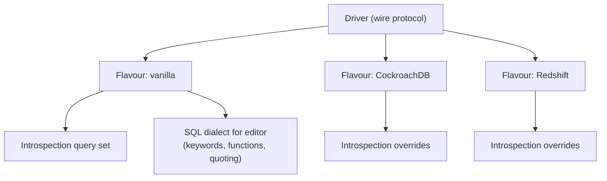
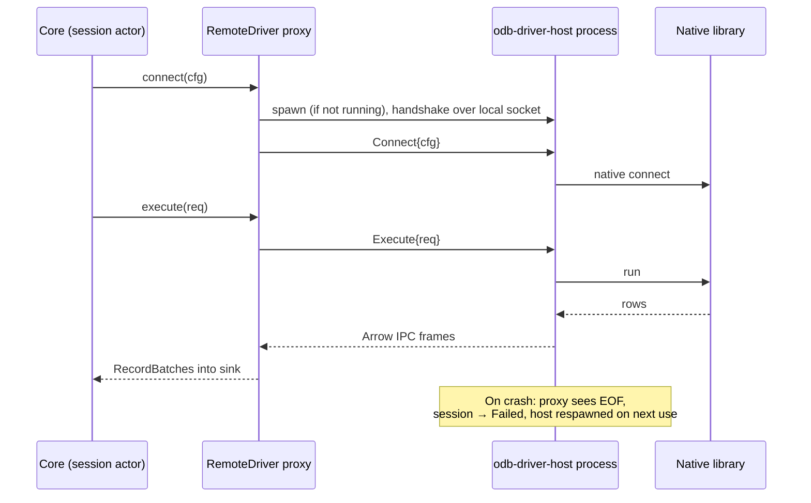

# 05 — Database Drivers

## 1. Goals

- Support every major database family through **one contract** so the grid, editor, exporter and safety features work everywhere.
- Prefer **pure-Rust, async, permissively licensed** client libraries. Avoid bundling proprietary or copyleft client libraries.
- Let drivers declare what they can do (**capabilities**) so the UI adapts instead of special-casing database names.
- Make adding a driver mechanical: implement traits, pass the conformance suite.

## 2. Driver contract

```rust
#[async_trait]
pub trait Driver: Send + Sync + 'static {
    fn id(&self) -> DriverId;                       // "postgres", "mysql", ...
    fn info(&self) -> &DriverInfo;                  // display name, icon id, URL schemes, default port
    fn capabilities(&self) -> &Capabilities;
    fn params_schema(&self) -> &ParamsSchema;       // drives the connection form UI
    fn parse_url(&self, url: &str) -> Result<DriverParams>;
    async fn connect(&self, cfg: ConnectConfig, net: &NetContext) -> Result<Box<dyn Connection>>;
}

#[async_trait]
pub trait Connection: Send {
    fn server_info(&self) -> &ServerInfo;            // product, version, flavour (e.g. CockroachDB on PG wire)
    fn cancel_handle(&self) -> Option<Arc<dyn CancelHandle>>;
    async fn execute(&mut self, req: ExecuteRequest, sink: &mut dyn ResultSink) -> Result<ExecSummary>;
    async fn ping(&mut self) -> Result<()>;
    async fn close(self: Box<Self>) -> Result<()>;

    // Optional facets — return None when unsupported
    fn introspector(&mut self) -> Option<&mut dyn Introspector> { None }
    fn row_editor(&mut self) -> Option<&mut dyn RowEditor> { None }
    fn explainer(&mut self) -> Option<&mut dyn Explainer> { None }
    fn admin(&mut self) -> Option<&mut dyn Admin> { None }
    fn bulk_loader(&mut self) -> Option<&mut dyn BulkLoader> { None }
    fn kv(&mut self) -> Option<&mut dyn KeyValueOps> { None }        // Redis
    fn documents(&mut self) -> Option<&mut dyn DocumentOps> { None } // MongoDB
}

pub trait ResultSink: Send {
    fn begin_result(&mut self, schema: SchemaRef, edit: Option<EditTarget>) -> Result<()>;
    fn push_batch(&mut self, batch: RecordBatch) -> SinkFlow;      // Continue | Pause | Stop
    fn end_result(&mut self, summary: ResultSummary) -> Result<()>;
    fn notice(&mut self, n: Notice);
}
```

Drivers build Arrow `RecordBatch`es directly with typed builders (no intermediate `Vec<Value>`), targeting ~64 k cells or 4 MB per batch, whichever comes first, and always flushing the first batch early (after ≤ 200 rows) so the UI can paint quickly.

### 2.1 Capabilities

```rust
pub struct Capabilities {
    pub paradigm: Paradigm,              // Relational | Document | KeyValue | WideColumn | Search | Analytical
    pub query_language: QueryLanguage,   // Sql(Dialect) | Mql | RedisCmd | Cql | PartiQl | EsDsl
    pub transactions: TxSupport,         // None | Single | Full { savepoints }
    pub server_cancel: bool,
    pub explain: ExplainSupport,         // None | Text | Json | Analyze
    pub editable_results: bool,
    pub schemas: bool,                   // namespaces inside a database
    pub multiple_databases: bool,
    pub streaming: bool,                 // true streaming vs. buffered pages
    pub bulk_load: bool,
    pub ssh_tunnel: bool,
    pub tls: bool,
    pub process_list: bool,
    pub object_kinds: &'static [ObjectKind],
}
```

The UI reads capabilities to decide which toolbar buttons, tree nodes and editors appear.

## 3. Support tiers

| Tier | Meaning | Release gate |
| --- | --- | --- |
| **Tier 1** | Full feature set, every conformance test, tested against all supported server versions on every PR. | Ships in first alpha. |
| **Tier 2** | Full browse/query/edit/export; some advanced features (admin, explain visualiser) may lag. Integration-tested nightly. | Ships by 1.0. |
| **Tier 3** | Browse/query/export; editing where the model allows; tested nightly on latest server version. | Ships by 1.0, may be marked beta. |
| **Bridge** | Via ADBC or JDBC-free bridges; capabilities as exposed by the bridge driver. | Post-1.0. |

## 4. Per-database strategy

| Database | Family / wire | Rust library | Licence | Tier | Notes |
| --- | --- | --- | --- | --- | --- |
| PostgreSQL 12–17+ | PG wire v3 | `tokio-postgres` (+ `postgres-types`, own binary decoders into Arrow) | MIT/Apache | 1 | Binary format for known types, text fallback; `COPY` for import/export; cancel via `CancelToken`; `EXPLAIN (FORMAT JSON)`. |
| CockroachDB, YugabyteDB, Neon, Supabase, Timescale, AlloyDB, Aurora PG | PG wire | same driver, **flavour** profile | — | 1 (PG-compatible), flavour quirks Tier 2 | Flavour detected from `version()` / `SHOW` settings; introspection queries adapted per flavour. |
| Amazon Redshift | PG wire (old protocol subset) | same driver, Redshift flavour | — | 3 | Different catalog, no cancel token in some setups. |
| MySQL 5.7, 8.0, 8.4 | MySQL protocol | `mysql_async` | MIT/Apache | 1 | Streaming `query_iter`; cancel via `KILL QUERY <id>` on side connection; column metadata gives `org_table` for editability. |
| MariaDB 10.6+ / 11.x, TiDB, Vitess/PlanetScale, Aurora MySQL | MySQL protocol | same, flavour profile | — | 1 / 2 | Flavour detected from version string and variables. |
| SQLite 3 | in-process | `rusqlite` (bundled SQLite, `column_metadata` feature) | MIT | 1 | Runs on a dedicated thread; `sqlite3_interrupt` for cancel; WAL-friendly read sessions; open read-only option. |
| libSQL / Turso | in-process + remote (Hrana over HTTP/WebSocket) | `libsql` | MIT | 2 | Remote embedded replicas optional. |
| SQL Server 2017+ / Azure SQL | TDS | `tiberius` | MIT/Apache | 2 | `rustls` TLS; Azure AD token auth (P2); cancel via TDS attention where supported, else `KILL` on side connection; `GO` batch separator handled by splitter. |
| ClickHouse | HTTP interface (and native later) | own client on `hyper` using `FORMAT ArrowStream` | — | 2 | Server streams Arrow directly → near-zero decode cost. Cancel via `KILL QUERY WHERE query_id = …` using client-generated `query_id`. |
| DuckDB | in-process | `duckdb` crate (C++ library) | MIT | 2 | Native Arrow output. FFI → eligible for out-of-process driver host. |
| MongoDB 5.0+ | OP_MSG | official `mongodb` crate | Apache-2.0 | 2 | Shell-like query parser in `odb-sql/mql`; documents → JSON column + flattened tabular view; `killOp` for cancel. |
| Redis 6+ / Valkey / KeyDB / Dragonfly | RESP2/RESP3 | `redis` crate | BSD-3 | 2 | `SCAN`-based key browser (never `KEYS *`); type-aware editors; cluster and sentinel support. |
| Oracle 19c+ | OCI | `oracle` crate (ODPI-C, loads **user-installed** Instant Client at runtime) | UPL/Apache | 3 | Not bundled; app detects/locates Instant Client and guides installation. Runs in driver host. |
| Cassandra 4+ / ScyllaDB | CQL native protocol | `scylla` crate | MIT/Apache | 3 | Paging via paging state; editing by full primary key only. |
| DynamoDB | AWS JSON API | `aws-sdk-dynamodb` | Apache-2.0 | 3 | PartiQL editor + Scan/Query builder; AWS profile/SSO credentials; consumed-capacity display. |
| Elasticsearch 7/8, OpenSearch 2 | REST | own client on `hyper` | — | 3 | JSON DSL editor and SQL endpoint where enabled; index browser. |
| Snowflake, BigQuery, Databricks, others | ADBC | `adbc_core` driver manager + vendor ADBC drivers | Apache-2.0 (manager) | Bridge | Post-1.0; drivers user-installed or downloaded from official sources with consent. |

Library choices are validated in Milestone 0 spikes (see [19-roadmap.md](19-roadmap.md)); swapping a library touches only that driver crate.

## 5. Dialects and flavours



- A **flavour** is detected after connect and selects: introspection query variants, keyword/function lists for autocomplete, DDL generation quirks, and capability adjustments (e.g. CockroachDB lacks some catalog views).
- Introspection SQL lives in versioned `.sql` resource files inside each driver crate, not in Rust string literals, so it is reviewable and testable on its own.

## 6. Introspection contract

```rust
#[async_trait]
pub trait Introspector {
    async fn list(&mut self, parent: &ObjectPath, kinds: &[ObjectKind]) -> Result<Vec<ObjectSummary>>;
    async fn describe(&mut self, path: &ObjectPath) -> Result<ObjectDetail>;  // columns, indexes, FKs, ...
    async fn ddl(&mut self, path: &ObjectPath) -> Result<String>;
    async fn search_index(&mut self, scope: &ObjectPath) -> Result<Vec<SearchEntry>>; // bulk names for fuzzy search
    async fn fingerprint(&mut self, scope: &ObjectPath) -> Result<Option<String>>;    // cheap change detection
}
```

- `list` is called lazily on tree expand.
- `search_index` fetches names of all objects in one query (bounded) for fuzzy search and autocomplete.
- `fingerprint` lets the cache know whether to refetch (e.g. PG: hash over `pg_class.oid, relname, relkind` max xmin; MySQL: `information_schema.TABLES.UPDATE_TIME`/`CREATE_TIME` aggregates). Drivers without a cheap fingerprint return `None` and the cache uses TTL. See [10-schema-and-data-editing.md](10-schema-and-data-editing.md).

## 7. Editing contract

```rust
pub struct EditTarget {
    pub table: ObjectPath,
    pub key_columns: Vec<ColumnRef>,     // PK or unique not-null
    pub column_map: Vec<Option<ColumnRef>>, // result column index → table column (None = computed, not editable)
}

#[async_trait]
pub trait RowEditor {
    fn render(&self, cs: &ChangeSet, target: &EditTarget) -> Result<Vec<Statement>>; // pure, for preview
    async fn apply(&mut self, stmts: Vec<Statement>, opts: ApplyOpts) -> Result<ApplyReport>;
}
```

How drivers determine `EditTarget` for an arbitrary query:

| Database | Source of column→table mapping |
| --- | --- |
| PostgreSQL | `RowDescription` table OID + attribute number per column → catalog lookup for PK. |
| MySQL/MariaDB | Column definition `org_table`, `org_name`, flags (`PRI_KEY_FLAG`). |
| SQLite | `sqlite3_column_table_name` / `sqlite3_column_origin_name` (with `column_metadata` feature) + `rowid` fallback for rowid tables. |
| SQL Server | `sp_describe_first_result_set` with `@browse_information_mode = 1`. |
| Others | Editable only for app-generated table-browse queries where the target is known. |

If all non-computed columns map to one table and that table has a usable key present in the result (or the driver can add it invisibly for browse queries), the result is editable. Otherwise the grid is read-only and shows why.

## 8. Conformance suite

A shared test crate (`odb-driver-conformance`) parameterised by driver. Every driver must pass the applicable groups:

| Group | Examples |
| --- | --- |
| Connect | URL parsing round-trips, bad password → `Auth` error kind, wrong port → `Connect`, TLS required/failed paths, SSH tunnel path. |
| Types | Round-trip of every logical type including NULL, extremes, unicode, invalid UTF-8, precision-sensitive decimals, timezone edge cases. |
| Streaming | 1 M-row query streams with bounded memory; first batch latency; pause/resume back-pressure. |
| Cancel | Long query cancelled within 1 s; session usable afterwards. |
| Transactions | Commit, rollback, state tracking when user types `BEGIN`. |
| Introspection | Golden snapshots of a fixture schema per server version. |
| Editing | Insert/update/delete with composite keys, NULL in keys rejected, conflict detection, rollback on partial failure. |
| Errors | Syntax error position mapping, constraint violation codes. |

## 9. Out-of-process driver host

Drivers built on C/C++ libraries (Oracle via ODPI-C, DuckDB, ADBC drivers) can crash the process on bugs we cannot catch. These drivers can run inside `odb-driver-host`, a small helper executable:



- Transport: Unix domain socket (macOS/Linux) / named pipe (Windows); frames are length-prefixed `postcard`-encoded control messages plus raw Arrow IPC payloads.
- Because the `Driver` trait is already message-shaped (requests in, batches out), `RemoteDriver` implements the same trait; the rest of the engine cannot tell the difference.
- Default: in-process for pure-Rust drivers; out-of-process for FFI drivers. Users can override per driver.

## 10. Non-SQL paradigms in a shared UI

| Paradigm | Primary view | Tabular projection | Editor language |
| --- | --- | --- | --- |
| Document (MongoDB) | Document list with tree/JSON view per document | Top-level fields flattened into columns (union of keys over the sampled window), nested values as JSON cells | MQL (`db.coll.find({...}).sort(...)`) parsed into driver commands — no JS execution |
| Key-value (Redis) | Key browser (SCAN with pattern, type filter), value editor by type (string, hash, list, set, zset, stream, JSON) | Hash/zset/list rendered as two-column grids | Redis command console with command-aware autocomplete |
| Wide-column (Cassandra) | Table grid | Native | CQL |
| Search (Elasticsearch) | Hits grid + raw JSON | `_source` flattened | JSON DSL, SQL endpoint |
| Key-value/document (DynamoDB) | Item grid | Attributes flattened | PartiQL, Scan/Query builder |
