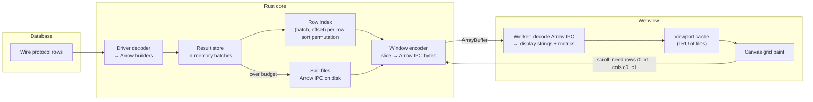
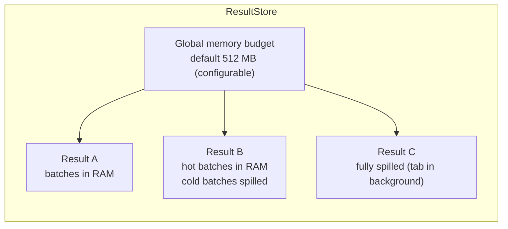
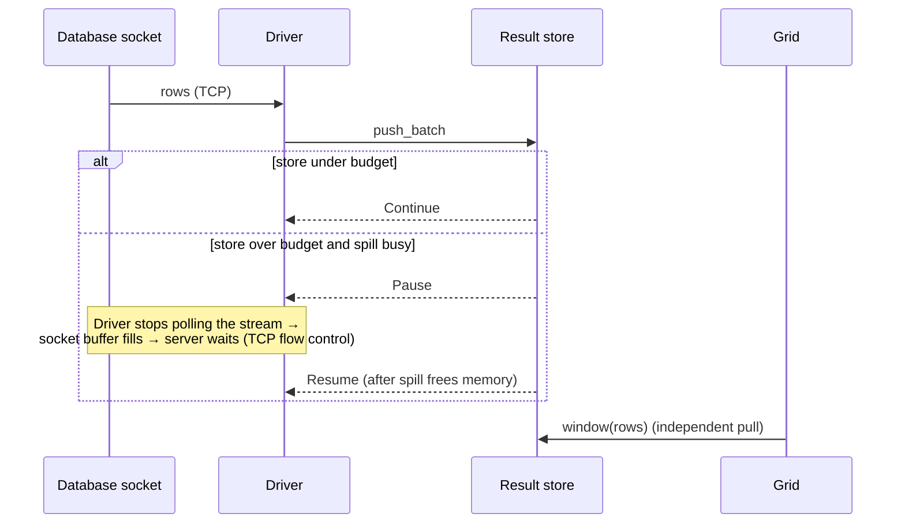

# 06 — IPC and Result Pipeline

The single most important performance decision: **result data lives in Rust; the UI is a viewport that asks for just the cells it can see.** This keeps the webview's memory flat no matter how many rows a query returns, and keeps JSON serialisation off the hot path.

## 1. IPC channels

Tauri 2 offers several mechanisms. We use each for what it is best at:

| Mechanism | Payload | Used for |
| --- | --- | --- |
| **Commands** (`invoke`) with JSON args/returns | Small structured data (< ~100 KB) | Profiles, schema nodes, settings, starting queries, change sets |
| **Commands returning raw bytes** (`tauri::ipc::Response`) | `ArrayBuffer` | Result windows encoded as Arrow IPC, binary cell values, images |
| **Channels** (`tauri::ipc::Channel<T>`) | Ordered stream to one caller | Query progress events, WebSocket/SSE messages, export progress, log tail |
| **Global events** (`emit`) | Broadcast | Session state changes, update available, settings changed in another window |

All command signatures are declared in Rust and exported to TypeScript with `tauri-specta`, producing `@openrows/ipc`:

```ts
// generated — do not edit
export const commands = {
  queryExecute: (args: { sessionId: SessionId; sql: string; params?: Param[]; options?: ExecOptions }, onEvent: Channel<QueryEvent>) =>
    invoke<QueryId>("query_execute", { ...args, onEvent }),
  resultWindow: (args: { resultId: ResultId; rows: Range; cols: Range; maxCellBytes: number }) =>
    invoke<ArrayBuffer>("result_window", args),
  // ...
};
```

## 2. End-to-end result flow



### 2.1 Tiles

The grid requests data in **tiles** of 256 rows × all-visible-columns (column subset when there are > 64 columns). Tiles are cached in an LRU on the UI side (default 64 tiles). Scrolling triggers prefetch of the next tile in the scroll direction. A typical screen shows ~50 rows, so one tile covers several screens.

### 2.2 Cell truncation

Window encoding truncates text/binary cells to `maxCellBytes` (default 2 KB) and sets a "truncated" flag. The full value is fetched on demand by `result_cell(resultId, row, col)` when the user opens the inspector, copies the cell, or exports. A 50 MB `bytea` column therefore never crosses IPC unless asked for.

### 2.3 Why Arrow IPC

- Columnar slices are zero-copy in Rust (`RecordBatch::slice`), so encoding a window is mostly a memcpy of buffers.
- The JS `apache-arrow` reader exposes typed arrays directly; numbers need no parsing.
- The same format is used for spill files and the out-of-process driver host, and Parquet export reuses the same batches.
- Measured target (M0 spike gate): encode + transfer + decode of a 256 × 20 tile of mixed types ≤ 3 ms on reference hardware.

If the spike shows Arrow JS decoding cost or bundle size is unacceptable, the fallback is a minimal custom columnar format with the same structure (ADR-0002 lists the exit criteria).

## 3. Result store



- **Accounting:** each batch reports `get_array_memory_size()`. The store tracks per-result and global usage.
- **Eviction policy:** when over budget, spill least-recently-viewed batches of results not visible in a focused tab, then results in background tabs, then cold batches of visible results. Spill files are Arrow IPC in a per-session temp dir, deleted on close and swept on startup.
- **Hard cap:** per-result row cap (default 10 M rows, configurable / disable-able). On hitting the cap the query is stopped and the UI says so, offering "export full result to file" which streams straight from the database to disk.
- **Lifetime:** results are dropped when their tab closes or when re-run replaces them. Pinned results (user pins a result tab) are kept.

### 3.1 Client-side sort and filter on ad-hoc results

For results already in the store, sort/filter happens in Rust:

- Sort produces a **permutation index** (`arrow::compute::lexsort_to_indices`), not a copy of data. Windows are served through the permutation.
- Filter produces a selection vector (indices) with simple predicates (equals, contains, regex, range, is null) built from the grid's filter row.
- Both run on the Rayon pool with a cancellation token; for > 1 M rows the UI shows a progress pill.

For table-browse views, sort/filter instead regenerate SQL (`ORDER BY`/`WHERE`) so the database does the work on the full table.

## 4. Query event protocol

```ts
type QueryEvent =
  | { type: "started"; queryId: QueryId; statementIndex: number; at: number }
  | { type: "resultBegin"; resultId: ResultId; schema: ColumnMeta[]; editable: EditInfo | null }
  | { type: "progress"; resultId: ResultId; rows: number; bytes: number }   // throttled to ≤ 10 Hz
  | { type: "resultEnd"; resultId: ResultId; rows: number; truncatedByCap: boolean }
  | { type: "rowsAffected"; count: number }
  | { type: "notice"; level: "info" | "warning"; message: string }
  | { type: "completed"; elapsedMs: number }
  | { type: "failed"; error: OdbErrorDto }
  | { type: "cancelled" };
```

`progress` events are coalesced in Rust so a fast query never floods the webview with thousands of messages.

## 5. Back-pressure across the boundary



The UI never pushes on the core and the core never pushes rows to the UI; the UI only receives small events and pulls windows. This decoupling is what keeps scrolling smooth while a 20 M-row query is still arriving.

## 6. Large non-tabular payloads

| Payload | Path |
| --- | --- |
| Big JSON cell / document | `result_cell` returns bytes; worker pretty-prints with a streaming formatter; viewer virtualises lines. |
| Images in blobs | Core sniffs magic bytes; inspector requests a downscaled preview generated in Rust (`image` crate) — never decodes untrusted images in the webview. |
| HTTP response bodies | Stored in core (memory up to 10 MB, then temp file); viewer fetches ranges, like result windows. |
| Export | Never goes through the webview. Core streams from DB or result store to the file the user chose. |

## 7. Security on the IPC boundary

- Commands are scoped per window via Tauri 2 **capabilities**; e.g. the "about" window cannot call `query_execute`.
- Command handlers validate all inputs (IDs must exist and belong to the calling window's workspace; ranges clamped).
- No command returns a secret value except `secret_reveal`, which requires a user gesture and is rate limited. See [12-security.md](12-security.md).

## 8. Implementation notes (D-05: connections and sessions)

| Area | What exists |
| --- | --- |
| App state | `connections::install` (setup hook in `apps/desktop/src-tauri`) resolves Tauri's app-data dir (`~/Library/Application Support/com.prabhavalabs.openrows/` on macOS), opens `openrows.sqlite` (`LocalStore`), `connections/` (`ProfileService` over `KeychainSecretStore`) and one `SessionManager`. `crates/*` stay Tauri-free. Until D-07 wires the result store, the manager's `BatchSink` drops batches; no command executes SQL yet. |
| Commands | `profiles_list`, `profiles_search`, `profile_get`, `profile_create`, `profile_update`, `profile_duplicate`, `profile_delete`, `profile_parse_url`, `connection_test`, `session_open`, `session_close`. All reject with one typed `IpcError { kind, message, code }` (`invalid`, `notFound`, `storage`, `secret`, `url`, `network`, `auth`, `protocol`, `server`, `unsupported`, `internal`); `code` carries the SQLSTATE. |
| Secrets | Webview → core only, through `PasswordInput` (`keep` / `clear` / `set` / `fromUrl`). `profile_parse_url` returns a `UrlDraft` with `passwordProvided: boolean`, never the password; the form re-sends the pasted URL as `fromUrl` on Save/Test and the core extracts the password. `ProfileDto` has `hasPassword` only. |
| Driver call site | `connections/pg.rs` is the only caller of `PgSession::connect`: 10 s timeout, `SHOW server_version`, host:port added to network errors. `require`/`verify-*` TLS modes are rejected as `unsupported` until the driver speaks TLS; `prefer`/`allow`/`disable` connect over plain TCP. |
| Events | `session-state-changed` (`SessionStateChanged { sessionId, state, message }`) is a tauri-specta event forwarded from `SessionManager::subscribe`; `@openrows/ipc` exposes it as `onSessionState`. |
| Capabilities | `capabilities/main.json` grants only the main window the commands above plus `core:event:allow-listen`/`allow-unlisten`; `build.rs` lists every app command. |
| Wrappers | `packages/ipc/src/connections.ts` unwraps the generated `Result` objects and throws `CommandError` (`kind`, `code`); plain Tauri string rejections become `internal`. |
