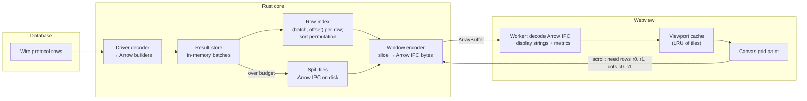
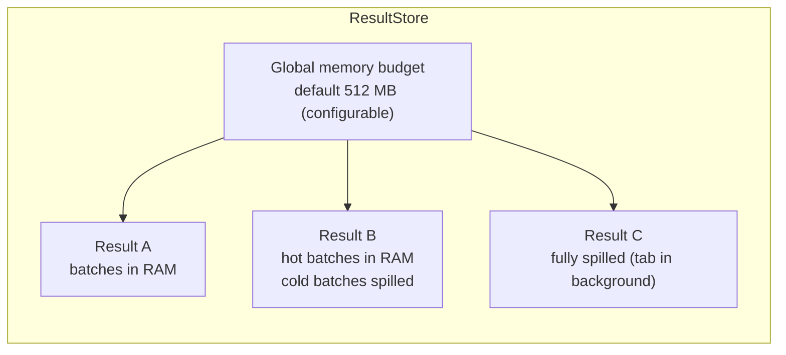
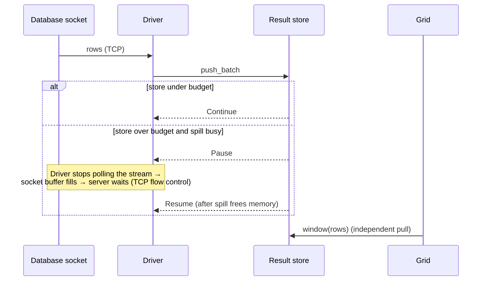

# 06 — IPC and Result Pipeline

The single most important performance decision: **result data lives in Rust; the UI is a viewport that asks for just the cells it can see.** This keeps the webview's memory flat no matter how many rows a query returns, and keeps JSON serialisation off the hot path.

## 1. IPC channels

Tauri 2 offers several mechanisms. We use each for what it is best at:

| Mechanism | Payload | Used for |
| --- | --- | --- |
| **Commands** (`invoke`) with JSON args/returns | Small structured data (< ~100 KB) | Profiles, schema nodes, settings, starting queries, change sets |
| **Commands returning raw bytes** (`tauri::ipc::Response`) | `ArrayBuffer` | Result windows encoded as Arrow IPC, binary cell values, images |
| **Channels** (`tauri::ipc::Channel<T>`) | Ordered stream to one caller | Query progress events, WebSocket/SSE messages, export progress, log tail |
| **Global events** (`emit`) | Broadcast | Session state changes, update available, settings changed in another window |

All command signatures are declared in Rust and exported to TypeScript with `tauri-specta`, producing `@openrows/ipc`:

```ts
// generated — do not edit
export const commands = {
  queryExecute: (args: { sessionId: SessionId; sql: string; params?: Param[]; options?: ExecOptions }, onEvent: Channel<QueryEvent>) =>
    invoke<QueryId>("query_execute", { ...args, onEvent }),
  resultWindow: (args: { resultId: ResultId; rows: Range; cols: Range; maxCellBytes: number }) =>
    invoke<ArrayBuffer>("result_window", args),
  // ...
};
```

## 2. End-to-end result flow



### 2.1 Tiles

The grid requests data in **tiles** of 256 rows × all-visible-columns (column subset when there are > 64 columns). Tiles are cached in an LRU on the UI side (default 64 tiles). Scrolling triggers prefetch of the next tile in the scroll direction. A typical screen shows ~50 rows, so one tile covers several screens.

### 2.2 Cell truncation

Window encoding truncates text/binary cells to `maxCellBytes` (default 2 KB) and sets a "truncated" flag. The full value is fetched on demand by `result_cell(resultId, row, col)` when the user opens the inspector, copies the cell, or exports. A 50 MB `bytea` column therefore never crosses IPC unless asked for.

### 2.3 Why Arrow IPC

- Columnar slices are zero-copy in Rust (`RecordBatch::slice`), so encoding a window is mostly a memcpy of buffers.
- The JS `apache-arrow` reader exposes typed arrays directly; numbers need no parsing.
- The same format is used for spill files and the out-of-process driver host, and Parquet export reuses the same batches.
- Measured target (M0 spike gate): encode + transfer + decode of a 256 × 20 tile of mixed types ≤ 3 ms on reference hardware.

If the spike shows Arrow JS decoding cost or bundle size is unacceptable, the fallback is a minimal custom columnar format with the same structure (ADR-0002 lists the exit criteria).

## 3. Result store



- **Accounting:** each batch reports `get_array_memory_size()`. The store tracks per-result and global usage.
- **Eviction policy:** when over budget, spill least-recently-viewed batches of results not visible in a focused tab, then results in background tabs, then cold batches of visible results. Spill files are Arrow IPC in a per-session temp dir, deleted on close and swept on startup.
- **Hard cap:** per-result row cap (default 10 M rows, configurable / disable-able). On hitting the cap the query is stopped and the UI says so, offering "export full result to file" which streams straight from the database to disk.
- **Lifetime:** results are dropped when their tab closes or when re-run replaces them. Pinned results (user pins a result tab) are kept.

### 3.1 Client-side sort and filter on ad-hoc results

For results already in the store, sort/filter happens in Rust:

- Sort produces a **permutation index** (`arrow::compute::lexsort_to_indices`), not a copy of data. Windows are served through the permutation.
- Filter produces a selection vector (indices) with simple predicates (equals, contains, regex, range, is null) built from the grid's filter row.
- Both run on the Rayon pool with a cancellation token; for > 1 M rows the UI shows a progress pill.

For table-browse views, sort/filter instead regenerate SQL (`ORDER BY`/`WHERE`) so the database does the work on the full table.

## 4. Query event protocol

```ts
type QueryEvent =
  | { type: "started"; queryId: QueryId; statementIndex: number; at: number }
  | { type: "resultBegin"; resultId: ResultId; schema: ColumnMeta[]; editable: EditInfo | null }
  | { type: "progress"; resultId: ResultId; rows: number; bytes: number }   // throttled to ≤ 10 Hz
  | { type: "resultEnd"; resultId: ResultId; rows: number; truncatedByCap: boolean }
  | { type: "rowsAffected"; count: number }
  | { type: "notice"; level: "info" | "warning"; message: string }
  | { type: "completed"; elapsedMs: number }
  | { type: "failed"; error: OdbErrorDto }
  | { type: "cancelled" };
```

`progress` events are coalesced in Rust so a fast query never floods the webview with thousands of messages.

## 5. Back-pressure across the boundary



The UI never pushes on the core and the core never pushes rows to the UI; the UI only receives small events and pulls windows. This decoupling is what keeps scrolling smooth while a 20 M-row query is still arriving.

## 6. Large non-tabular payloads

| Payload | Path |
| --- | --- |
| Big JSON cell / document | `result_cell` returns bytes; worker pretty-prints with a streaming formatter; viewer virtualises lines. |
| Images in blobs | Core sniffs magic bytes; inspector requests a downscaled preview generated in Rust (`image` crate) — never decodes untrusted images in the webview. |
| HTTP response bodies | Stored in core (memory up to 10 MB, then temp file); viewer fetches ranges, like result windows. |
| Export | Never goes through the webview. Core streams from DB or result store to the file the user chose. |

## 7. Security on the IPC boundary

- Commands are scoped per window via Tauri 2 **capabilities**; e.g. the "about" window cannot call `query_execute`.
- Command handlers validate all inputs (IDs must exist and belong to the calling window's workspace; ranges clamped).
- No command returns a secret value except `secret_reveal`, which requires a user gesture and is rate limited. See [12-security.md](12-security.md).

## 8. Implementation notes (D-05: connections and sessions)

| Area | What exists |
| --- | --- |
| App state | `connections::install` (setup hook in `apps/desktop/src-tauri`) resolves Tauri's app-data dir (`~/Library/Application Support/com.prabhavalabs.openrows/` on macOS), opens `openrows.sqlite` (`LocalStore`), `connections/` (`ProfileService` over `KeychainSecretStore`) and one `SessionManager`. `crates/*` stay Tauri-free. The manager streams batches into the shared `Arc<ResultStore>` (D-07, §9); catalog reads use separate per-database metadata sessions (D-06). |
| Commands | `profiles_list`, `profiles_search`, `profile_get`, `profile_create`, `profile_update`, `profile_duplicate`, `profile_delete`, `profile_parse_url`, `connection_test`, `connection_open`, `connection_close`, `session_open`, `session_close`, since D-06 the catalog commands of [docs/10 §2.1](10-schema-and-data-editing.md#21-implementation-notes-d-06-postgresql-schema-tree) and since D-07 the query commands of §9. All reject with one typed `IpcError { kind, message, code }` (`invalid`, `notFound`, `storage`, `secret`, `url`, `network`, `auth`, `protocol`, `server`, `unsupported`, `internal`); `code` carries the SQLSTATE. |
| Secrets | Webview → core only, through `PasswordInput` (`keep` / `clear` / `set` / `fromUrl`). `profile_parse_url` returns a `UrlDraft` with `passwordProvided: boolean`, never the password; the form re-sends the pasted URL as `fromUrl` on Save/Test and the core extracts the password. `ProfileDto` has `hasPassword` only. |
| Driver call site | `connections/pg.rs` is the only caller of `PgSession::connect_with`: the profile's TLS mode maps 1:1 to `SslMode`, `application_name` is the profile's or `OpenRows` (metadata sessions append ` metadata`), the driver's per-stage timeouts apply (docs/14 §4) and host:port is added to network errors. Profiles have no startup commands yet. `require`/`verify-*` TLS modes are rejected as `unsupported` until the driver speaks TLS; `prefer`/`allow`/`disable` connect over plain TCP. `connection_test` and `session_open` return `server: ServerDto` (`product`, `serverVersion`, `flavour` such as Neon, `database`) from `server_info()` (D-06). |
| Databases per connection | PostgreSQL cannot switch databases on a connection, so every opened database has its own user session and metadata session. `connection_open(profileId) -> ConnectionOpened { server, database }` reaches the server on its home database (the profile's database, else `postgres`, which is also the default target when a profile has none) through that database's metadata session and returns the profile's database to open first (`null` lets the user choose). `session_open(profileId, database \| null)` opens a user session on one database; `session_close(sessionId)` closes it and, with the last session on that database, its metadata session; `connection_close(profileId)` closes every user and metadata session of the connection (it replaced `catalog_close`). `connections::owners::Owners` maps each session to `Owner { profile, database }`; `query_execute` reads the profile's safety settings from it and records the owner's database in history. Covered by unit tests (`owners`, `metadata`) and the container test `two_databases_of_one_connection_run_side_by_side` (`just test-pg`). The webview keeps per-connection `OpenedDatabase { name, state: opening \| open \| failed }` lists; session events fail or remove the owning database. |
| Events | `session-state-changed` (`SessionStateChanged { sessionId, state, message }`) is a tauri-specta event forwarded from `SessionManager::subscribe`; `@openrows/ipc` exposes it as `onSessionState`. |
| Capabilities | `capabilities/main.json` grants only the main window the commands above plus `core:event:allow-listen`/`allow-unlisten`; `build.rs` lists every app command. |
| Wrappers | `packages/ipc/src/connections.ts` unwraps the generated `Result` objects and throws `CommandError` (`kind`, `code`); plain Tauri string rejections become `internal`. |

## 9. Implementation notes (D-07: query execution and results)

| Area | What exists |
| --- | --- |
| Result store | `openrows_results::ResultStore` is thread-safe (`RwLock`) and shared as `Arc<ResultStore>` (managed by `spike::configure`, used by the session manager and `result_window`). Streaming API: `begin(id, schema)`, `append(id, batch) -> Append::{Continue, Full}`, `remove(id)`, `rows(id) -> (rows, truncated)`, `memory()`; `insert` (complete results, used by the S1 spike) stays. Windows can be read while a result still streams; the lock is only held to collect `RecordBatch` clones, encoding runs after it. `openrows-core` implements `BatchSink for ResultStore` (`Full` → `SinkFlow::Stop`). |
| Limits | `Limits { max_rows: 1 000 000 per result, max_bytes: 1 GiB of Arrow memory across all results }`. The batch that crosses the row cap is cut to fit; a batch that would exceed the memory budget is dropped. Either stops the query and marks the result `truncated`. A released result id also returns `Full`. **No spill to disk yet** (§3 eviction and spill files are later work); the 1 M default is lower than §3's 10 M until spilling exists. |
| Commands | `query_execute(request: ExecuteRequest { sessionId, sql, mode: all \| selection \| current, cursor (UTF-16), confirmToken }, onEvent: Channel<QueryEventDto>) -> ExecuteReply`, `query_cancel(queryId)`, `results_release(resultIds)`, `history_recent(profileId, limit)`; `result_window` (raw Arrow bytes, S1) now serves real results. `@openrows/ipc` wraps them as `executeQuery`, `cancelQuery`, `releaseResults`, `recentHistory`. |
| Statement selection | `openrows_core::script::statements(sql, Scope)`: `all`/`selection` split the text with `openrows-sql` and run every statement; `current` maps the UTF-16 cursor to a byte offset and runs `statement_at`. Statements run without their `;` through the extended protocol, so a statement never smuggles a second one. |
| Safety gate | `openrows_core::safety::SafetyPlan::check(policy, statements)` classifies each statement (D-02) before anything runs, with the saved connection's `read_only` / `confirm_writes` read from its profile at execution time (the session → profile mapping is recorded by `session_open`). Read-only: any `Write`, `Ddl`, `Unknown` or dangerous statement is `Block` and the whole run is refused (`ExecuteReply::blocked`). Otherwise dangerous statements always need confirmation, and with confirm-writes every modifying statement does (`confirmationRequired { token, statements }`). `Read` and `TxControl` run freely. The token hashes the session id and the exact statement texts, so a confirmation never authorises edited or additional statements. Server-side read-only transactions (for volatile functions the classifier cannot see) and the safe-mode toolbar toggle are D-09. |
| Runs | `openrows_core::script::run_script` executes the statements one at a time on the session actor and stops at the first `Failed` or `Cancelled`; `ScriptCanceller` cancels the running statement and skips the rest. Events are tagged with the statement index. |
| Event protocol | `QueryEventDto` (tag `type`): `statementStarted`, `resultBegin { resultId, columns: { name, sourceType }[] }`, `progress { rows }` (≤ 10 Hz), `resultEnd { rows, truncated }` (row counts come from the store, so they never exceed what `result_window` can serve), `rowsAffected`, `notice`, `statementDone { elapsedMs }`, `failed { error: IpcError }` (SQLSTATE in `error.code`), `cancelled`, and always last `finished { outcome, elapsedMs }`. Counts and durations are `u32` (saturating). |
| History | Every started statement is written to the local store's `history` (profile, database, start, duration, rows returned or affected, status, error message, source `editor`). Failures to write history never fail the query. |
| UI | `apps/desktop/src/features/query/`: query tabs per connection and database (`useQueryTabs`, `TabScope { connectionId, database }`, ⌘T/⌘W; since UX-B the database is always explicit and tabs run on that database's session; before connecting, tabs open in the profile's database), opening a tree or ⌘P relation opens (or refocuses) its table view (D-08, below) and other objects a query tab, and switches the schema picker, lazy CodeMirror editor (⌘↵ current or selection, ⇧⌘↵ all), Run / Run all / Cancel, one result tab per result set over `TileSource` + the shared Arrow worker + `@openrows/grid/canvas`, status line and messages, confirmation sheet, inspector Details (focused cell) and History. Result rows never enter React state; a tab's results are released when it closes or re-runs. The grid is mounted once a result has ended, because `TileSource` has a fixed row count. |
| Table pages (D-08) | `table_page` and `table_count` reuse this pipeline with generated, parameterised SELECTs (`script::run_bound`, `Session::execute_bound`) on the opened database's own session (the owners map must match both the target connection and database); see [docs/08 §10](08-data-grid.md#10-implementation-notes-d-08-postgresql-table-view). |
| Known gaps | Spill to disk, pinned results, `result_cell` (full values), live grid growth while streaming, editor text persistence (NFR-REL-01), statement highlighting/gutter status, history in the sidebar's History segment (the inspector shows it meanwhile). Per-database sessions landed with UX-B (§8): every tab runs on its database's own session. |
