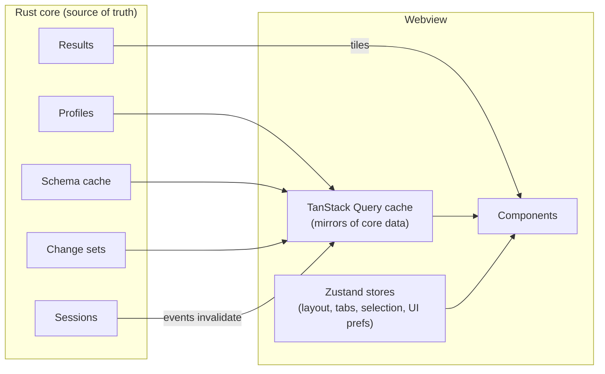

# 07 — Frontend Architecture

## 1. Stack

| Concern | Choice |
| --- | --- |
| Language | TypeScript (strict, `noUncheckedIndexedAccess`) |
| Framework | React 19 with the React Compiler |
| Build | Vite (dev server for Tauri, production bundle) |
| Package manager | pnpm workspaces |
| UI primitives | Radix UI primitives (menus, dialogs, popovers, tooltips) — behaviour and accessibility only, unstyled |
| Styling | CSS modules + design tokens as CSS custom properties; no runtime CSS-in-JS |
| Layout panes | `react-resizable-panels` |
| UI state | Zustand stores (sliced per feature) |
| Core-backed data | TanStack Query over generated IPC bindings |
| Editor | CodeMirror 6 (`@odb/editor`) |
| Grid | Canvas grid (`@odb/grid`), see [08-data-grid.md](08-data-grid.md) |
| Icons | Own SVG icon set (Lucide-style geometry, MIT-compatible sources only) |
| Tests | Vitest, Testing Library, Playwright |

## 2. Application structure

```text
apps/desktop/src/
  app/                    # bootstrapping, providers, window routing
  shell/                  # window chrome, sidebar, tab strip, status bar, command palette
  features/
    connections/          # connection list, editor form, test dialog
    schema/               # object tree, structure view, DDL view, ER diagram
    query/                # editor tab, result tabs, history panel
    table/                # table browser (grid + filters + pagination)
    editing/              # change set UI, commit preview
    documents/            # MongoDB views
    keyvalue/             # Redis views
    api/                  # API client workspace
    admin/                # process list, roles
    settings/
  lib/                    # shared hooks, formatters, keyboard system
packages/
  ipc/                    # generated bindings + thin typed wrappers
  ui/                     # design system components on top of Radix
  grid/                   # canvas grid
  editor/                 # CodeMirror setup, SQL/MQL/Redis languages, completion sources
  arrow-worker/           # Web Worker for Arrow decoding & formatting
```

Feature folders own their components, stores, IPC queries and tests. Cross-feature imports go through each feature's `index.ts` only (lint-enforced).

## 3. State model



Rules:

1. **The core owns data.** The webview caches mirrors via TanStack Query and invalidates them on core events (`schema.changed`, `session.state`, `changeset.updated`). It never treats its copy as authoritative.
2. **UI-only state lives in Zustand:** open tabs and their order, split sizes, focused pane, selection ranges, panel visibility. Persisted (debounced) to the core's workspace state so it survives relaunch and crashes.
3. **Result rows never enter React state.** The grid holds a tile cache outside React and repaints imperatively; React only re-renders on structural changes (columns, result replaced).
4. **Unsaved editor text** is sent to the core on change (debounced 300 ms, flushed on blur/quit) where it is written to the local store (NFR-REL-01).

## 4. Tabs and windows

- A **workspace window** contains a sidebar (connections / schema tree / API collections) and a tab area.
- Tab kinds: `QueryTab`, `TableTab`, `StructureTab`, `DocumentCollectionTab`, `RedisKeyTab`, `ApiRequestTab`, `ErDiagramTab`, `ProcessListTab`, `SettingsTab`.
- Each tab has a serialisable descriptor (`{ kind, connectionId, objectPath?, fileRef?, viewState }`) → restore on launch, move to another window, or "reopen closed tab".
- **Tab virtualisation:** only the active tab and the last 2 visited tabs stay mounted. Other tabs are unmounted but keep their descriptor and lightweight view state (scroll position, selection), so 100 open tabs cost little.

## 5. Keyboard and command system

- Central **command registry**: every action is a command `{ id, title, when, run }`. Menus, toolbar buttons, context menus and the command palette all dispatch commands — no logic in click handlers.
- Keybindings map `chord → commandId` with `when` context expressions (`editorFocus && !suggestOpen`). Defaults per platform (⌘ on macOS, Ctrl elsewhere). User overrides stored in `keybindings.json`.
- The native macOS menu bar is generated from the same registry (via IPC to the shell) so menu items show the user's actual shortcuts.

## 6. Workers

| Worker | Work |
| --- | --- |
| `arrow-worker` | Decode Arrow IPC tiles, produce display strings and measured text widths (via `OffscreenCanvas` measureText) for column auto-size. |
| `format-worker` | Pretty-print big JSON/XML, SQL formatting for very large scripts, diff of change-set previews. |
| `search-worker` | Fuzzy search over the schema search index and command palette entries when lists exceed ~5 000 items. |

Communication uses transferable `ArrayBuffer`s; no structured cloning of large objects.

## 7. Rendering performance rules

- No layout thrash: read DOM measurements in one pass, write in the next (`requestAnimationFrame`).
- Long lists everywhere (schema tree, history, API collections, logs) use virtualization.
- Expensive derived data uses `useMemo` only where the React Compiler cannot infer it; profiled in CI with React Profiler markers for key interactions.
- Animations use `transform`/`opacity` only; respect `prefers-reduced-motion`.
- Fonts bundled locally (no network), subset to needed glyph ranges; monospace font for grid and editor configurable.

## 8. Theming

- Design tokens (colour, spacing, radius, typography, elevation, motion) defined once in `packages/ui/tokens` and emitted as CSS variables for `light`, `dark`, `high-contrast-light`, `high-contrast-dark`.
- The canvas grid and CodeMirror read the same tokens at runtime (grid re-reads on theme change event).
- Environment tag colours are tokens too, so a "prod" red works in every theme with adequate contrast.
- Theme follows system by default, synchronised with the native window appearance (vibrancy/titlebar on macOS).

## 9. Error and empty states

- Every async view has explicit loading, empty, error and partial states (design phase defines visuals).
- Errors render the `OdbError` kind, message, database code and hint, with "Copy details" (redacted) and "Open logs".
- Network/session loss shows an inline, non-modal banner with Reconnect, never a blocking dialog.

## 10. Internationalisation

- All strings via an i18n layer (`@lingui/core` or `i18next`, decided in M1) with ICU message format; English source. Dates/numbers through `Intl`.
- Right-to-left support is a P2 goal; layout uses logical CSS properties from the start to keep it cheap.
