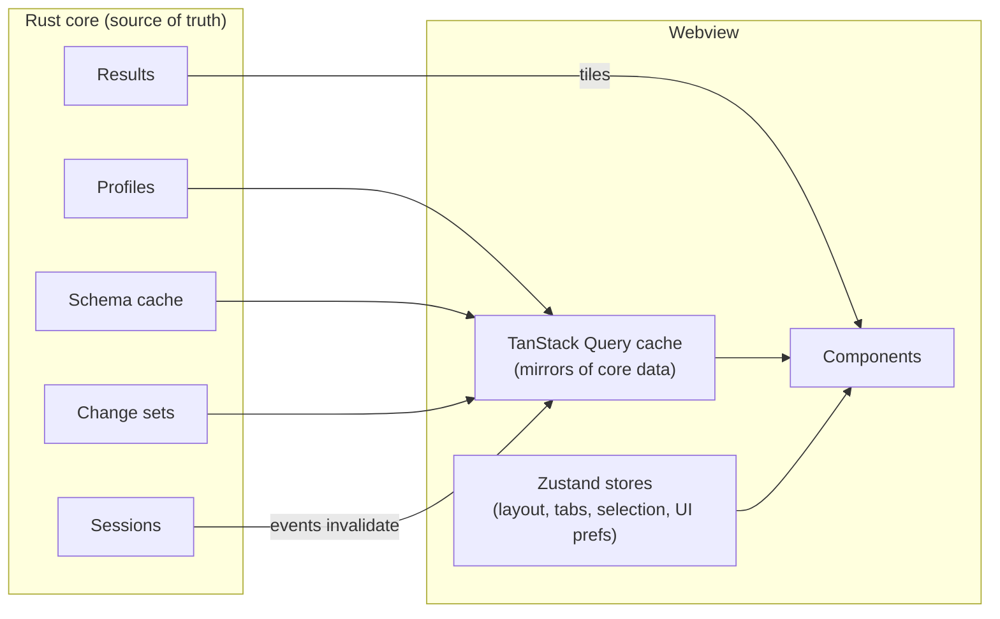

# 07 — Frontend Architecture

## 1. Stack

| Concern | Choice |
| --- | --- |
| Language | TypeScript (strict, `noUncheckedIndexedAccess`) |
| Framework | React 19 with the React Compiler |
| Build | Vite (dev server for Tauri, production bundle) |
| Package manager | pnpm workspaces |
| UI primitives | Radix UI primitives (menus, dialogs, popovers, tooltips) — behaviour and accessibility only, unstyled |
| Styling | CSS modules + design tokens as CSS custom properties; no runtime CSS-in-JS |
| Layout panes | `react-resizable-panels` |
| UI state | Zustand stores (sliced per feature) |
| Core-backed data | TanStack Query over generated IPC bindings |
| Editor | CodeMirror 6 (`@openrows/editor`) |
| Grid | Canvas grid (`@openrows/grid`), see [08-data-grid.md](08-data-grid.md) |
| Icons | Own SVG icon set (Lucide-style geometry, MIT-compatible sources only) |
| Tests | Vitest, Testing Library, Playwright |

## 2. Application structure

```text
apps/desktop/src/
  app/                    # bootstrapping, providers, window routing
  shell/                  # window chrome, sidebar, tab strip, status bar, command palette
  features/
    connections/          # connection list, editor form, test dialog
    schema/               # object tree, structure view, DDL view, ER diagram
    query/                # editor tab, result tabs, history panel
    table/                # table browser (grid + filters + pagination)
    editing/              # change set UI, commit preview
    documents/            # MongoDB views
    keyvalue/             # Redis views
    api/                  # API client mode
    admin/                # process list, roles
    settings/
  lib/                    # shared hooks, formatters, keyboard system
packages/
  ipc/                    # generated bindings + thin typed wrappers
  ui/                     # design system components on top of Radix
  grid/                   # canvas grid
  editor/                 # CodeMirror setup, SQL/MQL/Redis languages, completion sources
  arrow-worker/           # Web Worker for Arrow decoding & formatting
```

Feature folders own their components, stores, IPC queries and tests. Cross-feature imports go through each feature's `index.ts` only (lint-enforced).

## 3. State model



Rules:

1. **The core owns data.** The webview caches mirrors via TanStack Query and invalidates them on core events (`schema.changed`, `session.state`, `changeset.updated`). It never treats its copy as authoritative.
2. **UI-only state lives in Zustand:** open tabs and their order, split sizes, focused pane, selection ranges, panel visibility. Persisted (debounced) to the core's workspace state so it survives relaunch and crashes.
3. **Result rows never enter React state.** The grid holds a tile cache outside React and repaints imperatively; React only re-renders on structural changes (columns, result replaced).
4. **Unsaved editor text** is sent to the core on change (debounced 300 ms, flushed on blur/quit) where it is written to the local store (NFR-REL-01).

## 4. Tabs and windows

- A **workspace window** hosts connection Workspaces with multiple databases, a schema sidebar and per-database tab areas. API collections are loaded separately from a **Project** folder (`.openrows/project.yaml`, Open Project Folder).
- Tab kinds: `QueryTab`, `TableTab`, `StructureTab`, `DocumentCollectionTab`, `RedisKeyTab`, `ApiRequestTab`, `ErDiagramTab`, `ProcessListTab`, `SettingsTab`.
- Each tab has a serialisable descriptor (`{ kind, connectionId, objectPath?, fileRef?, viewState }`) → restore on launch, move to another window, or "reopen closed tab".
- **Tab virtualisation:** only the active tab and the last 2 visited tabs stay mounted. Other tabs are unmounted but keep their descriptor and lightweight view state (scroll position, selection), so 100 open tabs cost little.

## 5. Keyboard and command system

- Central **command registry**: every action is a command `{ id, title, when, run }`. Menus, toolbar buttons, context menus and the command palette all dispatch commands — no logic in click handlers.
- Keybindings map `chord → commandId` with `when` context expressions (`editorFocus && !suggestOpen`). Defaults per platform (⌘ on macOS, Ctrl elsewhere). User overrides stored in `keybindings.json`.
- The native macOS menu bar is generated from the same registry (via IPC to the shell) so menu items show the user's actual shortcuts.

## 6. Workers

| Worker | Work |
| --- | --- |
| `arrow-worker` | Decode Arrow IPC tiles, produce display strings and measured text widths (via `OffscreenCanvas` measureText) for column auto-size. |
| `format-worker` | Pretty-print big JSON/XML, SQL formatting for very large scripts, diff of change-set previews. |
| `search-worker` | Fuzzy search over the schema search index and command palette entries when lists exceed ~5 000 items. |

Communication uses transferable `ArrayBuffer`s; no structured cloning of large objects.

## 7. Rendering performance rules

- No layout thrash: read DOM measurements in one pass, write in the next (`requestAnimationFrame`).
- Long lists everywhere (schema tree, history, API collections, logs) use virtualization.
- Expensive derived data uses `useMemo` only where the React Compiler cannot infer it; profiled in CI with React Profiler markers for key interactions.
- Animations use `transform`/`opacity` only; respect `prefers-reduced-motion`.
- Fonts bundled locally (no network), subset to needed glyph ranges; monospace font for grid and editor configurable.

## 8. Theming

The M0-T4 implementation is `@openrows/ui` in `packages/ui`. Its public components and theme API are exported from `src/index.ts`; the standalone stylesheet is exported as `@openrows/ui/tokens.css` and the TypeScript values as `@openrows/ui/tokens`.

- **Single source:** `src/tokens/colours.ts`, `typography.ts`, `geometry.ts`, and `material.ts` define theme colours, typography, spacing/radius, elevation/glass and motion. Rem-based type/spacing preserve browser text scaling; the base size is 13 px at the normal 16 px root.
- **Pipeline:** `scripts/token-css.ts` serialises the values; `just gen-tokens` writes the checked-in `src/tokens/tokens.css`. `just ui-check` compares exact generated bytes and scans all UI/app CSS modules for raw colour literals. Both run in `just check`; Vitest independently checks generated freshness. Generated CSS is exempt from Prettier because generator bytes are canonical.
- **CSS themes:** light defaults on `:root`, dark on `[data-theme="dark"]`, OS dark under `[data-theme="system"]`. Increased contrast supplies opaque panels and stronger separators; reduced transparency replaces glass with solid materials (OS query plus `[data-transparency="reduced"]` on `<html>`). Reduced motion disables animations/transitions. Both standard and WebKit backdrop-filter declarations are included.
- **Theme state:** `src/theme/ThemeProvider.tsx` / `useTheme` expose `system | light | dark` plus resolved appearance. A single root `data-theme` attribute changes the CSS cascade; the OS media listener updates resolved appearance without per-element writes or layout reads. The UI-only preference uses `openrows.theme` in localStorage with guarded reads/writes; failure falls back to system/in-memory state.
- **Components:** `src/components/` contains CSS modules and native button/input semantics. SegmentedControl is an ARIA radiogroup with roving focus and arrow/Home/End selection; Switch uses native Space/Enter button activation. There are no added runtime primitives, CSS-in-JS or icon dependencies. `src/icons/Icon.tsx` is original SVG geometry.
- **Gallery:** `apps/desktop/src/gallery/` exercises all components, themes, swatches, typography and applicable interaction states; `shell/AppFooter.tsx` shows native `app_info`. The native traffic-light area retains its 96 px toolbar clearance.
- **Verification:** token contrast tests composite translucent fills over every supported surface in normal/high-contrast themes. Keyboard/ARIA, theme persistence/OS changes/storage failures and gallery axe tests run in Vitest. `just contrast-report` prints worst-case ratios; `just bench-ui` enforces style and bundle gzip budgets.

Native window vibrancy/appearance synchronisation, the canvas grid and CodeMirror integration remain later work. This task provides CSS glass within the webview only. Since M0-S5, `@openrows/editor` exists as a lazily loaded package whose highlight and editor theme read these CSS custom properties ([09 §1.1](09-query-editor.md#11-current-implementation-m0-s5)); it is not yet mounted in the workspace, only in the gallery's lazy **SQL editor** specimen.

### 8.1 Implementation notes (D-05: connections feature)

- `apps/desktop/src/features/connections/` is the first feature folder; other code imports it through its `index.ts` (`ConnectionRail`, `ConnectionHeader`, `ConnectionSheets`, `EnvironmentBadge`, `statusLabel`, `useConnections`).
- TanStack Query and Zustand are not dependencies yet, so state is local React state: `useProfiles` (reloads `profiles_list` after each change), `useSessions` (profile → `disconnected | connecting | connected | failed`, updated by command results and `session-state-changed` events) and `useConnections` (active profile, open sheet, duplicate/delete). Pure logic lives in `form.ts` (draft ↔ `ProfileInput`, URL fill, prod default, validation; `urlText.ts` masks and composes URLs) and `sessions.ts` (event reducer, labels).
- Only `@openrows/ipc` wrappers are called; jsdom tests replace them with `src/test/ipcStub.ts` (no native shell, no keychain).
- `shell/SidebarMenu.tsx` and `shell/useSidebarMenu.ts` (anchored glass menu) moved out of `mock/` because the real connection menu and the database menu share them.
- M1-18 moves the rest of the M0 `mock/` folder, by then the live workspace, to `features/workspace/` (`Workspace`, toolbar, sidebar, inspector, palettes, the controller and its command routing). The sample assistant and all sample data are gone; `mock/` no longer exists. Commands reach the active tab through two registered targets in `features/commands/tabCommands.ts`: the active query tab (`TAB_COMMANDS`) and the active table tab (`TABLE_COMMANDS`: commit, discard, insert and delete rows, copy the selection, filter, columns panel and Refresh).
- UX pass (connection sheet): `useUrlField` keeps the URL and the fields in sync both ways. Typing parses after 250 ms; a paste parses at once. Invalid URLs show an inline error. `urlText.ts` splits the password out in the webview: the field shows it as `••••`, the core `profile_parse_url` receives a password-free copy, and the typed password is saved as `{ kind: 'set' }`. The core still never returns a password. A field edit recomposes the URL from the draft. `PasswordField` uses `SecureField`, which is always dotted, has a reveal button and blocks copy/cut while masked. A saved password shows only "Saved in Keychain" with Change… and Forget actions. Delete asks with a native macOS alert through `confirmDestructive` (scoped `dialog:allow-ask`). Outside the native shell it falls back to an alert `Sheet`.
- D-06 adds `features/schema/` (`index.ts` exports `useCatalog`, `DatabaseSelector`, `ObjectTree`, `SchemaPicker`, `DatabaseSwitcher`, `QuickOpen`). `useResources` is a small keyed async cache (idle/loading/ready/error, invalidate by key prefix); keys include the session id, so a reconnect reads afresh. `useNavigation` keeps opened databases and the chosen schema per connection. Opening an object passes an `ObjectRef` `{ database, schema, name, kind, arguments }` to the workspace, which opens the object's query tab in that database's tab set (D-07, see [06 §9](06-ipc-and-result-pipeline.md#9-implementation-notes-d-07-query-execution-and-results)). Tests mock IPC with `src/test/catalogStub.ts`.

## 9. Error and empty states

- Every async view has explicit loading, empty, error and partial states (design phase defines visuals).
- Errors render the `OdbError` kind, message, database code and hint, with "Copy details" (redacted) and "Open logs".
- Network/session loss shows an inline, non-modal banner with Reconnect, never a blocking dialog.

## 10. Internationalisation

- All strings via an i18n layer (`@lingui/core` or `i18next`, decided in M1) with ICU message format; English source. Dates/numbers through `Intl`.
- Right-to-left support is a P2 goal; layout uses logical CSS properties from the start to keep it cheap.
