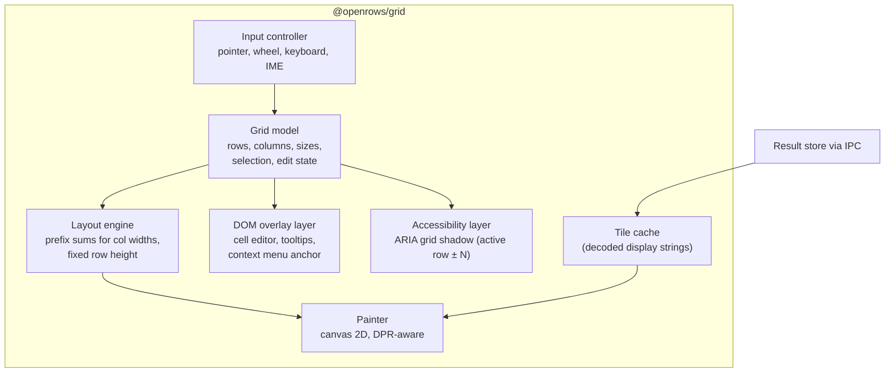
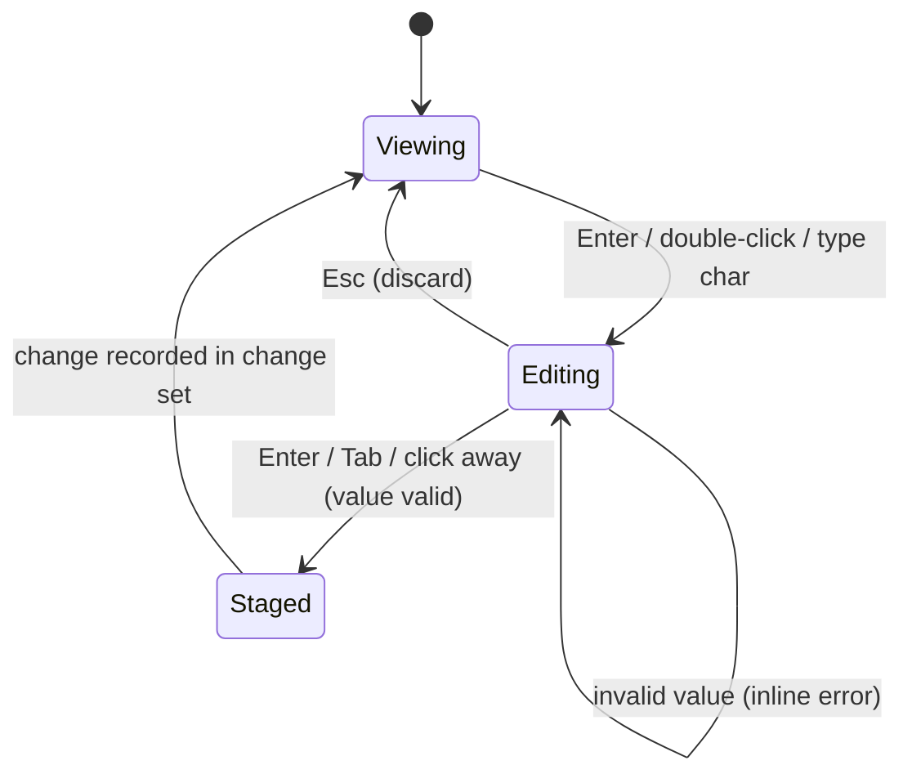

# 08 — Data Grid

The grid is where users spend most of their time. It must feel instant with ten rows and with ten million.

## 1. Requirements recap

- 60 fps (or display rate) scrolling at 1 M+ rows and 100+ columns (NFR-PERF-04).
- Rich cells: NULL markers, booleans, numbers, dates, JSON preview, binary size, truncated long text, edited/inserted/deleted state, conflict state.
- Excel-like selection and keyboard navigation; copy in many formats.
- Inline editing with type-specific editors.
- Accessible to screen readers and keyboard-only users.

## 2. Rendering approach

DOM-based virtualised grids cost one or more DOM nodes per visible cell. With 60 rows × 30 columns, every scroll frame touches ~1 800 nodes, and style recalculation dominates — especially in WebKit-based webviews (WKWebView, WebKitGTK). We therefore render the cell area to **canvas** and use DOM only for overlays.



### 2.1 Canvas layers

| Layer | Content | Repaint trigger |
| --- | --- | --- |
| Header canvas | Column headers, sort/filter indicators, resize handles | Column change, hover |
| Body canvas | Cells (only visible region + 1 row/col margin) | Scroll, data arrival, edit state |
| Selection canvas | Selection rectangles, active cell border, drag fill handle | Selection change |
| Pinned columns | Separate canvas for frozen left columns and row-number gutter | Scroll Y only |

Splitting layers keeps selection changes (frequent) from repainting all text (expensive).

### 2.2 Paint loop

1. Wheel/scroll events update a target offset; one `requestAnimationFrame` per frame paints.
2. Compute visible row range (fixed row height → O(1)) and column range (binary search over prefix sums → O(log n)).
3. For each visible cell: look up tile; if missing, draw a skeleton shimmer and request the tile (deduplicated).
4. Text drawing uses cached glyph-width measurements per font to truncate with ellipsis without calling `measureText` per cell per frame.
5. Device pixel ratio handled by scaling the backing store; integer-snapped coordinates to keep text crisp.

**Accepted design: Option A, our own Canvas 2D painter**, recorded in
[ADR-0004](adr/0004-canvas-data-grid.md). The app sees the adapter API below;
renderer internals own the layers, edit-state visuals, pinned columns,
multi-range selection and ARIA shadow grid. No external grid renderer is shipped.

## 3. Grid API (adapter boundary)

The M0-S2 spike exposes the following minimal public boundary in `packages/grid/src/index.ts`.
The painter is a deferred entry point (`@openrows/grid/canvas`), exporting `mountGrid(host, props): GridHandle`.

```ts
interface GridDataSource {
  readonly rows: number;
  readonly columns: readonly GridColumn[]; // id, title, width, pinned (leading prefix)
  readonly metrics: { requested: number; hits: number };
  cell(row: number, column: number): DisplayCell | undefined; // synchronous; no I/O
  window(range: CellRange, direction: number): Promise<void>;
  subscribe(listener: () => void): () => void;
}
interface GridProps {
  source: GridDataSource;
  selection: SelectionModel; // focused row/column + inclusive, zero-based ranges
  theme: GridTheme; // gridTheme("light" | "dark") resolves @openrows/ui tokens
  onSelection(selection: SelectionModel): void;
  onError(error: unknown): void;
}
interface GridHandle {
  readonly viewport: { x: number; y: number; width: number; height: number };
  readonly metrics: { milliseconds: number; placeholders: number; paints: number };
  scrollTo(x: number, y: number): void; // CSS pixels, native scroll container
  destroy(): void;
}
```

`TileSource(resultId, rows, columns, load)` reuses S1's `TileClient`, moved to
`@openrows/grid/tile-client`; the desktop re-export keeps S1 imports compatible.
`load` returns worker-decoded S1 typed tiles, not JSON rows. Tiles are 256×20,
clamped at the result edges, held in one deduplicating 64-entry LRU. Conversion
to display strings occurs once on arrival. Visible windows include pinned
columns and prefetch one vertical tile in `direction` (-1/0/+1) and one horizontal
tile in the observed column direction. Cache hits count requested windows already
resident, not every painted cell lookup. The spike repeats the twenty S1 columns
for the 100-column scenario; all windows still go through binary IPC and the worker.

Own canvas uses four layers, backing-store DPR scaling, snapped text origins,
a weak text measurement cache prepared on arrival, and persistent paint callbacks.
The painter allocates no JS arrays/objects/strings per cell or per frame. Tile
requests, conversion, and measurement run outside that hot loop. Headers repaint
on horizontal/data changes; pinned cells on vertical/data changes; selection
changes repaint the selection layer. NULL, changed cells and deleted rows use
the shared tokens. Editing and copy remain future work.
This spike is not connected to the workspace mock.

## 4. Selection model

- Ranges: list of rectangles `{ r0, r1, c0, c1 }` + active cell; supports cell, multi-range (⌘-click), full rows, full columns, all.
- Large selections are **logical**, not materialised: "copy 2 M rows × 5 columns" is sent to the core as a range spec and the core writes to the clipboard (with a size warning past 50 MB).
- Keyboard: arrows, ⇧+arrows, ⌘/Ctrl+arrows (jump to edge), Page Up/Down, Home/End, Tab/⇧Tab, Enter (edit), Esc, Space (toggle row selection in row mode), ⌘A.

## 5. Column behaviour

- Auto-size: measures header and first loaded tile (worker), clamps to [60 px, 480 px]; double-click resize handle to fit.
- Reorder by drag; hide/show via header menu; pin left; per-result column layout remembered for table tabs (keyed by table path).
- Type-aware alignment and formatting: numbers right-aligned with optional thousands separators; dates in user's chosen format; booleans as check glyphs; UUIDs monospace.

## 6. Editing in the grid



- The cell editor is a DOM element positioned over the cell (supports IME, spellcheck off, native undo).
- Type-specific editors: text (multi-line expands into popover), number (validated), boolean (toggle), enum (dropdown from schema), date/time (picker + free text), JSON (popover CodeMirror with validation), binary (load from file / set NULL).
- Context actions: Set NULL, Set DEFAULT, Set empty string, Revert cell, Revert row.
- Visual states: edited cell (accent fill), inserted row (green gutter), deleted row (strikethrough + red gutter), conflict (warning outline).
- Paste a TSV block → stages a multi-cell edit with preview.

All staging goes through the core's change-set API ([10-schema-and-data-editing.md](10-schema-and-data-editing.md)).

## 7. Copy formats

| Format | Notes |
| --- | --- |
| TSV (default ⌘C) | Pastes cleanly into spreadsheets. |
| CSV | RFC 4180 quoting. |
| JSON (array of objects) | Types preserved where JSON allows; decimals as strings by default. |
| Markdown table | For tickets and docs. |
| SQL `INSERT` | Dialect-correct quoting and literals. |
| SQL `WHERE col IN (...)` | From one column selection. |
| Column names | Header row only. |

## 8. Accessibility

The S2 prototype exposes a shadow ARIA grid beside the canvas layers. It exposes one
focused logical cell with `aria-activedescendant`, a row index of model row + 2
(the header counts as row 1), column index + 1, and real row/column totals. Tile
arrival updates the announced header/value. Tab focuses the shadow grid; arrows
move its focused cell. Canvas clicks and arrow navigation update the same selection model.
No million-row DOM is created.

This is a hook prototype, not accessibility certification. Neighbouring rows,
selection live announcements, screen-reader testing and the complete keyboard
model remain future work; test VoiceOver before production accessibility sign-off.

## 9. Performance budget per frame (16.6 ms at 60 Hz)

| Step | Budget |
| --- | --- |
| Input handling and range computation | ≤ 0.5 ms |
| Body paint (≈ 60 × 20 cells) | ≤ 6 ms |
| Overlay/selection paint | ≤ 1 ms |
| Tile requests (async, off frame) | — |
| Headroom for GC, compositor | ≥ 8 ms |

Measured with `just bench-grid [repeats=3]` in the release app's
`OPENROWS_SPIKE=grid` mode in **WKWebView**, after the native show-window handshake.
The maintainer's three M4/60 Hz release runs establish the S2 decision:
complete mean paint 0.5–1.9 ms/frame (≤6 ms body budget), zero painter allocations
and zero blank-placeholder frames. [ADR-0004](adr/0004-canvas-data-grid.md) retains
all supplied comparison numbers and the environmental-stall analysis.

Every repeat starts with fresh app, scroll and cache state. All sampled rAF
intervals and attribution are retained. Gate on the best repeat per scenario
with zero frames >32 ms, plus zero frames >32 ms with ≥16 ms tracked main-thread
work in **every** repeat. See [docs/13 §4](13-performance.md#4-benchmark-suite).
`performance.now()` times the complete layered paint, excluding compositor/GPU
time; mean paint includes zero-repaint frames. The measured page clock resolution
is reported (commonly 1 ms); thresholds have no rounding allowance. React commit
instrumentation is retained for attribution and fails on changed signatures.
