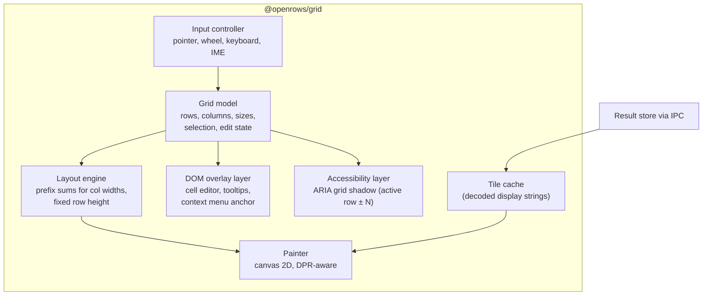
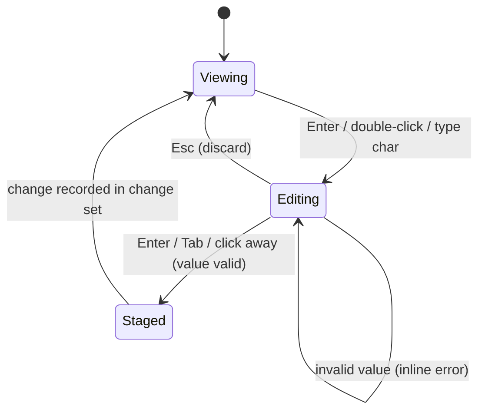

# 08 — Data Grid

The grid is where users spend most of their time. It must feel instant with ten rows and with ten million.

## 1. Requirements recap

- 60 fps (or display rate) scrolling at 1 M+ rows and 100+ columns (NFR-PERF-04).
- Rich cells: NULL markers, booleans, numbers, dates, JSON preview, binary size, truncated long text, edited/inserted/deleted state, conflict state.
- Excel-like selection and keyboard navigation; copy in many formats.
- Inline editing with type-specific editors.
- Accessible to screen readers and keyboard-only users.

## 2. Rendering approach

DOM-based virtualised grids cost one or more DOM nodes per visible cell. With 60 rows × 30 columns, every scroll frame touches ~1 800 nodes, and style recalculation dominates — especially in WebKit-based webviews (WKWebView, WebKitGTK). We therefore render the cell area to **canvas** and use DOM only for overlays.



### 2.1 Canvas layers

| Layer | Content | Repaint trigger |
| --- | --- | --- |
| Header canvas | Column headers, sort/filter indicators, resize handles | Column change, hover |
| Body canvas | Cells (only visible region + 1 row/col margin) | Scroll, data arrival, edit state |
| Selection canvas | Selection rectangles, active cell border, drag fill handle | Selection change |
| Pinned columns | Separate canvas for frozen left columns and row-number gutter | Scroll Y only |

Splitting layers keeps selection changes (frequent) from repainting all text (expensive).

### 2.2 Paint loop

1. Wheel/scroll events update a target offset; one `requestAnimationFrame` per frame paints.
2. Compute visible row range (fixed row height → O(1)) and column range (binary search over prefix sums → O(log n)).
3. For each visible cell: look up tile; if missing, draw a skeleton shimmer and request the tile (deduplicated).
4. Text drawing uses cached glyph-width measurements per font to truncate with ellipsis without calling `measureText` per cell per frame.
5. Device pixel ratio handled by scaling the backing store; integer-snapped coordinates to keep text crisp.

Implementation candidates (decided by the M0 spike, ADR-0004): **build our own** painter on Canvas 2D (≈ 3–5 k lines, full control), or **adopt Glide Data Grid** (MIT, canvas-based, proven at millions of rows) behind our `@openrows/grid` adapter interface. Either way, the rest of the app only sees the adapter API below.

## 3. Grid API (adapter boundary)

```ts
interface GridDataSource {
  rowCount(): number;                        // may grow while streaming
  columns(): ColumnMeta[];
  getTile(tileIndex: number): Tile | undefined;   // sync lookup
  requestTile(tileIndex: number): void;           // async fill, emits 'tile'
  on(event: "tile" | "rows" | "columns", cb: () => void): Unsubscribe;
}

interface GridProps {
  source: GridDataSource;
  editState?: EditOverlay;                   // pending changes keyed by (rowKey, col)
  selection: SelectionModel;
  readOnlyReason?: string;
  onCommand(cmd: GridCommand): void;         // copy, edit, delete rows, open inspector, fk-jump, ...
}
```

## 4. Selection model

- Ranges: list of rectangles `{ r0, r1, c0, c1 }` + active cell; supports cell, multi-range (⌘-click), full rows, full columns, all.
- Large selections are **logical**, not materialised: "copy 2 M rows × 5 columns" is sent to the core as a range spec and the core writes to the clipboard (with a size warning past 50 MB).
- Keyboard: arrows, ⇧+arrows, ⌘/Ctrl+arrows (jump to edge), Page Up/Down, Home/End, Tab/⇧Tab, Enter (edit), Esc, Space (toggle row selection in row mode), ⌘A.

## 5. Column behaviour

- Auto-size: measures header and first loaded tile (worker), clamps to [60 px, 480 px]; double-click resize handle to fit.
- Reorder by drag; hide/show via header menu; pin left; per-result column layout remembered for table tabs (keyed by table path).
- Type-aware alignment and formatting: numbers right-aligned with optional thousands separators; dates in user's chosen format; booleans as check glyphs; UUIDs monospace.

## 6. Editing in the grid



- The cell editor is a DOM element positioned over the cell (supports IME, spellcheck off, native undo).
- Type-specific editors: text (multi-line expands into popover), number (validated), boolean (toggle), enum (dropdown from schema), date/time (picker + free text), JSON (popover CodeMirror with validation), binary (load from file / set NULL).
- Context actions: Set NULL, Set DEFAULT, Set empty string, Revert cell, Revert row.
- Visual states: edited cell (accent fill), inserted row (green gutter), deleted row (strikethrough + red gutter), conflict (warning outline).
- Paste a TSV block → stages a multi-cell edit with preview.

All staging goes through the core's change-set API ([10-schema-and-data-editing.md](10-schema-and-data-editing.md)).

## 7. Copy formats

| Format | Notes |
| --- | --- |
| TSV (default ⌘C) | Pastes cleanly into spreadsheets. |
| CSV | RFC 4180 quoting. |
| JSON (array of objects) | Types preserved where JSON allows; decimals as strings by default. |
| Markdown table | For tickets and docs. |
| SQL `INSERT` | Dialect-correct quoting and literals. |
| SQL `WHERE col IN (...)` | From one column selection. |
| Column names | Header row only. |

## 8. Accessibility

Canvas content is invisible to assistive technology, so the grid maintains a **shadow ARIA grid**:

- A visually hidden `role="grid"` element mirrors the active row and its neighbours (± 10 rows) with `aria-rowindex`/`aria-colindex` and `aria-rowcount` set to the real totals.
- The focused cell in the shadow grid moves with the active cell; screen readers announce column header + value.
- Live region announces selection size changes and edit commits.
- High-contrast themes increase grid line contrast and use patterns (not only colour) for edit states.

## 9. Performance budget per frame (16.6 ms at 60 Hz)

| Step | Budget |
| --- | --- |
| Input handling and range computation | ≤ 0.5 ms |
| Body paint (≈ 60 × 20 cells) | ≤ 6 ms |
| Overlay/selection paint | ≤ 1 ms |
| Tile requests (async, off frame) | — |
| Headroom for GC, compositor | ≥ 8 ms |

Measured in CI with a synthetic 1 M-row data source driving a scripted scroll through Playwright and the Performance API (long frame count must be 0 above 32 ms).
