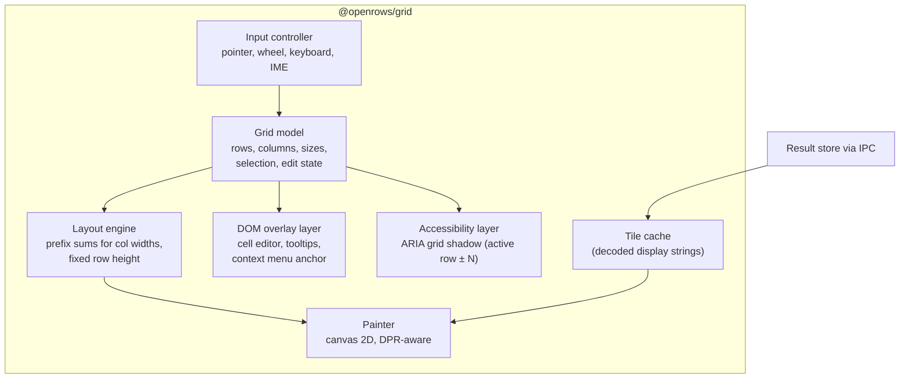
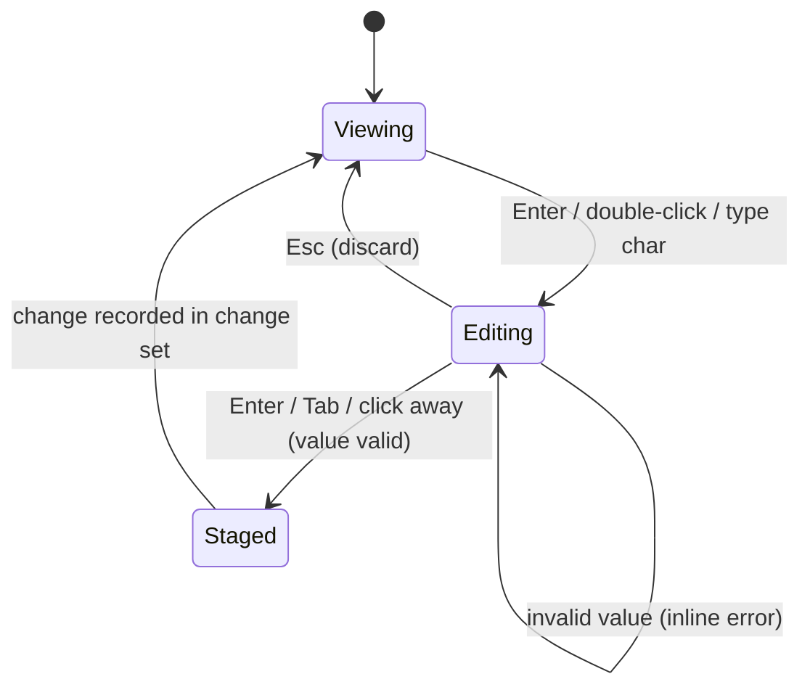

# 08 — Data Grid

The grid is where users spend most of their time. It must feel instant with ten rows and with ten million.

## 1. Requirements recap

- 60 fps (or display rate) scrolling at 1 M+ rows and 100+ columns (NFR-PERF-04).
- Rich cells: NULL markers, booleans, numbers, dates, JSON preview, binary size, truncated long text, edited/inserted/deleted state, conflict state.
- Excel-like selection and keyboard navigation; copy in many formats.
- Inline editing with type-specific editors.
- Accessible to screen readers and keyboard-only users.

## 2. Rendering approach

DOM-based virtualised grids cost one or more DOM nodes per visible cell. With 60 rows × 30 columns, every scroll frame touches ~1 800 nodes, and style recalculation dominates — especially in WebKit-based webviews (WKWebView, WebKitGTK). We therefore render the cell area to **canvas** and use DOM only for overlays.



### 2.1 Canvas layers

| Layer | Content | Repaint trigger |
| --- | --- | --- |
| Header canvas | Column headers, sort/filter indicators, resize handles | Column change, hover |
| Body canvas | Cells (only visible region + 1 row/col margin) | Scroll, data arrival, edit state |
| Selection canvas | Selection rectangles, active cell border, drag fill handle | Selection change |
| Pinned columns | Separate canvas for frozen left columns and row-number gutter | Scroll Y only |

Splitting layers keeps selection changes (frequent) from repainting all text (expensive).

### 2.2 Paint loop

1. Wheel/scroll events update a target offset; one `requestAnimationFrame` per frame paints.
2. Compute visible row range (fixed row height → O(1)) and column range (binary search over prefix sums → O(log n)).
3. For each visible cell: look up tile; if missing, draw a skeleton shimmer and request the tile (deduplicated).
4. Text drawing uses cached glyph-width measurements per font to truncate with ellipsis without calling `measureText` per cell per frame.
5. Device pixel ratio handled by scaling the backing store; integer-snapped coordinates to keep text crisp.

**Accepted design: Option A, our own Canvas 2D painter**, recorded in
[ADR-0004](adr/0004-canvas-data-grid.md). The app sees the adapter API below;
renderer internals own the layers, edit-state visuals, pinned columns,
multi-range selection and ARIA shadow grid. No external grid renderer is shipped.

## 3. Grid API (adapter boundary)

The M0-S2 spike exposes the following minimal public boundary in `packages/grid/src/index.ts`.
The painter is a deferred entry point (`@openrows/grid/canvas`), exporting `mountGrid(host, props): GridHandle`.

```ts
interface GridDataSource {
  readonly rows: number;
  readonly columns: readonly GridColumn[]; // id, title, width, pinned (leading prefix)
  readonly metrics: { requested: number; hits: number };
  cell(row: number, column: number): DisplayCell | undefined; // synchronous; no I/O
  window(range: CellRange, direction: number): Promise<void>;
  subscribe(listener: () => void): () => void;
}
interface GridProps {
  source: GridDataSource;
  selection: SelectionModel; // focused row/column + inclusive, zero-based ranges
  theme: GridTheme; // gridTheme("light" | "dark") resolves @openrows/ui tokens
  onSelection(selection: SelectionModel): void;
  onError(error: unknown): void;
}
interface GridHandle {
  readonly viewport: { x: number; y: number; width: number; height: number };
  readonly metrics: { milliseconds: number; placeholders: number; paints: number };
  scrollTo(x: number, y: number): void; // CSS pixels, native scroll container
  destroy(): void;
}
```

`TileSource(resultId, rows, columns, load)` reuses S1's `TileClient`, moved to
`@openrows/grid/tile-client`; the desktop re-export keeps S1 imports compatible.
`load` returns worker-decoded S1 typed tiles, not JSON rows. Tiles are 256×20,
clamped at the result edges, held in one deduplicating 64-entry LRU. Conversion
to display strings occurs once on arrival. Visible windows include pinned
columns and prefetch one vertical tile in `direction` (-1/0/+1) and one horizontal
tile in the observed column direction. Cache hits count requested windows already
resident, not every painted cell lookup. The spike repeats the twenty S1 columns
for the 100-column scenario; all windows still go through binary IPC and the worker.

Own canvas uses four layers, backing-store DPR scaling, snapped text origins,
a weak text measurement cache prepared on arrival, and persistent paint callbacks.
The painter allocates no JS arrays/objects/strings per cell or per frame. Tile
requests, conversion, and measurement run outside that hot loop. Headers repaint
on horizontal/data changes; pinned cells on vertical/data changes; selection
changes repaint the selection layer. NULL, changed cells and deleted rows use
the shared tokens. Inline editing is described in §6.1.
Since D-07 the query tab mounts this grid over real `result_window` tiles (see [06 §9](06-ipc-and-result-pipeline.md#9-implementation-notes-d-07-query-execution-and-results)); the cell text conversion handles the PostgreSQL Arrow types and marks only the `spike` result with sample edit states.

## 4. Selection model

- Ranges: list of rectangles `{ r0, r1, c0, c1 }` + active cell; supports cell, multi-range (⌘-click), full rows, full columns, all.
- Large selections are **logical**, not materialised: "copy 2 M rows × 5 columns" is sent to the core as a range spec and the core writes to the clipboard (with a size warning past 50 MB).
- Keyboard: arrows, ⇧+arrows, ⌘/Ctrl+arrows (jump to edge), Page Up/Down, Home/End, Tab/⇧Tab, Enter (edit), Esc, Space (toggle row selection in row mode), ⌘A.

## 5. Column behaviour

- Auto-size: measures header and first loaded tile (worker), clamps to [60 px, 480 px]; double-click resize handle to fit.
- Reorder by drag; hide/show via header menu; pin left; per-result column layout remembered for table tabs (keyed by table path).
- Type-aware alignment and formatting: numbers right-aligned with optional thousands separators; dates in user's chosen format; booleans as check glyphs; UUIDs monospace.

## 6. Editing in the grid



- The cell editor is a DOM element positioned over the cell (supports IME, spellcheck off, native undo).
- Type-specific editors: text (multi-line expands into popover), number (validated), boolean (toggle), enum (dropdown from schema), date/time (picker + free text), JSON (popover CodeMirror with validation), binary (load from file / set NULL).
- Context actions: Set NULL, Set DEFAULT, Set empty string, Revert cell, Revert row.
- Visual states: edited cell (accent fill), inserted row (green gutter), deleted row (strikethrough + red gutter), conflict (warning outline).
- Paste a TSV block → stages a multi-cell edit with preview.

All staging goes through the core's change-set API ([10-schema-and-data-editing.md](10-schema-and-data-editing.md)).

### 6.1 Implementation notes (inline editing and type-aware cells)

- **Cells.** `DisplayCell.marker` (`null` | `empty` | `default`) marks staged NULL, empty string and an unset insert column (`DEFAULT`); markers and unchanged `null`/`empty` cells paint muted (`tertiary`). `GridColumn.kind` (`boolean` | `enum`) paints booleans as centred `TRUE`/`FALSE` and draws a ⌃⌄ stepper at the right edge of both kinds; text is truncated with `…` to the width left of the stepper. Booleans come from the result type (`bool`); enums from `TableColumnDto.enumLabels` once edit info arrives (`EditedSource.describe` + `GridHandle.refresh()`, no remount). Staged cells keep the `cell-edited` fill plus a 1px `destructive` border with corner dots; staged inserts paint `row-inserted` after the page's rows with a `+` gutter.
- **Selection.** Like TablePlus, a selected row fills edge to edge with `accent` and `on-accent` text (pinned gutter included); whole-column selections (header click, ⌘Space) fill only their cells. The focused cell keeps a subtle inner ring. Painted on the selection layer for visible rows only, so the body is not repainted on selection changes.
- **Editing.** Enter, F2, double-click or a printable key (which seeds the value) calls `onEdit(cell, text?)`; Space, typing or a click on the stepper opens the value menu on boolean/enum columns. The app (`features/table/inline/`) places a DOM `<input>` exactly over `GridHandle.cellRect(row, column)` in the grid font, kept aligned through `onScroll`. Enter stages, Escape cancels (never stages), Tab/⇧Tab and ↑/↓ stage and move (`GridHandle.select`), ⌘⌫ stages NULL, blur stages. Values with newlines, JSON/text over 120 characters or wider than the cell open a 480 × 320 popover (monospace, wrapping; ⌘↩ saves; Pretty/Minify for JSON; Copy). Booleans offer TRUE/FALSE/NULL and enums their labels (+ NULL when nullable) in a `PointMenu`. The input shows the exact server value (`table_edit_row`), never the painted text, so an unchanged Enter stages nothing.
- **Accessibility.** The shadow grid owns a polite `role=status` region (`GridHandle.announce`): "Editing *column*", "*column* staged", "Edit cancelled", or why a cell is read-only. Focus returns to the grid after every commit or cancel.

## 7. Copy formats

| Format | Notes |
| --- | --- |
| TSV (default ⌘C) | Pastes cleanly into spreadsheets. |
| CSV | RFC 4180 quoting. |
| JSON (array of objects) | Types preserved where JSON allows; decimals as strings by default. |
| Markdown table | For tickets and docs. |
| HTML table | `<table>` with a header row, escaped values and right-aligned numbers; written to the clipboard as both `text/html` and its markup text, so spreadsheets and documents paste a table. The HTML write starts within the copy gesture and supplies promised contents while result windows load, preserving WebKit clipboard authorization. |
| SQL `INSERT` | Dialect-correct quoting and literals. |
| SQL `WHERE col IN (...)` | From one column selection. |
| Column names | Header row only. |

## 8. Accessibility

The S2 prototype exposes a shadow ARIA grid beside the canvas layers. It exposes one
focused logical cell with `aria-activedescendant`, a row index of model row + 2
(the header counts as row 1), column index + 1, and real row/column totals. Tile
arrival updates the announced header/value. Tab focuses the shadow grid; arrows
move its focused cell. Canvas clicks and arrow navigation update the same selection model.
No million-row DOM is created.

This is a hook prototype, not accessibility certification. Neighbouring rows,
selection live announcements, screen-reader testing and the complete keyboard
model remain future work; test VoiceOver before production accessibility sign-off.

## 9. Performance budget per frame (16.6 ms at 60 Hz)

| Step | Budget |
| --- | --- |
| Input handling and range computation | ≤ 0.5 ms |
| Body paint (≈ 60 × 20 cells) | ≤ 6 ms |
| Overlay/selection paint | ≤ 1 ms |
| Tile requests (async, off frame) | — |
| Headroom for GC, compositor | ≥ 8 ms |

Measured with `just bench-grid [repeats=3]` in the release app's
`OPENROWS_SPIKE=grid` mode in **WKWebView**, after the native show-window handshake.
The maintainer's three M4/60 Hz release runs establish the S2 decision:
complete mean paint 0.5–1.9 ms/frame (≤6 ms body budget), zero painter allocations
and zero blank-placeholder frames. [ADR-0004](adr/0004-canvas-data-grid.md) retains
all supplied comparison numbers and the environmental-stall analysis.

Every repeat starts with fresh app, scroll and cache state. All sampled rAF
intervals and attribution are retained. Gate on the best repeat per scenario
with zero frames >32 ms, plus zero frames >32 ms with ≥16 ms tracked main-thread
work in **every** repeat. See [docs/13 §4](13-performance.md#4-benchmark-suite).
`performance.now()` times the complete layered paint, excluding compositor/GPU
time; mean paint includes zero-repaint frames. The measured page clock resolution
is reported (commonly 1 ms); thresholds have no rounding allowance. React commit
instrumentation is retained for attribution and fails on changed signatures.

## 10. Implementation notes (D-08: PostgreSQL table view)

Opening a table, view, materialized view or foreign table (tree double-click/Enter or ⌘P) opens a **table tab** (`kind: 'table'`, one per relation, refocused when already open; title = name) instead of a `SELECT … LIMIT 1000` query tab. Routines and sequences still open query tabs. The hook is `openTableView(tabs, scope, object)` in `apps/desktop/src/features/table/open.ts`; the workspace controller's `openObject` calls it first.

| Area | What exists |
| --- | --- |
| SQL generation | `openrows_sql::select` (pure, unit-tested): `page_sql(query, known_columns, limit, offset)` and `count_sql`. Identifiers are double-quoted (`"` doubled, NUL refused) and every projected, filtered or sorted column must be one of the relation's **catalog columns** (read on the metadata session) — anything else is `UnknownColumn`. User values are **never** in the SQL text: they become `$n` bind parameters in text format. Operators: `= <> < > <= >=`, contains / not contains / starts with / ends with (`col::text ILIKE $n`, with `\`, `%`, `_` escaped so they match literally), `IN` (comma list, each item trimmed and bound; empty list refused), `IS NULL` / `IS NOT NULL` (no parameter), `BETWEEN $n AND $m`. Filters are parenthesised and joined with AND or OR. `LIMIT`/`OFFSET` are Rust-formatted integers (page ≤ 5 000). The app re-classifies every generated statement and refuses anything that is not a plain `Read`. |
| Bind parameters | `Session::execute_bound(sql, params, sink)` (default: only empty params). `PgSession` binds text-format values, so the server applies the inferred type's input function (`id = $1` with `'42'` works; `'abc'` fails with the server's error). Parameter count mismatches fail at `Describe`; editor SQL with `$1` still reports `unsupported: bind parameters`. `SessionManager::execute_bound` and `script::run_bound` carry them through the actor. |
| Commands | `table_structure(target)` (columns, indexes, `rowEstimate`), `table_sql(query, offset, limit)` (preview: SQL + params), `table_page(request, onEvent)` (streams `QueryEventDto` into the result store like `query_execute`; no history entry) and `table_count(request)` (exact `count(*)` with the same filters; `CountReply::counted \| cancelled`). Pages and counts run on the opened database's own user session (UX-B), which must belong to the target's connection **and** database (owners map); both cancel through `query_cancel` (page `queryId`, count `ticket`). |
| UI | `features/table/`: canvas grid over the page's result tiles (rows never enter React state); server-side pagination (300 rows) with ‹ › and ⌘[ / ⌘]; footer `1–300 of ~1,811 rows` (planner estimate when unfiltered) plus an explicit, cancellable **Count**; header click sorts server-side (asc → desc → none, `▲`/`▼` in the header); Data \| Structure \| Indexes; `+ Row` disabled ("Editing arrives in D-09"); Filters bar (⌘F) with [enabled] [column] [operator] [value] [Apply] [−] [+], Return / Apply All, AND/OR, Clear and an SQL preview; Columns panel (hidden columns are left out of the SELECT). Selecting a row shows its fields in the inspector's Details with "Search for field…". NULL and empty strings paint as dimmed `NULL` / `EMPTY` markers. State per tab survives tab switches (`useTableViews`). |
| Known gaps | Page size, column widths/order/pins and filter state are not persisted (FR-GRID-12); single-column sort; no raw-SQL or any-column filters, quick filters or per-type operator hints; Count runs on the database's user session (it queues behind a running page); tables in the tree do not expand to columns yet; editing is D-09. |

## 11. Implementation notes (M2-19: grid parity)

M2-19 closes most of the D-08 gaps above (FR-GRID-07, 09..14, FR-DATA-04, 06, 08).

| Area | What exists |
| --- | --- |
| Filter builder | Filter rows grouped with independent AND/OR joins (FU-03), with operators by column type (`filterOperators.ts`): booleans get equality only; numbers and dates add ranges and `between`; text adds contains/starts/ends, LIKE and regex (no regex on SQLite). Values stay bind parameters through `openrows_sql::select`. |
| Raw SQL filter | A **Raw SQL** row (`FilterOp::Raw`) is checked in `openrows_sql::select::raw`: no comments, no `;`, no bind parameters, balanced parentheses and closed strings (`InvalidPredicate` otherwise). The whole SELECT then passes the usual read-only classification. A live preview shows the generated WHERE or the error. |
| Saved state | Per table (`presentationStore.ts` over `results/keyedStore.ts`): hidden columns, sort, filters and named saved filters are restored across sessions, next to the widths, order and pins already kept. Version-two filters migrate flat saved state to one group (FU-03); the stored column layout format is unchanged. |
| Copy options | Settings ▸ Tables ▸ Copy (`copy` in `settings.json`): headers (`format`/`always`/`never`), NULL as text or empty, minimal or full quoting, quote character, CSV delimiter (comma, semicolon, tab, pipe), LF/CRLF line endings and a point or comma decimal separator for numeric columns (M2-19b). **Copy with Headers** (⌥⇧⌘C) is a command. |
| Bulk inspector | With several rows selected, each field shows the shared value or "Multiple values". An edit there is staged in every selected row through the normal change set and review. The comparison reads at most 1,000 rows. |
| Foreign keys | Key cells draw an arrow (grid `link` columns, `onLink`). Clicking it, or **Open Referenced Row** in the row menu, opens the referenced row in a filtered table tab; composite keys work. **Referenced By** lists the tables pointing at the row. Outgoing keys use schema-qualified table detail (FU-03); same-schema incoming keys use bounded ER metadata. Both are cached for 60 s, including session identity. |
| Row form | **Form** in the footer (⌥⌘F) shows the focused row field by field, with previous/next within the page. Edits go through the change set. |
| Footer statistics | For a cell selection: count, sum, average, minimum and maximum on numbers; count and distinct otherwise. |
| Discard and reload | With staged edits, Discard and Reload (⌘R) ask for confirmation. Reload returns to the same scroll position and selected cell. |
| Search, quick filters, settings | See "Implemented (M2-19b)" below. |
| Known gaps | Incoming Referenced By discovery remains within the current schema; the form view moves only within the current page. |

### Implemented (M2-19b): search, quick filters, table settings, copy options and date pickers

- **Any-column search.** Table tabs have one compact **Search** field in the footer. After a 400 ms pause (Return at once, Escape clears) it matches every catalog column, including hidden columns. The server binds case-insensitive substring values and ANDs the search with the existing filter expression, preserving every AND/OR group. Search and table-specific striping are restored across sessions. Clear in the filter bar also clears search. Query results keep their client-side **Filter rows** field over loaded rows.
- **Header quick filters.** Right-clicking a column header offers **Filter column…**, which opens a one-row popover under the header with an operator, a value and **Filter** (Return applies, Escape closes). Table tabs offer the filter bar's typed operators with at most one value, `contains` first for text. The filter is applied through the normal quick-filter path, and the filter bar opens to show it. Query results filter loaded rows client-side with `contains`, `=`, `≠`, IS NULL and IS NOT NULL. These filters AND with the search text, and a **Clear column filters (n)** button appears only while one is active. Nothing is drawn permanently in the headers.
- **Table settings.** Settings ▸ Tables (`tables` in `settings.json`, `tableSettings.ts`) sets alternate row backgrounds for table and result grids (a table's display menu still toggles its own), scrollbars that fade until hovered or stay visible (`data-grid-scrollbars` on the root and `data-grid-scroll` on the grid scroller), and the row count. With **Estimated**, the planner's `~` count shows and **Count** runs on request. With **Exact**, the app also counts once per filter set, and again after an explicit reload. Both are cancellable through **Counting… Cancel**. Replacing a count cancels its previous ticket and ignores late replies; closing a table or workspace cancels its outstanding counts.
- **Copy ambiguity.** A comma decimal separator with the comma CSV delimiter is rejected in Settings with a message and is never saved. A hand-edited `settings.json` with that combination makes copies fail with the same message.
- **Date and time picker (FR-DATA-06).** `date`, `time`/`timetz`, `timestamp`/`timestamptz`, `datetime`, `datetime2`, `smalldatetime` and `datetimeoffset` columns show a calendar button. It appears at the end of the in-cell editor, in the row form/inspector value box and in the edit sheet. The button (or Alt+↓ in the inline editor) opens the system picker (`<input type=date|time|datetime-local>` with `showPicker`). The picked value is written as `YYYY-MM-DD HH:MM:SS` and keeps the previous zone offset (`inline/temporal.ts`). Unchanged selections retain the exact value; changing only the date retains sub-millisecond precision. Typed entry keeps full precision.

### Implemented (FU-03): grouped filters and cross-schema references

The builder supports one level of groups: independent AND/OR joins inside each group and an outer AND/OR join. Enabled typed rows share bind numbering across groups; raw rows keep the existing predicate validation. Empty groups do not add a predicate. Quick filters preserve applied groups without applying unrelated draft edits. Version-two presentations and saved filters migrate older flat rows into one group with their original join.

Outgoing foreign keys now come from table-detail constraints, retaining the referenced schema and composite column order. An `a.orders → b.customers` arrow opens `b.customers` with bound equality filters; destination menus show the schema when it differs. Metadata is cached for 60 seconds by profile, database, schema, table, session and engine, with failed reads evicted and catalog changes invalidating the profile. Same-schema incoming links still use bounded ER metadata. Cross-database references are outside this task, including MySQL/MariaDB keys into another database.

SQL unit tests cover PostgreSQL, MySQL, SQLite/libSQL, SQL Server and ClickHouse. PostgreSQL integration tests verify grouped row counts and cross-schema metadata/destination queries; component tests verify the arrow click and schema-qualified table opening.
