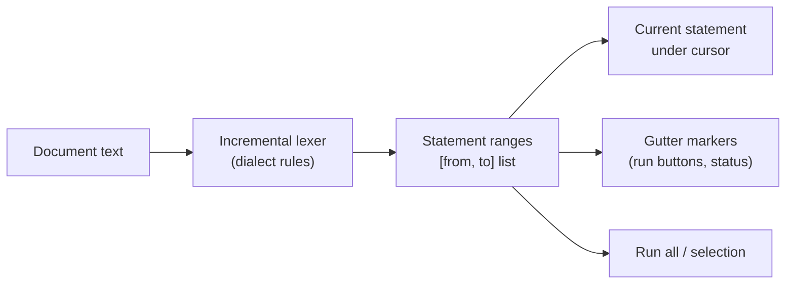
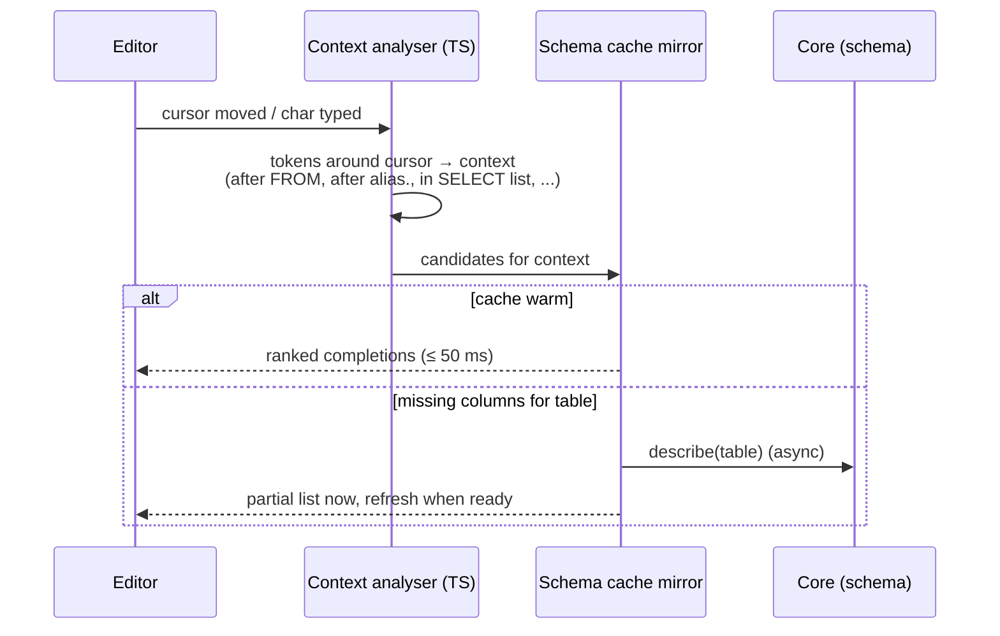
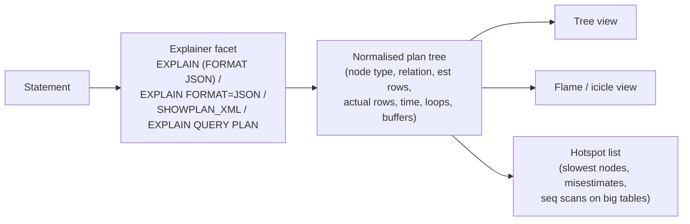

# 09 — Query Editor

## 1. Editor foundation

CodeMirror 6 (`@openrows/editor`) configured with:

- Language packages: `@codemirror/lang-sql` with per-dialect configuration (PostgreSQL, MySQL, SQLite, MSSQL, PL/SQL, ClickHouse, DuckDB, CQL), custom Lezer grammars for MQL (MongoDB shell subset) and Redis commands, JSON for Elasticsearch DSL.
- Extensions: search/replace, multiple cursors, bracket matching, code folding, rectangular selection, linting gutter, optional Vim mode (`@replit/codemirror-vim`), optional Emacs keys.
- Large document mode: past 2 MB, disable expensive decorations (semantic highlighting, inline diagnostics) and keep syntax highlighting viewport-only (CodeMirror's default).

Why not Monaco: Monaco's bundle and memory are several times larger, it assumes a VS Code-like environment, and CodeMirror 6 handles very large documents and IME input more gracefully in WebKit webviews. (ADR-0003.)

## 2. Statement awareness

- The lexer runs in the editor (TypeScript port of the core's splitter rules, shared test vectors with Rust to guarantee identical results) and updates statement ranges incrementally on edit.
- "Run current statement" (⌘↵) executes the range under the cursor; the range is briefly highlighted so the user sees exactly what ran.
- Gutter shows per-statement status after execution: ✓ duration, ✗ error, ● running.
- Errors with positions draw a squiggle at the mapped offset; hover shows message + hint.

## 3. Autocomplete

Context analysis (no full parse required, robust to incomplete SQL):

| Context | Suggestions |
| --- | --- |
| Statement start | Keywords (`SELECT`, `WITH`, `INSERT`…), snippets |
| After `FROM` / `JOIN` / `UPDATE` / `INTO` | Schemas, tables, views, CTE names, table functions |
| After `JOIN … ON` | Join conditions inferred from foreign keys (whole `ON` clause as one suggestion) |
| `alias.` | Columns of the aliased table/CTE/subquery |
| `SELECT` list / `WHERE` | Columns of tables in scope (resolving aliases from the FROM clause even when written later), functions, keywords |
| Function call | Signature help with parameter types |
| `INSERT INTO t (` | Column list of `t` |

Ranking: exact prefix > fuzzy; in-scope tables' columns > others; recently used objects boosted (per-connection usage stats in local store); casing follows user preference (preserve / upper keywords / lower).

The schema mirror for autocomplete is the same `search_index` data used for fuzzy search, so no extra introspection round trips are needed for names.

## 4. Formatting

- SQL formatting done in Rust (`openrows-sql::format`) so the CLI and app agree; options: keyword case, indent width, comma position, line width, dialect.
- Candidate implementation: adapt `sqlformat` crate (MIT/Apache) and extend for dialect quirks, or a custom pretty-printer over the tokenizer. Formatting must be **lossless** for comments and must never change semantics — tested by re-tokenizing and comparing token streams ignoring whitespace.

## 5. Parameters

- Detected placeholders: `:name`, `@name` (SQL Server), `$1`, `?`.
- Running a statement with placeholders opens an inline parameter bar with typed inputs (type inferred from usage when possible) and remembers last values per query file.
- Values are always bound as real parameters, never string-interpolated.

## 6. Explain and plan visualiser

- Drivers convert native plan output into a normalised `PlanNode` tree; the original text/JSON is always available in a raw tab.
- `EXPLAIN ANALYZE` executes the statement; for write statements the app wraps it in a transaction and rolls back, and warns that side effects such as sequences still advance.

## 7. Files and snippets

- Query tabs can be **scratch** (stored in app data) or **file-backed** (`.sql` in a workspace folder). File-backed tabs save with ⌘S and detect external changes (file watcher) with a reload prompt.
- A tab remembers its connection via a header comment the user can opt into (`-- openrows: connection=analytics-prod`) or via workspace metadata, so shared `.sql` files open on the right connection for each teammate's local profile name.
- Snippets: user-defined templates with tab stops, scoped per dialect, stored in `snippets/*.json` in the workspace or user settings.

## 8. Native query languages

| Language | Approach |
| --- | --- |
| MQL (MongoDB) | Parser for a safe subset of mongosh syntax: `db.<coll>.<method>(args)` chains for `find`, `aggregate`, `count`, `distinct`, `insert*`, `update*`, `delete*`, `createIndex`, plus `db.runCommand`. Arguments parsed as relaxed EJSON / JS object literals. **No arbitrary JavaScript execution.** Translated to driver commands. |
| Redis | Tokenizer with quoting rules matching `redis-cli`; command table (arity, flags read/write) drives autocomplete and safe-mode classification. |
| CQL | Lexer/grammar for highlighting, statements executed as-is. |
| PartiQL (DynamoDB) | Highlighting + executed via `ExecuteStatement`. |
| Elasticsearch | Kibana-console-like format: `GET /index/_search` line + JSON body; JSON schema-based completion for common query DSL. |
