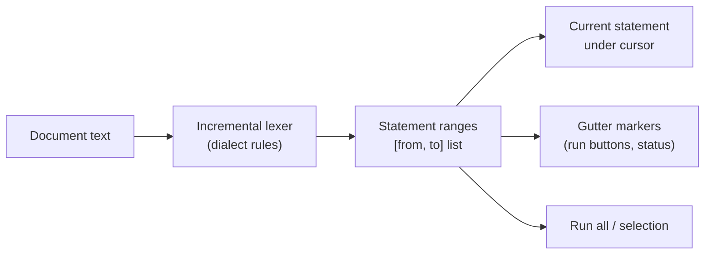
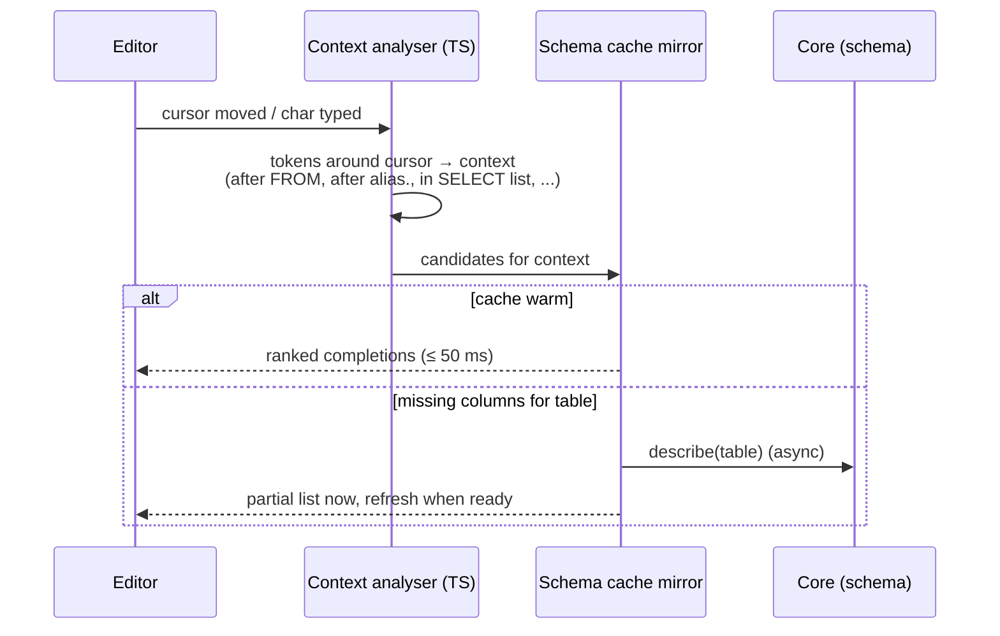
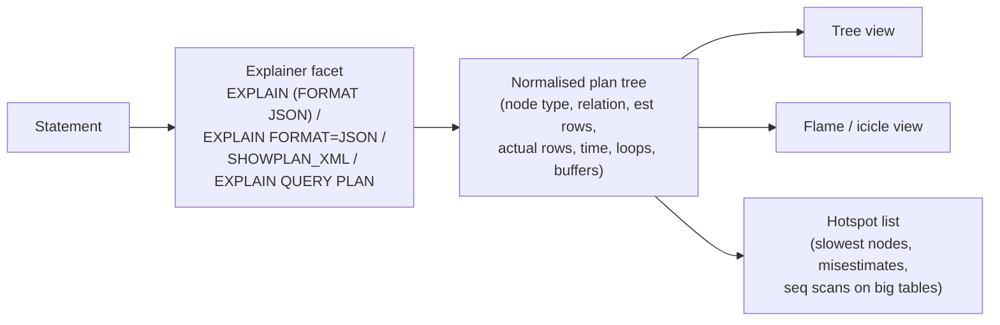

# 09 — Query Editor

## 1. Editor foundation

CodeMirror 6 (`@openrows/editor`) configured with:

- Language packages: `@codemirror/lang-sql` with per-dialect configuration (PostgreSQL, MySQL, SQLite, MSSQL, PL/SQL, ClickHouse, DuckDB, CQL), custom Lezer grammars for MQL (MongoDB shell subset) and Redis commands, JSON for Elasticsearch DSL.
- Extensions: search/replace, multiple cursors, bracket matching, code folding, rectangular selection, linting gutter, optional Vim mode (`@replit/codemirror-vim`), optional Emacs keys.
- Large document mode: past 2 MB, disable expensive decorations (semantic highlighting, inline diagnostics) and keep syntax highlighting viewport-only (CodeMirror's default).

Why not Monaco: Monaco's bundle and memory are several times larger, it assumes a VS Code-like environment, and CodeMirror 6 handles very large documents and IME input more gracefully in WebKit webviews. (ADR-0003.)

### 1.1 Current implementation (M0-S5)

`packages/editor` (`@openrows/editor`) is the S5 foundation, not yet the production editor (M1-21):

- `mountSqlEditor(parent, { doc, label, keyMode?, onDocChange? })` (`label` is the accessible name) mounts CodeMirror 6 with the PostgreSQL dialect of `@codemirror/lang-sql`, dialect keyword completion (`autocompletion()`), line numbers, active line, history, bracket matching and the default/completion/history keymaps. `parseFully(view, budgetMs)` forces a complete parse (used before measuring).
- Syntax colours use `@openrows/ui` CSS custom properties (`--or-accent`, `--or-success-fg`, …) so theme switching needs no editor reconfiguration. Dedicated syntax tokens with contrast checks are later work.
- Vim mode is a separate entry, `@openrows/editor/vim` (`vimMode()`, `vimModeOf(view)`), passed as `keyMode` so it precedes every other keymap. It loads as its own lazy chunk; non-Vim users never download it.
- The package and all `@codemirror/*`, `@lezer/*` and `@replit/codemirror-vim` modules are denied in the initial JS graph by `just bench-ui`; today only the `OPENROWS_SPIKE=editor` benchmark and the component gallery's **SQL editor** specimen (with a Vim switch, used for the manual IME check) load them.
- Other dialects, statement awareness, schema completion, search/replace, folding and Emacs keys arrive with M1-21. IME is verified manually (see [13 §4, M0 S5](13-performance.md#m0-s5-editor-keystroke-measurement)).

## 2. Statement awareness

- The lexer runs in the editor (TypeScript port of the core's splitter rules, shared test vectors with Rust to guarantee identical results) and updates statement ranges incrementally on edit.
- "Run current statement" (⌘↵) executes the range under the cursor; the range is briefly highlighted so the user sees exactly what ran.
- Gutter shows per-statement status after execution: ✓ duration, ✗ error, ● running.
- Errors with positions draw a squiggle at the mapped offset; hover shows message + hint.

### 2.1 Current implementation (D-02, slice of M1-15)

The Rust side lives in `crates/openrows-sql` (pure, no I/O); PostgreSQL rules only so far. The TypeScript port and incremental updates arrive with M1-21 and must reuse the Rust test tables as shared vectors.

- `split(text, Dialect::Postgres) -> Vec<Statement>`: never fails. `Statement.range` is a byte range into the original text from the first non-whitespace token (leading comments included) to the last non-whitespace token, excluding the `;`; `terminator` is the `;` offset, and `range_with_terminator()` is what the editor highlights. A `;` splits only outside `'…'` (with `''`), `E'…'` (with backslash escapes), `"…"`, `$$…$$`/`$tag$…$tag$`, `--` and nested `/* */` comments, parentheses and `BEGIN ATOMIC … END` bodies (same rules as `psql`). Unterminated constructs extend to the end of the text. Empty and comment-only statements are dropped; a comment on the same line after a `;` belongs to no statement.
- `statement_at(&statements, cursor) -> Option<usize>`: the statement containing the cursor; between statements (after `;`, blank lines, a trailing same-line comment) the closest **preceding** statement, so ⌘↵ right after typing `…;` runs it; before the first statement, the first one. A cursor exactly on a statement's first byte selects that statement.
- `placeholders(text, dialect)` returns `$n`, `:name` and `?` positions (see §5).

### 2.2 Current implementation (D-07, slices of M1-14, M1-19, M1-21)

- The workspace content area is a real query tab per connection (`apps/desktop/src/features/query/`). `@openrows/editor` loads lazily with the first tab; `mountSqlEditor` gained a `keys` option (application shortcuts ahead of the default keymaps), used for ⌘↵ (run current) and ⇧⌘↵ (run all). ⌘↵ with a non-empty selection runs exactly the selected text. The same chords work anywhere in the tab (toolbar, results).
- Statement awareness still runs in Rust: the editor sends the full text and the cursor (UTF-16 offset) and `query_execute` applies `split` / `statement_at` (§2.1), so there is no TypeScript port yet; range highlighting and gutter status are later work.
- Before execution every statement is classified and gated (read-only blocks writes, confirm-writes and dangerous statements open a confirmation sheet listing them); see [06 §9](06-ipc-and-result-pipeline.md#9-implementation-notes-d-07-query-execution-and-results).
- Editor text is kept per tab (saved from the editor at most every 300 ms and on unmount). With **Auto Save SQL Query Tab** on (the default) query tabs — text, bound file and last parameter values — are written to webview storage (`openrows.queryTabs`) 500 ms after the last change, so unsaved text survives a relaunch within about a second; turning it off forgets them. Table tabs are not restored. Moving this into the local store's `drafts`/`workspace_state` (§7, docs/15) is later work.

### 2.3 Editor bar (M1-21, slice after #51)

The bar between editor and results holds the settings menu, cursor position, row limit, **Beautify** and **Run** split buttons. Every setting persists in `openrows.editor` and is shared live by all tabs.

- **Settings**: font size, invisibles, wrapping, highlight, autocomplete, key binding, then **Auto Save SQL Query Tab** (§2.2; also writes file-bound tabs to their file), **Query Params** (Off, `:name`, plus `$1` on PostgreSQL, `?` on MySQL/MariaDB, `?1` and `?` on SQLite; §5), **Result View Mode** (one result tab per statement, or only the last result) and **Return on Error** (on: a multi-statement run stops at the first error; off: the remaining statements run and each error is listed; implemented by `openrows_core::script::Script::stop_on_error`).
- **Beautify ▸** Beautify/Uglify, indent width, indent with, keyword case, **Indent Type** (sql-formatter `indentStyle`: Standard, Tabular Left, Tabular Right), **Lines Between Queries** (1–3) and **Dense Operators**. The same options are in Settings ▸ Editor ▸ Formatter. Beautify and Uglify act on the selection, else the whole document.
- **Run ▸** Run All / Run Current (the menu shows which one ⌘↵ and ⇧⌘↵ trigger), **Default ▸** (what the Run button and ⌘↵ run; a selection always runs itself), **Save SQL As…** (⇧⌘S), **Open SQL File…** (⌘O) and **Add to Queries…**.
- **Files**: `sql_file_save_as` shows the native save panel and writes the tab's SQL; the tab is then bound to the file (title = file name, a `•` while unsaved) and ⌘S writes it with `sql_file_save` (absolute `.sql` paths only, atomic replace). `sql_file_open` picks a `.sql` file (UTF-8, at most 16 MiB) into a new tab bound to it. The webview gets no file-system permission; Rust shows the panels.
- **Saved queries**: Add to Queries asks for a name and stores it per connection in the local store (`saved_queries`, docs/15). The sidebar's **Queries** tab lists them (search filters by name); a click opens one in a new tab, right-click offers Rename… and Delete….
- To open a tab from elsewhere (schema tree, history, assistant), call `QueryTabs.open(connectionId, { sql?, title?, objectPath? })` from `useQueryTabs()`; the workspace controller exposes it as `addQuery(sql?)` and `openObject(object)`, which refocuses an open tab for the same object.

### 2.4 Editor parity (M2-18)

- **Split panes** (FR-EDIT-11): View ▸ Split Editor Right (⌘\\) or Down (⇧⌘\\) keeps the active tab in the first pane and opens a new query tab beside it; the second pane follows the active tab. Each pane keeps its own tab, connection scope, editor and results. Choosing a tab in the tab strip fills the focused pane; Focus Other Pane (⌥⌘\\) moves keyboard focus; the divider resizes by pointer or arrow keys (20–80 %); Close Split (or the pane's ×) returns to one pane. Menu, palette and shortcut tab commands act on the focused pane.
- **Editing** (FR-EDIT-12): ⌥-click (or ⌘-click) adds a caret, ⌥-drag selects a column, ⌘D selects the next occurrence and ⇧⌘L every occurrence; Escape returns to one caret. Statements, block comments and multi-line bracketed blocks fold from the gutter (⌥⌘[ / ⌥⌘]). A minimap is not included: CodeMirror has no built-in one and the add-on is not worth its bundle cost yet.
- **Display** (Settings ▸ Editor, `editor` in settings.json): line numbers, folding, font size and family, invisibles, wrapping and the current-statement highlight.
- **Completion** (FR-EDIT-13): auto-trigger on/off (⌃Space always works and highlighting is unaffected), delay, keyword case, and whether schemas, tables/views, columns and snippets are suggested.
- **Execution** (FR-EDIT-15, Settings ▸ Execution, `execution` in settings.json): what ⌘↵ runs without a selection (`editor.runDefault`), whether a selection runs itself (`runSelection`), an automatic `LIMIT n` for `SELECT`s without one (`autoLimit`; `openrows_sql::limit_select` appends it after the last token for PostgreSQL, MySQL/MariaDB and SQLite and leaves statements with a top-level `LIMIT`, `OFFSET`, `FETCH`, `INTO`, `FOR`, `LOCK` or `PROCEDURE`, non-`SELECT`s and writing CTEs alone; **Run ▸ Run Without Limit**, ⌥⌘↵, skips it once), confirmation before multi-statement runs (`confirmMultiple`, the core replies `confirmationRequired` once per exact run), Return on Error, and whether server notices are listed (`showNotices`).
- **Messages**: the panel above the results lists errors and server notices of the shown result (with several results, those of its statement plus those of statements without a result), labelled by statement and filtered by level (All, Errors, Warnings, Info).

## 3. Autocomplete

Context analysis (no full parse required, robust to incomplete SQL):

| Context | Suggestions |
| --- | --- |
| Statement start | Keywords (`SELECT`, `WITH`, `INSERT`…), snippets |
| After `FROM` / `JOIN` / `UPDATE` / `INTO` | Schemas, tables, views, CTE names, table functions |
| After `JOIN … ON` | Join conditions inferred from foreign keys (whole `ON` clause as one suggestion) |
| `alias.` | Columns of the aliased table/CTE/subquery |
| `SELECT` list / `WHERE` | Columns of tables in scope (resolving aliases from the FROM clause even when written later), functions, keywords |
| Function call | Signature help with parameter types |
| `INSERT INTO t (` | Column list of `t` |

Ranking: exact prefix > fuzzy; in-scope tables' columns > others; recently used objects boosted (per-connection usage stats in local store); casing follows user preference (preserve / upper keywords / lower).

The schema mirror for autocomplete is the same `search_index` data used for fuzzy search, so no extra introspection round trips are needed for names.

## 4. Formatting

- SQL formatting done in Rust (`openrows-sql::format`) so the CLI and app agree; options: keyword case, indent width, comma position, line width, dialect.
- Implemented (M2-16): `sql-formatter` in the webview, loaded on first use, per dialect (PostgreSQL, MySQL/MariaDB, SQLite), with the options of §2. Placeholders (`:name`, `$1`, `?`, SQLite `?1`/`@name`/`$name`) are declared as parameter tokens so formatting keeps them intact; comments are kept. Uglify collapses to one line and turns `--` comments into block comments. A Rust formatter shared with the CLI remains later work.
- Candidate implementation: adapt `sqlformat` crate (MIT/Apache) and extend for dialect quirks, or a custom pretty-printer over the tokenizer. Formatting must be **lossless** for comments and must never change semantics — tested by re-tokenizing and comparing token streams ignoring whitespace.

## 5. Parameters

- Detected placeholders: `:name`, `@name` (SQL Server), `$1`, `?`.
- Running a statement with placeholders opens an inline parameter bar with typed inputs (type inferred from usage when possible) and remembers last values per query file.
- Values are always bound as real parameters, never string-interpolated.
- Implemented binding (M1-21): with Settings ▸ Query Params on, `query_execute` finds the chosen style's placeholders with `openrows_sql::ParamBinder` and, while values are missing, replies `parametersRequired` with the distinct names (`:id`, `$1`, or `?1`, `?2`, … numbered across the run). A sheet asks for them, prefilled with the tab's last values; the resend rewrites each occurrence into the engine's bind placeholder (`$n`, `?`, `?n`) and passes the values as text parameters through `Session::execute_bound`, so values are never spliced into SQL. Since M2-16 the sheet is replaced by an inline, collapsible **parameters bar** between the editor bar and the results: it lists the placeholders of the chosen style found in the tab's SQL (`@openrows/editor/params`, mirroring the core's rules) and every name the core asked for, each with a type (Text, Number, NULL) and a value. Values are kept on the query tab (`QueryTab.params`, persisted with the tab) and every run sends them; NULL binds SQL NULL (`ParamValueDto.value: null`). When values are missing the core still replies `parametersRequired`; the bar then expands, focuses the empty field and its Run resends the waiting request. Anonymous `?` are numbered across the document in the bar and renumbered for runs that start after some of them.
- Implemented detection (`openrows_sql::placeholders`, PostgreSQL rules): `$n`, `:name` and `?` outside strings, quoted identifiers, dollar quotes and comments, returned with byte ranges including the sigil. Excluded: `::type` casts, `:=`, array slices `a[lo:hi]`, psql variables `:'v'`/`:"v"`, and the `jsonb` operators `?|`/`?&`. A bare `?` is also the PostgreSQL `jsonb` key-exists operator, so the UI should ignore `Anonymous` placeholders for PostgreSQL connections. `@name` (SQL Server) arrives with that dialect.

## 6. Explain and plan visualiser

- Drivers convert native plan output into a normalised `PlanNode` tree; the original text/JSON is always available in a raw tab.
- `EXPLAIN ANALYZE` executes the statement; for write statements the app wraps it in a transaction and rolls back, and warns that side effects such as sequences still advance.

## 7. Files and snippets

- Implemented (M2-17): projects of `.sql` files with `.openrows/project.yaml`, their folder tree in the sidebar and the folder and query actions; see [15 §5.1](15-storage-and-persistence.md#51-current-implementation-m2-17).
- Query tabs can be **scratch** (stored in app data) or **file-backed** (`.sql` in a Project folder). File-backed tabs save with ⌘S and detect external changes (file watcher) with a reload prompt.
- A tab remembers its connection via a header comment the user can opt into (`-- openrows: connection=analytics-prod`) or via Project metadata, so shared `.sql` files open on the right connection for each teammate's local profile name.
- Snippets: user-defined templates with tab stops, scoped per dialect, stored in `snippets/*.json` in the Project or user settings.
- Implemented (M2-16): snippets live in `settings.json` under `snippets` (`items`: name, prefix, body, scope; `disabledBuiltins`). Typing a prefix offers matching snippets in completion; **Insert Snippet…** (palette and Query menu) picks one by name. Bodies use CodeMirror templates (`${1:name}` tab stops, Tab/Shift-Tab between them). Settings ▸ Snippets adds, edits, deletes, imports and exports (JSON) user snippets and turns built-ins (common CRUD plus per-engine create table, upsert, explain and activity snippets) on or off. Project-folder snippet files remain later work.

## 8. Native query languages

| Language | Approach |
| --- | --- |
| MQL (MongoDB) | Parser for a safe subset of mongosh syntax: `db.<coll>.<method>(args)` chains for `find`, `aggregate`, `count`, `distinct`, `insert*`, `update*`, `delete*`, `createIndex`, plus `db.runCommand`. Arguments parsed as relaxed EJSON / JS object literals. **No arbitrary JavaScript execution.** Translated to driver commands. |
| Redis | Tokenizer with quoting rules matching `redis-cli`; command table (arity, flags read/write) drives autocomplete and safe-mode classification. |
| CQL | Lexer/grammar for highlighting, statements executed as-is. |
| PartiQL (DynamoDB) | Highlighting + executed via `ExecuteStatement`. |
| Elasticsearch | Kibana-console-like format: `GET /index/_search` line + JSON body; JSON schema-based completion for common query DSL. |
