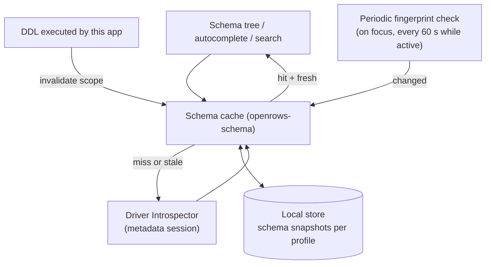
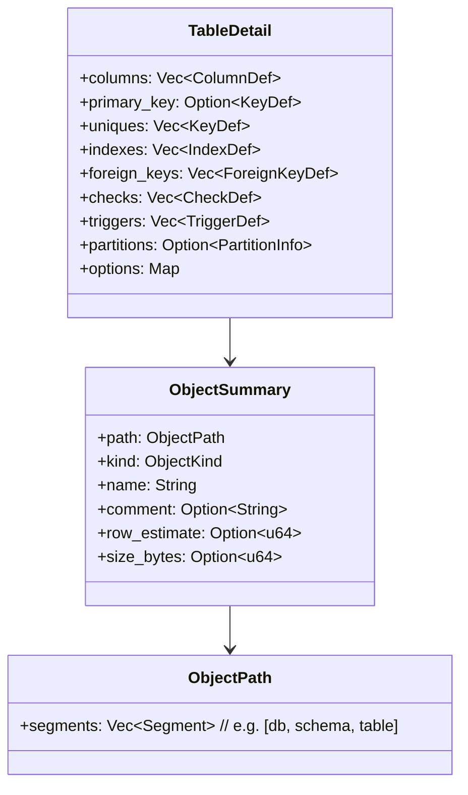
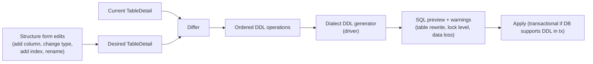

# 10 — Schema and Data Editing

## 1. Schema cache



- **Lazy:** each tree level loaded on expand; nothing pre-walks the whole database except the bounded `search_index` (names only).
- **Persistent:** snapshots stored in the local store keyed by profile + database + server version so the tree renders instantly on reconnect (marked "refreshing" until validated).
- **Invalidation:**
  - DDL statements run from the app invalidate the affected objects (from statement classification) — immediate.
  - Fingerprint check detects external changes cheaply; on change, refetch only the scopes that are expanded or recently used.
  - Manual refresh (⌘R on a node) always works.
- **Isolation:** introspection uses the dedicated metadata session so it never queues behind a user query.
- **Large catalogs:** pagination for lists > 5 000 children with "show more" and filter-as-you-type pushed down to the database (`LIKE`/`ILIKE`).

## 2. Object model



`ObjectKind` covers: Database, Schema, Table, View, MaterializedView, ForeignTable, Column, Index, Constraint, Trigger, Function, Procedure, Sequence, Type/Enum, Extension, Role, Collection (Mongo), KeyPattern (Redis), Keyspace (Cassandra), Index (Elasticsearch). Drivers list the kinds they support.

### 2.1 Implementation notes (D-06: PostgreSQL schema tree)

D-06 implements the listing slice of §1–§2 for PostgreSQL. There is no `openrows-schema` crate, no persistent snapshot, no fingerprint check and no pagination yet; the webview caches each read until **Refresh**.

| Area | What exists |
| --- | --- |
| Object model | `openrows_driver_api::catalog`: `ObjectKind` (`Table`, `View`, `MaterializedView`, `ForeignTable`, `Function`, `Procedure`, `Sequence`), `DatabaseSummary` and `SchemaSummary` (`name`, `system`, `comment`), and `ObjectSummary` (`schema`, `name`, `kind`, routine `arguments`, `row_estimate`, `comment`). The path is `[database, schema, name]`; routine overloads differ by `arguments`. |
| Introspector | `PgSession::list_databases`, `list_schemas`, `list_objects(schema, kinds)` and `search_index` in `crates/openrows-driver-postgres/src/introspect/`, with the SQL in `introspect/sql/*.sql` (docs/05 §5). Each listing is one simple query. The schema name and kinds are quoted literals (libpq `PQescapeLiteral` rules) until the driver has bind parameters. |
| What is listed | Databases: `NOT datistemplate AND datallowconn`; `postgres` and the RDS, Azure and Cloud SQL maintenance databases are flagged `system`. Schemas: TOAST and temporary schemas are skipped; `pg_catalog` and `information_schema` are flagged `system`. Objects: tables (ordinary and partitioned), foreign tables, views, materialized views, sequences, functions (including window functions) and procedures. Partitions and extension-owned routines are skipped. Aggregates, triggers, indexes and types come later. |
| Row estimates | `pg_class.reltuples` for tables and materialized views, `None` when never analysed (`-1`). The UI prefixes them with `~` and calls them estimates. |
| Name index | `search_index` lists tables, views, sequences and routines in every non-system schema in one query, capped at 20 000 rows. Quick open (⌘P) uses it. |
| Metadata sessions | `connections/metadata.rs` in the app keeps one `PgSession` per (connection, database), opened lazily on the first catalog read with `application_name` `<name> metadata`. Reads for the same key run one at a time and never pass through the user session's actor. PostgreSQL cannot change database on a connection, so each opened database gets its own metadata session. A non-server error drops the session, and the next read reconnects. `session_close` closes a database's metadata session with its last user session and `connection_close` (on disconnect) closes all of a connection's metadata sessions (since UX-B, see docs/06 §8). |
| Commands | `catalog_databases`, `catalog_schemas`, `catalog_objects(kinds)`, `catalog_search` (all take `profileId` and `database`); `catalog_databases` reads through the connection's home database. DTOs: `DatabaseDto`, `SchemaDto`, `ObjectDto` (`rowEstimate` is a number) and `ObjectKindDto`. Errors use the D-05 `IpcError`. |
| Tests | Unit tests cover literal quoting, row mapping and malformed rows, DTO serialisation and target derivation. `just test-pg` creates a schema with a table, view, materialized view, sequence, function and procedure and checks every listing, the row estimate and the name index. |

### 2.2 Implementation notes (D-08: table structure)

`PgSession::table_structure(schema, name)` (and `table_columns`) read a relation's columns (`name`, formatted type, nullable, default or identity, comment) from `introspect/sql/columns.sql`, its indexes (`name`, key columns/expressions without INCLUDE columns, unique, primary, access method, partial predicate) from `indexes.sql` and the planner estimate from `estimate.sql`, on the metadata session (`table_structure` command). The model types are `ColumnSummary`, `IndexSummary` and `TableStructure` in `openrows_driver_api::catalog`. The Data tab uses them for columns and the row estimate, and table browsing validates every identifier against the listed columns (docs/08 §10). The Structure, Index, Triggers and DDL views read the fuller `table_detail` (§3.1).

## 3. Structure editing (DDL generation)

Structure edits follow the same **stage → preview → apply** model as data edits.



- Warnings are dialect-aware, e.g. PostgreSQL: changing a column type may rewrite the table and take `ACCESS EXCLUSIVE`; adding an index without `CONCURRENTLY` blocks writes (offer the concurrent variant). MySQL: note whether the change can use `ALGORITHM=INSTANT/INPLACE`.
- Destructive operations (drop column, narrowing type) require typing the object name to confirm on prod-tagged connections.
- DDL that cannot run in a transaction (MySQL DDL auto-commits, PG `CREATE INDEX CONCURRENTLY`) is labelled; the apply step runs statements one by one and reports progress precisely.

### 3.1 Implementation notes (PostgreSQL Structure, Index, Triggers and DDL)

| Area | What exists |
| --- | --- |
| Detail read | `PgSession::table_detail(schema, name)` (`introspect/detail.rs`, SQL in `detail-columns.sql`, `constraints.sql`, `index-detail.sql`, `triggers.sql`, `table-info.sql`) returns `openrows_driver_api::schema::TableDetail`: columns with identity/stored-generated kind, constraints (PK, unique, check, FK with referenced table and columns, exclusion), indexes (method, key columns, `INCLUDE`, predicate, comment, `pg_get_indexdef`, constraint-backed flag), user triggers (timing, events and level decoded from `tgtype`, function, enabled, `pg_get_triggerdef`) and table info (kind, `reltuples` estimate, `pg_total_relation_size` / `pg_relation_size` / `pg_indexes_size`, comment, view query, partition key). Column lists arrive as `quote_ident` names and are unquoted by a tested parser. The `table_detail` command reads it on the metadata session and adds the rebuilt DDL. |
| DDL | `openrows_driver_postgres::ddl::create_table_sql` rebuilds `-- Table Definition`, `CREATE TABLE "schema"."table" (…)` with types, `NOT NULL`, defaults, identity and stored generated columns and every constraint (`pg_get_constraintdef`), `PARTITION BY`, then `CREATE INDEX` for indexes that do not back a constraint, `COMMENT ON` statements and triggers. Views print their stored query. |
| Change set | The webview sends a typed `SchemaChangeDto` list (rename/comment table; rename, type, nullability, default, comment, add, drop column; create/drop index). Columns are named by their current catalog name; SQL text never comes from the webview except a default *expression*, which only exists as `{ kind: "expression", sql }` (a literal is `{ kind: "literal", value }` and is quoted). `ddl::alter_sql` validates against a fresh catalog read on the commit connection: unknown or conflicting changes, name clashes, constraint-backed index drops, empty names and non-type text are typed `AlterError`s. Types must match a conservative grammar (words, quoted/qualified names, integer modifiers, array suffixes). Expressions are wrapped in parentheses and placed last; the app additionally requires every generated text to split into exactly one DDL statement, and the driver runs each through the extended protocol, which refuses multiple statements. |
| Order | Drop columns; per existing column type, nullability, default, comment, then rename; add columns (with their comments); drop then create indexes (final column names); table comment; table rename last. |
| Review and commit | `table_alter` without a token returns the statements, warnings (rewrite/lock on type change, data loss on drop, `SET NOT NULL` and `NOT NULL` without default failures, `CREATE INDEX` blocking writes) and a token bound to the session, change set and statements. Read-only connections are refused. On `prod` or confirm-writes connections, destructive change sets (drop column/index, type change) also require typing the table name. The commit runs `BEGIN` → statements → `COMMIT` on a short-lived connection; any error rolls everything back and keeps the staged changes; a lost `COMMIT` acknowledgement is reported as uncertain (08007). The tab then reloads its structure, and follows a committed table rename. |
| Not yet | Constraint editing (check/FK/unique/PK) and trigger editing, `USING` casts for type changes, `CREATE INDEX CONCURRENTLY`, column reordering, other dialects. |

## 4. Data editing: change sets

### 4.1 Model

```rust
pub struct ChangeSet {
    pub id: ChangeSetId,
    pub target: EditTarget,              // table + key columns
    pub base_result: ResultId,           // where original values come from
    pub ops: Vec<RowOp>,                 // ordered, undoable
}

pub enum RowOp {
    Update { key: RowKey, original: RowValues, changes: Vec<(ColumnRef, CellValue)> },
    Insert { temp_id: TempRowId, values: Vec<(ColumnRef, CellValue)> },
    Delete { key: RowKey, original: RowValues },
}

pub enum CellValue { Value(Value), Null, Default }
```

- Multiple edits to the same row merge into one `Update`. Editing then deleting a row collapses to `Delete`. Inserting then deleting removes both.
- Undo/redo stack lives in the core alongside the ops, so it survives reload.
- Change sets are persisted to the local store on every mutation (NFR-REL-01). If the app crashes, reopening the tab offers to restore pending edits.

### 4.2 Statement generation

For each op, the driver's `RowEditor::render` produces parameterised statements:

```sql
-- Update (optimistic concurrency, default "key + changed columns" mode)
UPDATE "public"."orders"
SET "status" = $1, "updated_at" = $2
WHERE "id" = $3 AND "status" IS NOT DISTINCT FROM $4;

-- Insert (returns generated values to refresh the grid)
INSERT INTO "public"."orders" ("customer_id", "total") VALUES ($1, $2) RETURNING *;

-- Delete
DELETE FROM "public"."orders" WHERE "id" = $1;
```

Concurrency modes (per profile, default **key + changed columns**):

| Mode | WHERE clause | Trade-off |
| --- | --- | --- |
| Key only | PK columns | Last write wins. |
| Key + changed columns | PK + original values of changed columns | Detects conflicting edits to the same fields (default). |
| Key + all columns | PK + all original values | Strictest; fails on any concurrent change; skips types without equality (json, blobs over threshold). |

Comparisons use null-safe equality per dialect (`IS NOT DISTINCT FROM`, `<=>`, `IS` in SQLite).

### 4.3 Apply

1. Show preview (rendered SQL with literal values inlined *for display only*; execution uses bind parameters).
2. Safety policy check (read-only → blocked; confirm-before-write → dialog listing counts per op type).
3. `BEGIN` (if supported) → execute statements in order: deletes, updates, inserts (configurable; respects FK dependencies within the set).
4. Each statement must affect exactly one row. Zero → conflict ("row changed or deleted by someone else"); more than one → abort (key was not unique — should be impossible, treat as bug, roll back).
5. `COMMIT` → refresh affected rows in the result (using `RETURNING`/re-select by key) → clear change set.
6. Any failure → `ROLLBACK`, keep the change set intact, highlight the failing row with the error.

For databases without multi-statement transactions (some NoSQL), apply is per-row with a clear "partial apply" report and the remaining ops kept staged.

### 4.3.1 Implementation notes (PostgreSQL staged values and the Details inspector)

- **Staged values are typed end to end.** `RowEditDto.values` maps columns to `CellValueDto` — `{ kind: 'null' }`, `{ kind: 'default' }` or `{ kind: 'text', value }` — and `openrows_sql::edit::CellValue` mirrors it. NULL binds a NULL parameter, text binds its exact string (so `'DEFAULT'`, `'NULL'` and `''` are ordinary data), and DEFAULT becomes the `DEFAULT` keyword: `UPDATE … SET "col" = DEFAULT`, while an `INSERT` leaves DEFAULT columns out (all of them: `DEFAULT VALUES`). DEFAULT is never a bound value. Originals stay `Option<String>` exact `::text` snapshots for the optimistic guard.
- **Inspector editing.** The Details tab lists each field as name, muted type and a monospace value box with a chevron. When the table is editable (writable connection, stable key, not uncertain), focusing a field loads the row's exact snapshot (`table_edit_row`); the page's display text can be rounded or summarised (bytea shows `N bytes`) and is never edited. Typing then blur or Enter (⌘Enter once the value spans lines) stages text; Escape reverts the typing. Staged fields use the grid's staged-cell colour, and the inspector shows staged values (NULL/DEFAULT/EMPTY as muted markers) while the row stays selected.
- **Value menu.** NULL (nullable columns), DEFAULT (nullable or with a default, including identity), EMPTY (scalar text types), PRETTY/MINIFY (valid json/jsonb; whitespace-only reformatting that keeps number digits and string escapes exactly) and *Add a file…*. Generated columns and rows staged for deletion are read-only. The same NULL/DEFAULT rules are re-checked when staging.
- **Add a file….** `table_edit_file(encoding)` shows the native open panel from Rust (attached to the window) and reads the file there, so the webview has no file-system permission and never supplies a path. Files over 16 MiB are refused with a typed error; `text` encoding (text, varchar, json, xml) requires UTF-8 without NUL; `hex` encoding (bytea) returns `\x…` input. Picking only stages.

### 4.3.2 Implementation notes (inline cell editing, PostgreSQL)

- Inline edits stage through the same change set as the row sheet: `RowEditing.draftFor(result, row)` reads the exact snapshot once per opened editor (`table_edit_row`; staged inserts after the page resolve to their staged row), and `stageCell(draft, column, value)` stages **only that field** through an ordered queue (`useEditIo.queue`), so later commits never drop an earlier one and a stale snapshot never reverts another field. Staging a field back to its original removes it from the change (and the row when nothing remains). Escape and closing a menu never stage.
- NULL, empty string and unchanged are distinct: ⌘⌫ / "Set NULL" stage `{ kind: 'null' }`, "Set EMPTY" stages `{ kind: 'text', value: '' }`, an unchanged Enter stages nothing. Boolean menus stage `true`/`false`; enum menus stage the label. Values stay text; the server's input function coerces them at commit (`$n` binds).
- "+ Row" stages an empty insert immediately (unset columns insert `DEFAULT`, generated columns are never sent), shows it after the page and starts editing its first editable column without a default. Delete row on a staged insert unstages it. "Edit row…" keeps the sheet; "Edit value…", the inspector's field action and grid double-click edit in place. Read-only connections, tables without a usable key, and in-flight or uncertain commits refuse to open an editor (`writableResult`).
- `table_edit_info` columns carry `enumLabels` (labels in sort order, also for domains over enums), read by `columns.sql` from `pg_enum` as character-length-prefixed text so any label is unambiguous.

### 4.3.3 Implementation notes (D-09: crash recovery, bulk edits, safe mode)

- **Journal of staged edits (NFR-REL-01).** The webview writes a table tab's change set to the local store on every mutation (`table_edits_save`: key columns, every staged row with its exact original snapshot and values, keyed by connection + database + schema + table) and clears it on commit or discard (`table_edits_clear`); commits in flight and uncertain outcomes are never journaled over. Opening a table with nothing staged reads the journal (`table_edits_saved`) and shows a banner "N unsaved changes from <time> — Restore · Discard". Restore is a single undo step and only enabled while the table's key columns still match the journal; restored rows keep their originals, so the optimistic guard rejects rows that changed in the meantime and the whole commit rolls back. The journal holds user data and is stored only in the local `openrows.sqlite` (`change_sets`, docs/15 §2); it never leaves the machine. One journal per table: two tabs on the same table share it. Closing the window or a tab while edits are staged or a commit is running asks first (⌘W / close button via the Tauri close-requested event; row edits are kept for restore, structure changes are not). macOS ⌘Q is not intercepted; the journal makes it safe.
- **Bulk edits.** With a multi-cell selection (drag, Shift-click, Shift-click on a header, Space / ⌘Space, ⌘-click for several ranges) the context menu offers *Set value for N cells…*, *Paste into N cells*, Set NULL / DEFAULT / EMPTY, *Duplicate N rows* and *Delete N rows*; right-clicking inside the selection keeps it. Typing or Enter on a cell of the selection fills every selected cell with the committed value, and ⌘V over the grid pastes: one value fills the selection, a TSV block (tabs, line breaks, `"…"` quoting with `""`) lands from the selection's top-left cell and is clipped to the page and staged inserts; a pasted `NULL` becomes SQL NULL in nullable columns. Every action reads the selected rows' exact snapshots in one window read and one `table_edit_rows` call, validates every cell first (catalog rules plus the text form of integers, numbers, booleans, uuid and json; other types are left to the server's input function) and stages all cells as **one undo step** through `stageMany`; a single invalid cell stages nothing and the error lists the first offending rows.
- **Safe mode.** Read-only profiles disable inline, inspector, bulk and structure editing in the UI, and `table_edit`, `table_alter` and `SafetyPlan` refuse their statements in the core. Every commit goes through the review sheet (`table_edit` returns `prepared` until the preview token comes back), which names the environment for `prod` profiles and counts rows per operation. The generated DML can never be unbounded: an `UPDATE`/`DELETE` always carries the full original-row guard and a missing key or snapshot is refused before SQL exists (`edit_commands` tests assert the statements are never classified dangerous and that a read-only policy blocks them).

### 4.4 Document and key-value editing

- **MongoDB:** edit a document as JSON (relaxed EJSON) with schema-free validation; apply as `replaceOne({_id, ...versionGuard})` or targeted `$set`/`$unset` diffs computed from original vs edited (default, smaller and safer). Inline cell edits in the flattened view become `$set` on the dotted path.
- **Redis:** type-specific operations (`SET`, `HSET`/`HDEL`, `LSET`, `ZADD`, `SADD`/`SREM`, `XADD`, JSON.SET), TTL editing, rename; optional `WATCH`/`MULTI` for optimistic check on the key.

## 5. Safe mode and environment guards

| Policy | Behaviour | Default |
| --- | --- | --- |
| Read-only | Blocks all statements classified as write/DDL/unknown; data edit UI disabled. | Off |
| Confirm writes | Any write/DDL requires confirmation showing the statement(s). | On for `prod` tag |
| Confirm dangerous | Confirmation for `DELETE`/`UPDATE` without `WHERE`, `DROP`, `TRUNCATE`, `ALTER … DROP`. | On everywhere |
| Require typing name | For DROP/TRUNCATE on prod, type the object name. | On for `prod` tag |
| Auto-rollback timer | In manual-commit mode, warn after N minutes with open transaction. | 5 min |

The environment tag colour is shown in the window toolbar, every tab of that connection, and the status bar, so it is visible even in screenshots.

## 6. ER diagrams

- Built from cached `TableDetail` FKs for a schema or user selection.
- Layout computed in a worker with an ELK-based layered algorithm (`elkjs`, EPL-2.0 — licence compatibility reviewed in [22-governance-and-licensing.md](22-governance-and-licensing.md); fallback `dagre`, MIT).
- Rendered with SVG for ≤ 300 tables, canvas above that. Export to SVG/PNG.
