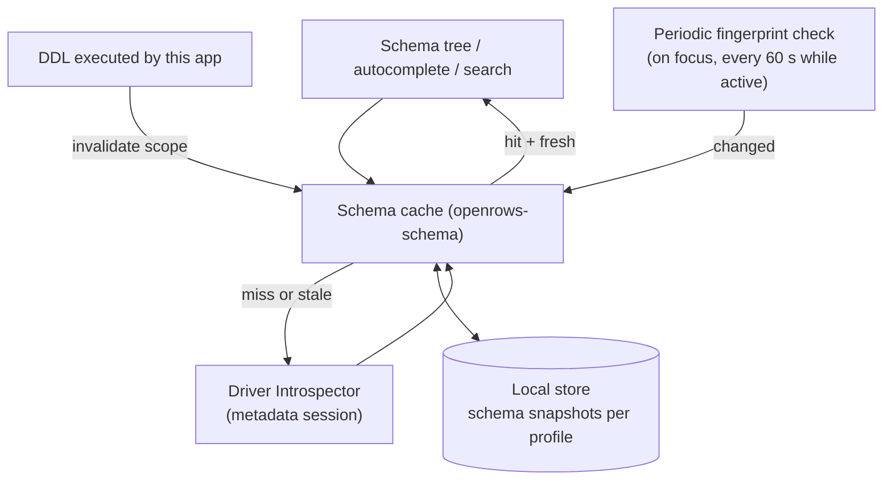
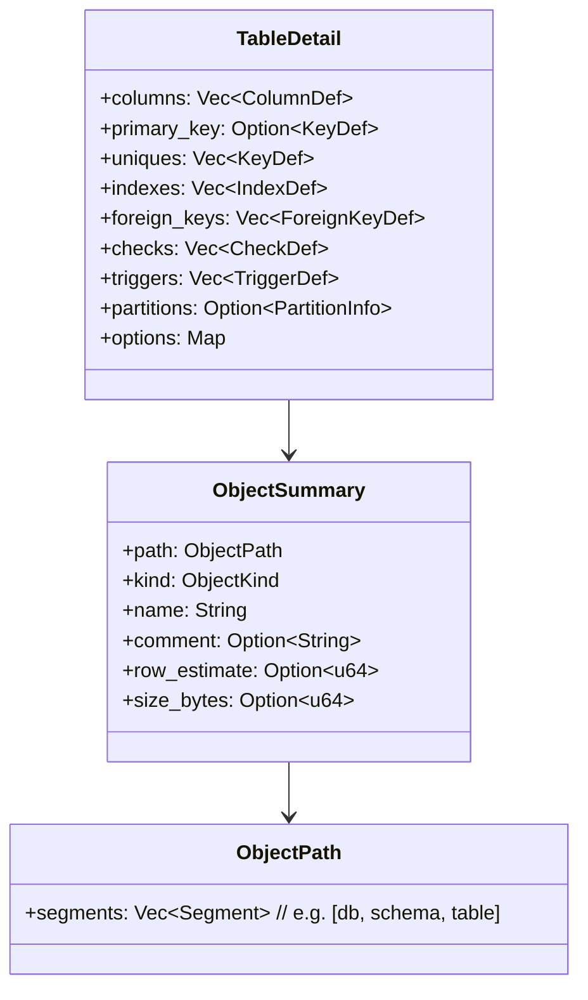
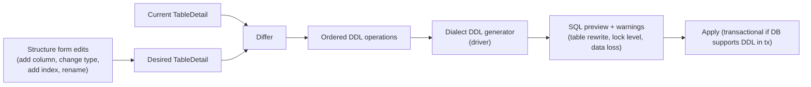

# 10 — Schema and Data Editing

## 1. Schema cache



- **Lazy:** each tree level loaded on expand; nothing pre-walks the whole database except the bounded `search_index` (names only).
- **Persistent:** snapshots stored in the local store keyed by profile + database + server version so the tree renders instantly on reconnect (marked "refreshing" until validated).
- **Invalidation:**
  - DDL statements run from the app invalidate the affected objects (from statement classification) — immediate.
  - Fingerprint check detects external changes cheaply; on change, refetch only the scopes that are expanded or recently used.
  - Manual refresh (⌘R on a node) always works.
- **Isolation:** introspection uses the dedicated metadata session so it never queues behind a user query.
- **Large catalogs:** pagination for lists > 5 000 children with "show more" and filter-as-you-type pushed down to the database (`LIKE`/`ILIKE`).

## 2. Object model



`ObjectKind` covers: Database, Schema, Table, View, MaterializedView, ForeignTable, Column, Index, Constraint, Trigger, Function, Procedure, Sequence, Type/Enum, Extension, Role, Collection (Mongo), KeyPattern (Redis), Keyspace (Cassandra), Index (Elasticsearch). Drivers list the kinds they support.

### 2.1 Implementation notes (D-06: PostgreSQL schema tree)

D-06 implements the listing slice of §1–§2 for PostgreSQL. There is no `openrows-schema` crate, no persistent snapshot, no fingerprint check and no pagination yet; the webview caches each read until **Refresh**.

| Area | What exists |
| --- | --- |
| Object model | `openrows_driver_api::catalog`: `ObjectKind` (`Table`, `View`, `MaterializedView`, `ForeignTable`, `Function`, `Procedure`, `Sequence`), `DatabaseSummary` and `SchemaSummary` (`name`, `system`, `comment`), and `ObjectSummary` (`schema`, `name`, `kind`, routine `arguments`, `row_estimate`, `comment`). The path is `[database, schema, name]`; routine overloads differ by `arguments`. |
| Introspector | `PgSession::list_databases`, `list_schemas`, `list_objects(schema, kinds)` and `search_index` in `crates/openrows-driver-postgres/src/introspect/`, with the SQL in `introspect/sql/*.sql` (docs/05 §5). Each listing is one simple query. The schema name and kinds are quoted literals (libpq `PQescapeLiteral` rules) until the driver has bind parameters. |
| What is listed | Databases: `NOT datistemplate AND datallowconn`; `postgres` and the RDS, Azure and Cloud SQL maintenance databases are flagged `system`. Schemas: TOAST and temporary schemas are skipped; `pg_catalog` and `information_schema` are flagged `system`. Objects: tables (ordinary and partitioned), foreign tables, views, materialized views, sequences, functions (including window functions) and procedures. Partitions and extension-owned routines are skipped. Aggregates, triggers, indexes and types come later. |
| Row estimates | `pg_class.reltuples` for tables and materialized views, `None` when never analysed (`-1`). The UI prefixes them with `~` and calls them estimates. |
| Name index | `search_index` lists tables, views, sequences and routines in every non-system schema in one query, capped at 20 000 rows. Quick open (⌘P) uses it. |
| Metadata sessions | `connections/metadata.rs` in the app keeps one `PgSession` per (connection, database), opened lazily on the first catalog read with `application_name` `<name> metadata`. Reads for the same key run one at a time and never pass through the user session's actor. PostgreSQL cannot change database on a connection, so each opened database gets its own metadata session. A non-server error drops the session, and the next read reconnects. `session_close` closes a database's metadata session with its last user session and `connection_close` (on disconnect) closes all of a connection's metadata sessions (since UX-B, see docs/06 §8). |
| Commands | `catalog_databases`, `catalog_schemas`, `catalog_objects(kinds)`, `catalog_search` (all take `profileId` and `database`); `catalog_databases` reads through the connection's home database. DTOs: `DatabaseDto`, `SchemaDto`, `ObjectDto` (`rowEstimate` is a number) and `ObjectKindDto`. Errors use the D-05 `IpcError`. |
| Tests | Unit tests cover literal quoting, row mapping and malformed rows, DTO serialisation and target derivation. `just test-pg` creates a schema with a table, view, materialized view, sequence, function and procedure and checks every listing, the row estimate and the name index. |

## 3. Structure editing (DDL generation)

Structure edits follow the same **stage → preview → apply** model as data edits.



- Warnings are dialect-aware, e.g. PostgreSQL: changing a column type may rewrite the table and take `ACCESS EXCLUSIVE`; adding an index without `CONCURRENTLY` blocks writes (offer the concurrent variant). MySQL: note whether the change can use `ALGORITHM=INSTANT/INPLACE`.
- Destructive operations (drop column, narrowing type) require typing the object name to confirm on prod-tagged connections.
- DDL that cannot run in a transaction (MySQL DDL auto-commits, PG `CREATE INDEX CONCURRENTLY`) is labelled; the apply step runs statements one by one and reports progress precisely.

## 4. Data editing: change sets

### 4.1 Model

```rust
pub struct ChangeSet {
    pub id: ChangeSetId,
    pub target: EditTarget,              // table + key columns
    pub base_result: ResultId,           // where original values come from
    pub ops: Vec<RowOp>,                 // ordered, undoable
}

pub enum RowOp {
    Update { key: RowKey, original: RowValues, changes: Vec<(ColumnRef, CellValue)> },
    Insert { temp_id: TempRowId, values: Vec<(ColumnRef, CellValue)> },
    Delete { key: RowKey, original: RowValues },
}

pub enum CellValue { Value(Value), Null, Default }
```

- Multiple edits to the same row merge into one `Update`. Editing then deleting a row collapses to `Delete`. Inserting then deleting removes both.
- Undo/redo stack lives in the core alongside the ops, so it survives reload.
- Change sets are persisted to the local store on every mutation (NFR-REL-01). If the app crashes, reopening the tab offers to restore pending edits.

### 4.2 Statement generation

For each op, the driver's `RowEditor::render` produces parameterised statements:

```sql
-- Update (optimistic concurrency, default "key + changed columns" mode)
UPDATE "public"."orders"
SET "status" = $1, "updated_at" = $2
WHERE "id" = $3 AND "status" IS NOT DISTINCT FROM $4;

-- Insert (returns generated values to refresh the grid)
INSERT INTO "public"."orders" ("customer_id", "total") VALUES ($1, $2) RETURNING *;

-- Delete
DELETE FROM "public"."orders" WHERE "id" = $1;
```

Concurrency modes (per profile, default **key + changed columns**):

| Mode | WHERE clause | Trade-off |
| --- | --- | --- |
| Key only | PK columns | Last write wins. |
| Key + changed columns | PK + original values of changed columns | Detects conflicting edits to the same fields (default). |
| Key + all columns | PK + all original values | Strictest; fails on any concurrent change; skips types without equality (json, blobs over threshold). |

Comparisons use null-safe equality per dialect (`IS NOT DISTINCT FROM`, `<=>`, `IS` in SQLite).

### 4.3 Apply

1. Show preview (rendered SQL with literal values inlined *for display only*; execution uses bind parameters).
2. Safety policy check (read-only → blocked; confirm-before-write → dialog listing counts per op type).
3. `BEGIN` (if supported) → execute statements in order: deletes, updates, inserts (configurable; respects FK dependencies within the set).
4. Each statement must affect exactly one row. Zero → conflict ("row changed or deleted by someone else"); more than one → abort (key was not unique — should be impossible, treat as bug, roll back).
5. `COMMIT` → refresh affected rows in the result (using `RETURNING`/re-select by key) → clear change set.
6. Any failure → `ROLLBACK`, keep the change set intact, highlight the failing row with the error.

For databases without multi-statement transactions (some NoSQL), apply is per-row with a clear "partial apply" report and the remaining ops kept staged.

### 4.4 Document and key-value editing

- **MongoDB:** edit a document as JSON (relaxed EJSON) with schema-free validation; apply as `replaceOne({_id, ...versionGuard})` or targeted `$set`/`$unset` diffs computed from original vs edited (default, smaller and safer). Inline cell edits in the flattened view become `$set` on the dotted path.
- **Redis:** type-specific operations (`SET`, `HSET`/`HDEL`, `LSET`, `ZADD`, `SADD`/`SREM`, `XADD`, JSON.SET), TTL editing, rename; optional `WATCH`/`MULTI` for optimistic check on the key.

## 5. Safe mode and environment guards

| Policy | Behaviour | Default |
| --- | --- | --- |
| Read-only | Blocks all statements classified as write/DDL/unknown; data edit UI disabled. | Off |
| Confirm writes | Any write/DDL requires confirmation showing the statement(s). | On for `prod` tag |
| Confirm dangerous | Confirmation for `DELETE`/`UPDATE` without `WHERE`, `DROP`, `TRUNCATE`, `ALTER … DROP`. | On everywhere |
| Require typing name | For DROP/TRUNCATE on prod, type the object name. | On for `prod` tag |
| Auto-rollback timer | In manual-commit mode, warn after N minutes with open transaction. | 5 min |

The environment tag colour is shown in the window toolbar, every tab of that connection, and the status bar, so it is visible even in screenshots.

## 6. ER diagrams

- Built from cached `TableDetail` FKs for a schema or user selection.
- Layout computed in a worker with an ELK-based layered algorithm (`elkjs`, EPL-2.0 — licence compatibility reviewed in [22-governance-and-licensing.md](22-governance-and-licensing.md); fallback `dagre`, MIT).
- Rendered with SVG for ≤ 300 tables, canvas above that. Export to SVG/PNG.
