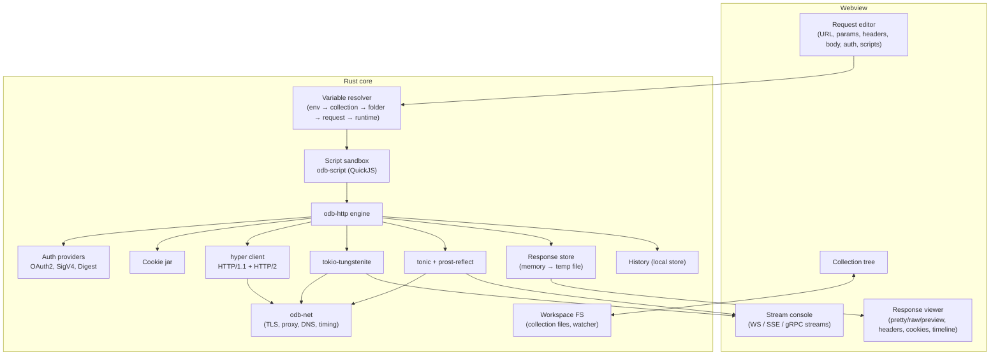
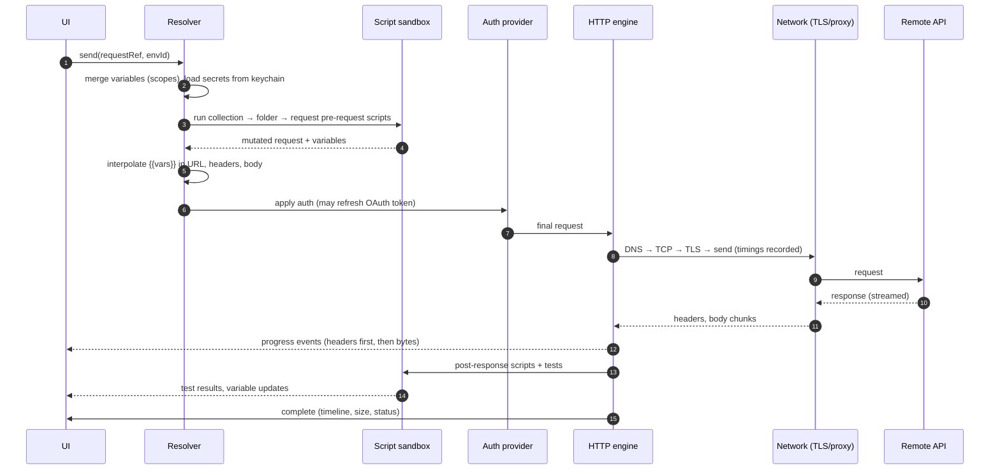
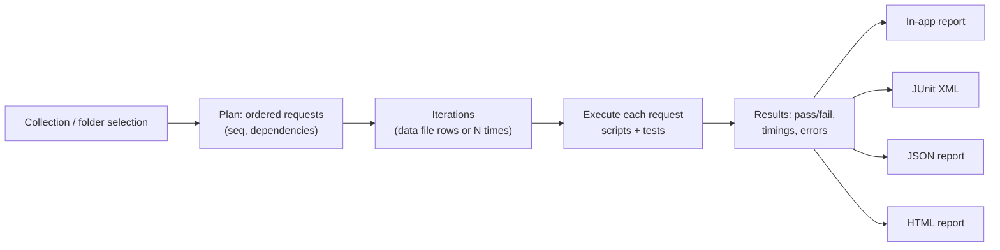

# 11 — API Client

The API client lives in the same app as a second workspace mode (sidebar switch: **Databases | APIs**). It shares the Rust network stack, secret store, environment system, editor and viewers with the database side. Collections are plain files in a folder you can commit to git — no account, no cloud sync.

## 1. Scope

| Protocol / feature | 1.0 | Later |
| --- | --- | --- |
| HTTP/1.1, HTTP/2 (ALPN), all methods | ✓ | HTTP/3 (QUIC) |
| Bodies: none, JSON, text, XML, form-urlencoded, multipart (files), binary file, GraphQL | ✓ | |
| Auth: Basic, Bearer, API key, Digest, OAuth 2.0 (auth code + PKCE, client credentials, device code, refresh), AWS SigV4 | ✓ | NTLM, Hawk, OAuth 1.0a |
| Cookies (per-collection jar, viewable/editable) | ✓ | |
| Proxies (HTTP/HTTPS/SOCKS5, system proxy, PAC), custom CA, client certificates, TLS verify toggle | ✓ | |
| GraphQL: introspection, autocomplete, docs explorer, variables | ✓ | Subscriptions over WS |
| WebSocket: connect, send text/binary, message log, filters, saved messages | ✓ | Socket.IO, STOMP |
| Server-Sent Events | ✓ | |
| gRPC: unary, server/client/bidi streaming; reflection or `.proto` import; metadata; TLS | ✓ | gRPC-Web |
| Environments, variables, secrets | ✓ | |
| Pre-request/post-response scripts, tests/assertions | ✓ | |
| Collection runner + CLI with reports | ✓ | Data-driven runs (CSV/JSON iterations) in 1.0 if time permits |
| Import: Postman 2.1, Insomnia v4, Bruno, OpenAPI 3.0/3.1, HAR, cURL | ✓ | Swagger 2.0, `.http` files |
| Export: cURL, code snippets (fetch, axios, Python requests, Go net/http, Rust reqwest, Java HttpClient, C# HttpClient, PHP) | ✓ | OpenAPI generation from collection |
| Mock server, monitors, docs publishing | | Post-1.0 |

## 2. Architecture



### 2.1 Request execution pipeline



### 2.2 Timing breakdown

A custom `hyper` connector records: DNS lookup, TCP connect, TLS handshake (with negotiated protocol, cipher, certificate chain), request write, time to first byte, content download. Shown as a waterfall bar; also stored in history for comparison.

### 2.3 Response handling

- Bodies stream into the response store: memory up to 10 MB, then a temp file. Viewer fetches byte ranges, so a 2 GB download never enters the webview.
- Content-type aware views: JSON (tree + pretty + JSONPath/JMESPath filter), XML/HTML (pretty, HTML preview rendered in a **sandboxed iframe with scripts disabled**), images, PDF (sandboxed), binary (hex), plain text.
- Decompression: gzip, deflate, br, zstd.

## 3. Collection file format

Design goals: one file per request (clean diffs, few merge conflicts), human-readable and hand-editable, stable key ordering, no secrets, no volatile data (timestamps, IDs) unless needed.

We use **YAML** for structure with body content stored inline as block scalars (or as sibling files for large/binary bodies).

```text
my-api/                          # a collection = a folder
  odb-collection.yaml            # collection metadata, defaults, scripts
  environments/
    local.yaml
    staging.yaml
    production.yaml
  .env                           # optional local overrides — gitignored by default
  users/
    _folder.yaml                 # folder-level auth/headers/scripts (optional)
    list-users.req.yaml
    get-user.req.yaml
    create-user.req.yaml
    bodies/
      avatar.png                 # referenced binary body
  orders/
    stream-orders.ws.yaml        # WebSocket request
    order-service.grpc.yaml      # gRPC request
  protos/
    orders.proto
```

### 3.1 Request file

```yaml
# users/create-user.req.yaml
odb: 1                      # format version
name: Create user
seq: 3                      # order within folder
method: POST
url: "{{baseUrl}}/v1/users"
params:
  - { name: notify, value: "true" }
headers:
  - { name: Content-Type, value: application/json }
  - { name: X-Trace, value: "{{$uuid}}", enabled: false }
auth:
  inherit: true             # use folder/collection auth
body:
  type: json
  content: |
    {
      "email": "{{userEmail}}",
      "name": "Ada"
    }
scripts:
  preRequest: |
    odb.variables.set("userEmail", `ada+${Date.now()}@example.com`);
  postResponse: |
    odb.variables.set("userId", odb.response.json().id);
tests: |
  test("created", () => expect(odb.response.status).toBe(201));
  test("has id", () => expect(odb.response.json().id).toBeTruthy());
docs: |
  Creates a user. Requires `users:write` scope.
```

### 3.2 Environment file

```yaml
# environments/staging.yaml
odb: 1
name: Staging
color: amber
variables:
  baseUrl: https://staging.api.example.com
  userEmail: ada@example.com
secrets:                    # names only; values live in the OS keychain
  - apiToken
  - oauthClientSecret
```

Secret values are stored in the keychain under `odb/api/<collection-id>/<env>/<name>`. A teammate cloning the repo sees which secrets are needed and is prompted to fill them in. Optional `.env` file values override variables locally (and is added to `.gitignore` on collection creation).

### 3.3 Format rules

- Serializer writes keys in a fixed order and omits defaults so files stay minimal.
- Unknown keys are preserved on round-trip (forward compatibility).
- A JSON Schema for each file type ships with the app and is published so editors can validate.
- Format version `odb: 1`; migrations are explicit and never silent across major versions.

## 4. Variables and scopes

Resolution order (later wins): global → collection → environment → folder → request → runtime (set by scripts) → `.env` local overrides → one-off overrides in the UI.

Dynamic variables: `{{$uuid}}`, `{{$timestamp}}`, `{{$isoTimestamp}}`, `{{$randomInt}}`, `{{$randomEmail}}`, etc.

The URL bar and editors highlight variables: resolved (with hover showing the value and its scope), unresolved (warning), secret (masked).

## 5. Scripting sandbox

- Engine: QuickJS via `rquickjs`, one fresh context per script run (or per runner iteration), with:
  - memory limit (default 64 MB), execution time limit (default 5 s, configurable), interrupt handler for cancellation;
  - **no** filesystem, process, or raw network access;
  - a curated `odb` API: `odb.request` (mutable before send), `odb.response`, `odb.variables`, `odb.environment`, `odb.cookies`, `odb.sendRequest()` (goes through the same engine and respects the collection's proxy/TLS settings), `odb.test()`, `expect()` (Jest-like matchers), `console.log` (to a script console panel);
  - bundled pure-JS helpers: crypto hashes/HMAC (implemented in Rust, exposed as functions), base64, URL utilities, a JSON schema validator, date utilities.
- Postman-compatible shim (`pm.*`) maps the common subset (`pm.environment`, `pm.variables`, `pm.response`, `pm.test`, `pm.expect` via chai-style adapter) so imported collections mostly run unchanged; unsupported calls produce clear errors listing what to adjust.
- Imported collections with scripts open in **restricted mode** until the user reviews and trusts the collection (scripts can still make network requests to arbitrary hosts via `sendRequest`).

## 6. GraphQL

- Introspection query on demand, cached per endpoint; schema stored with the collection optionally (`schema.graphql`) for offline use.
- Editor: GraphQL language mode with schema-aware completion, validation, hover docs; variables editor with JSON schema derived from operation variables.
- Docs explorer pane for browsing types.

## 7. WebSocket and SSE

- Connection panel with handshake headers/subprotocols; message composer (text/JSON/binary from file); saved message templates; log with timestamps, direction, size, filters and search; auto-reconnect option.
- SSE: event stream log with event type/id parsing; Last-Event-ID reconnect.
- Message logs are capped in memory (default 10 000 messages) with optional save-to-file.

## 8. gRPC

- Service discovery: server reflection (v1 and v1alpha) or imported `.proto` files (with include paths) compiled at runtime via `protox` (pure-Rust protobuf compiler) into a descriptor pool used by `prost-reflect`.
- Request editor generates a JSON template from the input message type; JSON ↔ protobuf conversion follows the canonical proto3 JSON mapping.
- Metadata editor, deadlines, TLS/mTLS, compression.
- Streaming views reuse the stream console from WebSocket.

## 9. Collection runner and CLI



CLI (`odb`), built from the same crates:

```bash
odb api run ./my-api --env staging --folder users --reporter junit --out results.xml
odb api run ./my-api --env ci --data users.csv --bail
odb api import postman ./export.postman_collection.json --into ./my-api
```

- Secrets in CI come from environment variables (`ODB_SECRET_<NAME>`) or a `--secrets-file` — never from a keychain on headless systems.
- Exit code non-zero on any failed test or request error.

## 10. Importers

| Source | Notes |
| --- | --- |
| Postman 2.1 | Folders, auth, variables, scripts (with `pm.*` shim), examples → saved responses. |
| Insomnia v4 export | Requests, environments, folders. |
| Bruno | `.bru` files parsed and converted; environments. |
| OpenAPI 3.0/3.1 | One request per operation, grouped by tag; examples or schema-generated bodies; servers → environments; security schemes → auth. |
| HAR | Requests from browser sessions; headers filtered (cookies optional). |
| cURL | Paste into URL bar auto-detects and converts. |

Every importer produces a report: imported, adjusted, unsupported items.

## 11. DB ↔ API integration (differentiator)

Because both live in one app:

- Request scripts can query a configured database connection (read-only by default) via `odb.db.query(connectionName, sql, params)` — opt-in per collection, disabled in CLI unless explicitly allowed. Useful for fetching test fixtures or verifying side effects.
- "Send as request" from a grid selection: turn rows into a JSON body.
- Response JSON arrays can be opened in the data grid for sorting/filtering/exporting.
