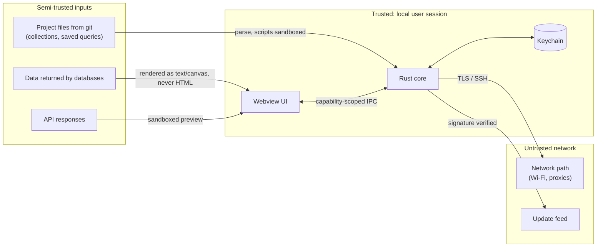
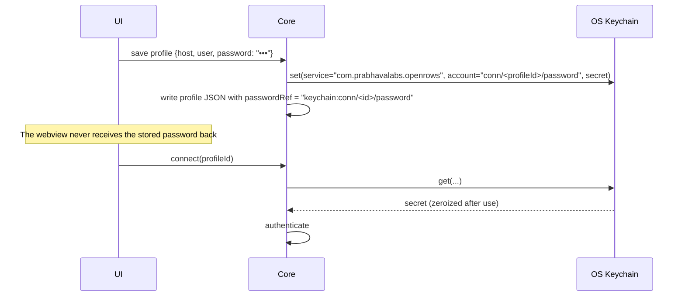

# 12 — Security

A database client holds the keys to production. Security failures here are catastrophic for users, so the bar is higher than for a typical desktop app.

## 1. Assets

| Asset | Where it lives |
| --- | --- |
| Database passwords, SSH key passphrases, tokens, API secrets, OAuth tokens | OS keychain only |
| Connection profiles (hosts, users, options) | App data dir (JSON) / Project files (shared definitions, no secrets) |
| Query text and history | Local store (SQLite) |
| Result data | Memory, spill temp files |
| API collections and responses | Project folder / local store |
| Update signing private key | Offline/HSM-backed CI secret, never on dev machines |

## 2. Threat model (STRIDE summary)

| Threat | Example | Mitigation |
| --- | --- | --- |
| **Spoofing** server | MITM on café Wi-Fi impersonates DB or SSH server | TLS verify-full by default with OS trust store (`rustls-platform-verifier`); SSH host key check against `known_hosts` with TOFU prompt showing SHA256 fingerprint; changed host key = hard stop with explanation. |
| **Tampering** with updates | Malicious update payload | Tauri updater signature verification (Ed25519/minisign) + platform code signing + notarization; HTTPS-only feed; pinned public key in the binary. |
| **Tampering** via Project files | Malicious collection in a cloned repo runs scripts | Scripts sandboxed (no FS/process); untrusted collections open in restricted mode (scripts disabled) until user trusts the folder; `ors.db.query` off by default. |
| **Repudiation** | "I didn't run that DELETE" | Local history records every executed statement with timestamp and connection (user-controllable). |
| **Information disclosure** — XSS in webview | DB cell contains `<script>` or a crafted SVG | Cells rendered on canvas or as text nodes, never `innerHTML`; strict CSP; HTML/SVG/PDF previews only in sandboxed iframes without script permission and with an opaque origin. |
| **Information disclosure** — logs | Password or query values in logs | Structured logging with redaction layer: known secret fields never logged; query text logged only at `trace` level and off by default; connection URLs redacted. |
| **Information disclosure** — crash reports | Data in panic messages | Opt-in only; reports exclude query text, values, hosts by default; user can review the payload before sending. |
| **Denial of service** | Huge result exhausts RAM | Result store budget + spill + row cap; response body size caps; script time/memory limits. |
| **Elevation of privilege** — webview → native | Compromised UI calls dangerous commands | Tauri 2 capabilities: per-window allowlist of commands; no shell/FS plugins exposed to the webview beyond scoped dialogs; inputs validated in Rust. |
| **Supply chain** | Malicious crate/npm package | Lockfiles committed; `cargo-deny` (advisories, licences, bans, sources), `cargo-audit`, `cargo-vet` imports for critical crates; `pnpm audit`, no install scripts by default (`pnpm` `onlyBuiltDependencies` allowlist); GitHub Actions pinned by SHA; SBOM per release. |

## 3. Credentials

- Secret values held in `secrecy::SecretString` / `zeroize` types; never `Debug`-printed.
- "Ask every time" option per secret: not stored at all; prompted on connect and held only for the session lifetime.
- macOS: Keychain items created with access restricted to our signed app (designated requirement), so other apps get a system prompt. Optional Touch ID gate for prod connections via `LocalAuthentication` (P1, through `security-framework`/objc bindings).
- Linux without Secret Service: fall back to an encrypted file vault unlocked by a user passphrase (Argon2id + XChaCha20-Poly1305), with a clear warning.
- Export of profiles never includes secrets unless the user explicitly chooses "include secrets" and sets an export passphrase (same vault format).

## 4. Network security

### 4.1 TLS

- `rustls` everywhere; minimum TLS 1.2; system roots plus user-added CAs per connection.
- Modes exposed per connection (mapped to each driver's terms): `disable`, `prefer`, `require`, `verify-ca`, `verify-full` (default where the database supports TLS and the host isn't localhost; PostgreSQL `sslmode` semantics are matched exactly for PG).
- "Skip verification" is a separate explicit toggle that shows a persistent warning badge on the connection.
- Client certificate auth with key material from files or keychain.

### 4.2 SSH tunnels

- `russh` client: auth via agent (macOS launchd agent, 1Password/Secretive agents via `SSH_AUTH_SOCK`), key files (OpenSSH, PEM, PKCS#8; ed25519/ecdsa/rsa-sha2), password, keyboard-interactive (for 2FA prompts).
- Jump hosts (`ProxyJump`) chained; `~/.ssh/config` parsing for `Host`, `HostName`, `User`, `Port`, `IdentityFile`, `ProxyJump`, `IdentitiesOnly`.
- Local listener bound to `127.0.0.1` on an ephemeral port, or (preferred) **in-process stream** passed directly to the driver when the driver accepts a custom stream (avoids exposing a local port to other local processes). Drivers that need a socket address get the loopback listener, accepting only the one expected connection.
- Host key verification against `~/.ssh/known_hosts` plus app-managed known hosts; never auto-accept changed keys. The user's file is only read; accepted first-use keys go to the app-managed file (`0600`).
- RSA user keys are signed with ring (constant time); the `rsa` crate is excluded because of RUSTSEC-2023-0071 (see [24 §11](24-networking-and-protocols.md#11-implementation-notes-m0-s4-ssh-spike)).

### 4.3 Proxies

SOCKS5 and HTTP CONNECT proxies supported for both database and API connections; system proxy detection for API requests.

## 5. Webview hardening (Tauri 2)

- `frontendDist` bundled; no remote URLs loaded in app windows.
- CSP: `default-src 'self'; script-src 'self'; style-src 'self' 'unsafe-inline'` (inline styles needed for CodeMirror; no inline scripts); `connect-src ipc: http://ipc.localhost`; `img-src 'self' data: blob:`; `frame-src` limited to sandboxed blob previews.
- Tauri **isolation pattern** enabled to validate IPC messages in an isolated iframe.
- Capabilities file per window kind; plugins limited to: dialog (scoped), clipboard, updater, window-state, deep-link (for OAuth redirect), single-instance.
- External links open in the system browser after URL scheme validation (`https`, `http`, `mailto` only).
- OAuth 2.0 redirects use a loopback listener with PKCE, or the system browser + `openrows://` deep link; never an embedded login webview (users should see the real browser URL bar).

## 6. Data at rest

- Local store is a plain SQLite DB in the user's app data dir (protected by OS account permissions and FileVault/BitLocker). It contains history and cached schema metadata — potentially sensitive.
- Per-connection "don't record history" and "don't cache schema" toggles; global "clear all history".
- Optional encrypted local store (SQLCipher-compatible build) is a P2 item.
- Spill files and response temp files are created with `0600` permissions in a per-user temp dir and deleted on close; startup sweeps leftovers.

## 7. Secure development lifecycle

- Threat model reviewed for every feature touching credentials, IPC, scripts, network, or file parsing.
- Fuzzing: SQL splitter, MQL parser, collection file parser, importers (Postman/HAR/OpenAPI), protocol decoders (`cargo-fuzz`, run nightly).
- `unsafe` Rust forbidden outside designated FFI crates (`#![forbid(unsafe_code)]` elsewhere); FFI crates require two reviewers.
- Security policy (`SECURITY.md`) with private disclosure channel and 90-day disclosure timeline.
- Releases built only in CI from tagged commits; reproducibility checks on Linux builds where feasible.

## 8. Implementation notes (D-03: secrets and profiles)

| Area | What exists |
| --- | --- |
| Crate | `crates/openrows-secrets`: `SecretStore` trait (`set` / `get` / `delete`, delete of a missing item succeeds), `KeychainSecretStore`, `MemorySecretStore` (tests, future "ask every time"), `SecretKey` (`conn/<profileId>/password`), `SERVICE = "com.prabhavalabs.openrows"`. |
| Backends | `keyring` 3.6 per OS: macOS Keychain (`apple-native`, via `security-framework`), Windows Credential Manager (`windows-native`), Linux kernel keyutils (`linux-native`, session-scoped, lost on reboot). The Secret Service backend and the encrypted file vault of §3 are not in yet; Linux is compile- and test-only for now. Access-control lists bound to the signed app, Touch ID and "ask every time" are not implemented. |
| Values | `SecretString` wraps `zeroize::Zeroizing<String>`; `Debug` prints `SecretString([redacted])`; no `Display` or `Serialize`. `SecretKey`, errors and `MemorySecretStore` `Debug` output never contain values. |
| Profiles | `ProfileService` writes the secret before the profile file that references it and removes the file before the secret. Profile files hold only `"secrets": { "password": "keychain" }`. Duplicating a profile copies its password to the new id; deleting removes it. |
| URL parsing | `postgres://` and `postgresql://` URLs: the userinfo password and `?password=` both become a `SecretString`, never a profile field or option. `UrlError` values carry the failing component name or a non-secret value (port, sslmode, scheme), never the URL. Known gap: the `url` crate's internal copy of the URL during parsing is not zeroized. |
| TLS default | Without `sslmode`, a profile gets `verify-full` for remote hosts and `prefer` for `localhost`, loopback IPs and socket directories (§4.1). |
| Safety | Prod-tagged profiles start with `confirmWrites = true`; retagging a profile as prod turns it on (FR-CONN-07). Enforcement belongs to the execution path (later). |
| Tests | Secrets never appear in the profile directory or the SQLite files (raw byte scan after create / rotate / duplicate / history insert), in `Debug` output or in URL errors. The real-keychain round trip is `#[ignore]`d and uses a throwaway `conn/openrows-test-throwaway-<uuid>/password` item it always deletes: `cargo nextest run -p openrows-secrets --run-ignored only`. |
