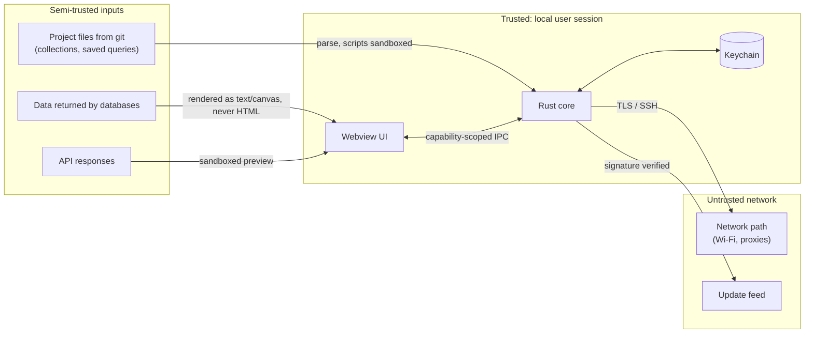
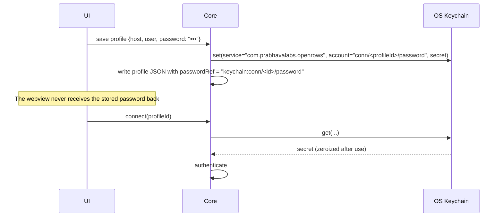

# 12 — Security

A database client holds the keys to production. Security failures here are catastrophic for users, so the bar is higher than for a typical desktop app.

## 1. Assets

| Asset | Where it lives |
| --- | --- |
| Database passwords, SSH key passphrases, tokens, API secrets, OAuth tokens | OS keychain only |
| Connection profiles (hosts, users, options) | App data dir (JSON) / Project files (shared definitions, no secrets) |
| Query text and history | Local store (SQLite) |
| Result data | Memory, spill temp files |
| API collections and responses | Project folder / local store |
| Update signing private key | Offline/HSM-backed CI secret, never on dev machines |

## 2. Threat model (STRIDE summary)

| Threat | Example | Mitigation |
| --- | --- | --- |
| **Spoofing** server | MITM on café Wi-Fi impersonates DB or SSH server | TLS verify-full by default with OS trust store (`rustls-platform-verifier`); SSH host key check against `known_hosts` with TOFU prompt showing SHA256 fingerprint; changed host key = hard stop with explanation. |
| **Tampering** with updates | Malicious update payload | Tauri updater signature verification (Ed25519/minisign) + platform code signing + notarization; HTTPS-only feed; pinned public key in the binary. |
| **Tampering** via Project files | Malicious collection in a cloned repo runs scripts | Scripts sandboxed (no FS/process); untrusted collections open in restricted mode (scripts disabled) until user trusts the folder; `ors.db.query` off by default. |
| **Repudiation** | "I didn't run that DELETE" | Local history records every executed statement with timestamp and connection (user-controllable). |
| **Information disclosure** — XSS in webview | DB cell contains `<script>` or a crafted SVG | Cells rendered on canvas or as text nodes, never `innerHTML`; strict CSP; HTML/SVG/PDF previews only in sandboxed iframes without script permission and with an opaque origin. |
| **Information disclosure** — logs | Password or query values in logs | Structured logging with a scrubbing layer (docs/14 §6): call sites never log secrets, SQL text, literals, row values, hosts or driver messages; the writer redacts URL passwords, secret-named fields and bearer tokens. Tests prove that a password and a query literal never reach the log. |
| **Information disclosure** — crash reports | Data in panic messages | Opt-in only; reports exclude query text, values, hosts by default; user can review the payload before sending. |
| **Denial of service** | Huge result exhausts RAM | Result store budget + spill + row cap; response body size caps; script time/memory limits. |
| **Elevation of privilege** — webview → native | Compromised UI calls dangerous commands | Tauri 2 capabilities: per-window allowlist of commands; no shell/FS plugins exposed to the webview beyond scoped dialogs; inputs validated in Rust. |
| **Supply chain** | Malicious crate/npm package | Lockfiles committed; `cargo-deny` (advisories, licences, bans, sources), `cargo-audit`, `cargo-vet` imports for critical crates; `pnpm audit`, no install scripts by default (`pnpm` `onlyBuiltDependencies` allowlist); GitHub Actions pinned by SHA; SBOM per release. |

## 3. Credentials

- Secret values held in `secrecy::SecretString` / `zeroize` types; never `Debug`-printed.
- "Ask every time" option per secret: not stored at all; prompted on connect and held only for the session lifetime.
- macOS: Keychain items created with access restricted to our signed app (designated requirement), so other apps get a system prompt. Optional Touch ID gate for prod connections via `LocalAuthentication` (P1, through `security-framework`/objc bindings).
- Linux without Secret Service: fall back to an encrypted file vault unlocked by a user passphrase (Argon2id + XChaCha20-Poly1305), with a clear warning.
- Profile exports never include secrets in 1.0 (G02). A future encrypted transfer requires a separate security decision.

## 4. Network security

### 4.1 TLS

- `rustls` everywhere; minimum TLS 1.2; system roots plus user-added CAs per connection.
- Modes exposed per connection (mapped to each driver's terms): `disable`, `prefer`, `require`, `verify-ca`, `verify-full` (default where the database supports TLS and the host isn't localhost; PostgreSQL `sslmode` semantics are matched exactly for PG).
- "Skip verification" is a separate explicit toggle that shows a persistent warning badge on the connection.
- Client certificate auth with key material from files or keychain.

### 4.2 SSH tunnels

- `russh` client: auth via agent (macOS launchd agent, 1Password/Secretive agents via `SSH_AUTH_SOCK`), key files (OpenSSH, PEM, PKCS#8; ed25519/ecdsa/rsa-sha2), password, keyboard-interactive (for 2FA prompts).
- Jump hosts (`ProxyJump`) chained; `~/.ssh/config` parsing for `Host`, `HostName`, `User`, `Port`, `IdentityFile`, `ProxyJump`, `IdentitiesOnly`.
- Local listener bound to `127.0.0.1` on an ephemeral port, or (preferred) **in-process stream** passed directly to the driver when the driver accepts a custom stream (avoids exposing a local port to other local processes). Drivers that need a socket address get the loopback listener, accepting only the one expected connection.
- Host key verification against `~/.ssh/known_hosts` plus app-managed known hosts; never auto-accept changed keys. The user's file is only read; accepted first-use keys go to the app-managed file (`0600`).
- RSA user keys are signed with ring (constant time); the `rsa` crate is excluded because of RUSTSEC-2023-0071 (see [24 §11](24-networking-and-protocols.md#11-implementation-notes-m0-s4-ssh-spike)).

### 4.3 Proxies

SOCKS5 and HTTP CONNECT proxies supported for both database and API connections; system proxy detection for API requests.

Implemented for databases (M1-06, docs/24 §13): the proxy is the first hop, in front of the database or of the first SSH hop. SOCKS5 sends host names unresolved (remote DNS, so internal names do not leak to the local resolver); the proxy password is the keychain item `conn/<id>/proxy-password`, sent only to the proxy (RFC 1929 or HTTP Basic) and never logged: `ProxySpec` and `ProxyError` redact it, and the HTTP request head that carries it is zeroized. Basic authentication is cleartext between the app and the proxy, as with every HTTP proxy; TLS to the database runs inside the tunnel and is verified against the profile's host.

## 5. Webview hardening (Tauri 2)

- `frontendDist` bundled; no remote URLs loaded in app windows.
- CSP: `default-src 'self'; script-src 'self'; style-src 'self' 'unsafe-inline'` (inline styles needed for CodeMirror; no inline scripts); `connect-src ipc: http://ipc.localhost`; `img-src 'self' data: blob:`; `frame-src` limited to sandboxed blob previews.
- Tauri **isolation pattern** enabled to validate IPC messages in an isolated iframe.
- Capabilities file per window kind; plugins limited to: dialog (scoped), clipboard, updater, window-state, deep-link (for OAuth redirect), single-instance.
- External links open in the system browser after URL scheme validation (`https`, `http`, `mailto` only).
- OAuth 2.0 redirects use a loopback listener with PKCE, or the system browser + `openrows://` deep link; never an embedded login webview (users should see the real browser URL bar).

## 6. Data at rest

- Local store is a plain SQLite DB in the user's app data dir (protected by OS account permissions and FileVault/BitLocker). It contains history and cached schema metadata — potentially sensitive.
- Per-connection "don't record history" and "don't cache schema" toggles; global "clear all history".
- Optional encrypted local store (SQLCipher-compatible build) is a P2 item.
- Spill files and response temp files are created with `0600` permissions in a per-user temp dir and deleted on close; startup sweeps leftovers.

## 7. Secure development lifecycle

- Threat model reviewed for every feature touching credentials, IPC, scripts, network, or file parsing.
- Fuzzing: SQL splitter, MQL parser, collection file parser, importers (Postman/HAR/OpenAPI), protocol decoders (`cargo-fuzz`, run nightly).
- `unsafe` Rust forbidden outside designated FFI crates (`#![forbid(unsafe_code)]` elsewhere); FFI crates require two reviewers.
- Security policy (`SECURITY.md`) with private disclosure channel and 90-day disclosure timeline.
- Releases built only in CI from tagged commits; reproducibility checks on Linux builds where feasible.

## 8. Implementation notes (D-03: secrets and profiles)

| Area | What exists |
| --- | --- |
| Crate | `crates/openrows-secrets`: `SecretStore` trait (`set` / `get` / `delete`, delete of a missing item succeeds), `KeychainSecretStore`, `CachingSecretStore`, `MemorySecretStore` (tests, future "ask every time"), `SecretKey` (`conn/<profileId>/password`), `SERVICE = "com.prabhavalabs.openrows"`. |
| Backends | `keyring` 3.6 per OS: macOS Keychain (`apple-native`, via `security-framework`), Windows Credential Manager (`windows-native`), Linux kernel keyutils (`linux-native`, session-scoped, lost on reboot). The Secret Service backend and the encrypted file vault of §3 are not in yet; Linux is compile- and test-only for now. Access-control lists bound to the signed app and Touch ID are not implemented. |
| Values | `SecretString` wraps `zeroize::Zeroizing<String>`; `Debug` prints `SecretString([redacted])`; no `Display` or `Serialize`. `SecretKey`, errors and `MemorySecretStore` `Debug` output never contain values. |
| Profiles | `ProfileService` writes the secret before the profile file that references it and removes the file before the secret. Profile files hold only `"secrets": { "password": "keychain" }`. Duplicating a profile copies its password to the new id; deleting removes it. |
| Keychain access | The app wraps `KeychainSecretStore` in `CachingSecretStore`: each item is read at most once per run (absent items too; failed reads are not cached), set/delete update the cache, and setting an unchanged value skips the write. Values stay `SecretString`s in the core process; the webview never receives them. `ProfileService` touches the store only for profiles whose file references a password: no read, write or delete for passwordless profiles, and keeping the password on edit does not rewrite it. On macOS every access by a binary the item's ACL does not trust is a password prompt. |
| macOS signing | Release builds must be Developer ID signed: the keychain ACL then matches the stable designated requirement (team ID + bundle id) across updates. Debug builds are ad-hoc signed, whose requirement is the `cdhash`, so every rebuild loses "Always Allow". Opt-in fix for development: `just dev-cert` once creates a self-signed "OpenRows Dev" code-signing identity in the login keychain (not trusted system-wide; only `codesign` may use its key); `just dev` then runs the app through `scripts/dev-sign-run.sh`, a Cargo runner that re-signs only `openrows-app` with that identity (identifier `com.prabhavalabs.openrows.dev`) and is a no-op with a one-line hint when the identity is missing. Release ACLs are unchanged (no "allow all applications"). |
| Reveal | `profile_reveal_secret(id, field)` is the only command that returns a stored secret: one profile, one field (password, SSH password or passphrase, TLS key passphrase, proxy password), read on demand when the user clicks the eye button of a saved secret. `RevealedSecret` redacts its `Debug`; `ProfileDto` still only says `hasPassword`. The webview keeps the value in the field's component state, masked until revealed, and drops it on blur, after 30 s and when the sheet closes. |
| Ask every time | Per profile `passwordStorage`: `keychain` (default; files written before the choice have no key) or `ask`. With `ask` the password slot is never stored (switching forgets a saved one); connecting opens a sheet, `connection_open` receives the typed password and holds it in an in-memory `MemorySecretStore` (zeroized) for the database and metadata sessions of that connection until `connection_close`, a failed connect or deleting the profile. Profiles are JSON files, so the field needs no SQLite migration: serde's default is the migration. |
| URL parsing | `postgres://` and `postgresql://` URLs: the userinfo password and `?password=` both become a `SecretString`, never a profile field or option. `UrlError` values carry the failing component name or a non-secret value (port, sslmode, scheme), never the URL. Known gap: the `url` crate's internal copy of the URL during parsing is not zeroized. |
| TLS default | Without `sslmode`, a profile gets `verify-full` for remote hosts and `prefer` for `localhost`, loopback IPs and socket directories (§4.1). |
| Safety | Prod-tagged profiles start with `confirmWrites = true`; retagging a profile as prod turns it on (FR-CONN-07). Enforcement belongs to the execution path (later). |
| Tests | Secrets never appear in the profile directory or the SQLite files (raw byte scan after create / rotate / duplicate / history insert), in `Debug` output or in URL errors. The real-keychain round trip is `#[ignore]`d and uses a throwaway `conn/openrows-test-throwaway-<uuid>/password` item it always deletes: `cargo nextest run -p openrows-secrets --run-ignored only`. |

## 9. Implementation notes (D-10 SSH tunnels, D-11 TLS)

| Area | What exists |
| --- | --- |
| Secrets | Besides `conn/<id>/password`, a profile may reference `conn/<id>/ssh-password`, `conn/<id>/ssh-passphrase`, `conn/<id>/tls-key-passphrase` and (M1-06) `conn/<id>/proxy-password` (`SecretSlot`). Profile files hold only `"keychain"` markers; saving removes items the settings no longer use. The keychain is read only on connect and only for items the profile references (tests use a secret store that fails every access to prove it). Form secrets travel webview → core as `SecretInput`; DTOs sent back say only `hasPassword` / `hasPassphrase` / `hasKeyPassphrase`. |
| Client tools (M2-14) | `pg_dump`, `pg_restore`, `psql`, `mysqldump` and `mysql` never get a password in their arguments or environment: it goes to a 0600 file (`PGPASSFILE`, `--defaults-extra-file`) deleted after the job, and inherited `PGPASSWORD`/`MYSQL_PWD` are removed. Routed profiles give the tools a loopback forward that accepts only the expected connections. Restores pass the read-only and confirmation gates (docs/05 §15). |
| In-process streams | §4.2's preferred option: the PostgreSQL driver accepts a `Dialer` and reads/writes `direct-tcpip` channels directly; no loopback listener exists. |
| Host keys | Unknown keys open a sheet with host, port, algorithm and SHA256 fingerprint (and a warning when the host is already known with another key type); Trust appends to the app-managed `known_hosts` (0600) next to the profiles, Cancel or Escape rejects. Changed and revoked keys fail with a `hostKey` error naming the `known_hosts` file and line, before any credential is sent; there is no override in the UI. Keyboard-interactive (MFA, OTP) questions open a sheet; non-echo answers are masked. |
| TLS | rustls with the ring provider, TLS 1.2+; libpq `sslmode` semantics exactly (`require` + CA file verifies the chain). A per-connection CA file replaces the system roots, as libpq does; `verify-full` without a CA file uses the macOS trust store. Client certificate and key from files; an encrypted PKCS#8 key's passphrase is a keychain item. Deviation from §4.1: there is no separate "skip verification" toggle; the modes below `verify-ca` are the skip (the mode list says "Require (skip verification)") and the connection sheet shows a persistent "Certificate not verified" / "Not encrypted" badge for remote hosts, even with the TLS section collapsed. Since M1-06 the connection itself carries the flag too: an open-lock mark in the connection list (reasons in the tooltip) and a "Not secure" badge in the window toolbar, for disabled or unverified TLS towards a remote host and for an SSH host key accepted with "Connect once" (not saved to `known_hosts`; flagged while that tunnel lives). Bundled cloud provider CAs (AWS RDS, Azure) count as a configured CA. Client key material from the keychain is not supported yet. |
| Logging | No secret reaches `Debug` output (`SecretString`, `TlsFiles`, `ConnectOptions` redact) or error messages; TLS and SSH errors name files and hosts, never key material. |

## 10. Implemented (M2-21): credential commands and local trust

`passwordStorage` now also supports `none` (never access the database-password keychain slot or prompt) and `command`. The keychain default is unchanged for old profile JSON. A command has an absolute program path, a literal argument vector and a 1–120 second timeout (default 10). It runs directly without a shell, closes stdin, inherits the environment with `OPENROWS_*`, `PGPASSWORD`, `PGSSLPASSWORD` and `MYSQL_PWD` removed, and reads the trimmed first stdout line. Arguments must contain configuration only, never credentials. Credential output is not logged, returned to the webview, cached or written to disk; it is a `SecretString` for one driver connection attempt. Reconnect and metadata sessions obtain fresh command output rather than storing it like keychain credentials.

**Threat:** an imported or externally edited profile can point to an arbitrary executable with the user's filesystem/network permissions. **Mitigation:** before any spawn, `CommandTrust` requires a local entry keyed by profile id and SHA-256 of the JSON-encoded program plus arguments. The file is `trusted-commands.json` in Tauri's app config directory, outside `connections/`, and is atomically written with mode 0600 on Unix. It never appears in exchange files. Imported profiles have new ids and no trust entry. Changing program/args causes a hash mismatch; changing executable contents at a trusted path is outside this configuration-based trust boundary.

Creating or editing a command shows a native blocking confirmation with the exact program and JSON argument vector, warning that the program runs with the user's permissions. **Trust and run** explicitly approves it; Cancel saves no trust. Connect and **Test command** use the same gate when no matching local entry exists. Testing reports success without revealing the value. During a running connect, the existing Disconnect/Cancel connection action cancels the credential worker. The child has its own process group on Unix; cancellation/deadline kills the group and reaps the direct child. Other platforms kill/reap the direct child; descendant-process management needs platform-specific support.

Both output pipes are drained concurrently with bounded 64 KiB buffers held in zeroizing storage. Failure diagnostics replace the produced first-line password and redact everything after `password=` or `token=` on each line, case-insensitively, then truncate to 512 characters. Timeout and cancellation return typed errors without child output. These controls reduce diagnostic disclosure and memory denial of service; they do not sandbox a trusted credential provider or authenticate the executable's contents. Tests compile a tiny local helper to prove literal shell characters, closed stdin, timeout, live cancellation, stderr scrubbing, no imported-command side effect before trust and trust invalidation after editing.

## 11. Spawned cloud helpers (M2-24)

Cloud route helpers are direct child executables, invoked with structured argument vectors and no shell. They bind only IPv4 loopback on an ephemeral port, are health-checked before database authentication, and are killed with their entire process tree after the last session lease or on application exit. Helper fields reject option-like values, control characters and Google instance query parameters that could override the bind address. Database TLS verification retains the original database hostname. Google auth proxies encrypt/authenticate the upstream connection, so their form defaults database TLS to disabled with an explanation.

Profiles store paths and cloud resource identifiers, never AWS/GCP/Cloudflare credentials or service tokens. Authentication remains in each tool's own configuration. Bounded stderr is redacted before being retained or exposed in diagnostics; credential-like lines and oversized lines are removed in full. Settings ▸ Tools lets the user choose executables; custom command hops require the separate command trust store and remain out of scope. Loopback listeners are accessible to other local processes, matching the cloud tools' security model; they do not provide authentication isolation from other processes running as the user.
