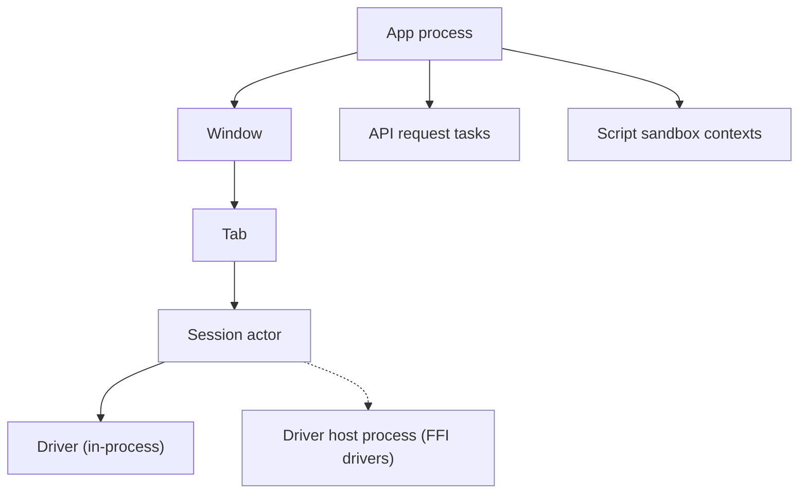

# 14 — Reliability and Observability

## 1. Principles

1. **Never lose user work.** Editor text, pending change sets, open tabs and API request drafts are persisted continuously.
2. **Fail small.** A failure in one session, driver, request or panel must not take down the window or the app.
3. **Never retry a write behind the user's back.**
4. **Every wait is bounded and cancellable.**
5. **Explain failures in user terms** with a precise technical detail one click away.

## 2. Failure domains



| Failure | Containment | Recovery |
| --- | --- | --- |
| Driver returns error | Query fails, session stays usable | Error shown inline; session continues |
| Driver panics | Session actor task ends (`JoinError`) | Session marked Failed; "Reconnect" offered; panic logged with correlation id |
| FFI driver segfault | Driver host process dies | Proxy sees EOF → sessions on that host Failed; host respawned on next connect |
| Network drop (idle) | Keepalive detects | Auto-reconnect with backoff (1 s, 2 s, 4 s … max 30 s, 5 attempts); startup commands replayed |
| Network drop (in query) | Query fails with `Network` error | Not retried; user can rerun |
| Network drop (in transaction) | Session → `Broken` | Clear message: "transaction was rolled back by the server"; staged change set preserved |
| Script infinite loop | QuickJS interrupt handler at time limit | Request marked failed with "script timeout" |
| Webview crash / reload | Core unaffected | Webview reloads; UI state restored from core (tabs, drafts, results still in store) |
| Core panic outside a session | Global panic hook logs, writes crash marker | App restarts on next launch with "restore previous session?"; opt-in crash report |

### 2.1 Panic policy

- `panic = "unwind"` in release so session-level panics are catchable at task boundaries.
- A global panic hook records the panic message (scrubbed), thread, backtrace and correlation id to the log and crash marker.
- Code in the core must not `unwrap()`/`expect()` on data from external sources; lint (`clippy::unwrap_used` in non-test code, with explicit allowances) enforces this.

## 3. Persistence of in-progress work

| Item | When persisted | Where |
| --- | --- | --- |
| Editor text (scratch tabs) | 300 ms debounce after change, on blur, on quit | Local store `drafts` table |
| File-backed tab unsaved changes | Same | Local store `drafts` (does not overwrite the file until ⌘S) |
| Pending change sets | Every mutation | Local store `change_sets` |
| Tab layout and view state | 1 s debounce | Local store `workspace_state` |
| API request edits (unsaved) | 300 ms debounce | Local store `drafts` |

All writes go through a single writer task with WAL mode; batched to avoid fsync storms.

## 4. Timeouts (defaults, all configurable)

| Operation | Default |
| --- | --- |
| DNS | 5 s |
| TCP connect | 10 s |
| SSH handshake + auth | 20 s (excluding user prompts) |
| TLS handshake | 10 s |
| Database auth | 15 s |
| Introspection query | 30 s |
| User query | none (cancel button), optional per profile |
| Keepalive interval | 30 s |
| API request | 0 = none by default, configurable per collection |
| Script run | 5 s |
| Graceful shutdown | 2 s |

## 5. Connection diagnostics

"Test connection" runs a staged probe and reports each step:

```text
✓ Resolve db.internal.example.com → 10.0.4.12            12 ms
✓ SSH bastion.example.com:22 (ed25519 key, agent)          184 ms
✓ Tunnel to 10.0.4.12:5432                                  21 ms
✓ TLS 1.3 (TLS_AES_128_GCM_SHA256), cert valid for db.internal.example.com
✗ Authentication failed: password authentication failed for user "app" (28P01)
  Hint: check the password, or whether pg_hba.conf allows this user from the bastion's IP.
```

Hints come from a curated table keyed by error kind + database code.

## 6. Logging

- `tracing` with structured fields; logs written to the platform log dir (`~/Library/Logs/OpenRows/` on macOS) as JSON lines, rotated daily, 7 days / 50 MB max.
- Levels: `error`, `warn`, `info` (default), `debug`, `trace`. Changeable at runtime from Settings → Diagnostics.
- **Redaction layer** before the writer: fields named or tagged as secret are replaced; URLs pass through a redactor that strips userinfo and sensitive query params (`password`, `token`, `key`, `secret`, `sig`, …); query text and parameter values only at `trace`.
- In-app log viewer (filter by level/component/session) and "Export diagnostics bundle" (logs + app version + OS + redacted settings) for bug reports; the bundle is shown to the user before saving.
- Webview logs (console errors, unhandled rejections) forwarded to the core log with a `ui` target.

## 7. Crash and error reporting

- **Off by default.** First-run screen asks; can change in Settings.
- When enabled: native crash (minidump via `crashpad`/`sentry-rust`-compatible self-hostable backend) and Rust panic reports. Endpoint is configurable; the project's default endpoint is a self-hosted, open-source crash collector.
- Payload excludes query text, values, hostnames, usernames, file paths in home dir (rewritten to `~`).
- User can view exactly what will be sent.

## 8. Health and metrics (local only)

- Internal metrics (counters/histograms via `metrics` crate) kept in memory: query latency, decode throughput, result store usage, spill bytes, IPC payload sizes, frame times reported by the UI.
- Visible in a Diagnostics panel (useful for users filing perf issues). Never sent anywhere.

## 9. Upgrades and data migration safety

- Local store schema migrations are versioned, forward-only, run in a transaction, and preceded by a backup copy of the DB file (keep last 3).
- Settings and profile files carry a version; unknown fields preserved.
- If a migration fails, the app starts in a safe mode with the backup and shows a recovery dialog instead of crashing.
