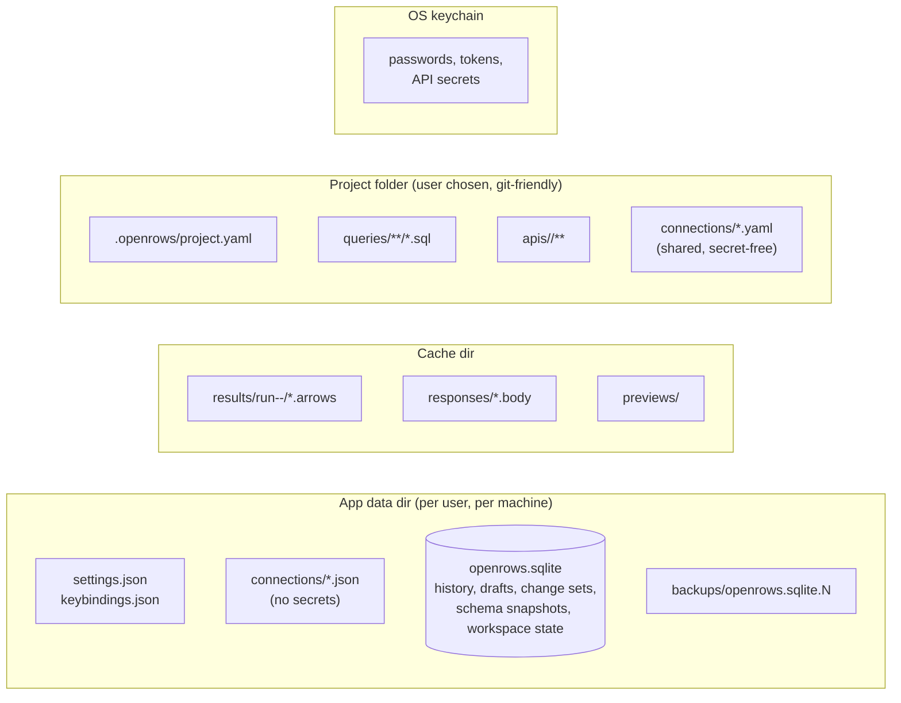

# 15 — Storage and Persistence

## 1. What is stored where



| Platform | App data | Cache | Logs |
| --- | --- | --- | --- |
| macOS | `~/Library/Application Support/com.prabhavalabs.openrows/` | `~/Library/Caches/com.prabhavalabs.openrows/` | `~/Library/Logs/OpenRows/` |
| Windows | `%APPDATA%\OpenRows\Client\` | `%LOCALAPPDATA%\OpenRows\Client\Cache\` | `%LOCALAPPDATA%\OpenRows\Client\Logs\` |
| Linux | `$XDG_DATA_HOME/openrows/` | `$XDG_CACHE_HOME/openrows/` | `$XDG_STATE_HOME/openrows/logs/` |

Paths come from Tauri's path resolver / the `directories` crate; the bundle identifier is `com.prabhavalabs.openrows`.

## 2. Local store (SQLite)

Single SQLite database, WAL mode, `synchronous=NORMAL`, accessed only by the core through one writer task and a small reader pool.

```sql
-- Simplified schema (v1)
CREATE TABLE meta (key TEXT PRIMARY KEY, value TEXT NOT NULL);

CREATE TABLE history (
  id            INTEGER PRIMARY KEY,
  profile_id    TEXT NOT NULL,
  database      TEXT,
  started_at    INTEGER NOT NULL,          -- unix ms
  duration_ms   INTEGER,
  status        TEXT NOT NULL,             -- ok | error | cancelled
  rows          INTEGER,
  statement     TEXT NOT NULL,
  error_message TEXT,
  source        TEXT NOT NULL              -- editor | browse | edit-commit | api
);
CREATE INDEX history_profile_time ON history(profile_id, started_at DESC);
CREATE VIRTUAL TABLE history_fts USING fts5(statement, content='history', content_rowid='id');

CREATE TABLE drafts (
  tab_id      TEXT PRIMARY KEY,
  kind        TEXT NOT NULL,               -- query | api-request
  content     TEXT NOT NULL,
  file_ref    TEXT,
  updated_at  INTEGER NOT NULL
);

CREATE TABLE change_sets (
  id          TEXT PRIMARY KEY,
  tab_id      TEXT NOT NULL,
  profile_id  TEXT NOT NULL,
  target      TEXT NOT NULL,               -- JSON EditTarget
  ops         BLOB NOT NULL,               -- versioned binary (postcard) of ops + undo stack
  updated_at  INTEGER NOT NULL
);

CREATE TABLE schema_snapshots (           -- v5 (M1-16)
  profile_id    TEXT NOT NULL,
  database_name TEXT NOT NULL,
  scope         TEXT NOT NULL,             -- databases | schemas | index | objects:<kinds>:<schema>
  payload       BLOB NOT NULL,             -- versioned JSON listing (openrows-schema)
  fetched_at    INTEGER NOT NULL,
  PRIMARY KEY (profile_id, database_name, scope)
);

CREATE TABLE workspace_state (            -- v6 (M1-21, M1-26)
  window_id   TEXT NOT NULL,
  part        TEXT NOT NULL,               -- queryTabs | session
  state       TEXT NOT NULL,               -- the webview's JSON
  updated_at  INTEGER NOT NULL,
  PRIMARY KEY (window_id, part)
);

CREATE TABLE usage_stats (
  profile_id  TEXT NOT NULL,
  object      TEXT NOT NULL,
  uses        INTEGER NOT NULL,
  last_used   INTEGER NOT NULL,
  PRIMARY KEY (profile_id, object)
);

CREATE TABLE api_history (
  id          INTEGER PRIMARY KEY,
  request_ref TEXT,
  method      TEXT, url TEXT, status INTEGER,
  started_at  INTEGER NOT NULL,
  timings     TEXT,                        -- JSON
  response_meta TEXT,                      -- headers, size; body stored only if small or user-pinned
  body_ref    TEXT
);
```

Retention defaults: history 90 days or 100 000 entries per profile (whichever first); API history 30 days; schema snapshots evicted when the profile is deleted or after 60 days unused.

## 3. Connection profiles

Two layers, merged at runtime:

| Layer | Location | Contains |
| --- | --- | --- |
| **Personal** | App data `connections/<id>.json` | Everything for the user's own connections (minus secrets). |
| **Shared** | Project `connections/*.yaml` | Team-shared definitions: driver, host, port, database, SSH bastion host, TLS mode, env tag. No usernames or secrets by default. Each user binds personal credentials to a shared definition locally. |

```json
{
  "openrows": 1,
  "id": "4f0b5b4e-…",
  "name": "Orders – staging",
  "driver": "postgres",
  "group": "Orders",
  "envTag": { "kind": "staging", "color": "#d97706" },
  "params": { "host": "orders-db.staging.internal", "port": 5432, "database": "orders", "user": "app_user" },
  "secrets": { "password": "keychain" },
  "ssh": { "host": "bastion.staging", "user": "app_user", "auth": "agent" },
  "tls": { "mode": "verify-full" },
  "safety": { "readOnly": false, "confirmWrites": false },
  "session": { "mode": "per-tab", "maxSessions": 4, "startup": ["SET search_path = orders, public"] }
}
```

## 4. Settings

- `settings.json`: user-level preferences (theme, fonts, grid density, editor options, history retention, telemetry opt-in, update channel).
- Project `.openrows/project.yaml` may override a safe subset (formatting style, default page size) so teams share conventions.
- JSON Schema provided; settings UI and file stay in sync (file watcher).

<a id="5-workspaces"></a>

## 5. Projects

A Project is a folder the user opens with **Open Project Folder** (or the default personal Project in app data). A Workspace is a connection to a server/host and can contain multiple databases; it is separate from the Project folder:

```text
my-team-project/
  .openrows/
    project.yaml        # name, defaults, trusted flag is stored locally, NOT here
  connections/            # shared, secret-free connection definitions
  queries/                # .sql files, any folder structure
  apis/                   # API collections (see 11-api-client.md)
  snippets/
  .gitignore              # generated: .env, .openrows/local/
```

"Trusted" state (allowing scripts, `ors.db.query`) is stored in the local store keyed by Project path + git remote, never in the Project itself — otherwise a malicious repo could mark itself trusted.

### 5.1 Current implementation (M2-17)

- **File ▸ Open Project…** (`project_choose`) shows the native folder panel. A folder without `.openrows/project.yaml` becomes a project: the manifest is written with the folder's name and an empty `queries/` folder is created. Recent projects and the open one are remembered in webview storage (`openrows.projects`, up to 8); the project reopens on launch. **Close Project** returns the sidebar to local queries only.
- `project.yaml` (parsed with `serde_yaml_ng`): `version: 1`, `name`, optional `default_connection` (a saved connection id; selected when the project opens and no connection is active) and `query_folders` (relative paths, default `[queries]`; `.` is the project root). Unknown keys are ignored so later sections (connections, API collections) stay compatible; a newer `version` is refused.
- Path rules (`apps/desktop/src-tauri/src/projects/paths.rs`): the root is absolute and canonical; every path from the webview is relative, `/`-separated, without `..`, and its existing part must not resolve outside the root through a symlink. Items must lie inside a query folder, never in `.openrows`, and query folders themselves cannot be renamed, moved or deleted. Only folders holding a manifest can be touched, and only through the native panel can one be created. The tree skips hidden entries, does not follow symlinks, and stops at 10,000 entries or 16 levels.
- The sidebar's **Queries** segment shows the project tree, then the connection's **Local** (store-backed) queries. A query opens in a tab bound to its file (the `.sql` binding, Auto Save and outside-change detection of M1-21); renames and moves rebind open tabs. Row menu: New Query…, New Folder…, Rename…, Duplicate (`name copy.sql`, `name copy 2.sql`…), Delete… (native confirmation; folders with their contents), Reveal in Finder, Copy Path; drag a row onto a folder to move it. Nothing is overwritten: an existing target is an error. A local query's **Move to Project** writes it to the first query folder and then deletes the local copy.

## 6. Migrations

- Local store: numbered SQL migrations embedded in the binary (`openrows-store/migrations/0001_init.sql` …), applied at startup inside a transaction after a file-level backup.
- Files (profiles, settings, collections): `openrows: <version>` field; loaders upgrade in memory and write back only on the next user-initiated save, keeping a `.bak` the first time a file is upgraded across a major version.
- Downgrades: a newer local store version opened by an older app → read-only safe mode with a clear message, never corruption.

## 7. Backup and portability

- "Export everything" produces an archive of profiles (without secrets in 1.0), settings, snippets, and scratch queries.
- History is excluded by default (sensitive and large) but can be included.

## 8. Implementation notes (D-03: local store and connection profiles)

First slice of M1-02 (local store) and M1-03 (profiles). Nothing here depends on Tauri; the app wiring comes with the connection UI.

| Area | What exists |
| --- | --- |
| Crate | `crates/openrows-store`: `LocalStore` (SQLite) and the `profile` module (model, connection URL parser, file repository, `ProfileService`). The profile model lives here rather than in `openrows-core` so it can ship before the core crate; it moves (or is re-exported) when `openrows-core` takes over connection orchestration. |
| SQLite | `rusqlite` 0.40 with bundled SQLite; `journal_mode=WAL`, `synchronous=NORMAL`, `foreign_keys=ON`. One writer connection behind a `Mutex` (single-writer design); no reader pool yet. |
| Schema v1 | `migrations/0001_init.sql`: `meta` and `history` (+ `history_profile_time` index) from §2, with `CHECK` constraints on `status` / `source`. `history_fts`, drafts, snapshots, workspace state, usage stats and API history arrive with their features as later numbered migrations. |
| Schema v2 (D-09) | `migrations/0002_change_sets.sql`: `change_sets (id, profile_id, target, ops, updated_at)`, one row per edited table (`id` = connection + database + schema + table; there is no durable tab id). `target` is the JSON table reference and `ops` the webview's JSON change set (key columns, staged rows with exact originals), written on every mutation and deleted on commit or discard (docs/10 §4.3.3). The payload is user data and stays in the local database. API: `save_change_set`, `change_set(id)`, `clear_change_set`. |
| Migrations | Embedded with `include_str!`; the applied version is `PRAGMA user_version` (mirrored to `meta.schema_version`). Pending steps run in one transaction; re-opening is a no-op. Before upgrading a non-empty database it is copied with `VACUUM INTO` to `backups/openrows.sqlite.v<old>` next to the DB (consistent with WAL, unlike a raw file copy). A database newer than the build fails with `StoreError::NewerSchema` and is not touched; the read-only safe mode of §6 is the caller's job. |
| Schema v3 (M1-22) | `migrations/0003_history_search.sql`: `history_fts`, an external-content FTS5 index over `history.statement`, kept in step by insert, update and delete triggers and rebuilt once so rows recorded before v3 are searchable. `0003_history_search.down.sql` reverses it; the migration test applies, reverts and re-applies it. Search terms are quoted and matched as prefixes, so SQL punctuation cannot break a query. |
| Schema v4 (M1-21) | `migrations/0004_saved_queries.sql`: `saved_queries (id, profile_id, name, sql, created_at, updated_at)` with a `(profile_id, name)` index and a non-empty `name` check; the sidebar's Queries tab of each connection (docs/09 §2.3). Ids are UUID v7. API: `create_saved_query`, `saved_queries(profile_id)` (by name, case-insensitive), `rename_saved_query`, `delete_saved_query`. Rows are not removed when a profile is deleted yet. Query tab text is restored from webview storage for now (docs/09 §2.2), not from `drafts`. |
| Schema v5 (M1-16) | `migrations/0005_schema_snapshots.sql`: `schema_snapshots (profile_id, database_name, scope, payload, fetched_at)` keyed by connection, database and scope, with a `fetched_at` index for eviction. One row per cached listing (docs/10 §1.1); the payload is versioned JSON owned by `openrows-schema` (uncompressed: a 50 000-object index is a few MB, and no compression crate is needed yet), and rows this build cannot decode are ignored. Server version and fingerprint columns are left for the fingerprint check. API: `save_schema_snapshot` (upsert), `schema_snapshots(profile_id, database)`, `delete_schema_snapshots(profile_id)` (on `profile_delete`) and `prune_schema_snapshots(before_ms)` (at startup, 60 days). |
| Schema v6 (M1-21, M1-26) | `migrations/0006_workspace_state.sql`: `workspace_state (window_id, part, state, updated_at)`, one row per window (`main`) and part (`queryTabs`, `session`) holding the webview's JSON. API: `workspace_state`, `save_workspace_state`, `clear_workspace_state`; IPC `workspace_state_read` / `workspace_state_write` (32 MiB cap). The webview writes debounced (500 ms for tabs) and never waits for the write; on first launch after v6 it imports the old web-storage keys once, then clears them. |
| Down migrations and crash safety (M1-02) | Every migration has a `.down.sql`; the migrate test applies all up steps, all down steps newest first (leaving no schema object) and all up steps again, and compares the schema. `tests/crash_safety.rs` re-runs its own test binary as a child that writes history rows and workspace state in a loop, kills it (`SIGKILL`) after 200 committed writes, reopens the store and asserts `PRAGMA integrity_check` is `ok`, no committed history row is missing, the FTS index matches `history` and the workspace state matches the last or previous write. |
| History API | `record_history(&HistoryRecord) -> id`, `search_history(profile_id \| None, text, limit)` (newest first; text is full-text matched), `delete_history(id)` and `clear_history(profile_id)`. No retention sweep yet (FR-WS-05, M2). |
| Profiles | Personal profiles are JSON files `connections/<uuid-v7>.json`, as §3 specifies, rather than SQLite rows: they are human-readable, diff-able, easy to export, and match the shared `connections/*.yaml` layer. Groups are a `group` string on each profile; `groups()` lists the distinct names. Writes are atomic (temp file + rename) and `0600` on Unix. `load_all` returns readable profiles plus a list of unreadable files, so one corrupt file never hides the rest. Files with `openrows` > 1 are rejected (`UnsupportedFormat`). |
| Format | As in §3 with `envTag` as `{ kind, label?, color }`, `params.applicationName` and `params.options` (other libpq parameters). `tls` is `{ mode, caFile?, clientCert?, clientKey? }` (paths, D-11; files written before D-11 hold only `mode`). `ssh` (D-10) is optional: `{ host, port?, user?, auth, jumpHosts? }` where `host` may be a `~/.ssh/config` alias, `auth` is `{ "method": "password" }`, `{ "method": "privateKey", "keyFile": "~/.ssh/id_ed25519" }`, `{ "method": "agent" }` or `{ "method": "keyboardInteractive" }`, and `jumpHosts` are `[user@]host[:port]` strings, first hop first (empty: the alias's `ProxyJump`). `session` is not in the model yet (M1-05). Example: `"ssh": { "host": "bastion", "user": "ops", "auth": { "method": "privateKey", "keyFile": "~/.ssh/id_ed25519" } }`, `"tls": { "mode": "verify-ca", "caFile": "/certs/ca.pem" }`. |
| Engines (D-12) | The format stays `"openrows": 1`: `"driver"` names the engine — `postgres`, `mysql`, `mariadb` or `sqlite` — so every profile written before D-12 loads and saves byte-for-byte as before (fixture test `profiles_written_before_d12_load_and_save_unchanged`). Older builds refuse only profiles of the new engines (unknown `driver`). Server engines use `params` as above. `sqlite` profiles add `"file": { "path": "/abs/path.sqlite", "readOnly"?: true, "create"?: true }` (`create`: the file is created on the next connect, set by "New File…"), have no password, SSH or TLS (`tls.mode` is `disable`), and keep `params` at its defaults (ignored). URLs: `postgres://`, `postgresql://`, `mysql://` and `mariadb://` (default port 3306; `ssl-mode` accepts `DISABLED`, `PREFERRED`, `REQUIRED`, `VERIFY_CA`, `VERIFY_IDENTITY` as well as libpq `sslmode`) and `sqlite:/abs/path` or `sqlite:///abs/path` (`?mode=ro` opens read-only). A profile without a database opens the engine's home database: `postgres`, `information_schema`, or `main` for a file. `recordHistory` (M1-22) is written only when it is `false`; without it the connection records its statements in history. |
| Secrets | `secrets` holds only `"keychain"` markers: `password`, `sshPassword`, `sshPassphrase`, `tlsKeyPassphrase`. Values live in `openrows-secrets` under `conn/<id>/password`, `conn/<id>/ssh-password`, `conn/<id>/ssh-passphrase` and `conn/<id>/tls-key-passphrase` (docs/12 §8). Saving removes secrets the settings no longer use (SSH turned off, another auth method, no client key); duplicate copies every secret; delete removes them all. |
| Settings (M1-26) | `settings.json` in the app-data dir: `{ "openrows": 1, "theme", "general", "appearance", "editor", "execution", "shortcuts", "diagnostics", "results", "snippets", "tools" }` (`tools` holds the Settings ▸ Tools paths of `pgDump`, `pgRestore`, `psql`, `mysqldump` and `mysql`, read by the core when a backup or restore starts, empty for automatic; `results.memoryBudgetMb`, default 512, is the result store budget read by the core at launch, docs/06 §9; `diagnostics` holds `logLevel`, read by the core at launch, and the `crashReports` stub, which defaults to off; `run-marker.json` next to it is the crash marker of docs/14 §2.1), written by the webview through `settings_write` (Rust checks the envelope, pretty-prints and writes atomically; files from a newer format are refused) about 300 ms after a change, with `"$schema": "./settings.schema.json"` first; that JSON Schema (`apps/desktop/src-tauri/settings.schema.json`, hand-written and checked against the stores by a test) is written beside the file at launch so editors validate and complete it. The core checks the file's size and modification time once a second and, on an edit made outside the app (its own writes are recognised), re-applies the keepalive and emits `settings-changed`; the webview then loads the file into the stores and every reader re-renders, while a file that no longer parses is ignored until it is fixed. The result memory budget still applies at the next launch. On launch the file is loaded into the `openrows.*` web-storage keys before the first render; when it does not exist yet, those keys are migrated into it. An unreadable file is left untouched and settings stay device-local for that session. Keybindings live in `shortcuts` (overrides only; `null` removes a default) rather than a separate `keybindings.json`. Session restore state (open connections, their databases and the active one; query and table tabs) lives in the local store's `workspace_state` (schema v6); the former `openrows.session` and `openrows.queryTabs` web-storage keys are imported once and then cleared. |


## 9. Implemented (M2-21): open connection exchange

**File ▸ Export Connections…** exports selected profiles, a named group or all profiles. Connection row menus offer the same scopes. **Import Connections…** previews OpenRows JSON, pgpass, libpq services or MySQL option groups. The open format is named `openrows-connections`; its envelope is exactly `"format": "openrows.connections", "version": 1`. The JSON Schema is [connections.schema.json](../apps/desktop/src-tauri/connections.schema.json), draft 2020-12, used to validate both exports and imports.

```json
{
  "format": "openrows.connections",
  "version": 1,
  "profiles": [
    {
      "name": "Local development",
      "driver": "postgres",
      "group": "Development",
      "tags": ["example"],
      "envTag": { "kind": "local", "color": "#6b7280" },
      "params": { "host": "localhost", "port": 5432, "database": "app", "user": "app", "options": { "connect_timeout": "10" } },
      "passwordStorage": "none",
      "tls": { "mode": "prefer", "caFile": "/certificates/ca.pem" },
      "safety": { "readOnly": false, "confirmWrites": false }
    }
  ]
}
```

Each profile preserves its name, driver, group, string tags, environment label/colour, read-only and confirmation switches, server/file settings, TLS paths/cloud CA, SSH authentication method/key path/jump hosts, proxy settings, history policy and session limits. Optional fields use the defaults of the personal profile model. Password storage is `keychain` (default), `ask`, `none` or `command`. A command adds `credentialCommand: { "program": "/absolute/provider", "args": ["literal", "arguments"], "timeoutSeconds": 10 }`; the timeout range is 1–120 seconds. Program and arguments are configuration and must never contain credentials. Only file **paths** are serialized: no certificate/private-key file is opened by the exporter.

Ids, secret references, passwords, passphrases, tokens, command output and machine-local trust are excluded. Opaque startup SQL and arbitrary driver options are deliberately excluded because they may contain secret literals; the only portable extra option in v1 is `connect_timeout`. Private-key contents and secret-bearing exports remain excluded from 1.0 (G02).

Imports reject future versions with a typed error and report malformed JSON with line/column. Unknown fields are ignored recursively with field-path warnings; values are never echoed in errors. Inputs are bounded to 4 MiB. The conflict sheet labels New, Same name exists (Skip / Replace / Keep both with a unique numeric suffix), or Identical (skip). Identical compares portable settings, ignoring ids and keychain state. A core-owned, single-use preview token retains optional third-party passwords only in memory; Cancel/unmount drops it. Changing saved profiles since preview refuses confirmation without writes. Confirmation validates all decisions before writes, gives imported profiles new ids and `imported: true`, and never copies command trust. Replace creates the new profile before deleting the previous profile and its keychain items. File/keychain I/O failure can leave earlier successfully imported rows saved; imports are not a multi-file transaction.

Public sources: [libpq pgpass](https://www.postgresql.org/docs/current/libpq-pgpass.html), [libpq service files](https://www.postgresql.org/docs/current/libpq-pgservice.html), and [MySQL option files](https://dev.mysql.com/doc/refman/8.4/en/option-files.html). Defaults are `~/.pgpass` (or `PGPASSFILE`), `~/.pg_service.conf` (or `PGSERVICEFILE`, plus `PGSYSCONFDIR/pg_service.conf` when set), and `~/.my.cnf`. Any wildcard pgpass address field is skipped with a note because it cannot uniquely identify a connection. Service sections map the documented connection/TLS fields, application name and connect timeout. MySQL imports `[client]`, `[mysql]` and `[client<suffix>]`, including quoted values, escapes, sockets and TLS paths. Unknown keys/groups and `!include`/`!includedir` produce notes; includes are never followed. Missing files say “not found”. Passwords from public files stay in the core and reach the keychain only through an unchecked-by-default per-row checkbox. Proprietary/encrypted formats remain excluded (G01).

### M2-24b helper exchange extension

The v1 JSON Schema now includes `helper` for SSM, Kubernetes, Cloud SQL/AlloyDB,
Cloudflare Access and Custom routes. Custom stores `program`, template `args`
and optional `readyTimeoutSeconds`; placeholders remain unexpanded in exports.
These are configuration, so they must not contain secrets. Local command trust
is never exported. Import validates the helper, allocates a fresh profile id and
requires a new hop-purpose approval before execution, including Replace imports.
This additive v1 extension needs no profile-format migration.

## 10. Sidebar local state (M2-23)

- `openrows.sidebarObjects.v1`: keyed web-storage entries under JSON `[profileId, database]`, using the same validated keyed-store pattern as table presentation. Each entry contains ordered `favourites`, newest-first `recent` (50 stored, 15 shown) and its write timestamp. Identities contain `profileId`, `database`, `schema`, `kind`, `name` and nullable routine `arguments`; no session id, catalog ordinal or mutable display text. Corrupt identities are discarded and duplicates removed. Favourite scopes are not evicted; only recent objects have a cap. This state is outside connection files, settings export and project sync.
- `openrows.sidebar.v1`: per-profile text/kind/schema filters, hidden section ids and `systemObjects` (default false). Mirrored as the `sidebar` map in device-local `settings.json`, validated against the settings schema; empty kind/schema lists mean all supported kinds/current schema. Unknown section ids are discarded. These choices follow a connection across its databases and reconnects.
- Both use versioned keys. Missing favourites stay in the identity list until explicitly removed; their availability comes from ordinary refreshed catalog sections, without a separate verification request.
