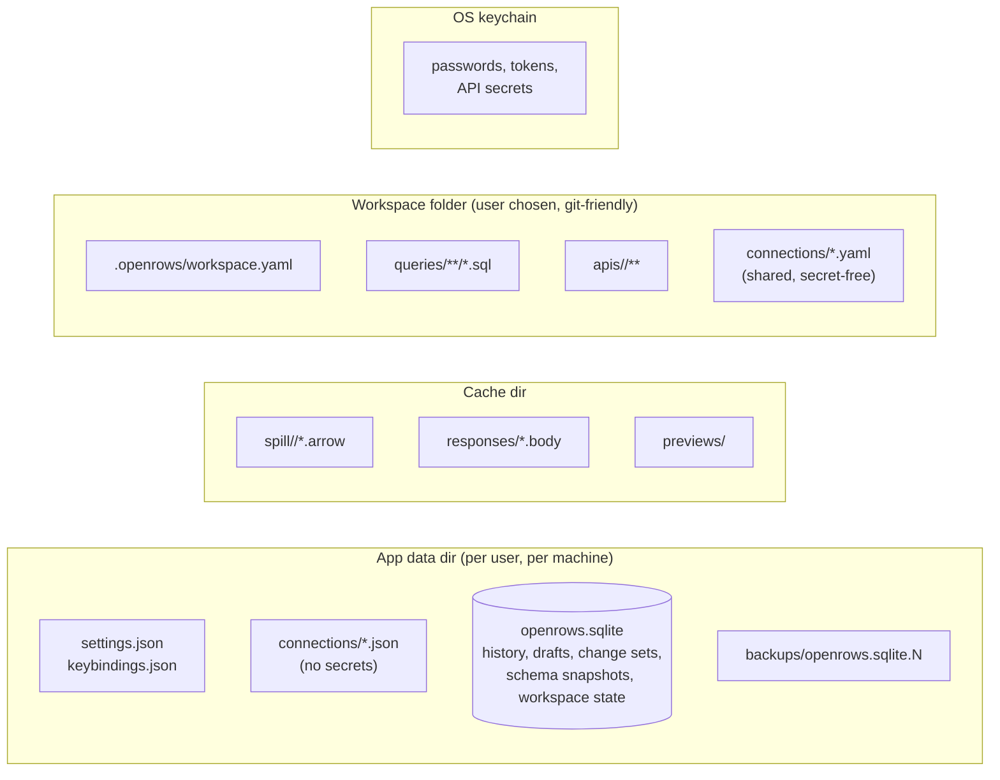

# 15 — Storage and Persistence

## 1. What is stored where



| Platform | App data | Cache | Logs |
| --- | --- | --- | --- |
| macOS | `~/Library/Application Support/com.prabhavalabs.openrows/` | `~/Library/Caches/com.prabhavalabs.openrows/` | `~/Library/Logs/OpenRows/` |
| Windows | `%APPDATA%\OpenRows\Client\` | `%LOCALAPPDATA%\OpenRows\Client\Cache\` | `%LOCALAPPDATA%\OpenRows\Client\Logs\` |
| Linux | `$XDG_DATA_HOME/openrows/` | `$XDG_CACHE_HOME/openrows/` | `$XDG_STATE_HOME/openrows/logs/` |

Paths come from Tauri's path resolver / the `directories` crate; the bundle identifier is `com.prabhavalabs.openrows`.

## 2. Local store (SQLite)

Single SQLite database, WAL mode, `synchronous=NORMAL`, accessed only by the core through one writer task and a small reader pool.

```sql
-- Simplified schema (v1)
CREATE TABLE meta (key TEXT PRIMARY KEY, value TEXT NOT NULL);

CREATE TABLE history (
  id            INTEGER PRIMARY KEY,
  profile_id    TEXT NOT NULL,
  database      TEXT,
  started_at    INTEGER NOT NULL,          -- unix ms
  duration_ms   INTEGER,
  status        TEXT NOT NULL,             -- ok | error | cancelled
  rows          INTEGER,
  statement     TEXT NOT NULL,
  error_message TEXT,
  source        TEXT NOT NULL              -- editor | browse | edit-commit | api
);
CREATE INDEX history_profile_time ON history(profile_id, started_at DESC);
CREATE VIRTUAL TABLE history_fts USING fts5(statement, content='history', content_rowid='id');

CREATE TABLE drafts (
  tab_id      TEXT PRIMARY KEY,
  kind        TEXT NOT NULL,               -- query | api-request
  content     TEXT NOT NULL,
  file_ref    TEXT,
  updated_at  INTEGER NOT NULL
);

CREATE TABLE change_sets (
  id          TEXT PRIMARY KEY,
  tab_id      TEXT NOT NULL,
  profile_id  TEXT NOT NULL,
  target      TEXT NOT NULL,               -- JSON EditTarget
  ops         BLOB NOT NULL,               -- versioned binary (postcard) of ops + undo stack
  updated_at  INTEGER NOT NULL
);

CREATE TABLE schema_snapshots (
  profile_id  TEXT NOT NULL,
  scope       TEXT NOT NULL,               -- object path
  server_ver  TEXT NOT NULL,
  fingerprint TEXT,
  payload     BLOB NOT NULL,               -- compressed
  fetched_at  INTEGER NOT NULL,
  PRIMARY KEY (profile_id, scope)
);

CREATE TABLE workspace_state (
  window_id   TEXT PRIMARY KEY,
  state       TEXT NOT NULL,               -- JSON: tabs, layout
  updated_at  INTEGER NOT NULL
);

CREATE TABLE usage_stats (
  profile_id  TEXT NOT NULL,
  object      TEXT NOT NULL,
  uses        INTEGER NOT NULL,
  last_used   INTEGER NOT NULL,
  PRIMARY KEY (profile_id, object)
);

CREATE TABLE api_history (
  id          INTEGER PRIMARY KEY,
  request_ref TEXT,
  method      TEXT, url TEXT, status INTEGER,
  started_at  INTEGER NOT NULL,
  timings     TEXT,                        -- JSON
  response_meta TEXT,                      -- headers, size; body stored only if small or user-pinned
  body_ref    TEXT
);
```

Retention defaults: history 90 days or 100 000 entries per profile (whichever first); API history 30 days; schema snapshots evicted when the profile is deleted or after 60 days unused.

## 3. Connection profiles

Two layers, merged at runtime:

| Layer | Location | Contains |
| --- | --- | --- |
| **Personal** | App data `connections/<id>.json` | Everything for the user's own connections (minus secrets). |
| **Shared** | Workspace `connections/*.yaml` | Team-shared definitions: driver, host, port, database, SSH bastion host, TLS mode, env tag. No usernames or secrets by default. Each user binds personal credentials to a shared definition locally. |

```json
{
  "openrows": 1,
  "id": "4f0b5b4e-…",
  "name": "Orders – staging",
  "driver": "postgres",
  "group": "Orders",
  "envTag": "staging",
  "params": { "host": "orders-db.staging.internal", "port": 5432, "database": "orders", "user": "app_user" },
  "secrets": { "password": "keychain" },
  "ssh": { "host": "bastion.staging", "user": "app_user", "auth": "agent" },
  "tls": { "mode": "verify-full" },
  "safety": { "readOnly": false, "confirmWrites": false },
  "session": { "mode": "per-tab", "maxSessions": 4, "startup": ["SET search_path = orders, public"] }
}
```

## 4. Settings

- `settings.json`: user-level preferences (theme, fonts, grid density, editor options, history retention, telemetry opt-in, update channel).
- Workspace `.openrows/workspace.yaml` may override a safe subset (formatting style, default page size) so teams share conventions.
- JSON Schema provided; settings UI and file stay in sync (file watcher).

## 5. Workspaces

A workspace is a folder the user opens (or the default personal workspace in app data):

```text
my-team-workspace/
  .openrows/
    workspace.yaml        # name, defaults, trusted flag is stored locally, NOT here
  connections/            # shared, secret-free connection definitions
  queries/                # .sql files, any folder structure
  apis/                   # API collections (see 11-api-client.md)
  snippets/
  .gitignore              # generated: .env, .openrows/local/
```

"Trusted" state (allowing scripts, `ors.db.query`) is stored in the local store keyed by workspace path + git remote, never in the workspace itself — otherwise a malicious repo could mark itself trusted.

## 6. Migrations

- Local store: numbered SQL migrations embedded in the binary (`openrows-store/migrations/0001_init.sql` …), applied at startup inside a transaction after a file-level backup.
- Files (profiles, settings, collections): `openrows: <version>` field; loaders upgrade in memory and write back only on the next user-initiated save, keeping a `.bak` the first time a file is upgraded across a major version.
- Downgrades: a newer local store version opened by an older app → read-only safe mode with a clear message, never corruption.

## 7. Backup and portability

- "Export everything" produces an archive of profiles (optionally with encrypted secrets), settings, snippets, and scratch queries.
- History is excluded by default (sensitive and large) but can be included.
