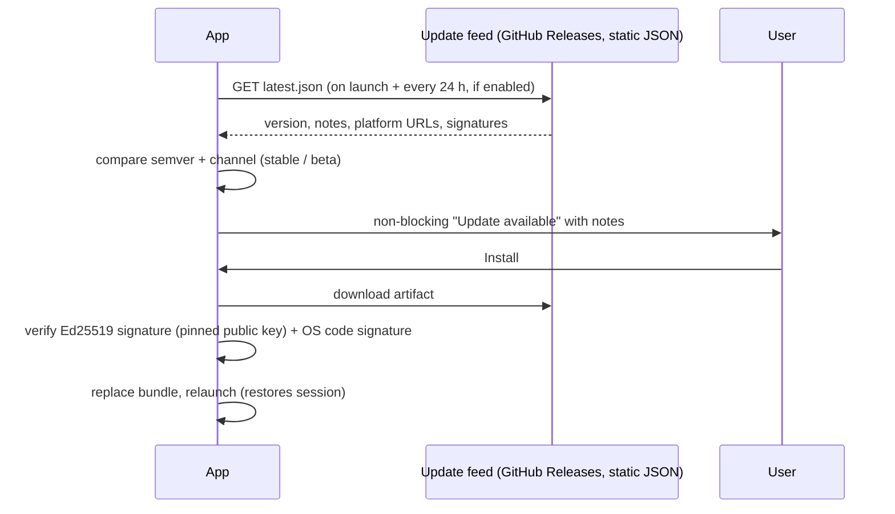

# 16 — Platform and Distribution

## 1. Strategy: macOS first, portable always

The core engine is OS-agnostic and tested on macOS, Windows and Linux from the first commit (NFR-PORT-03). The UI ships on macOS first; Windows and Linux follow once the macOS alpha stabilises (see [19-roadmap.md](19-roadmap.md)). Platform-specific code lives behind small traits in `openrows-platform` (keychain extras, file reveal, appearance, biometric unlock).

## 2. Webview differences

| | macOS | Windows | Linux |
| --- | --- | --- | --- |
| Engine | WKWebView (Safari/WebKit) | WebView2 (Chromium, Evergreen) | WebKitGTK 4.1 |
| JS/canvas performance | Very good | Very good | Varies by distro/GPU; weakest target |
| DevTools | Safari Web Inspector | Edge DevTools | WebKit inspector |
| Known pitfalls | Older WebKit on older macOS versions — check feature support (e.g. `OffscreenCanvas` text in workers needs Safari 16.4+/macOS 13.3+; fallback path required for macOS 12) | Large IPC payload performance different from WebKit; test both | Hardware acceleration bugs on some drivers (DMABUF renderer); font rendering differences |

Rules:

- CI runs the UI test suite on all three engines (Playwright WebKit + Chromium approximate webview engines; real-app smoke tests per OS).
- Feature detection, never UA sniffing. Each modern API used has a documented fallback or a minimum-version gate.
- Supported minimums: macOS 12 Monterey; Windows 10 1809+ with WebView2; Linux with WebKitGTK 4.1 (Ubuntu 22.04+, Fedora 38+, Debian 12+).

## 3. macOS specifics

| Area | Plan |
| --- | --- |
| Architecture | Universal binary (`aarch64-apple-darwin` + `x86_64-apple-darwin`, `lipo`), or separate downloads if size matters; DMG ≤ 40 MB target. |
| Window chrome | Native traffic lights with a transparent, overlay titlebar (`titleBarStyle: Overlay`) so the toolbar sits in the titlebar area; vibrancy for sidebar (`NSVisualEffectView` via `window-vibrancy`); on macOS 26+ the Liquid Glass material (`NSGlassEffectView`) behind a transparent webview via a small objc2 bridge in `openrows-platform`, with CSS `backdrop-filter` glass inside the webview and solid fallbacks when "Reduce transparency" is on; full-screen and Stage Manager friendly. See [20-ux-foundations.md §3.2](20-ux-foundations.md#32-macos-native-design-methodology-macos-26-era). |
| Menus | Native menu bar generated from the command registry (App, File, Edit, View, Query, Connection, Window, Help) with user shortcuts. |
| Keyboard | ⌘-based defaults; respects system text editing shortcuts (⌥⌫, ⌃A/⌃E) in text fields and editor. |
| Appearance | Follows system light/dark; accent colour from system where appropriate. |
| Keychain | Generic password items under service `com.prabhavalabs.openrows`; access restricted to the signed app. Optional Touch ID for revealing/using prod secrets (P1). |
| SSH agent | Uses `SSH_AUTH_SOCK` from launchd; supports macOS Keychain-backed keys via agent; 1Password/Secretive agents work through the same socket. |
| File access | Not sandboxed (Developer ID distribution) so SSH keys, `~/.ssh/config`, `pgpass`, local SQLite files work without friction. A Mac App Store build (sandboxed, security-scoped bookmarks) is a post-1.0 option. |
| Signing & notarization | Developer ID Application certificate, hardened runtime, entitlements: `com.apple.security.network.client` is only needed if sandboxed; for hardened runtime we avoid `allow-jit`/`disable-library-validation` unless required by FFI drivers loaded in the driver host (Oracle Instant Client is user-installed and unsigned by us → load inside the separately-signed `openrows-driver-host` helper with `disable-library-validation`, keeping the main app strict). Notarized via `notarytool` in CI; stapled. |
| Deep links | `openrows://` scheme for OAuth callbacks and "open connection" links (with confirmation). |
| Services / Quick actions | P2: "Open in OpenRows" for `.sqlite`/`.db`/`.duckdb` files via document types in `Info.plist`. |

### M0-T4c toolbar geometry

The overlay window explicitly enables decorations and sets `trafficLightPosition`
to `{ "x": 16, "y": 26 }` in logical pixels. The toolbar is 48 CSS px tall,
with centre line y = 24; all controls and context children use flex centring.
The native close button starts at x = 16. Button size and pitch differ between
macOS releases: before macOS 26 the cluster ends at x ≈ 70, on macOS 26 at
x ≈ 78. So the app measures the real zoom button at first paint
(`src-tauri/src/titlebar.rs`, safe objc2 calls) and sets
`--or-traffic-light-clearance` to its right edge plus 8 px, the same gap used
between toolbar groups. Full screen hides the lights, so the inset falls back
to the 10 px toolbar padding there. The 86 px token is only the fallback
(macOS 26 geometry) outside the native shell. These pixel geometry tokens stay
fixed when text scales.

Tauri's y value is a titlebar inset, not a button-centre coordinate, so the
value was set empirically: with y = 26 the button centres sit on the toolbar
centre line within 1 px in a Retina screenshot of the release build (the
computed y = 20 left them about 6 pt high). Re-check by screenshot whenever the
toolbar height or the window inset changes.
See [Tauri window configuration](https://v2.tauri.app/reference/config/#trafficlightposition)
and [Tao native inset implementation](https://github.com/tauri-apps/tao/blob/tao-v0.34.5/src/platform_impl/macos/view.rs#L1078).
This establishes the intended alignment; the maintainer must verify the actual
native frame by screenshot on their macOS version. No synthetic buttons are drawn.

### Main window size and position

`tauri.conf.json` keeps 1280 × 800 as a fallback and 900 × 600 as the minimum.
Before the hidden main window is first revealed, `window_frame.rs` either
restores the saved frame or, on first launch, sizes the window to 85 % of the
current monitor's work area (capped at 1680 × 1050, never below the minimum)
and centres it. Size, position and maximized state are saved by the official
`tauri-plugin-window-state` 500 ms after the visible window stops moving or
resizing (so a killed `just dev` keeps them) and again on quit, to
`.window-state.json` in the app config
directory (`~/Library/Application Support/com.prabhavalabs.openrows/` on
macOS); delete that file to get the first-launch size again. A saved frame that
no longer overlaps a connected monitor by at least a quarter of its width and
height is ignored and the first-launch sizing is used instead. Full-screen and
visibility are not restored.

### Implemented M0-T4b native material

`apps/desktop/src-tauri/src/material.rs` applies Tauri's `Effect::Sidebar` through
its existing `window-vibrancy` integration. This installs an `NSVisualEffectView`
behind the transparent WKWebView. `FollowsWindowActiveState` follows the native
window; the effect radius and the webview's `--or-radius-window` match AppKit's
titled-window corner (16 pt on macOS 26, 10 pt before, set at runtime from the
OS version), native decorations and shadow remain enabled,
and `titleBarStyle: Overlay` retains the real traffic lights. DOM traffic lights
are not drawn. The webview root is transparent; the table, grid, SQL and sheet
surfaces use opaque theme tokens for legibility. Rail, sidebar and inspector use
the glass tokens over the desktop material.

Transparent WKWebView requires `app.macOSPrivateApi: true` in `tauri.conf.json`
and Tauri's `macos-private-api` Cargo feature. This uses private WebKit APIs and
is appropriate for the planned Developer ID distribution; a Mac App Store build
would need to remove that dependency on private API and redesign the material
boundary. This task uses NSVisualEffectView on all supported macOS versions;
NSGlassEffectView and Windows/Linux vibrancy are not implemented.

The macOS-only `objc2-app-kit` dependency exposes the safe `NSWorkspace` Reduce
Transparency accessor (no custom unsafe FFI). At setup, first-paint readiness and
window focus, the app checks the native preference, clears native effects when
reduced, and sets `data-transparency="reduced"` on the document root so glass
becomes solid. Native accessibility changes made in System Settings are reflected
when returning focus to OpenRows. The CSS reduced-transparency media query is also
retained. No IPC command is added. Other platforms compile without the native
material module. See Apple's [Reduce Transparency accessor](https://developer.apple.com/documentation/appkit/nsworkspace/accessibilitydisplayshouldreducetransparency)
and [Tauri window effects](https://docs.rs/tauri/latest/tauri/webview/struct.WebviewWindow.html#method.set_effects).

The review sheet uses native HTML dialog focus containment and dismissal; a fixed
modal, inert-background and focus-loop fallback supports WebKit before dialog
support (macOS 12.0–12.2). Build/tests cannot prove desktop translucency, native
rounding/shadow, or light/dark appearance over different wallpapers: verify these
locally along with Reduce Transparency and inactive-window material changes.

## 4. Windows specifics (pre-1.0)

- Installers: MSI (WiX) for enterprise and NSIS `.exe` for consumers; per-user install by default (no admin).
- WebView2 Evergreen bootstrapper embedded; offline installer variant for air-gapped environments.
- Code signing with an EV or OV certificate (or Azure Trusted Signing) to avoid SmartScreen warnings.
- Credential Manager for secrets; Windows OpenSSH agent named pipe and Pageant support for SSH.
- Snap layouts, Mica backdrop (optional), high-contrast themes mapped to our high-contrast tokens.
- ARM64 build.

## 5. Linux specifics (pre-1.0)

- Packages: AppImage (universal), `.deb`, `.rpm`; Flatpak on Flathub; optionally Snap.
- Secret Service (GNOME Keyring/KWallet) via `keyring`; encrypted file fallback (see [12-security.md](12-security.md)).
- Wayland and X11; document known WebKitGTK workarounds (e.g. `WEBKIT_DISABLE_DMABUF_RENDERER=1`) and apply automatically when a known-bad configuration is detected.
- Respect XDG directories and desktop file integration.

## 6. Updates



- The Tauri updater plugin verifies Ed25519 signatures before installation. The
  build pins the public key; the webview can select only `stable` or `beta`, not
  arbitrary URLs or keys. Builds without a release public key/feed make no requests.
- Settings ▸ General ▸ Update notifications disables launch, daily and manual
  checks. Update channel selects stable or beta. Checks show a non-blocking notice
  with release notes rendered as text. “Later” dismisses the current notice.
- Installation requires explicit “Install and restart” approval, all tabs closed
  through their existing dirty-tab guards, and every connection disconnected.
  A modal blocks workspace interaction during download, verification and install.
  Failed checks/downloads/signature verification report an error and never restart.
- Homebrew users disable Update notifications and use `brew upgrade`.

## 7. Distribution channels

| Channel | Platform | Milestone |
| --- | --- | --- |
| GitHub Releases (DMG, zip) | macOS | Alpha |
| Homebrew cask | macOS | Alpha |
| winget, Scoop, MSI/NSIS | Windows | Beta |
| AppImage, deb, rpm, Flathub | Linux | Beta |
| Mac App Store (sandboxed variant) | macOS | Post-1.0 (evaluate) |

## 8. Release process

M1-31 builds separate arm64 and x86_64 DMGs, retaining
`com.prabhavalabs.openrows`. Both the main app and the real production driver-host
sidecar use hardened runtime and `Entitlements.plist` (no sandbox, JIT or library
validation exceptions). The bundler signs nested code before the outer app. Oracle
Instant Client is not bundled; any future helper-only entitlement exception needs
its own review. Release symbols are archived outside the signed bundle by the
existing before-bundle hook.

### Local DMG

Install dependencies once with `pnpm install --frozen-lockfile`, then run
`just release-dmg`. It respects `CARGO_TARGET_DIR`, `RUSTC_WRAPPER` and build jobs,
stages the native production helper, strips release symbols, creates an ad-hoc
signed `.app` and DMG, verifies both app/helper signatures, and enforces the decimal
40,000,000-byte installer ceiling. Output is under
`$CARGO_TARGET_DIR/<native-triple>/release/bundle/{macos,dmg}`. Local mode removes
release signing/update credentials from the build environment and does not contact
Apple. Ad-hoc signing is not Developer ID notarization; downloaded builds require
local macOS approval. Use `CI=true` (already set by the recipe) to bypass Finder
layout automation during DMG creation.

### Release secrets and variables

`.github/workflows/release.yml` runs only on `v*` tags or manual dispatch selecting
an existing version tag, never on branches or pull requests. Bump the workspace
Cargo version, desktop package version and Tauri version before tagging. The
workflow checks tag/Cargo/Tauri agreement, builds on arm64 and Intel macOS runners,
and uploads both architectures to a GitHub Release. It publishes after all assets
are uploaded. Reruns can resume a draft, but cannot overwrite a published version.
CI requires the Developer ID certificate, notarization credentials,
updater private key and matching public key; missing inputs fail before publication.
Secret-free local builds remain available through `just release-dmg` and have no
update manifest.

Configure these in GitHub; never place credentials or private keys in the tree:

- `APPLE_CERTIFICATE`: base64 PKCS#12 Developer ID Application certificate;
  `APPLE_CERTIFICATE_PASSWORD`: its password; `APPLE_SIGNING_IDENTITY`: full
  Developer ID Application identity. CI imports it into a temporary keychain,
  removes the import file immediately and deletes the keychain on exit.
- Notarization: `APPLE_ID`, `APPLE_TEAM_ID`, `APPLE_PASSWORD` (app-specific password),
  **or** `APPLE_API_ISSUER`, `APPLE_API_KEY` (key ID), `APPLE_API_PRIVATE_KEY` (key
  content). CI writes the API key temporarily with mode 0600 and removes it on exit.
  Outside CI Tauri also accepts `APPLE_API_KEY_PATH` directly.
- `TAURI_SIGNING_PRIVATE_KEY` and optional `TAURI_SIGNING_PRIVATE_KEY_PASSWORD`:
  Tauri updater signing secrets. `TAURI_SIGNING_PUBLIC_KEY` is a repository variable
  containing the matching Tauri public key. Keep the key pair stable across releases;
  generating a new key breaks updates for existing installations.

`scripts/release-macos.sh release <triple>` uses these environment variables.
`scripts/release-config.py` merges only public feed/key configuration into Tauri
and the frontend. Signing and updater credentials are independent: Apple-only
builds sign/notarize but omit updater assets; updater-only builds cannot claim
Developer ID/Gatekeeper acceptance. These partial diagnostic builds do not pass
the production workflow, which requires all signing inputs. Tauri notarizes/staples
the app; the workflow additionally signs, notarizes and staples each DMG. Installer size and app/helper
signature checks fail the build before upload.

`scripts/release-artifacts.py` preserves signed archive bytes while assigning
architecture-specific names and generates a static manifest only when both
architectures have non-empty archives/signatures. Notes come from GitHub's release
notes. Stable manifests live at `/releases/latest/download/stable.json`. Prerelease
manifests are also uploaded to the prerelease `update-beta` feed tag **after** the
versioned release is published. That feed tag does not match `v*` and cannot trigger
a build. Failed/partial builds never advance either channel. Keep `update-beta`
marked as a prerelease so it cannot take over GitHub's stable latest release.

Before production publication, verify a downloaded DMG on a fresh Mac, run
`spctl --assess --type execute --verbose OpenRows.app`, test the packaged host,
and perform an update from the previous signed version on both architectures.
Actual Developer ID, notarization, Gatekeeper and update installation require the
owner's credentials and an existing signed release; local ad-hoc builds alone
cannot prove these gates.

Fill `packaging/homebrew/openrows.rb.template` with version, repository and the
SHA-256 of each **final stapled** DMG (`shasum -a 256 ...`); publish it in the
maintainer's Homebrew tap. The template supports both architectures and macOS 12+.
`just release-test` covers public configuration, manifest assembly, missing
signatures, bundle policy, workflow triggers and installer-size boundaries.
See [Tauri signing](https://v2.tauri.app/distribute/sign/macos/) and
[Tauri updater](https://v2.tauri.app/plugin/updater/) for credential/key formats.

## Implemented (M2-22b): file handoffs and update preferences

Tauri bundle associations register `.sqlite`, `.sqlite3`, `.db`, `.duckdb` and
`.sql`. macOS `RunEvent::Opened` and non-macOS launch argv enter a bounded native
queue; the unlocked frontend drains it. SQLite files require the 16-byte SQLite
magic header. SQL is bounded to 16 MiB, UTF-8 and rejects binary control bytes;
it opens a new editor without running any statement. Unexpected content displays
an error. DuckDB displays “DuckDB coming in M2-04”. Projects remain directories
with `.openrows/project.yaml`; there is no standalone workspace-file association.
Local database connection menus reveal their saved path using the native launcher;
existing export jobs retain Show in Finder/File Manager. Registry shortcuts and
platform native menu accelerators remain the single command route.

`general.updateChannel` defaults to `stable`; `beta` selects a distinct manifest.
`general.updateNotifications` defaults to true and controls the implemented updater
checks (§6, §8). Feed and public-key configuration is injected only into release
builds; the default source configuration stays null. Opt-in crash reporting remains
a stored off-by-default preference with no reporting service. Windows/Linux bundle
execution and actual Finder association registration require packaged-platform
verification (M6).

## 9. Implemented (M2-01c): driver-host packaging

`bundle.externalBin = ["binaries/openrows-driver-host"]` installs the helper in
`Contents/MacOS/` on macOS and beside the main executable on Windows/Linux.
`just stage-host [profile] [target-triple]` builds only the production binary
with no default/test features and copies it to the gitignored target-suffixed
`apps/desktop/src-tauri/binaries/` directory (`.exe` on Windows). It respects
CARGO_TARGET_DIR/RUSTC_WRAPPER; the default profile is release. Staging always
passes `--target <triple>`, including native builds, so its build output is
`$CARGO_TARGET_DIR/<triple>/<profile>/openrows-driver-host` (`debug` for `dev`,
`.exe` on Windows). Tauri copies it to the top-level profile directory beside
the app for dev and installed resolution. Tests/benches therefore launch Cargo's
separately named `host-test-fixture` via `CARGO_BIN_EXE_host-test-fixture`; neither
staging nor Tauri's copy overwrites or aliases that feature-enabled helper.
The fixture shares the production process entry, requires `test-sqlite`, and
is never staged or bundled. Benchmarks no longer need `OPENROWS_HOST_BIN`.
No placeholder
is ever staged or shipped. `just lint`, `test`, `gen-ipc`, `ipc-check` and `dev`
stage a dev-profile production helper automatically; `build-app` stages release.
The Tauri before-dev/build hooks also stage for direct CLI use. Raw desktop
Cargo commands require `just stage-host dev` first, or the matching target
argument when cross-compiling. Ubuntu CI explicitly stages before Clippy/tests
and runs the staging-isolation regression tests (`just script-test` locally).
The release script sets `CARGO_BUILD_TARGET` and stages the matching helper for
each architecture; universal app/helper assembly is not used.

macOS uses explicit hardened runtime and local `signingIdentity: "-"`.
`APPLE_SIGNING_IDENTITY` overrides that default when the owner's Developer ID
exists. Inspection of [Tauri 2.12.1 bundling](https://github.com/tauri-apps/tauri/blob/tauri-cli-v2.12.1/crates/tauri-bundler/src/bundle/macos/app.rs)
confirms sidecars are signed before the outer app; the same selected identity
and runtime policy apply. The explicit empty entitlement file keeps both binaries strict. Use Tauri's
[notarization credentials](https://v2.tauri.app/distribute/sign/macos/#notarization)
and verify/staple the final app/DMG; certificates and credentials stay outside
Git. `just dev` signs the unsuffixed copied helper and app with the stable dev
identity, with hardened runtime, when available.

Windows releases must Authenticode-sign the helper/native libraries, app and
MSI/NSIS installer using the owner's configured certificate or signing service.
Linux must retain helper execute permissions and verify signed package/feed
artifacts (and distro signing where used). No keys or hosted signing service
are invented. Developer ID, notarization/stapling, Windows compilation and
Windows/Linux installed package smoke remain gaps until their prerequisites
and release runners exist. Local evidence is in ADR-0010.

To verify a built macOS app without opening its UI (use an absolute CARGO_TARGET_DIR):

```sh
just build-app
OPENROWS_PACKAGED_SMOKE=1 OPENROWS_PACKAGED_APP="$CARGO_TARGET_DIR/release/bundle/macos/OpenRows.app" \
  cargo test --release --locked -p openrows-host-client --test packaged -- --nocapture
```

Other platforms use `OPENROWS_PACKAGED_EXECUTABLE=/absolute/installed/openrows-app`
(with `.exe` on Windows) instead of `OPENROWS_PACKAGED_APP`. For debug-only
overrides set `OPENROWS_DEV_HOST=/absolute/helper`; release ignores this variable.
