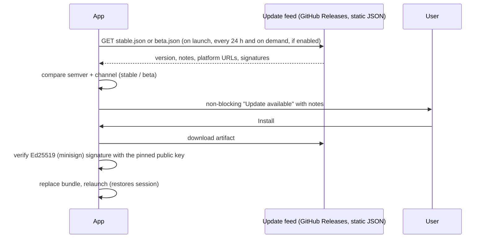

# 16 — Platform and Distribution

## 1. Strategy: macOS first, portable always

The core engine is OS-agnostic and tested on macOS, Windows and Linux from the first commit (NFR-PORT-03). The UI ships on macOS first; Windows and Linux follow once the macOS alpha stabilises (see [19-roadmap.md](19-roadmap.md)). Platform-specific code lives behind small traits in `openrows-platform` (keychain extras, file reveal, appearance, biometric unlock).

## 2. Webview differences

| | macOS | Windows | Linux |
| --- | --- | --- | --- |
| Engine | WKWebView (Safari/WebKit) | WebView2 (Chromium, Evergreen) | WebKitGTK 4.1 |
| JS/canvas performance | Very good | Very good | Varies by distro/GPU; weakest target |
| DevTools | Safari Web Inspector | Edge DevTools | WebKit inspector |
| Known pitfalls | Older WebKit on older macOS versions — check feature support (e.g. `OffscreenCanvas` text in workers needs Safari 16.4+/macOS 13.3+; fallback path required for macOS 12) | Large IPC payload performance different from WebKit; test both | Hardware acceleration bugs on some drivers (DMABUF renderer); font rendering differences |

Rules:

- CI runs the UI test suite on all three engines (Playwright WebKit + Chromium approximate webview engines; real-app smoke tests per OS).
- Feature detection, never UA sniffing. Each modern API used has a documented fallback or a minimum-version gate.
- Supported minimums: macOS 12 Monterey; Windows 10 1809+ with WebView2; Linux with WebKitGTK 4.1 (Ubuntu 22.04+, Fedora 38+, Debian 12+).

## 3. macOS specifics

| Area | Plan |
| --- | --- |
| Architecture | Universal binary (`aarch64-apple-darwin` + `x86_64-apple-darwin`, `lipo`), or separate downloads if size matters; DMG ≤ 40 MB target. |
| Window chrome | Native traffic lights with a transparent, overlay titlebar (`titleBarStyle: Overlay`) so the toolbar sits in the titlebar area; vibrancy for sidebar (`NSVisualEffectView` via `window-vibrancy`); on macOS 26+ the Liquid Glass material (`NSGlassEffectView`) behind a transparent webview via a small objc2 bridge in `openrows-platform`, with CSS `backdrop-filter` glass inside the webview and solid fallbacks when "Reduce transparency" is on; full-screen and Stage Manager friendly. See [20-ux-foundations.md §3.2](20-ux-foundations.md#32-macos-native-design-methodology-macos-26-era). |
| Menus | Native menu bar generated from the command registry (App, File, Edit, View, Query, Connection, Window, Help) with user shortcuts. |
| Keyboard | ⌘-based defaults; respects system text editing shortcuts (⌥⌫, ⌃A/⌃E) in text fields and editor. |
| Appearance | Follows system light/dark; accent colour from system where appropriate. |
| Keychain | Generic password items under service `com.prabhavalabs.openrows`; access restricted to the signed app. Optional Touch ID for revealing/using prod secrets (P1). |
| SSH agent | Uses `SSH_AUTH_SOCK` from launchd; supports macOS Keychain-backed keys via agent; 1Password/Secretive agents work through the same socket. |
| File access | Not sandboxed (Developer ID distribution) so SSH keys, `~/.ssh/config`, `pgpass`, local SQLite files work without friction. A Mac App Store build (sandboxed, security-scoped bookmarks) is a post-1.0 option. |
| Signing & notarization | Developer ID Application certificate, hardened runtime, entitlements: `com.apple.security.network.client` is only needed if sandboxed; for hardened runtime we avoid `allow-jit`/`disable-library-validation` unless required by FFI drivers loaded in the driver host (Oracle Instant Client is user-installed and unsigned by us → load inside the separately-signed `openrows-driver-host` helper with `disable-library-validation`, keeping the main app strict). Notarized via `notarytool` in CI; stapled. |
| Deep links | `openrows://` scheme for "open connection", file, object and filtered-table links (with confirmation) and the `openrows open` command (M5-09, see [Implemented (M5-09)](#implemented-m5-09-openrows-links-and-openrows-open)); OAuth callbacks reuse the scheme when an OAuth flow needs it. |
| Services / Quick actions | P2: "Open in OpenRows" for `.sqlite`/`.db`/`.duckdb` files via document types in `Info.plist`. |

### M0-T4c toolbar geometry

The overlay window explicitly enables decorations and sets `trafficLightPosition`
to `{ "x": 16, "y": 26 }` in logical pixels. The toolbar is 48 CSS px tall,
with centre line y = 24; all controls and context children use flex centring.
The native close button starts at x = 16. Button size and pitch differ between
macOS releases: before macOS 26 the cluster ends at x ≈ 70, on macOS 26 at
x ≈ 78. So the app measures the real zoom button at first paint
(`src-tauri/src/titlebar.rs`, safe objc2 calls) and sets
`--or-traffic-light-clearance` to its right edge plus 8 px, the same gap used
between toolbar groups. Full screen hides the lights, so the inset falls back
to the 10 px toolbar padding there. The 86 px token is only the fallback
(macOS 26 geometry) outside the native shell. These pixel geometry tokens stay
fixed when text scales.

Tauri's y value is a titlebar inset, not a button-centre coordinate, so the
value was set empirically: with y = 26 the button centres sit on the toolbar
centre line within 1 px in a Retina screenshot of the release build (the
computed y = 20 left them about 6 pt high). Re-check by screenshot whenever the
toolbar height or the window inset changes.
See [Tauri window configuration](https://v2.tauri.app/reference/config/#trafficlightposition)
and [Tao native inset implementation](https://github.com/tauri-apps/tao/blob/tao-v0.34.5/src/platform_impl/macos/view.rs#L1078).
This establishes the intended alignment; the maintainer must verify the actual
native frame by screenshot on their macOS version. No synthetic buttons are drawn.

### Workspace window size and position

`tauri.conf.json` keeps 1280 × 800 as a fallback and 900 × 600 as the minimum.
Before the hidden main window is first revealed, `window_frame.rs` either
restores the saved frame or, on first launch, sizes the window to 85 % of the
current monitor's work area (capped at 1680 × 1050, never below the minimum)
and centres it. Size, position and maximized state are saved by the official
`tauri-plugin-window-state` 500 ms after the visible window stops moving or
resizing (so a killed `just dev` keeps them) and again on quit, to
`.window-state.json` in the app config
directory (`~/Library/Application Support/com.prabhavalabs.openrows/` on
macOS); delete that file to get the first-launch size again. A saved frame that
no longer overlaps a connected monitor by at least a quarter of its width and
height is ignored and the first-launch sizing is used instead. Full-screen and
visibility are not restored. Since M5-11 every workspace window (`main`,
`workspace-2` … `workspace-12`) keeps its own entry in that file and is placed
the same way when it is restored; a new window opens 26 pt down and right of
the focused one, with its size.

### Implemented M0-T4b native material

`apps/desktop/src-tauri/src/material.rs` applies Tauri's `Effect::Sidebar` through
its existing `window-vibrancy` integration. This installs an `NSVisualEffectView`
behind the transparent WKWebView. `FollowsWindowActiveState` follows the native
window; the effect radius and the webview's `--or-radius-window` match AppKit's
titled-window corner (16 pt on macOS 26, 10 pt before, set at runtime from the
OS version), native decorations and shadow remain enabled,
and `titleBarStyle: Overlay` retains the real traffic lights. DOM traffic lights
are not drawn. The webview root is transparent; the table, grid, SQL and sheet
surfaces use opaque theme tokens for legibility. Rail, sidebar and inspector use
the glass tokens over the desktop material.

Transparent WKWebView requires `app.macOSPrivateApi: true` in `tauri.conf.json`
and Tauri's `macos-private-api` Cargo feature. This uses private WebKit APIs and
is appropriate for the planned Developer ID distribution; a Mac App Store build
would need to remove that dependency on private API and redesign the material
boundary. This task uses NSVisualEffectView on all supported macOS versions;
NSGlassEffectView and Windows/Linux vibrancy are not implemented.

The macOS-only `objc2-app-kit` dependency exposes the safe `NSWorkspace` Reduce
Transparency accessor (no custom unsafe FFI). At setup, first-paint readiness and
window focus, the app checks the native preference, clears native effects when
reduced, and sets `data-transparency="reduced"` on the document root so glass
becomes solid. Native accessibility changes made in System Settings are reflected
when returning focus to OpenRows. The CSS reduced-transparency media query is also
retained. No IPC command is added. Other platforms compile without the native
material module. See Apple's [Reduce Transparency accessor](https://developer.apple.com/documentation/appkit/nsworkspace/accessibilitydisplayshouldreducetransparency)
and [Tauri window effects](https://docs.rs/tauri/latest/tauri/webview/struct.WebviewWindow.html#method.set_effects).

The review sheet uses native HTML dialog focus containment and dismissal; a fixed
modal, inert-background and focus-loop fallback supports WebKit before dialog
support (macOS 12.0–12.2). Build/tests cannot prove desktop translucency, native
rounding/shadow, or light/dark appearance over different wallpapers: verify these
locally along with Reduce Transparency and inactive-window material changes.

## 4. Windows specifics (pre-1.0)

- Installers: MSI (WiX) for enterprise and NSIS `.exe` for consumers; per-user install by default (no admin).
- WebView2 Evergreen bootstrapper embedded; offline installer variant for air-gapped environments.
- Code signing with an EV or OV certificate (or Azure Trusted Signing) to avoid SmartScreen warnings.
- Credential Manager for secrets; Windows OpenSSH agent named pipe and Pageant support for SSH.
- Snap layouts, Mica backdrop (optional), high-contrast themes mapped to our high-contrast tokens.
- ARM64 build.

## 5. Linux specifics (pre-1.0)

- Packages: AppImage (universal), `.deb`, `.rpm`; Flatpak on Flathub; optionally Snap.
- Secret Service (GNOME Keyring/KWallet) via `keyring`; encrypted file fallback (see [12-security.md](12-security.md)).
- Wayland and X11; document known WebKitGTK workarounds (e.g. `WEBKIT_DISABLE_DMABUF_RENDERER=1`) and apply automatically when a known-bad configuration is detected.
- Respect XDG directories and desktop file integration.

## 6. Updates



- The Tauri updater plugin verifies Ed25519 signatures before installation. The
  build pins the public key; the webview can select only `stable` or `beta`, not
  arbitrary URLs or keys. Feeds must use HTTPS; only debug builds also accept a
  loopback `http://127.0.0.1` feed for the local update test (§8). Builds without a
  release public key/feed make no requests.
- Settings ▸ General ▸ Update notifications disables launch, daily and manual
  checks; the Check for updates button in the same section is disabled while it is
  off. Update channel selects stable or beta. Checks show a non-blocking notice
  with collapsible release notes rendered as text. “Later” dismisses the current notice.
- Installation requires explicit “Install and restart” approval, all tabs closed
  through their existing dirty-tab guards, and every connection disconnected.
  A modal blocks workspace interaction during download, verification and install.
  Failed checks/downloads/signature verification report an error and never restart.
- Homebrew users disable Update notifications and use `brew upgrade --cask openrows`.

## 7. Distribution channels

| Channel | Platform | Milestone |
| --- | --- | --- |
| GitHub Releases (DMG, zip) | macOS | Alpha |
| Homebrew cask | macOS | Alpha |
| winget, Scoop, MSI/NSIS | Windows | Beta |
| AppImage, deb, rpm, Flathub | Linux | Beta |
| Mac App Store (sandboxed variant) | macOS | Post-1.0 (evaluate) |

## 8. Release process

M1-31 builds separate arm64 and x86_64 DMGs, retaining
`com.prabhavalabs.openrows`. Both the main app and the real production driver-host
sidecar use hardened runtime and `Entitlements.plist` (no sandbox, JIT or library
validation exceptions). The bundler signs nested code before the outer app. Oracle
Instant Client is not bundled; any future helper-only entitlement exception needs
its own review. Release symbols are archived outside the signed bundle by the
existing before-bundle hook.

### Local DMG

Install dependencies once with `pnpm install --frozen-lockfile`, then run
`just release-dmg`. It respects `CARGO_TARGET_DIR`, `RUSTC_WRAPPER` and build jobs,
stages the native production helper, strips release symbols, creates an ad-hoc
signed `.app` and DMG, verifies both app/helper signatures, and enforces the decimal
40,000,000-byte installer ceiling. Output is under
`$CARGO_TARGET_DIR/<native-triple>/release/bundle/{macos,dmg}`. Local mode removes
release signing/update credentials from the build environment and does not contact
Apple. Ad-hoc signing is not Developer ID notarization; downloaded builds require
local macOS approval. Use `CI=true` (already set by the recipe) to bypass Finder
layout automation during DMG creation.

### Release workflow

`.github/workflows/release.yml` runs only on `v*` tags or manual dispatch selecting
an existing version tag, never on branches or pull requests. A `preflight` job runs
`scripts/release-preflight.sh`, which reports only which credential groups are
present, never their values:

| Credentials present | Result |
| --- | --- |
| None | Notices "Signing skipped", "Updater skipped" and "Publication skipped"; both architectures build ad-hoc signed DMGs that stay workflow artifacts. Nothing is notarised or published. |
| Apple only, or updater only | That stage runs; publication is skipped because a public release needs both. |
| Apple and updater | Developer ID signing, notarisation and stapling of app and DMG, signed updater archives, a GitHub Release and the update manifests. |
| Any group partly set, or `APPLE_SIGNING_IDENTITY` = `-` | The workflow fails before building and names the missing variables. |

The build job checks tag/Cargo/Tauri version agreement and builds on arm64 and Intel
macOS runners. With Apple credentials, `scripts/release-credentials.sh` imports the
certificate into a temporary keychain, writes the App Store Connect key to a mode
0600 file, and deletes both when the step ends; the certificate variables are then
removed from the Tauri build environment. Tauri signs nested code before the outer
app and notarises and staples the app; `scripts/notarize-dmg.sh` signs, notarises,
staples and validates each DMG and refuses a submission whose status is not
`Accepted`. Installer size and app/helper signature checks fail the build before
upload. The publish job creates or resumes a draft release with generated notes,
uploads every asset, and publishes; it refuses to overwrite a published version.

`scripts/release-config.py` merges only public feed/key configuration into Tauri
and the frontend. `scripts/release-artifacts.py` keeps the signed archive bytes,
assigns architecture-specific names, and writes a manifest only when both
architectures have non-empty archives and signatures. Notes come from the GitHub
release notes. The stable manifest is a release asset served at
`/releases/latest/download/stable.json` (GitHub's latest release excludes
prereleases). Every published release, stable or prerelease, also replaces
`beta.json` on the `update-beta` prerelease, so the beta channel always offers the
newest build. That tag does not match `v*` and cannot trigger a build. Failed or
partial builds never advance either channel. Keep `update-beta` marked as a
prerelease.

### Updater key

The repository holds no updater key: `plugins.updater.pubkey` is empty and
`plugins.openrowsUpdates` is null in `tauri.conf.json`, so source and local builds
never check for updates. The release build reads the public key from the GitHub
variable `TAURI_SIGNING_PUBLIC_KEY`. Generate the key pair once, on the owner's
machine and outside the repository:

```sh
pnpm --filter @openrows/desktop tauri signer generate -w ~/.tauri/openrows-updater.key
```

Choose a strong password when prompted. Store `openrows-updater.key` (private) and
its password in a password manager with an offline backup, then delete the local
copy once the GitHub secrets are set. `openrows-updater.key.pub` is public. Keep the
same key pair for every release: a new key cannot update existing installations.

### Local update test

The update flow can be exercised without GitHub, Apple or the real key. Debug
builds (and only debug builds) accept a loopback `http://127.0.0.1` feed in both
the frontend and `update_check`; release builds and the Tauri updater plugin accept
HTTPS only. Procedure used for M1-31 (2026-11-02):

1. Generate a throw-away key pair in a scratch directory outside the repository
   (`tauri signer generate --ci -p <password> -w <scratch>/key`).
2. Build a debug app bundle with the test-automation bridge and the throw-away
   public key and loopback feed:
   `tauri build --debug --bundles app --features test-automation --config <scratch config>`,
   with `VITE_OPENROWS_UPDATE_KEY` and `VITE_OPENROWS_UPDATE_STABLE` set to the
   same values. Copy the app to the scratch directory.
3. Package a changed copy of the app as `OpenRows.app.tar.gz`, sign it with
   `tauri signer sign`, and serve a manifest advertising a higher version from a
   local HTTP server.
4. Launch the copy with `OPENROWS_E2E_ROOT` (isolated data directory). The app
   checks on launch, shows "OpenRows <version> is available." with the release
   notes; Install and restart downloads, verifies the signature, replaces the
   bundle and relaunches.
5. Serve the same archive with a signature from a different key: installation
   fails with a signature error and the bundle is unchanged.
6. Turn Update notifications off: no further requests reach the server.

Delete the key pair, manifests, archives and app copies afterwards.

### How to cut a release

Add these once in GitHub → Settings → Secrets and variables → Actions:

| Name | Kind | Value |
| --- | --- | --- |
| `APPLE_CERTIFICATE` | secret | `base64 -i DeveloperID.p12` of the Developer ID Application certificate with its private key |
| `APPLE_CERTIFICATE_PASSWORD` | secret | password of that `.p12` |
| `APPLE_SIGNING_IDENTITY` | secret | full identity, e.g. `Developer ID Application: Name (TEAMID)` |
| `APPLE_API_ISSUER`, `APPLE_API_KEY`, `APPLE_API_PRIVATE_KEY` | secrets | App Store Connect API issuer ID, key ID and `.p8` content (preferred for notarisation) |
| `APPLE_ID`, `APPLE_TEAM_ID`, `APPLE_PASSWORD` | secrets | alternative to the API key: Apple ID, team ID and an app-specific password |
| `TAURI_SIGNING_PRIVATE_KEY` | secret | content of `openrows-updater.key` |
| `TAURI_SIGNING_PRIVATE_KEY_PASSWORD` | secret | its password |
| `TAURI_SIGNING_PUBLIC_KEY` | variable | content of `openrows-updater.key.pub` |

Then, for each release:

1. Set the same version in the workspace `Cargo.toml`, `apps/desktop/package.json`
   and `tauri.conf.json`; merge to `main`.
2. Optional: to curate the in-app release notes, create a draft GitHub release for
   the tag with those notes first. Otherwise GitHub's generated notes are used. The
   manifest copies the notes at publication; later edits do not reach the app.
3. Tag `vX.Y.Z` (or `vX.Y.Z-beta.N`) on `main` and push the tag. The workflow
   builds, signs, notarises and publishes; check that `preflight` reports
   `publish=true`.
4. On a Mac that has never run OpenRows, download each DMG, run
   `spctl --assess --type execute --verbose /Applications/OpenRows.app`, launch it
   and connect to a database.
5. Update from the previous signed release on both architectures.
6. Fill `packaging/homebrew/openrows.rb.template` with the version, repository and
   `shasum -a 256` of each final stapled DMG and publish it in the tap.

`just release-test` covers the credential preflight, public configuration, manifest
assembly, missing signatures, notarisation rejection, draft resumption, bundle
policy, workflow triggers and installer-size boundaries. See
[Tauri signing](https://v2.tauri.app/distribute/sign/macos/) and
[Tauri updater](https://v2.tauri.app/plugin/updater/) for credential and key
formats.

## Implemented (M2-22b): file handoffs and update preferences

Tauri bundle associations register `.sqlite`, `.sqlite3`, `.db`, `.duckdb` and
`.sql`. macOS `RunEvent::Opened` and non-macOS launch argv enter a bounded native
queue; the unlocked frontend drains it. SQLite files require the 16-byte SQLite
magic header. SQL is bounded to 16 MiB, UTF-8 and rejects binary control bytes;
it opens a new editor without running any statement. Unexpected content displays
an error. DuckDB displays “DuckDB coming in M2-04”. Projects remain directories
with `.openrows/project.yaml`; there is no standalone workspace-file association.
Local database connection menus reveal their saved path using the native launcher;
existing export jobs retain Show in Finder/File Manager. Registry shortcuts and
platform native menu accelerators remain the single command route.

`general.updateChannel` defaults to `stable`; `beta` selects a distinct manifest.
`general.updateNotifications` defaults to true and controls the implemented updater
checks (§6, §8). Feed and public-key configuration is injected only into release
builds; the default source configuration stays null. Opt-in crash reporting remains
a stored off-by-default preference with no reporting service. Windows/Linux bundle
execution and actual Finder association registration require packaged-platform
verification (M6).

## Implemented (M5-09): `openrows://` links and `openrows open`

**Registration.** `src-tauri/Info.plist` declares `CFBundleURLTypes` with the
scheme `openrows`; Tauri merges it into the bundle's `Info.plist` (and embeds it
in dev binaries). macOS LaunchServices delivers links through
`application:openURLs:`, which Tauri already surfaces as `RunEvent::Opened`, the
same event the file associations use. So no plugin is added:
`tauri-plugin-deep-link` would only wrap this event on macOS, and
`tauri-plugin-single-instance` is unnecessary because LaunchServices keeps one
instance per bundle. Windows and Linux need both plugins (docs/12 §5 already
allows them) with M6. Links only work from a bundled app (`just build-app`, or
any `.app` LaunchServices has registered); `just dev` runs a bare binary that
LaunchServices cannot route a scheme to.

**Grammar.** Every parameter is in the query string (`application/x-www-form-urlencoded`),
known and given once; only `filter` repeats (at most 16):

| Link | Parameters |
| --- | --- |
| `openrows://connection?id=…&name=…&database=…` | `id` (profile UUID) and/or `name`; optional `database` |
| `openrows://file?path=/abs/file.sql` | an absolute path ending in a registered extension (`.sql`, `.sqlite`, `.sqlite3`, `.db`, `.duckdb`) |
| `openrows://object?id=…&name=…&database=…&schema=…[&object=…&kind=…]` | a schema, or a relation (`kind`: `table`, `view`, `materializedView`, `foreignTable`; default `table`) |
| `openrows://table?…&object=…[&filter=…]*` | as `object` with a relation, plus filters; each `filter` value is itself form-encoded `column`, `op`, `value`, `second` |

The connection is resolved by `id` first, then by a unique `name`; Copy Link
writes both, so links stay usable on another machine with the same connection
name. Filter operators are the grid's typed operators; `raw` (SQL predicates)
is rejected, and Copy Link is disabled for raw filters and OR groups.

**Validation** (`src-tauri/src/links/`, docs/12 §5). Links are parsed in Rust
before the webview sees them, into the typed `OpenLinkDto` or a typed
`LinkError` whose message never repeats the link: longer than 8 KiB, other
schemes, user info, ports, fragments or paths, unknown or repeated parameters,
keys that name a credential (`pass`, `pwd`, `secret`, `token`, `key`,
`credential`, `auth`), values holding a `user:password@` URL, invalid UTF-8,
control characters, line breaks in identifiers, identifiers over 256 or values
over 4096 characters, and raw filters. Rejections are logged as
`Rejected an openrows link` with the error kind only, and shown in the window.
Unit tests, property tests (round trip of every link Copy Link can write, secret
keys always refused) and fuzz-style tests (arbitrary text and percent-encoded
bytes never panic) cover the parser.

**Opening.** Links join the native-file queue and go to the focused window (a
window is opened when none is). File links reuse the file-association path: SQL
opens in a new editor, database files open the new-connection form. Connection,
object and table links show an **Open link?** sheet with the connection, its
environment, server (engine and host, or file path, never a user or secret),
database, schema, object and filters; nothing connects before **Connect and
Open**. Then the connection is selected exactly as from the sidebar (its safety
policy and credential prompts apply), the schema is selected or the relation's
data view opens with the filters seeded as a foreign-key jump does. No link
runs SQL beyond that view's usual parameterised page query. A link that starts
the app waits until the saved connections are read.

**Copy Link** is in the connection menu, the schema menu, a relation's context
menu and the table filter bar (the applied filters).

**Command line.** `OpenRows.app/Contents/MacOS/openrows-app open <target>`
forwards `<target>` with `/usr/bin/open -a <bundle>`, which routes it to the
running instance or starts the app; the command itself never opens a window.
Targets: an `openrows://` link (validated first), a file path, or
`connection <name or id>`. For a shorter `openrows open …`, link the binary:
`ln -s /Applications/OpenRows.app/Contents/MacOS/openrows-app /usr/local/bin/openrows`.
Invalid input exits with 2 and a message; a LaunchServices failure exits with 1.

## Implemented (M5-11): multiple windows

Window ▸ New Window (⇧⌘N, also in the command palette) opens an independent
workspace window: its own connections, sessions, tabs and splits. Windows are
built from the main window's `tauri.conf.json` entry (same overlay titlebar,
traffic-light inset, material and first-paint reveal) under slot labels
`main`, `workspace-2` … `workspace-12`; the capability `main` covers all of
them. Each window stores its tabs and session in `workspace_state` under its
label (docs/15 §2), and the open labels under `app`/`windows`; a relaunch
recreates every window with its frame and tabs. Closing a window forgets its
workspace, except the last window: macOS keeps the app in the Dock, and a Dock
click, New Window or a link reopens that workspace. Quitting keeps every
window. Native menu commands and menu enabled-state sync go to the focused
window only; the app lock covers every window (shared native lock state,
broadcast lock events). Each window's native title names its active
connection and database, for the Window menu and Mission Control.

**Moving tabs.** The tab menu offers Move to New Window and Move to Window N;
Window ▸ Move Tab to New Window moves the active tab. A tab moves as its
session descriptor, with its unsaved SQL text; results and parameter values do
not move. The receiving window selects (and so reconnects) the tab's
connection and database. A tab with a running commit cannot move; staged
table-row edits stay in the local journal and the table offers to restore them
in the other window; staged query-result edits and structure changes are
listed and discarded only after confirmation. Dragging tabs between windows is
not implemented: each window is a separate WKWebView and HTML drag data does
not cross them reliably; it needs a native drag session.

## 9. Implemented (M2-01c): driver-host packaging

`bundle.externalBin = ["binaries/openrows-driver-host"]` installs the helper in
`Contents/MacOS/` on macOS and beside the main executable on Windows/Linux.
`just stage-host [profile] [target-triple]` builds only the production binary
with no default/test features and copies it to the gitignored target-suffixed
`apps/desktop/src-tauri/binaries/` directory (`.exe` on Windows). It respects
CARGO_TARGET_DIR/RUSTC_WRAPPER; the default profile is release. Staging always
passes `--target <triple>`, including native builds, so its build output is
`$CARGO_TARGET_DIR/<triple>/<profile>/openrows-driver-host` (`debug` for `dev`,
`.exe` on Windows). Tauri copies it to the top-level profile directory beside
the app for dev and installed resolution. Tests/benches therefore launch Cargo's
separately named `host-test-fixture` via `CARGO_BIN_EXE_host-test-fixture`; neither
staging nor Tauri's copy overwrites or aliases that feature-enabled helper.
The fixture shares the production process entry, requires `test-sqlite`, and
is never staged or bundled. Benchmarks no longer need `OPENROWS_HOST_BIN`.
No placeholder
is ever staged or shipped. `just lint`, `test`, `gen-ipc`, `ipc-check` and `dev`
stage a dev-profile production helper automatically; `build-app` stages release.
The Tauri before-dev/build hooks also stage for direct CLI use. Raw desktop
Cargo commands require `just stage-host dev` first, or the matching target
argument when cross-compiling. Ubuntu CI explicitly stages before Clippy/tests
and runs the staging-isolation regression tests (`just script-test` locally).
The release script sets `CARGO_BUILD_TARGET` and stages the matching helper for
each architecture; universal app/helper assembly is not used.

macOS uses explicit hardened runtime and local `signingIdentity: "-"`.
`APPLE_SIGNING_IDENTITY` overrides that default when the owner's Developer ID
exists. Inspection of [Tauri 2.12.1 bundling](https://github.com/tauri-apps/tauri/blob/tauri-cli-v2.12.1/crates/tauri-bundler/src/bundle/macos/app.rs)
confirms sidecars are signed before the outer app; the same selected identity
and runtime policy apply. The explicit empty entitlement file keeps both binaries strict. Use Tauri's
[notarization credentials](https://v2.tauri.app/distribute/sign/macos/#notarization)
and verify/staple the final app/DMG; certificates and credentials stay outside
Git. `just dev` signs the unsuffixed copied helper and app with the stable dev
identity, with hardened runtime, when available.

Windows releases must Authenticode-sign the helper/native libraries, app and
MSI/NSIS installer using the owner's configured certificate or signing service.
Linux must retain helper execute permissions and verify signed package/feed
artifacts (and distro signing where used). No keys or hosted signing service
are invented. Developer ID, notarization/stapling, Windows compilation and
Windows/Linux installed package smoke remain gaps until their prerequisites
and release runners exist. Local evidence is in ADR-0010.

To verify a built macOS app without opening its UI (use an absolute CARGO_TARGET_DIR):

```sh
just build-app
OPENROWS_PACKAGED_SMOKE=1 OPENROWS_PACKAGED_APP="$CARGO_TARGET_DIR/release/bundle/macos/OpenRows.app" \
  cargo test --release --locked -p openrows-host-client --test packaged -- --nocapture
```

Other platforms use `OPENROWS_PACKAGED_EXECUTABLE=/absolute/installed/openrows-app`
(with `.exe` on Windows) instead of `OPENROWS_PACKAGED_APP`. For debug-only
overrides set `OPENROWS_DEV_HOST=/absolute/helper`; release ignores this variable.
