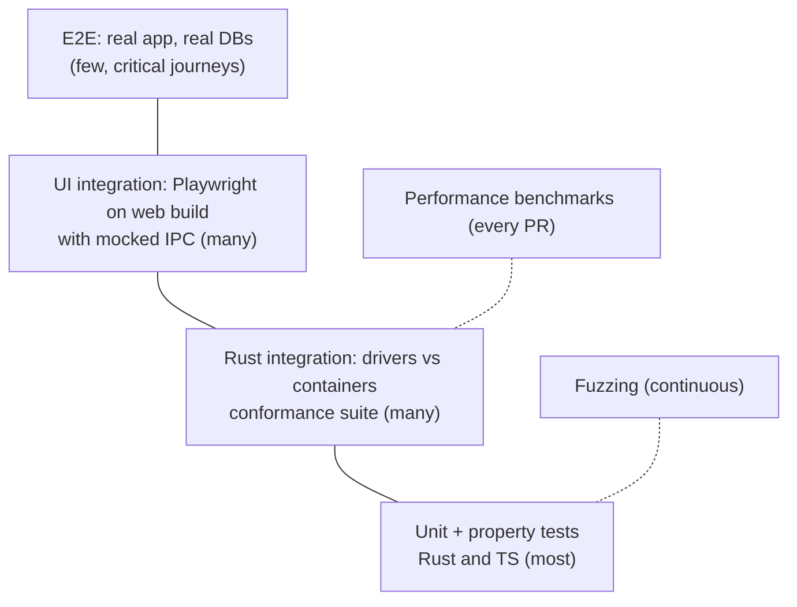

# 17 — Testing Strategy

Users trust a database client with production data. Testing is weighted toward the places where bugs cause data loss or wrong data: value decoding, statement splitting, change-set rendering/apply, and safety classification.

## 1. Test pyramid



## 2. Layers

### 2.1 Rust unit and property tests

- Every crate has unit tests next to the code.
- **Property tests** (`proptest`) for:
  - SQL splitter: splitting then joining preserves text; statement boundaries invariant under whitespace/comment insertion; Rust and TS splitters agree on shared vectors.
  - Value codecs: encode → decode round-trips for every logical type, including edge values.
  - Change-set algebra: any sequence of edit/insert/delete/undo/redo produces a minimal, consistent op list.
  - Collection file format: parse → serialise → parse is identity; unknown keys preserved.
- Snapshot tests (`insta`) for generated SQL (DML from change sets, DDL from structure diffs) per dialect.

### 2.2 Driver conformance and integration

- `openrows-driver-conformance` suite (see [05-database-drivers.md](05-database-drivers.md#8-conformance-suite)) run against real servers via `testcontainers` (Docker on Linux CI runners).
- **Version matrix** (Tier 1 on every PR, others nightly):

| Database | Versions |
| --- | --- |
| PostgreSQL | 12, 13, 14, 15, 16, 17 (+ latest) |
| MySQL | 5.7 (until EOL drop), 8.0, 8.4 LTS, latest 9.x |
| MariaDB | 10.6, 10.11, 11.4 |
| SQLite | bundled version + oldest supported file format fixtures |
| SQL Server | 2019, 2022 |
| ClickHouse | latest LTS, latest stable |
| MongoDB | 6.0, 7.0, 8.0 |
| Redis / Valkey | 6.2, 7.x, Valkey latest; cluster mode |
| Oracle | 23ai Free (container) |
| Cassandra / ScyllaDB | Cassandra 4.1, 5.0; Scylla latest |
| DynamoDB | DynamoDB Local / LocalStack |
| Elasticsearch / OpenSearch | ES 8.x, OpenSearch 2.x |
| CockroachDB, TiDB, YugabyteDB | latest (nightly) |

- **Current CI conformance matrix (M2-25).** CI runs only on `main` (docs/18 §4) on Linux x86_64 runners. Every Tier 1 and Tier 2 driver runs its conformance suite there:

| Driver | Tier | CI job | Server / fixture | Local command |
| --- | --- | --- | --- | --- |
| PostgreSQL | 1 | `containers` | `postgres:17-alpine` | `just test-pg` |
| MySQL, MariaDB | 1 | `containers` | MySQL 8.4, MariaDB 11.4 | `just test-mysql` |
| SQLite | 1 | `check` (workspace tests) | temporary file | `just test` |
| SQL Server | 2 | `tier2` (`mssql` leg) | `mcr.microsoft.com/mssql/server:2022-latest` | `just test-mssql` |
| ClickHouse | 2 | `tier2` (`clickhouse` leg) | `clickhouse/clickhouse-server:25.3.9.72` | `just test-clickhouse` |
| libSQL/Turso remote | 2 | `tier2` (`libsql` leg) | `ghcr.io/tursodatabase/libsql-server:v0.24.32`, JWT auth | `just test-libsql` |
| libSQL file | 2 | `check` (workspace tests) | temporary file | `just test` |
| DuckDB (driver host) | 2 | `check` (workspace tests) | temporary file through the host fixture | `just test` |

  Each `tier2` matrix leg has its own runner and Rust cache and `fail-fast: false`, so one engine's failure does not hide another's. Local scripts never use x86 emulation: on arm64 `just test-mssql` defaults to the native `mcr.microsoft.com/azure-sql-edge` image, and the libSQL and ClickHouse images are multi-arch. SQL Server readiness and the test database come from the `ready::` Rust test, so images without `sqlcmd` work. Azure SQL Edge is a SQL Server 2019-class engine without the CLR. Its conformance run passes, but the exact `float`/`real` edit-guard integration test fails there (`FORMAT` needs the CLR, docs/05 §14). SQL Server 2022 in CI remains the reference result.
- Fixture schemas per database: all types, composite keys, no-PK tables, views, partitions, unicode names, reserved-word identifiers, huge tables generated server-side (`generate_series`, recursive CTEs).
- Network fault injection with `toxiproxy`: latency, bandwidth caps, connection resets mid-stream, half-open sockets — verifies reconnection and "never retry writes" rules.
- SSH tests against an OpenSSH container with key, password, agent and jump-host setups.

### 2.3 Frontend tests

- **Unit/component:** Vitest + Testing Library for components, stores, formatters, keyboard system, autocomplete context analyser. Concurrent DOM environments are capped at four workers to prevent resource contention on shared runners; isolation and the existing test and assertion timeouts remain unchanged.

  Run from the repository root so `vitest.config.ts` supplies jsdom and
  `apps/desktop/src/test/setup.ts`. For a single file, use
  `pnpm exec vitest run apps/desktop/src/features/import/ImportSheet.test.tsx --maxWorkers=2`.
  For shuffled stability checks, add `--repeats 30 --sequence.shuffle` (Vitest 5).
  Package-directory invocations select the desktop Vite config and lack the DOM
  test environment; they are unsupported. See [CONTRIBUTING](../CONTRIBUTING.md#frontend-test-commands).
- **Grid:** deterministic rendering tests — paint to an offscreen canvas with a synthetic data source and compare against golden images (per theme, DPR 1 and 2) with tolerance; interaction tests for selection/keyboard.
- **UI integration:** Playwright against the Vite web build with a **mock IPC layer** generated from the same `tauri-specta` types. Fixtures replay recorded core responses (including Arrow tiles). Runs in WebKit and Chromium.
- **Accessibility:** `axe-core` checks in Playwright for every screen; keyboard-only journey scripts.

### 2.4 End-to-end (real app)

- `tauri-driver` (WebDriver) supports Linux and Windows; macOS WKWebView has no WebDriver support. Therefore:
  - Linux/Windows CI: full E2E journeys with the real app binary and containerised databases.
  - macOS: a smaller smoke suite driven via the app's built-in **test automation IPC** (dev/test builds only, compiled out of release) plus manual release checklists; macOS-specific UI tested in the Playwright WebKit layer.
- Critical journeys (must pass for every release):
  1. Create PG connection over SSH → browse → open table → edit 3 cells, insert, delete → commit → verify in DB.
  2. Run multi-statement script with one failing statement → correct results/errors per statement.
  3. Cancel a long query → session still usable.
  4. Stream 5 M rows → scroll to end → export CSV → file matches server data checksum.
  5. Kill network mid-transaction → correct "transaction lost" handling, change set preserved.
  6. Crash the app with pending edits and unsaved query → relaunch restores both.
  7. Import Postman collection → run with environment → tests pass; CLI produces JUnit.
  8. Prod-tagged connection: dangerous statement requires confirmation; read-only blocks writes.

### 2.5 Fuzzing

`cargo-fuzz` targets: SQL splitters (each dialect), MQL parser, Redis tokenizer, collection YAML loader, importers (Postman/Insomnia/Bruno/OpenAPI/HAR/cURL), Arrow window encoder bounds, connection URL parsers. Run nightly with corpus persisted; crashes become regression tests.

### 2.6 Performance

See [13-performance.md](13-performance.md#4-benchmark-suite). Benchmarks run on every PR (relative comparison on CI) and nightly on reference Macs (absolute budgets).

## 3. Data-integrity guardrails

- **Golden data tests:** for each database, a fixture table with tricky values is read, edited, written back and re-read; every byte must match except intended edits.
- **Export verification:** exports are re-imported and compared, or checksummed against server-side aggregates.
- **No silent coercion test:** every type in the fixtures must either round-trip exactly or be explicitly marked read-only/text with original type metadata.

## 4. Quality gates on PRs

| Gate | Tool |
| --- | --- |
| Format | `rustfmt`, `prettier` |
| Lint | `clippy -D warnings` (pedantic subset), `eslint` (typescript-eslint strict), `stylelint` |
| Types | `tsc --noEmit`; generated IPC bindings up to date check |
| Tests | Rust unit + Tier 1 integration; frontend unit + Playwright (mock IPC) |
| Security | `cargo-deny`, `cargo-audit`, `pnpm audit` (high+), secret scanning |
| Licences | `cargo-deny licenses`, `license-checker` for npm against the allowlist |
| Perf | Benchmarks vs `main`, thresholds in config |
| Size | Bundle size check (initial JS chunk ≤ 350 KB gzip) |
| Coverage | Report on PR; floor enforced for core crates (NFR-MAINT-03) |

## 5. Manual QA

- Release checklist per OS (install, upgrade from previous version, keychain prompts, notarization check with `spctl`, dark/light, multi-monitor/HiDPI).
- Exploratory testing sessions focused on each new driver before it moves up a tier.
- Public beta channel for early feedback.

## 6. Driver-host tests under machine load (X-HOSTFLAKE)

The default nextest profile serializes the `openrows-driver-host` and
`openrows-host-client` packages through the `driver-host` test group. Other
packages retain their configured parallelism. This bounds independent debug
fixture launches across test binaries; existing in-process guards alone cannot
coordinate nextest's separate processes. Tests intentionally running multiple
hosts still do so. Do not run these binaries in parallel outside nextest when
checking their unchanged production deadlines.

Native macOS reproduction on an Apple M4 (10 cores, 24 GiB, external SSD),
with four SHA-256 CPU workers and four nextest slots at nice level 10, failed
67 of 360 tests (18.61%) across 18 complete iterations before serialization:
SQLite 19/180, DuckDB 48/180. The baseline was stopped during iteration 19 once
reproduction was established, excluding that partial iteration from these rates.
The baseline command reused prebuilt nextest binaries metadata and ran
`cargo nextest run --binaries-metadata .host-flake-binaries.json
-E 'binary(conformance) | binary(duckdb_conformance)' --stress-count 50
--no-fail-fast --success-output immediate` under those four load workers.

Temporary timings separated closed-stdin image preflight, connect and cancel:
DuckDB preflight ranged 353.060–12,984.332 ms; successful connect timings ranged
96.562–1,955.597 ms; successful cancel drains ranged 51.162–258.349 ms. Failures
logged `startup_failed`, `Unresponsive`, no observed early exit and no helper
error category before Ready. A native fixture sample captured dyld bind-target
symbol fixups before the host runtime; the first-exec system log also recorded
an XProtect assessment of the DuckDB fixture. The debug fixture sizes were
45,144,752 bytes (SQLite) and 146,988,120 bytes (DuckDB). Warming once per test
process cannot eliminate concurrent dynamic-linking work on later launches.
The failure was fixture-launch/dynamic-linking work, rather than a cancellation
drain failure. Serialization alone still failed 7/60 tests in three complete
iterations after a fresh link. Temporary phase instrumentation is removed after
diagnosis.

The DuckDB debug fixture's `dyld_info -exports` listing had 149,722 lines before
the fix (about 149,700 symbols). The macOS fixture-only
`-Wl,-no_exported_symbols` link argument removes those exports, retaining local
debug symbols and the native implementation. These executables load no plugins,
the use case described in [Apple's linker guidance](https://developer.apple.com/videos/play/wwdc2022/110362/).
The production helper receives no new linker argument. `dyld_info -fixups`
output shrank from 128,440 to 65,895 lines; the load-run fixture has zero dynamic
exports and is 127,879,528 bytes. SQLite likewise has zero exports and is
38,978,016 bytes. The packaging regression checks both fixture export tables;
the existing native-symbol test still verifies SQLite/DuckDB separation.

With both changes, the same four-worker load passed all 50 consecutive paired
suite iterations: `Summary [ 102.468s] 50/50 stress run iterations: 50 passed`
(1,000 test invocations, zero failures). Each iteration ran the unchanged
20-test pair; there were no retries. This is fixture reliability evidence,
not a cold production-startup benchmark or reference-machine certification.

Run the repeatable, write-light load harness from the repository root:

```bash
export CARGO_TARGET_DIR=/path/to/shared/openrows-target
export RUSTC_WRAPPER=sccache CARGO_INCREMENTAL=0
export CARGO_BUILD_JOBS=4 NEXTEST_TEST_THREADS=4
nice -n 10 python3 scripts/host-test-load.py --runs 50 --cpu-workers 4
```

The harness builds once before starting CPU contention, then reuses the binaries
for each entire pair of conformance suites. It waits for each load worker to
start and terminates/reaps them on completion or failure. Its temporary metadata
is created in the worktree and removed automatically; no extra Cargo target,
Docker, emulation, test retry or deadline change is involved.


## MongoDB verification (M3-01–M3-04)

`just test-mongo` uses `scripts/test-mongo.sh` to create one throwaway `mongo:8`
replica set on a random loopback port. It verifies document/catalog/index and
aggregation reads, native mutations, atomic edits and stale-snapshot rollback,
credential errors, shared-route TLS, active-operation cancellation and idempotent
commit retry. Applicable native conformance groups run separately. The script
removes its container and runtime TLS files on exit.

Parser, safety-policy, Arrow mapping and UI tests run in their owning crates and
packages. Build every fuzz target with `cargo build --manifest-path fuzz/Cargo.toml
--bins`; the `mql` target exercises parsing/classification. Instrumented fuzz runs
use the existing `just fuzz-smoke` recipe when nightly and cargo-fuzz are installed.
