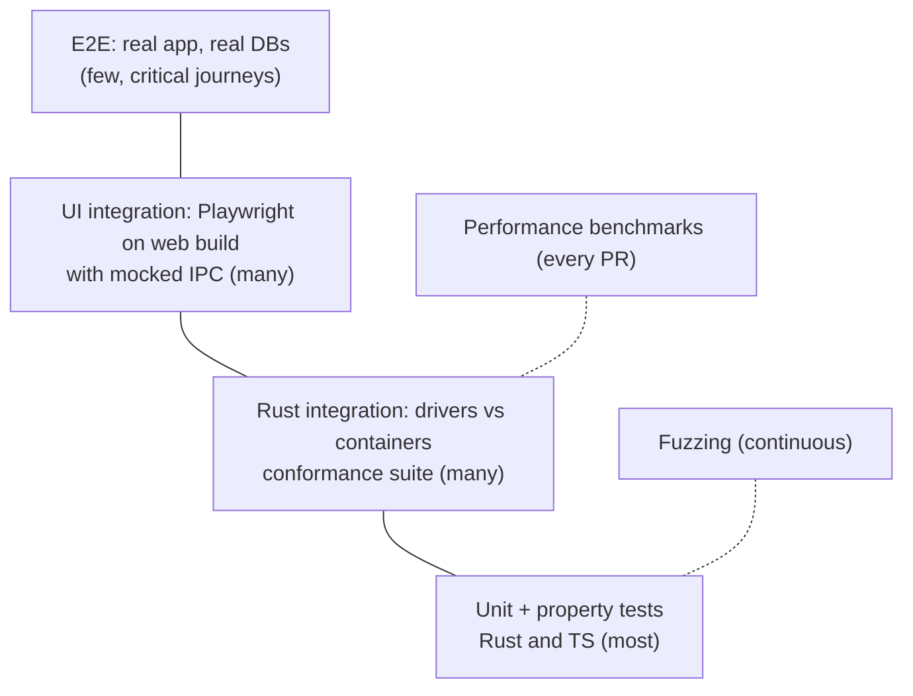

# 17 — Testing Strategy

Users trust a database client with production data. Testing is weighted toward the places where bugs cause data loss or wrong data: value decoding, statement splitting, change-set rendering/apply, and safety classification.

## 1. Test pyramid

## 2. Layers

### 2.1 Rust unit and property tests

- Every crate has unit tests next to the code.
- **Property tests** (`proptest`) for:
  - SQL splitter: splitting then joining preserves text; statement boundaries invariant under whitespace/comment insertion; Rust and TS splitters agree on shared vectors.
  - Value codecs: encode → decode round-trips for every logical type, including edge values.
  - Change-set algebra: any sequence of edit/insert/delete/undo/redo produces a minimal, consistent op list.
  - Collection file format: parse → serialise → parse is identity; unknown keys preserved.
- Snapshot tests (`insta`) for generated SQL (DML from change sets, DDL from structure diffs) per dialect.

### 2.2 Driver conformance and integration

- `openrows-driver-conformance` suite (see [05-database-drivers.md](05-database-drivers.md#8-conformance-suite)) run against real servers via `testcontainers` (Docker on Linux CI runners).
- **Version matrix** (Tier 1 on every PR, others nightly):

| Database | Versions |
| --- | --- |
| PostgreSQL | 12, 13, 14, 15, 16, 17 (+ latest) |
| MySQL | 5.7 (until EOL drop), 8.0, 8.4 LTS, latest 9.x |
| MariaDB | 10.6, 10.11, 11.4 |
| SQLite | bundled version + oldest supported file format fixtures |
| SQL Server | 2019, 2022 |
| ClickHouse | latest LTS, latest stable |
| MongoDB | 6.0, 7.0, 8.0 |
| Redis / Valkey | 6.2, 7.x, Valkey latest; cluster mode |
| Oracle | 23ai Free (container) |
| Cassandra / ScyllaDB | Cassandra 4.1, 5.0; Scylla latest |
| DynamoDB | DynamoDB Local / LocalStack |
| Elasticsearch / OpenSearch | ES 8.x, OpenSearch 2.x |
| CockroachDB, TiDB, YugabyteDB | latest (nightly) |

- Fixture schemas per database: all types, composite keys, no-PK tables, views, partitions, unicode names, reserved-word identifiers, huge tables generated server-side (`generate_series`, recursive CTEs).
- Network fault injection with `toxiproxy`: latency, bandwidth caps, connection resets mid-stream, half-open sockets — verifies reconnection and "never retry writes" rules.
- SSH tests against an OpenSSH container with key, password, agent and jump-host setups.

### 2.3 Frontend tests

- **Unit/component:** Vitest + Testing Library for components, stores, formatters, keyboard system, autocomplete context analyser.
- **Grid:** deterministic rendering tests — paint to an offscreen canvas with a synthetic data source and compare against golden images (per theme, DPR 1 and 2) with tolerance; interaction tests for selection/keyboard.
- **UI integration:** Playwright against the Vite web build with a **mock IPC layer** generated from the same `tauri-specta` types. Fixtures replay recorded core responses (including Arrow tiles). Runs in WebKit and Chromium.
- **Accessibility:** `axe-core` checks in Playwright for every screen; keyboard-only journey scripts.

### 2.4 End-to-end (real app)

- `tauri-driver` (WebDriver) supports Linux and Windows; macOS WKWebView has no WebDriver support. Therefore:
  - Linux/Windows CI: full E2E journeys with the real app binary and containerised databases.
  - macOS: a smaller smoke suite driven via the app's built-in **test automation IPC** (dev/test builds only, compiled out of release) plus manual release checklists; macOS-specific UI tested in the Playwright WebKit layer.
- Critical journeys (must pass for every release):
  1. Create PG connection over SSH → browse → open table → edit 3 cells, insert, delete → commit → verify in DB.
  2. Run multi-statement script with one failing statement → correct results/errors per statement.
  3. Cancel a long query → session still usable.
  4. Stream 5 M rows → scroll to end → export CSV → file matches server data checksum.
  5. Kill network mid-transaction → correct "transaction lost" handling, change set preserved.
  6. Crash the app with pending edits and unsaved query → relaunch restores both.
  7. Import Postman collection → run with environment → tests pass; CLI produces JUnit.
  8. Prod-tagged connection: dangerous statement requires confirmation; read-only blocks writes.

### 2.5 Fuzzing

`cargo-fuzz` targets: SQL splitters (each dialect), MQL parser, Redis tokenizer, collection YAML loader, importers (Postman/Insomnia/Bruno/OpenAPI/HAR/cURL), Arrow window encoder bounds, connection URL parsers. Run nightly with corpus persisted; crashes become regression tests.

### 2.6 Performance

See [13-performance.md](13-performance.md#4-benchmark-suite). Benchmarks run on every PR (relative comparison on CI) and nightly on reference Macs (absolute budgets).

## 3. Data-integrity guardrails

- **Golden data tests:** for each database, a fixture table with tricky values is read, edited, written back and re-read; every byte must match except intended edits.
- **Export verification:** exports are re-imported and compared, or checksummed against server-side aggregates.
- **No silent coercion test:** every type in the fixtures must either round-trip exactly or be explicitly marked read-only/text with original type metadata.

## 4. Quality gates on PRs

| Gate | Tool |
| --- | --- |
| Format | `rustfmt`, `prettier` |
| Lint | `clippy -D warnings` (pedantic subset), `eslint` (typescript-eslint strict), `stylelint` |
| Types | `tsc --noEmit`; generated IPC bindings up to date check |
| Tests | Rust unit + Tier 1 integration; frontend unit + Playwright (mock IPC) |
| Security | `cargo-deny`, `cargo-audit`, `pnpm audit` (high+), secret scanning |
| Licences | `cargo-deny licenses`, `license-checker` for npm against the allowlist |
| Perf | Benchmarks vs `main`, thresholds in config |
| Size | Bundle size check (initial JS chunk ≤ 350 KB gzip) |
| Coverage | Report on PR; floor enforced for core crates (NFR-MAINT-03) |

## 5. Manual QA

- Release checklist per OS (install, upgrade from previous version, keychain prompts, notarization check with `spctl`, dark/light, multi-monitor/HiDPI).
- Exploratory testing sessions focused on each new driver before it moves up a tier.
- Public beta channel for early feedback.
