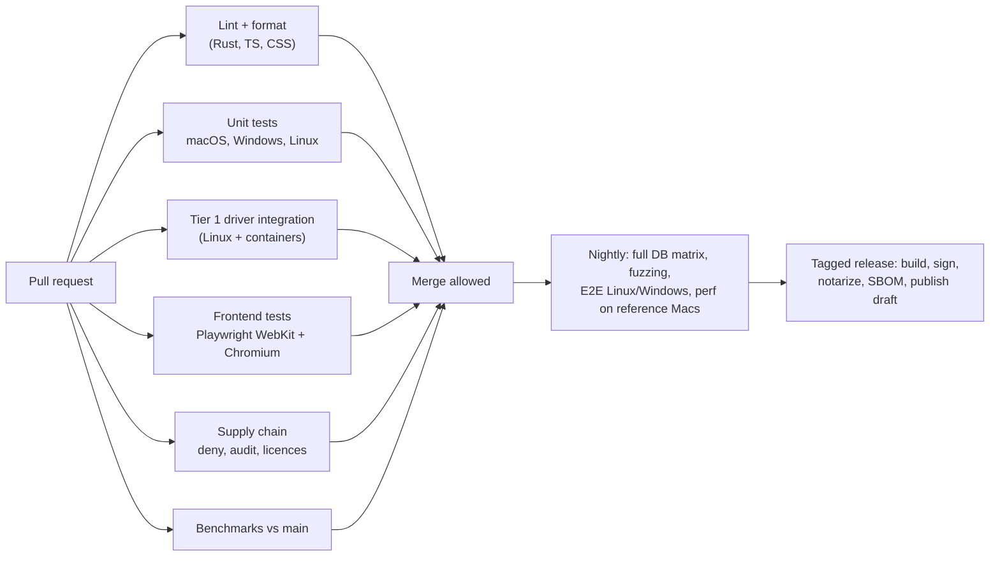

# 18 — Repository and Development Workflow

## 1. Monorepo layout

```text
open-db-client/
├── Cargo.toml                    # Rust workspace
├── package.json                  # pnpm workspace root (scripts only)
├── pnpm-workspace.yaml
├── rust-toolchain.toml           # pinned stable toolchain
├── deny.toml                     # cargo-deny: licences, advisories, bans
├── apps/
│   └── desktop/
│       ├── src/                  # React app (see 07-frontend-architecture.md)
│       ├── index.html
│       ├── vite.config.ts
│       └── src-tauri/
│           ├── Cargo.toml        # crate: openrows-app
│           ├── tauri.conf.json
│           ├── capabilities/     # per-window permission sets
│           ├── icons/
│           └── src/
│               ├── main.rs
│               ├── commands/     # thin IPC handlers → openrows-core
│               ├── menu.rs
│               └── updater.rs
├── crates/
│   ├── openrows-types/                # value model, ids, errors
│   ├── openrows-driver-api/           # Driver/Connection traits, capabilities
│   ├── openrows-driver-conformance/   # shared driver test suite
│   ├── openrows-driver-postgres/
│   ├── openrows-driver-mysql/
│   ├── openrows-driver-sqlite/
│   ├── openrows-driver-mssql/
│   ├── openrows-driver-clickhouse/
│   ├── openrows-driver-duckdb/
│   ├── openrows-driver-libsql/
│   ├── openrows-driver-mongodb/
│   ├── openrows-driver-redis/
│   ├── openrows-driver-oracle/
│   ├── openrows-driver-cassandra/
│   ├── openrows-driver-dynamodb/
│   ├── openrows-driver-elasticsearch/
│   ├── openrows-driver-host/          # out-of-process host binary for FFI drivers
│   ├── openrows-net/                  # SSH tunnels, TLS config, proxies, timing connector
│   ├── openrows-secrets/              # keychain + fallback vault
│   ├── openrows-sql/                  # splitter, classifier, formatter, MQL/Redis parsers
│   ├── openrows-results/              # result store, spill, windows, sort/filter
│   ├── openrows-schema/               # schema cache, fingerprints, DDL differ
│   ├── openrows-store/                # local SQLite store + migrations
│   ├── openrows-core/                 # Engine, sessions, change sets, history
│   ├── openrows-http/                 # API client engine (HTTP, WS, SSE, gRPC, auth)
│   ├── openrows-script/               # QuickJS sandbox + ors/pm APIs
│   ├── openrows-collections/          # collection file format, importers/exporters
│   ├── openrows-platform/             # OS integrations behind traits (keychain extras, sleep/wake, network path)
│   ├── openrows-ai/                   # AI orchestrator, providers, agent-CLI bridges
│   ├── openrows-mcp/                  # MCP server + client
│   └── openrows-cli/                  # `openrows` binary
├── packages/
│   ├── ipc/                      # @openrows/ipc — generated bindings
│   ├── ui/                       # @openrows/ui — design system + tokens
│   ├── grid/                     # @openrows/grid
│   ├── editor/                   # @openrows/editor
│   └── arrow-worker/             # @openrows/arrow-worker
├── tests/
│   ├── fixtures/                 # SQL fixtures per DB, sample collections
│   ├── e2e/                      # tauri-driver journeys
│   └── perf/                     # benchmark harnesses
├── docs/                         # this documentation
└── .github/
    ├── workflows/
    ├── ISSUE_TEMPLATE/
    └── PULL_REQUEST_TEMPLATE.md
```

## 2. Tooling

| Tool | Purpose |
| --- | --- |
| Rust stable (pinned in `rust-toolchain.toml`), edition 2024 | Core |
| `cargo-nextest` | Faster, isolated Rust test runs |
| `cargo-deny`, `cargo-audit`, `cargo-machete` | Supply chain, unused deps |
| Node LTS + pnpm (via Corepack) | Frontend |
| Vite, Vitest, Playwright | Build and tests |
| `just` (justfile) | Task runner: `just dev`, `just test`, `just bench`, `just gen-ipc` |
| Docker / OrbStack / Colima | Database containers for integration tests |
| `tauri-cli` v2 | Dev and bundling |
| `lefthook` | Git hooks: format + lint on staged files |

### 2.1 Common commands

```bash
just setup          # install toolchains, pnpm install, fetch test containers
just dev            # tauri dev with Vite HMR
just test           # rust unit + frontend unit
just test-int pg    # driver conformance against PostgreSQL containers
just gen-ipc        # regenerate TypeScript bindings from Rust
just bench          # criterion + perf harness
just bundle         # production build for current platform
```

## 3. Coding conventions

### Rust

- `#![forbid(unsafe_code)]` in every crate except designated FFI crates.
- Errors: `thiserror` in libraries, typed `OdbError` at API boundaries; `anyhow` only in binaries/tests.
- Async: no blocking calls in async code (lint via `clippy::await_holding_lock` and code review); use dedicated threads for blocking drivers.
- Public APIs documented (`#![warn(missing_docs)]` in public crates).
- Logging with `tracing` spans carrying `session_id`, `query_id`, `request_id`.

### TypeScript

- Strict mode, no `any` (lint error), explicit return types on exported functions.
- Feature-sliced folders; imports across features only through `index.ts`.
- No direct `invoke` calls — only through `@openrows/ipc`.
- Components: function components, colocated CSS modules, tokens only (no hard-coded colours/spacing; lint rule).

### Commits and PRs

The full rules, with examples, live in [CONTRIBUTING.md](../CONTRIBUTING.md). Summary:

- **Conventional Commits 1.0.0** for every commit: `<type>(<scope>)!: <subject>`, header ≤ 72 characters, imperative subject, no trailing period, blank line before the body. Types: `feat`, `fix`, `perf`, `refactor`, `docs`, `test`, `build`, `ci`, `style`, `chore`, `revert`. Scopes are crate/package/area names without the `openrows-` prefix.
- **Attribution:** commit messages, PR titles, PR descriptions and review comments describe the change only — no `Co-authored-by` trailers, co-author sections, signatures or "generated with/by" footers.
- **Enforcement:** `scripts/git-hooks/commit-msg` checks all of the above locally (enable once per clone with `git config core.hooksPath scripts/git-hooks`). CI will run the same check on every commit and on the PR title (M0).
- **Branches:** `<type>/<short-description>` (e.g. `feat/grid-column-pinning`), rebased on `main`.
- **Merging:** squash-merge only; the PR title is the squash commit header, so it must be a valid Conventional Commit header.
- Small PRs; every PR links an issue, requirement ID or ADR; UI changes include screenshots in both themes; docs updated in the same PR.
- Two approvals for changes to: security-sensitive code, FFI crates, change-set apply path, value codecs, update/signing config.
- DCO sign-off (`git commit -s`) required (see [22-governance-and-licensing.md](22-governance-and-licensing.md)).

### Files that never enter the repository

- Secrets and local environment files (`.env`, keys, certificates) — covered by `.gitignore`.
- Personal editor and tool configuration, including local AI coding assistant instruction/config files. These are excluded per developer through their global git excludes file or the clone's `.git/info/exclude`, never through tracked files. Ignore rules do not untrack files already committed, so reviewers check the PR file list for such files and ask for their removal.

## 4. CI pipeline



- Caching: `sccache`/`Swatinem/rust-cache` for Rust, pnpm store cache.
- macOS runners used for unit tests and bundling; integration tests on Linux (Docker available).
- Workflows use least-privilege `permissions:` and SHA-pinned actions; release signing secrets only available to the release workflow on protected tags.

## 5. Branching and versioning

- Trunk-based: `main` always releasable; short-lived feature branches.
- Feature flags (compile-time Cargo features + runtime settings flags) for in-progress features.
- Semantic versioning; pre-1.0 releases `0.x.y` with `alpha`/`beta` channels.

## 6. Architecture Decision Records

- Any decision that is hard to reverse or affects multiple crates gets an ADR in `docs/adr/NNNN-title.md` using the template in [adr/README.md](adr/README.md).
- ADR status: Proposed → Accepted → (Superseded by NNNN | Deprecated).
