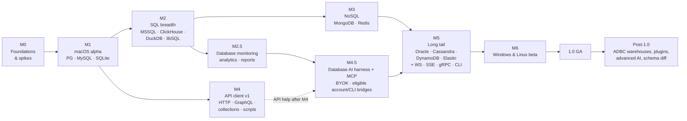

# 19 — Roadmap

Milestones are scope-based, not date-based. Each has exit criteria; a milestone is done when the criteria pass, not when the calendar says so. The task-level breakdown of every milestone lives in [27 — Delivery plan](27-delivery-plan.md).

M2/M3 and M4 can proceed in parallel once M1 is stable, given enough contributors.

The [feature parity inventory](26-feature-parity.md) maps the public benchmark to requirements. Coverage there means specified, not shipped. The additions below are P1; existing P0 features keep the M1 exit gate. Every supported engine follows [docs/05's capability tiers](05-database-drivers.md#3-support-tiers), rather than promising identical features across databases or platforms.

## M0 — Foundations and spikes

**Goal:** prove the risky parts before building features on them.

| Spike | Question | Exit criteria |
| --- | --- | --- |
| S1 IPC throughput | Can Arrow IPC tiles over Tauri 2 raw responses meet the tile budget in WKWebView? | **Met** on Mac mini M4: 256×20 mixed tile end-to-end p95 1.00 ms in both runs (≤ 3 ms); mac-low run to revisit. [ADR-0002](adr/0002-arrow-ipc-for-results.md#m0-s1-evidence--2026-10-06) |
| S2 Grid renderer — **met** | Own Canvas 2D painter behind our adapter | Supplied M4/60 Hz runs meet best-repeat 1 M-row frame criterion; [Accepted: Option A, ADR-0004](adr/0004-canvas-data-grid.md). Every-repeat own-cost gate covered by synthetic tests; production grid/a11y remains future work |
| S3 PG streaming | PostgreSQL binary decode into Arrow builders (prototype on `postgres-protocol`, not `tokio-postgres`: [05 §11](05-database-drivers.md#11-m0-s3-postgresql-streaming-spike)) | **Met** on Mac mini M4: 63–330 M cells/s/core (≥ 1 M); first batch 0.036 ms (≤ 5 ms). Evidence in [ADR-0002](adr/0002-arrow-ipc-for-results.md#m0-s3-evidence--2026-10-07) and [ADR-0007](adr/0007-session-actor-model.md#m0-s3-evidence--2026-10-07) |
| S4 SSH | `russh` tunnels with agent, jump host, keyboard-interactive | Works against OpenSSH container + real bastion |
| S5 Editor | CodeMirror 6 in WKWebView with 5 k-line SQL, Vim mode, IME | ≤ 16 ms keystroke p95. Implementer M4 runs pass (p95 9–11 ms); maintainer run, manual IME check and mac-low run pending, so [ADR-0003](adr/0003-codemirror-6-editor.md) is Accepted — validation pending |
| S6 Startup | Tauri 2 + React shell cold start | ≤ 800 ms on mac-low. M4 warm p50 ≈ 290–330 ms; mac-low run pending (M0-S6b), so [ADR-0001](adr/0001-rust-core-with-tauri-2.md) is Accepted — validation pending |

Also: repo skeleton, CI, lint/format, `tauri-specta` bindings pipeline, design tokens skeleton, ADRs 0001–0009 accepted with an explicit validation state: evidence recorded, or the task that will produce it named (M0-11, [ADR index](adr/README.md)).

## M1 — macOS alpha (Tier 1 databases)

M1 starts with a PostgreSQL **dogfood track** ([docs/27 §3a](27-delivery-plan.md#3a-dogfood-track-postgresql-first)): narrow slices of the tasks below, built feature-first ([docs/25 §0](25-engineering-standards.md#0-current-delivery-mode-feature-first-until-the-postgresql-dogfood-alpha)) so the maintainer can use the app on real databases early and steer the rest by feedback.

- Connections: profiles, groups, env tags, keychain, SSH, TLS, test diagnostics, URL import.
- Drivers: PostgreSQL (+ compatible flavours detected), MySQL/MariaDB, SQLite — full conformance.
- Schema tree with persistent cache, fuzzy search, structure view, DDL view.
- SQL editor: dialect highlighting, autocomplete, run current/selection/all, cancel, multiple results, history.
- Grid: canvas grid, selection, copy formats, client sort/filter, server sort/filter for tables, inspector panel.
- Editing: change sets, preview, transactional commit, undo/redo, crash recovery.
- Safe mode: read-only, confirm writes, dangerous statement detection.
- Export CSV/JSON/SQL; session restore; command palette; light/dark.
- Signed + notarized DMG, Homebrew cask, auto-update.
- Baseline for FR-APP-07 (Tier 1 driver matrix), FR-APP-10 (tabs), FR-APP-12 (updates) and FR-APP-14 (native menus); their remaining P1 controls land in M2/M6.

**Exit:** all P0 requirements met; Tier 1 conformance green; critical journeys 1–6 and 8 pass; performance budgets met on mac-low.

## M2 — SQL breadth and power features

- Drivers: SQL Server, ClickHouse, DuckDB, libSQL/Turso (Tier 2).
- Explain visualiser (PG, MySQL, SQLite, MSSQL).
- Structure editing with DDL preview and warnings.
- Import CSV/JSON with bulk-load fast paths; run SQL file; Excel/Parquet/Markdown export.
- ER diagram (read-only).
- Process list / kill; users and roles viewer.
- Formatter, parameters bar, snippets, file-backed queries, Projects.
- Driver host process for DuckDB.
- Connection parity: FR-CONN-12 (documented non-secret profile/group export and validated import), FR-CONN-13 (prompt/keychain policy and trusted credential commands). Unsupported proprietary formats remain excluded.
- Schema parity: FR-SCHEMA-09 (sidebar favourites/recents/visibility), FR-SCHEMA-10 (table lifecycle), FR-SCHEMA-11 (trigger/view/routine definition editing), FR-SCHEMA-12 (database/schema lifecycle). All mutations use capability checks and DDL review.
- Editor parity: FR-EDIT-11 (independent splits), FR-EDIT-12 (multi-caret, folding and display primitives), FR-EDIT-13 (completion settings), FR-EDIT-14 (file-backed favourite actions), FR-EDIT-15 (execution defaults, notices and result presentation).
- Grid parity: FR-GRID-11 (compound/raw/quick filters and SQL preview), FR-GRID-12 (persistent table presentation and count policy), FR-GRID-13 (copy formats/options), FR-GRID-14 (bulk row inspector). FR-DATA-08 adds explicit discard and server-state reload.
- Transfer parity: FR-IO-04 (dump/restore tools), FR-IO-05 (scope, options and background jobs), FR-IO-06 (table-creating import and conflict preview).
- Workspace parity: FR-WS-04 (multiple database contexts, quick switch and session descriptors), FR-WS-05 (history reuse/deletion/retention). Keep ⌘K as database switcher, ⌘P as quick-open and ⌘⇧P as command palette per docs/20; all bindings are rebindable.
- App parity: FR-APP-08 (settings groups and validated locations), FR-APP-10 (tab/layout controls), FR-APP-11 (safety policies and locks), FR-APP-12 (general controls), FR-APP-13 (original JSON themes and fonts), FR-APP-14 (file associations and native file actions). FR-APP-07 extends the driver matrix through Tier 2.

**Parity exit:** these M2 P1 requirements pass their complete acceptance text, including raw-filter safety, import trust, discard boundaries, dirty-tab protection, lock bypass tests and performance budgets. No new TablePlus-compatible encrypted format is assumed.

### M2 exit audit (M2-25, 2026-10-12)

Result: **M2 exit not met.** Tier 2 conformance now runs in CI, but seven M2 rows remain partial against their requirement text. Each row's evidence and precise missing list is in [docs/27 §5](27-delivery-plan.md#5-m2--sql-breadth-and-power-features). Evidence is code and tests on `main` at `7a6ec90f`. The new CI `tier2` job has not yet run on `main`.

| Exit item | Status | Evidence / missing |
| --- | --- | --- |
| Tier 2 drivers (SQL Server, ClickHouse, DuckDB, libSQL/Turso) | met | M2-02, M2-03, M2-04, M2-05 done. CI: `tier2` matrix job (`mssql`, `clickhouse`, `libsql`) plus DuckDB host and libSQL file conformance in the `check` job (docs/17 §2.2). |
| Explain visualiser (PG, MySQL, SQLite, MSSQL) | met | M2-06 |
| Structure editing with DDL preview and warnings | partial | M2-07. Missing: add a primary-key/unique constraint to an existing table, `USING` casts, `CREATE INDEX CONCURRENTLY`, column reordering. |
| Import with bulk-load fast paths; run SQL file; Excel/Parquet/Markdown export | met | M2-11 (PostgreSQL `COPY`, SQLite prepared batches; engine gaps listed), M2-12, M2-13 |
| ER diagram (read-only) | partial | M2-10. Missing: selection diagrams; Web Worker layout and canvas above 300 tables. |
| Process list / kill; users and roles viewer | met | M2-15, M2-09 |
| Formatter, parameters bar, snippets, file-backed queries, Projects | partial | M2-16 done. M2-17 missing: shared connection definitions in projects, snippets as project `.sql` files, saved-query keyword expansion and Insert/Copy actions. |
| Driver host process for DuckDB | partial | M2-01. Functional host is done (DuckDB through it). Missing: Windows MSVC compile and the 150 ms cold target. Signing/notarization and Windows/Linux package smoke are release items (M1-31, M6). |
| Connection parity (FR-CONN-12, 13) | met | M2-21 |
| Schema parity (FR-SCHEMA-09..12) | partial | M2-23 done. M2-08 missing: SQL Server database rename; Lifecycle conformance does not cover triggers, routines or databases. |
| Editor parity (FR-EDIT-11..15) | partial | M2-18. Missing: editor indentation settings, completion schema-qualification/closing-delimiter/acceptance-key controls, stacked results. |
| Grid parity (FR-GRID-11..14, FR-DATA-08) | partial | M2-19 and FU-03. Missing: any-column search, header quick filters, persisted striping, scrollbar and estimated-count settings, HTML-table copy, configurable delimiter/quote/newline/decimal with ambiguity rejection, and a date/time picker (FR-DATA-06). |
| Transfer parity (FR-IO-04, 05, 06) | met | M2-14, M2-13, M2-11 |
| Workspace parity (FR-WS-04, 05) | met | M2-20 |
| App parity (FR-APP-08, 10..14) | met | M2-22. Signed update feed stays M1-31. |
| FR-APP-07 through Tier 2 | met | Capability-gated drivers. The connection-type picker labels the Tier 2 engines beta (`isBetaEngine` in `apps/desktop/src/features/connections/engines.ts`). |
| Performance budgets | not met | Driver-host cold start misses 150 ms (ADR-0010). Cold whole-app startup with DuckDB is a failed checkpoint (M2-04). No mac-low M2 budget run is recorded. |

Native arm64 local run of `just test-mssql` against Azure SQL Edge: readiness 1/1, explain 1/1, conformance 10/10, integration 21/22. The one failure is a product gap. Exact edit guards on `float`/`real` use `FORMAT(…, 'R')`, which needs the CLR, and Azure SQL Edge has none (error 10347). These guards are in `crates/openrows-driver-mssql/src/editor/exact.rs`.

## M2.5 — Database monitoring and analytics

After the current DuckDB host repair, deliver the [monitoring scope](28-database-monitoring-and-ai-harness.md)
before the database AI harness. Start with PostgreSQL and the shared collector,
then add every implemented engine's supported metrics with explicit capability
and permission states. M2.5 follows M2 in the roadmap; the owner authorises its first slice immediately after the DuckDB host repair, without waiting for unrelated M2 tasks. [Accepted ADR-0011](adr/0011-performance-monitor.md) owns engine sources/grants, privacy, advisor safety and server/app budgets; implementation validation remains pending.

- Live health, resource/memory, query and lock/wait views; source/scope/freshness labels.
- Deterministic evidence-backed optimisation proposals, plan-only Explain by default, confirmed measured execution under #99 safety/authentication and production warnings.
- Bounded shared collection, reset-aware trends, opt-in local history and retention.
- Deterministic alerts and explicit in-app background monitoring.
- Read-only query-backed charts/cards/tables, typed parameters and portable boards.
- Evidence-backed health reports and chart/report export, useful without AI.

**Exit:** FR-ADMIN-03..08 acceptance passes across the published engine matrix;
collection is bounded and cancels on close/lock/disconnect; imported boards never
auto-run; unsupported data is visible; DuckDB's single-writer ownership holds.
Meet ADR-0011/NFR-PERF-11/NFR-SEC-08 source, privacy, advisor and overhead gates; measure history footprint and chart/UI performance at this checkpoint.

## M3 — NoSQL

- MongoDB: collections browser, MQL editor, document views (tree/JSON/table), document editing, indexes, aggregation pipeline editor with stage previews.
- Redis: SCAN-based key browser, type-aware viewers/editors, TTL, console with autocomplete, cluster/sentinel, pub/sub monitor.

## M4 — API client v1

**Moved out of 1.0 (2026-10-12):** the API client (this milestone and the WebSocket, SSE, gRPC, collection runner, CLI and DB ↔ API items of M5) ships later as a separate product. 1.0 is the database client, including monitoring and database AI. Current status: [29](29-status-and-test-guide.md).

- HTTP/1.1 + HTTP/2, all body types, auth helpers, cookies, proxies, client certs, timing waterfall.
- Collections as files, environments, secrets in keychain, variables with scopes.
- Scripts and tests (QuickJS), `pm.*` compatibility shim, restricted mode for untrusted collections.
- GraphQL with introspection.
- Importers: Postman, Insomnia, Bruno, OpenAPI, HAR, cURL. Code snippet export.

## M4.5 — Native AI and MCP

- `openrows-ai`: API-key providers (Anthropic, OpenAI, OpenRouter, Gemini, compatible endpoints), local models and eligible official account/CLI integrations. Provider eligibility and isolation are verified before enabling subscription reuse.
- `openrows-mcp`: MCP server with read-only tools + `propose_sql`; MCP client for user servers; optional localhost endpoint.
- Assistant panel, ⌘I inline edit, fix-error, plan analysis.
- Data-sharing policy, redaction, context preview, audit log.
- FR-AI-11..13: evidence-backed health/query investigations, report/chart/board proposals, multiple saved providers, usage limits and opt-in scheduled read-only checks; [28](28-database-monitoring-and-ai-harness.md). Database AI follows M2.5 and need not wait for the API-client milestone; API help follows M4.
- FR-AI-10: read-only scoped MCP tokens, revocation, client disconnection and scrubbed integration activity; settings surfaces from FR-APP-08. Generic ACP adapters, remote MCP and model write tools are not part of this milestone.

**Exit:** policy golden-payload tests green; no write path from model output;
NL→SQL and health/report evidence evaluations recorded per provider; provider
isolation, telemetry sharing, cancellation and scheduled-run budgets pass.

## M5 — Long tail

- Drivers: Oracle (driver host, user-installed Instant Client), Cassandra/ScyllaDB, DynamoDB, Elasticsearch/OpenSearch (Tier 3).
- Redshift flavour (Tier 3) per FR-APP-07 and docs/05; mark capability limitations and beta status explicitly.
- API: WebSocket, SSE, gRPC (reflection + `.proto`), collection runner, `openrows` CLI with JUnit/JSON/HTML reports.
- FR-APP-09: documented URL/CLI opening for profiles, files and object/filter links; never auto-execute arbitrary SQL or downgrade safety from a link.
- DB ↔ API integration features.

## M6 — Windows and Linux beta

- Platform specifics from [16-platform-and-distribution.md](16-platform-and-distribution.md).
- Full E2E suite on Windows and Linux; WebKitGTK workarounds.
- Packaging: MSI/NSIS, winget, AppImage, deb, rpm, Flathub.
- FR-APP-07/14: publish platform driver capabilities, file associations, native menu/shortcut behaviour and unsupported OS-auth fallbacks; verify settings, locks and restored multi-window layouts on each OS.

## 1.0 GA

**Exit criteria:**
- All P0 and P1 requirements met.
- Every 1.0 row in [26](26-feature-parity.md) has implemented evidence for its FR mapping; parity additions and the new monitoring/AI P1 requirements are included in the release gate. Deferred/excluded gaps remain visibly labelled.
- Tier 1 + Tier 2 drivers meet their tier definitions; Tier 3 at least beta.
- Zero open data-loss or security-high issues.
- Crash-free sessions ≥ 99.8 % over the last beta cycle (from opt-in reporters).
- Documentation site with user guide, driver notes, collection format spec.
- Accessibility audit passed (WCAG 2.2 AA for app chrome; grid screen-reader support verified with VoiceOver and NVDA).

## Post-1.0 candidates

- **ADBC bridge** for Snowflake, BigQuery, Databricks, Redshift-native features, Trino.
- **Plugin system** (WASM component model) for community drivers, exporters, themes ([21-extensibility.md](21-extensibility.md)).
- **Schema diff and migration generation** between connections.
- AI workflows beyond 1.0 (multi-step migrations with review) — the 1.0 assistant, scoped in-app scheduled health checks and MCP support are in M4.5 (ADR-0009, docs/28).
- Visual query builder; editable ER diagrams.
- Mock servers and OpenAPI generation for the API client.
- Mac App Store build.
- Team features without a server: expand the planned FR-WS-03 git-friendly Projects with signed connection definitions.
- Remaining benchmark gaps G03–G06/G08–G11/G13–G15 from [26](26-feature-parity.md#gaps-and-scope-decisions): cross-table value search, SQL minification/extra parameter syntaxes, user/grant/resource-limit editors (FR-ADMIN-02), plugin and migration exporters, safe cell links, Git theme installation, toolbar customisation, generic ACP and unapproved subscription adapters. G07 boards move to M2.5; eligible official account integrations move to M4.5.
- Driver candidates G18–G20: ADBC Snowflake/BigQuery, dedicated Cloudflare D1, and independently validated Greenplum/Vertica/SingleStore/other flavours. Existing docs/05 flavours retain their assigned tiers.
- Editable diagrams (G21) remain post-1.0; FR-SCHEMA-06 requires the 1.0 read-only diagram.

**Intentional boundaries:** G01 undocumented proprietary profile serialization, G02 secret-bearing connection exports, G12 iOS, G16 AI/MCP writes and G17 remote MCP are excluded from 1.0. Mobile or remote access needs a new scope/security decision; write tools remain excluded by ADR-0009. These exclusions do not imply TablePlus lacks the features.
