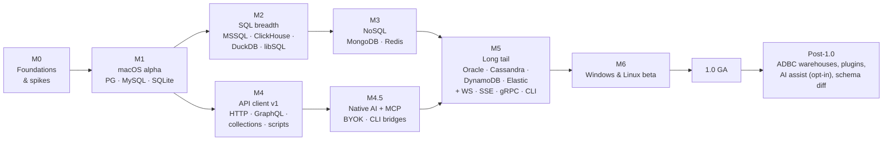

# 19 — Roadmap

Milestones are scope-based, not date-based. Each has exit criteria; a milestone is done when the criteria pass, not when the calendar says so.

M2/M3 and M4 can proceed in parallel once M1 is stable, given enough contributors.

## M0 — Foundations and spikes

**Goal:** prove the risky parts before building features on them.

| Spike | Question | Exit criteria |
| --- | --- | --- |
| S1 IPC throughput | Can Arrow IPC tiles over Tauri 2 raw responses meet the tile budget in WKWebView? | 256×20 mixed tile end-to-end ≤ 3 ms p95 on mac-low |
| S2 Grid renderer | Custom canvas painter vs Glide Data Grid behind our adapter | 1 M rows scroll with 0 frames > 32 ms; decision recorded in ADR-0004 |
| S3 PG streaming | `tokio-postgres` binary decode into Arrow builders | ≥ 1 M cells/s/core; first batch ≤ 5 ms |
| S4 SSH | `russh` tunnels with agent, jump host, keyboard-interactive | Works against OpenSSH container + real bastion |
| S5 Editor | CodeMirror 6 in WKWebView with 5 k-line SQL, Vim mode, IME | ≤ 16 ms keystroke p95 |
| S6 Startup | Tauri 2 + React shell cold start | ≤ 800 ms on mac-low |

Also: repo skeleton, CI, lint/format, `tauri-specta` bindings pipeline, design tokens skeleton, ADRs 0001–0008 accepted.

## M1 — macOS alpha (Tier 1 databases)

- Connections: profiles, groups, env tags, keychain, SSH, TLS, test diagnostics, URL import.
- Drivers: PostgreSQL (+ compatible flavours detected), MySQL/MariaDB, SQLite — full conformance.
- Schema tree with persistent cache, fuzzy search, structure view, DDL view.
- SQL editor: dialect highlighting, autocomplete, run current/selection/all, cancel, multiple results, history.
- Grid: canvas grid, selection, copy formats, client sort/filter, server sort/filter for tables, inspector panel.
- Editing: change sets, preview, transactional commit, undo/redo, crash recovery.
- Safe mode: read-only, confirm writes, dangerous statement detection.
- Export CSV/JSON/SQL; session restore; command palette; light/dark.
- Signed + notarized DMG, Homebrew cask, auto-update.

**Exit:** all P0 requirements met; Tier 1 conformance green; critical journeys 1–6 and 8 pass; performance budgets met on mac-low.

## M2 — SQL breadth and power features

- Drivers: SQL Server, ClickHouse, DuckDB, libSQL/Turso (Tier 2).
- Explain visualiser (PG, MySQL, SQLite, MSSQL).
- Structure editing with DDL preview and warnings.
- Import CSV/JSON with bulk-load fast paths; run SQL file; Excel/Parquet/Markdown export.
- ER diagram (read-only).
- Process list / kill; users and roles viewer.
- Formatter, parameters bar, snippets, file-backed queries, workspaces.
- Driver host process for DuckDB.

## M3 — NoSQL

- MongoDB: collections browser, MQL editor, document views (tree/JSON/table), document editing, indexes, aggregation pipeline editor with stage previews.
- Redis: SCAN-based key browser, type-aware viewers/editors, TTL, console with autocomplete, cluster/sentinel, pub/sub monitor.

## M4 — API client v1

- HTTP/1.1 + HTTP/2, all body types, auth helpers, cookies, proxies, client certs, timing waterfall.
- Collections as files, environments, secrets in keychain, variables with scopes.
- Scripts and tests (QuickJS), `pm.*` compatibility shim, restricted mode for untrusted collections.
- GraphQL with introspection.
- Importers: Postman, Insomnia, Bruno, OpenAPI, HAR, cURL. Code snippet export.

## M4.5 — Native AI and MCP

- `openrows-ai`: API-key providers (Anthropic, OpenAI, Gemini, OpenAI-compatible), local models, CLI bridges (Claude Code, Codex CLI, Cursor CLI, Gemini CLI).
- `openrows-mcp`: MCP server with read-only tools + `propose_sql`; MCP client for user servers; optional localhost endpoint.
- Assistant panel, ⌘I inline edit, fix-error, plan analysis.
- Data-sharing policy, redaction, context preview, audit log.

**Exit:** policy golden-payload tests green; no write path from model output; NL→SQL eval set baseline recorded per provider.

## M5 — Long tail

- Drivers: Oracle (driver host, user-installed Instant Client), Cassandra/ScyllaDB, DynamoDB, Elasticsearch/OpenSearch (Tier 3).
- API: WebSocket, SSE, gRPC (reflection + `.proto`), collection runner, `openrows` CLI with JUnit/JSON/HTML reports.
- DB ↔ API integration features.

## M6 — Windows and Linux beta

- Platform specifics from [16-platform-and-distribution.md](16-platform-and-distribution.md).
- Full E2E suite on Windows and Linux; WebKitGTK workarounds.
- Packaging: MSI/NSIS, winget, AppImage, deb, rpm, Flathub.

## 1.0 GA

**Exit criteria:**
- All P0 and P1 requirements met.
- Tier 1 + Tier 2 drivers meet their tier definitions; Tier 3 at least beta.
- Zero open data-loss or security-high issues.
- Crash-free sessions ≥ 99.8 % over the last beta cycle (from opt-in reporters).
- Documentation site with user guide, driver notes, collection format spec.
- Accessibility audit passed (WCAG 2.2 AA for app chrome; grid screen-reader support verified with VoiceOver and NVDA).

## Post-1.0 candidates

- **ADBC bridge** for Snowflake, BigQuery, Databricks, Redshift-native features, Trino.
- **Plugin system** (WASM component model) for community drivers, exporters, themes ([21-extensibility.md](21-extensibility.md)).
- **Schema diff and migration generation** between connections.
- AI agent workflows beyond 1.0 (multi-step migrations with review, scheduled checks) — the 1.0 assistant and MCP support are in M4.5 (ADR-0009).
- Visual query builder; editable ER diagrams.
- Mock servers and OpenAPI generation for the API client.
- Mac App Store build.
- Team features without a server: shared workspaces via git with merge-friendly formats (already in place), signed connection definitions.
