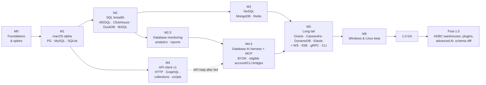

# 19 — Roadmap

Milestones are scope-based, not date-based. Each has exit criteria; a milestone is done when the criteria pass, not when the calendar says so. The task-level breakdown of every milestone lives in [27 — Delivery plan](27-delivery-plan.md).

M2/M3 and M4 can proceed in parallel once M1 is stable, given enough contributors.

The [feature parity inventory](26-feature-parity.md) maps the public benchmark to requirements. Coverage there means specified, not shipped. The additions below are P1; existing P0 features keep the M1 exit gate. Every supported engine follows [docs/05's capability tiers](05-database-drivers.md#3-support-tiers), rather than promising identical features across databases or platforms.

## M0 — Foundations and spikes

**Goal:** prove the risky parts before building features on them.

| Spike | Question | Exit criteria |
| --- | --- | --- |
| S1 IPC throughput | Can Arrow IPC tiles over Tauri 2 raw responses meet the tile budget in WKWebView? | **Met** on Mac mini M4: 256×20 mixed tile end-to-end p95 1.00 ms in both runs (≤ 3 ms); mac-low run to revisit. [ADR-0002](adr/0002-arrow-ipc-for-results.md#m0-s1-evidence--2026-10-06) |
| S2 Grid renderer — **met** | Own Canvas 2D painter behind our adapter | Supplied M4/60 Hz runs meet best-repeat 1 M-row frame criterion; [Accepted: Option A, ADR-0004](adr/0004-canvas-data-grid.md). Every-repeat own-cost gate covered by synthetic tests; production grid/a11y remains future work |
| S3 PG streaming | PostgreSQL binary decode into Arrow builders (prototype on `postgres-protocol`, not `tokio-postgres`: [05 §11](05-database-drivers.md#11-m0-s3-postgresql-streaming-spike)) | **Met** on Mac mini M4: 63–330 M cells/s/core (≥ 1 M); first batch 0.036 ms (≤ 5 ms). Evidence in [ADR-0002](adr/0002-arrow-ipc-for-results.md#m0-s3-evidence--2026-10-07) and [ADR-0007](adr/0007-session-actor-model.md#m0-s3-evidence--2026-10-07) |
| S4 SSH | `russh` tunnels with agent, jump host, keyboard-interactive | Works against OpenSSH container + real bastion |
| S5 Editor | CodeMirror 6 in WKWebView with 5 k-line SQL, Vim mode, IME | ≤ 16 ms keystroke p95. Implementer M4 runs pass (p95 9–11 ms); maintainer run, manual IME check and mac-low run pending, so [ADR-0003](adr/0003-codemirror-6-editor.md) is Accepted — validation pending |
| S6 Startup | Tauri 2 + React shell cold start | ≤ 800 ms on mac-low. M4 warm p50 ≈ 290–330 ms; mac-low run pending (M0-S6b), so [ADR-0001](adr/0001-rust-core-with-tauri-2.md) is Accepted — validation pending |

Also: repo skeleton, CI, lint/format, `tauri-specta` bindings pipeline, design tokens skeleton, ADRs 0001–0009 accepted with an explicit validation state: evidence recorded, or the task that will produce it named (M0-11, [ADR index](adr/README.md)).

## M1 — macOS alpha (Tier 1 databases)

M1 starts with a PostgreSQL **dogfood track** ([docs/27 §3a](27-delivery-plan.md#3a-dogfood-track-postgresql-first)): narrow slices of the tasks below, built feature-first ([docs/25 §0](25-engineering-standards.md#0-current-delivery-mode-feature-first-until-the-postgresql-dogfood-alpha)) so the maintainer can use the app on real databases early and steer the rest by feedback.

- Connections: profiles, groups, env tags, keychain, SSH, TLS, test diagnostics, URL import.
- Drivers: PostgreSQL (+ compatible flavours detected), MySQL/MariaDB, SQLite — full conformance.
- Schema tree with persistent cache, fuzzy search, structure view, DDL view.
- SQL editor: dialect highlighting, autocomplete, run current/selection/all, cancel, multiple results, history.
- Grid: canvas grid, selection, copy formats, client sort/filter, server sort/filter for tables, inspector panel.
- Editing: change sets, preview, transactional commit, undo/redo, crash recovery.
- Safe mode: read-only, confirm writes, dangerous statement detection.
- Export CSV/JSON/SQL; session restore; command palette; light/dark.
- Signed + notarized DMG, Homebrew cask, auto-update.
- Baseline for FR-APP-07 (Tier 1 driver matrix), FR-APP-10 (tabs), FR-APP-12 (updates) and FR-APP-14 (native menus); their remaining P1 controls land in M2/M6.

**Exit:** all P0 requirements met; Tier 1 conformance green; critical journeys 1–6 and 8 pass; performance budgets met on mac-low.

### M1 exit audit (M1-32, 2026-11-03)

Result: **M1 exit not met, and M1-32 stays partial.** All 38 P0 requirements have tests, but 8 of them have a clause that no test proves or that fails. Journeys 1–6 and 8 and Tier 1 conformance are green locally. No budget has been measured on mac-low, because the reference MacBook Air M1 was not available. GitHub CI is disabled and has run none of this.

| Exit item | Status | Evidence / missing |
| --- | --- | --- |
| All P0 requirements met | not met | 30 proved, 8 partial, 0 with no test ([traceability](#p0-traceability)) |
| Tier 1 conformance green | met locally | Final run 2026-11-03: SQLite in `just test`, `just test-pg 17`, `just test-mysql mysql:8.4`. Earlier that day: `just test-pg 13 15 16 17 18` (except the known PG 16 `pg_restore` 17.4 failure), `just test-mysql` on MySQL 8.4 and 9.7, MariaDB 11.4 and TiDB v8.5.1, and `just test-pg cockroach`. The CI `containers` job has not run |
| Critical journeys 1–6 and 8 | met on macOS | `just e2e`, final run 2026-11-03. That run used the macOS smoke size of 10,000 rows for journey 4; the 5,000,000-row variant (`OPENROWS_E2E_FULL_ROWS=1`) is recorded in M1-29 but was not repeated. Journeys 1–3, 5 and 8 drive the app's typed commands in the real app; journeys 4 and 6 and the palette part of 8 also drive the window. The Linux job has never run |
| Performance budgets on mac-low | not measured | No run on the reference machine. M4 numbers below already miss several budgets ([budgets](#budgets-measured-so-far)) |
| Signed and notarised DMG, Homebrew cask, auto-update | partial | M1-31: ad-hoc DMG and a local signed-update check with a throw-away key. Real signing, notarisation, cask publication and a clean-machine install and update are open |
| docs/02 status columns (M1-32) | not done as written | docs/02 has no status column. Adding one to 38 rows would copy this audit, so docs/02 links here instead |

#### P0 traceability

Every P0 row in [docs/02](02-requirements.md), each test read for this audit. **Proved** means tests cover every clause and belong to a suite in the runs above. **Partial** names the clause without proof. Paths: `features/`, `results/` and `app/` are under `apps/desktop/src/`; `src-tauri/` is under `apps/desktop/`. Vitest titles are quoted, up to their first words. Journeys are `just e2e` (docs/17 §7).

| Requirement | Status | Proof | Missing |
| --- | --- | --- | --- |
| FR-CONN-01 Profiles: create, edit, duplicate, delete, group, search | Proved | `crates/openrows-store/tests/profiles.rs`: `create_get_update_delete_round_trip`, `duplicate_copies_profile_and_password_under_new_id`, `list_search_and_groups`; `features/connections/ConnectionRail.test.tsx` "filters connections by the core search" | |
| FR-CONN-02 Connection URLs | **Partial** | `crates/openrows-store/tests/conn_url.rs`: `valid_urls_parse_into_params_and_secret`, `mysql_and_mariadb_urls_name_their_engine_and_default_port`, `sqlite_urls_name_an_absolute_file`; `mongodb+srv` tests in `crates/openrows-store/src/profile/conn_url.rs` | The requirement names `redis://`. It is refused as an unsupported scheme, and `malformed_urls_return_typed_errors` pins that. Redis is M3-05 |
| FR-CONN-03 Secrets in the OS keychain, references on disk | **Partial** | `profiles.rs` `secrets_never_reach_profile_files_store_or_debug_output`; `connections/dto/tests.rs` `profile_dto_has_no_secret_fields` under `src-tauri/src/`; neither touches the real Keychain | The only test of the real Keychain, `keychain_round_trip_with_throwaway_item` (`crates/openrows-secrets/src/keychain.rs`), is `#[ignore]` and manual, with no recorded run. The E2E profiles store no password |
| FR-CONN-04 SSH: password, key, agent, jump hosts, `~/.ssh/config` | Proved | `crates/openrows-net/tests/ssh_container/auth.rs`: `password_auth_first_use_then_hashed_known_hosts`, `private_key_matrix_including_encrypted_keys`, `ssh_agent_offers_identities_until_one_is_accepted`; `host_keys_and_jumps.rs` `two_hop_proxy_jump_from_ssh_config_alias`; journey 1 (key auth) | Note below on Docker. A run against a real bastion is still open (M0-S4) |
| FR-CONN-05 TLS: verify-full default, CA, client cert, flagged skip | Proved | `crates/openrows-net/src/tls/tests.rs`: `verify_full_with_a_ca_file_reports_the_negotiated_session`, `client_certificates_authenticate_with_plain_and_encrypted_keys`, `skip_verification_accepts_any_certificate_but_still_encrypts`; default in `conn_url.rs` `CASES`; flagged in `features/connections/RouteFields.test.tsx` "flags unverified TLS to a remote host", `features/workspace/contextBar.test.tsx` "flags an insecure active connection" | Default is `prefer` on local hosts by design (docs/12) |
| FR-CONN-06 Environment colour in chrome, tabs and status bar | **Partial** | `contextBar.test.tsx` "colours the tag and the tint strip from the environment"; `packages/ui/src/components/Tabs.test.tsx` "marks every tab in the colour it is given" | The requirement names a status bar, which the approved layout does not have (docs/29 §5) |
| FR-CONN-07 Read-only and confirm-before-write; prod default | Proved | Journey 8 (`apps/desktop/e2e/safety.mjs`, `paletteSafety.mjs`); `profiles.rs` `prod_defaults_to_confirm_writes_including_on_retag`; `crates/openrows-store/tests/safety_policies.rs`; `features/workspace/SafeMode.test.tsx` | |
| FR-CONN-08 Test connection step by step | Proved | `src-tauri/src/connections/diagnostics/steps/tests.rs`: `a_direct_connect_reports_dns_tcp_tls_auth_and_version_in_order`, `ssh_steps_show_completed_hops_and_the_failing_login`; `RouteFields.test.tsx` "shows Test connection step by step" | |
| FR-SCHEMA-01 Lazy tree | Proved | `features/schema/ObjectTree.test.tsx` "loads tables at once and other sections only when expanded"; conformance Metadata group (`crates/openrows-driver-conformance/src/metadata.rs`); journey 1 | |
| FR-SCHEMA-02 Fuzzy search under 50 ms from cache | Proved | `crates/openrows-schema/src/index.rs` `ranks_exact_then_prefix_then_qualified_then_substring`; `features/schema/schemaCache.test.tsx` "searches the selected user schema"; `just bench-schema` ≤ 7.1 ms at 50,000 objects | Time measured on the M4 only |
| FR-SCHEMA-03 Structure view | Proved | Conformance Metadata and golden introspection (`crates/openrows-driver-conformance/src/metadata.rs`, `golden.rs`); `features/table/structure/Structure.test.tsx` "shows the column grid", "lists the partitions" | |
| FR-SCHEMA-04 Generated DDL for any object | Proved | `generated_ddl_recreates_what_pg_dump_prints` (`crates/openrows-driver-postgres/tests/postgres/dump.rs`), `generated_ddl_recreates_what_show_create_table_prints` (`crates/openrows-driver-mysql/tests/mysql/ddl_round_trip.rs`), `generated_ddl_recreates_what_sqlite_master_holds` (`crates/openrows-driver-sqlite/tests/sqlite_ddl_round_trip.rs`); other kinds through object details in `metadata_objects.rs` | |
| FR-EDIT-01 Tabs restored, unsaved text included | Proved | `features/query/tabs.test.ts` "keeps tab sets and active tabs"; `features/query/tabStorage.test.ts` "auto saves tabs to the local store within a second"; journey 6 (real kill) | |
| FR-EDIT-02 Highlighting per dialect; autocomplete | **Partial** | `packages/editor/src/completion/completion.test.ts` (relations, aliases, schemas, columns, functions, keywords); `packages/editor/src/extensions.test.ts` "highlights PostgreSQL dollar quoting" | Only PostgreSQL highlighting is asserted. MySQL and SQLite have no highlighting assertion |
| FR-EDIT-03 Run all, selection, current; multiple results | Proved | `features/query/QueryContent.test.tsx` "runs the statement at the cursor", "runs all statements", "runs only the selected text"; `crates/openrows-sql/src/tests/split.rs` `statement_at_picks_containing_then_preceding`; journey 2 | |
| FR-EDIT-04 Cancel within 200 ms | Proved | `crates/openrows-core/src/tests/cancel.rs` `cancel_reaches_the_driver_within_200_ms`; `QueryContent.test.tsx` "turns Run into Cancel"; journey 3 (real `pg_sleep`, session reused) | The 200 ms is timed from the core's canceller on a fake driver, not from a click |
| FR-GRID-01 Any size, smooth scrolling, memory within budget | **Partial** | `crates/openrows-results/src/tests_spill.rs` `ten_million_rows_stream_within_a_small_budget`; `packages/grid/src/cappedScroll.test.ts`; journey 4 | Smooth scrolling fails: `just bench-grid` has one 93–159 ms frame per launch (docs/13 §4) |
| FR-GRID-02 Resize, reorder, hide, pin, auto-size | Proved | `packages/grid/src/headerDrag.test.ts`; `features/query/ResultGrid.test.tsx` "keeps repeated labels independent when resized, moved, pinned and hidden"; `features/table/TableGrid.test.tsx` "applies stored widths and pins" | |
| FR-GRID-03 Selection and copy formats | Proved | `results/copy/formats.test.ts` (TSV, CSV, JSON, Markdown, INSERT, WHERE IN); `packages/grid/src/selectionPaint.test.ts`, `accessibility.test.ts`; `features/table/tableCommands.test.ts` "copies selected cells" | |
| FR-GRID-04 Server and client filter and sort | Proved | `features/table/TableTab.test.tsx` "sorts server-side", "applies, previews and clears filters"; `features/query/localRows.test.ts`; journey 1 filtered page | |
| FR-GRID-05 Type-aware cells | Proved | `packages/grid/src/cellPaint.test.ts` (NULL, booleans, right-aligned numbers); `format.test.ts` (dates, binaries); `text.test.ts` (long text cut); JSON type in `crates/openrows-driver-postgres/tests/postgres/types.rs` | JSON cells draw as plain text; nothing grid-specific to assert |
| FR-GRID-06 Inspector: value, JSON tree, hex, image | Proved | `features/value/ValueInspector.test.tsx` "shows a JSON document as a tree", "then shows hex", "previews a PNG" | |
| FR-GRID-08 Pagination with configurable size; infinite mode | **Partial** | `TableTab.test.tsx` "opens a table tab and pages through rows"; `ResultGrid.test.tsx` "grows while rows stream" | Page size is not configurable: `PAGE_SIZE = 300` in `features/table/model.ts`, with no setting. This is a product gap, not only a test gap |
| FR-DATA-01 Edit, insert, duplicate, delete on keyed results | Proved | Journey 1; `features/table/useRowEditing.test.tsx`; `features/table/inline/InlineEditing.test.tsx`; `features/query/ResultEditing.test.tsx` "explains unsafe results" | |
| FR-DATA-02 Staged, highlighted, nothing written until Commit | Proved | Journey 1 asserts the preview writes nothing; `features/table/editHistory.test.ts`; `packages/grid/src/cellPaint.test.ts` "mutes staged NULL, EMPTY and DEFAULT markers and outlines staged cells" | |
| FR-DATA-03 SQL preview, one transaction, full rollback | Proved | Journey 1 `commitAndRollback` (`apps/desktop/e2e/safety.mjs`) checks a failing batch against the server; `useRowEditing.test.tsx` "stages exact snapshots, reviews first" | |
| FR-DATA-05 Undo and redo | Proved | `editHistory.test.ts` "merges updates, removes reverted cells, keeps exact originals and supports undo/redo"; `ResultEditing.test.tsx` | |
| FR-IO-01 Streamed export, P0 subset CSV, JSON, SQL | Proved | `crates/openrows-core/src/tests/export.rs` `a_statement_streams_into_the_file_and_not_the_store`; `crates/openrows-core/tests/sqlite_export.rs` `sql_insert_export_round_trips_and_text_formats_match`; `crates/openrows-core/tests/mysql.rs` `table_export_round_trips_through_sql_insert`; journey 4 (CSV SHA-256 against server `COPY`) | |
| FR-WS-01 Every statement recorded; full-text search | Proved | `src-tauri/src/queries/history.rs` `completed_statements_record_rows_and_duration`; `crates/openrows-store/tests/local_store.rs` `history_search_matches_words_in_one_profile_and_deletes_keep_the_index` | |
| FR-WS-02 History off per connection | Proved | `src-tauri/src/queries/history.rs` `a_disabled_connection_records_nothing` | |
| FR-NET-01 Route builder | **Partial** | `crates/openrows-net/src/proxy/tests.rs` `both_proxies_tunnel_streams_and_leave_names_to_the_proxy`; `ssh_container/route.rs` `proxies_carry_the_first_ssh_hop`, `unix_sockets_on_the_server_are_reached_with_streamlocal`; `two_hop_proxy_jump_from_ssh_config_alias`; TLS tests | A local Unix socket is only tested as address mapping (`crates/openrows-driver-postgres/src/connect/tests.rs` `socket_directories_become_unix_targets`). No test connects through one |
| FR-NET-02 SSH multiplexing, MFA, `~/.ssh/config` | Proved | `route.rs` `profile_route_dials_streams_through_one_shared_tunnel`; `auth.rs` `mfa_requires_key_then_one_time_code`; `crates/openrows-net/src/config/tests.rs` | Note below on Docker |
| FR-NET-04 Probe and reconnect on wake and network change | Proved | `crates/openrows-core/src/tests/resilience.rs`: `a_lost_idle_connection_is_detected_within_the_keepalive_interval`, `a_wake_probes_idle_sessions_at_once`; `crates/openrows-net/src/monitor.rs` `a_new_default_route_address_is_a_network_change`; `ssh_container/reconnect.rs` | Wake is a simulated clock gap; the real sleep check is docs/29 §7 |
| FR-NET-05 Per-hop diagnostics, route, certificate, latency | Proved | `diagnostics/steps/tests.rs` `unverified_tls_to_a_remote_host_is_a_warning_with_details`; `diagnostics/steps/route_tests.rs` `latency_is_a_timed_step…`; `features/workspace/routeStatus.test.ts`; `features/connections/insecure.test.ts` "rates latency and words certificate expiry" | |
| FR-APP-01 Palette with every action; rebindable shortcuts | Proved | `features/workspace/QuickOpen.test.tsx` "⌘⇧P lists every command"; `features/commands/commands.test.ts` "rebinds, unbinds and resets shortcuts" | |
| FR-APP-02 Themes, high contrast, font, density | Proved | `features/settings/SettingsSheet.test.tsx` "applies independent theme halves, fonts"; `packages/ui/src/tokens/tokens.test.ts` (contrast rows, including high contrast); `app/App.test.tsx` "applies Settings density" | |
| FR-APP-04 Signed auto-update with notes and opt-out | **Partial** | `features/settings/UpdateNotice.test.tsx` "does not install or restart after a rejected download/signature"; `features/settings/updater.test.ts` "respects opt-out", "selects the stored channel and exposes release notes"; `scripts/test_release_macos.py` | Automated tests stub the plugin. The real check was one manual run with a throw-away key (docs/16 §8). No real key, feed or clean-machine update yet (M1-31) |
| FR-APP-05 Settings as JSON with a UI | Proved | `features/settings/settingsFile.test.ts`: "loads settings.json into the stores", "reloads an externally edited file"; `SettingsSheet.test.tsx` | |

**Docker note.** Tests in `crates/openrows-net/tests/ssh_container` return without asserting when Docker is not running. `just test-ssh` turns that into a failure, and it was not in the final run list, so FR-CONN-04 and FR-NET-02 rest on `just test` with Docker up. Run `just test-ssh` once to record it.

The NFR tables in docs/02 have no priority column, so this audit does not count them as P0. M1 rows name many of them; the budgets are below.

#### Budgets measured so far

**None of these is a mac-low number.** All come from an Apple M4 Mac mini, most under load from other builds (docs/13 §4).

| Budget | Latest M4 result | Verdict on the M4 |
| --- | --- | --- |
| NFR-PERF-01 warm ≤ 400 ms, cold ≤ 800 ms | Warm p50 302–319 ms, against the M0-09 goal of about 290 ms. Cold on fresh copies p50 838 ms, p95 1,319 ms (docs/13, round 3) | Warm passes, cold misses |
| NFR-PERF-02 idle ≤ 200 MB | Connected median 168.56 MB (`monitor_memory` connected mode) | Passes |
| NFR-PERF-03 first rows ≤ 50 ms | No end-to-end result (`query_1m_rows_pg`) | Not measured |
| NFR-PERF-04 no frame over 32 ms | One 93–159 ms frame per launch in `just bench-grid`, tied to time since launch, cause unnamed | Misses |
| NFR-PERF-05 ≥ 1 M cells/s per core | 186.5 int, 56.4 text, 103.5 mixed, 140.7 wide M cells/s | Passes |
| NFR-PERF-06 memory ≤ 1.5× Arrow size | Resident growth 8–16 MiB for a 208 MB result (M1-10); ratio not reported | Not measured as written |
| NFR-PERF-07 keystroke ≤ 16 ms, popup ≤ 50 ms | Keystroke p95 10–12 ms. Popup p95 113–146 ms at the default 100 ms delay, 20–35 ms at 0 ms | Keystroke passes, popup misses |
| NFR-PERF-08 first level ≤ 300 ms, search ≤ 50 ms | 37.5 ms and ≤ 7.1 ms at 50,000 objects (Rust cache, no webview paint) | Passes |
| NFR-PERF-09 export ≥ 80 % of send rate | No result (`export_csv_10m`) | Not measured |
| NFR-PERF-10 no block over 50 ms | The same 100–160 ms main-thread block as NFR-PERF-04 | Misses |
| NFR-PERF-11 Monitor footprint ≤ 32 MiB | 107.2 MiB increment, mostly WebKit | Misses |

#### What M1-32 still needs

1. A run of `just bench-startup`, `just bench-memory`, `just bench-grid`, `just bench-editor` and `just bench-schema` on mac-low, plus the two missing harness results (`query_1m_rows_pg`, `export_csv_10m`).
2. A fix or an accepted decision for each budget miss above.
3. The 8 partial P0 rows: fix the product or test, or have the owner narrow the requirement.
4. The open M1 rows: M1-03, M1-05, M1-15, M1-19, M1-21, M1-26, M1-29, M1-31.

## M2 — SQL breadth and power features

- Drivers: SQL Server, ClickHouse, DuckDB, libSQL/Turso (Tier 2).
- Explain visualiser (PG, MySQL, SQLite, MSSQL).
- Structure editing with DDL preview and warnings.
- Import CSV/JSON with bulk-load fast paths; run SQL file; Excel/Parquet/Markdown export.
- ER diagram (read-only).
- Process list / kill; users and roles viewer.
- Formatter, parameters bar, snippets, file-backed queries, Projects.
- Driver host process for DuckDB.
- Connection parity: FR-CONN-12 (documented non-secret profile/group export and validated import), FR-CONN-13 (prompt/keychain policy and trusted credential commands). Unsupported proprietary formats remain excluded.
- Schema parity: FR-SCHEMA-09 (sidebar favourites/recents/visibility), FR-SCHEMA-10 (table lifecycle), FR-SCHEMA-11 (trigger/view/routine definition editing), FR-SCHEMA-12 (database/schema lifecycle). All mutations use capability checks and DDL review.
- Editor parity: FR-EDIT-11 (independent splits), FR-EDIT-12 (multi-caret, folding and display primitives), FR-EDIT-13 (completion settings), FR-EDIT-14 (file-backed favourite actions), FR-EDIT-15 (execution defaults, notices and result presentation).
- Grid parity: FR-GRID-11 (compound/raw/quick filters and SQL preview), FR-GRID-12 (persistent table presentation and count policy), FR-GRID-13 (copy formats/options), FR-GRID-14 (bulk row inspector). FR-DATA-08 adds explicit discard and server-state reload.
- Transfer parity: FR-IO-04 (dump/restore tools), FR-IO-05 (scope, options and background jobs), FR-IO-06 (table-creating import and conflict preview).
- Workspace parity: FR-WS-04 (multiple database contexts, quick switch and session descriptors), FR-WS-05 (history reuse/deletion/retention). Keep ⌘K as database switcher, ⌘P as quick-open and ⌘⇧P as command palette per docs/20; all bindings are rebindable.
- App parity: FR-APP-08 (settings groups and validated locations), FR-APP-10 (tab/layout controls), FR-APP-11 (safety policies and locks), FR-APP-12 (general controls), FR-APP-13 (original JSON themes and fonts), FR-APP-14 (file associations and native file actions). FR-APP-07 extends the driver matrix through Tier 2.

**Parity exit:** these M2 P1 requirements pass their complete acceptance text, including raw-filter safety, import trust, discard boundaries, dirty-tab protection, lock bypass tests and performance budgets. No new TablePlus-compatible encrypted format is assumed.

### M2 exit audit (M2-25, 2026-10-12; status refreshed 2026-11-02)

Result: **M2 exit not met.** The audit found seven M2 rows partial at `7a6ec90f`. M2-07, M2-08, M2-10, M2-17, M2-18 and M2-19 closed on 2026-10-13, so M2-01 is the only partial row, and performance budgets stay open. Each row's evidence is in [docs/27 §5](27-delivery-plan.md#5-m2--sql-breadth-and-power-features). The 2026-10-13 merges ran focused checks only; the full `just check` and the container suites ran on the integrated `main` on 2026-11-03 (docs/29 §2). The CI `tier2` job is defined but has not run on `main`, because CI is switched off.

| Exit item | Status | Evidence / missing |
| --- | --- | --- |
| Tier 2 drivers (SQL Server, ClickHouse, DuckDB, libSQL/Turso) | met | M2-02, M2-03, M2-04, M2-05 done. CI: `tier2` matrix job (`mssql`, `clickhouse`, `libsql`) plus DuckDB host and libSQL file conformance in the `check` job (docs/17 §2.2). |
| Explain visualiser (PG, MySQL, SQLite, MSSQL) | met | M2-06 |
| Structure editing with DDL preview and warnings | met | M2-07 (2026-10-13). |
| Import with bulk-load fast paths; run SQL file; Excel/Parquet/Markdown export | met | M2-11 (PostgreSQL `COPY`, SQLite prepared batches; engine gaps listed), M2-12, M2-13 |
| ER diagram (read-only) | met | M2-10 (2026-10-13). |
| Process list / kill; users and roles viewer | met | M2-15, M2-09 |
| Formatter, parameters bar, snippets, file-backed queries, Projects | met | M2-16, M2-17 (2026-10-13). |
| Driver host process for DuckDB | partial | M2-01. The macOS host is done (DuckDB through it). Missing: Windows MSVC compile and the 150 ms cold target. Signing/notarization and Windows/Linux package smoke are release items (M1-31, M6). |
| Connection parity (FR-CONN-12, 13) | met | M2-21 |
| Schema parity (FR-SCHEMA-09..12) | met | M2-23, M2-08 (2026-10-13). |
| Editor parity (FR-EDIT-11..15) | met | M2-18 (2026-10-13). |
| Grid parity (FR-GRID-11..14, FR-DATA-08) | met | M2-19 (2026-10-13), FU-03. |
| Transfer parity (FR-IO-04, 05, 06) | met | M2-14, M2-13, M2-11 |
| Workspace parity (FR-WS-04, 05) | met | M2-20 |
| App parity (FR-APP-08, 10..14) | met | M2-22. Signed update feed stays M1-31. |
| FR-APP-07 through Tier 2 | met | Capability-gated drivers. The connection-type picker labels the Tier 2 engines beta (`isBetaEngine` in `apps/desktop/src/features/connections/engines.ts`). |
| Performance budgets | not met | Driver-host cold start misses 150 ms (ADR-0010). Cold whole-app startup with DuckDB is a failed checkpoint (M2-04). No mac-low M2 budget run is recorded. |

Native arm64 local run of `just test-mssql` against Azure SQL Edge: readiness 1/1, explain 1/1, conformance 10/10, integration 21/22. The one failure is a product gap. Exact edit guards on `float`/`real` use `FORMAT(…, 'R')`, which needs the CLR, and Azure SQL Edge has none (error 10347). These guards are in `crates/openrows-driver-mssql/src/editor/exact.rs`.

## M2.5 — Database monitoring and analytics

After the current DuckDB host repair, deliver the [monitoring scope](28-database-monitoring-and-ai-harness.md)
before the database AI harness. Start with PostgreSQL and the shared collector,
then add every implemented engine's supported metrics with explicit capability
and permission states. M2.5 follows M2 in the roadmap; the owner authorises its first slice immediately after the DuckDB host repair, without waiting for unrelated M2 tasks. [Accepted ADR-0011](adr/0011-performance-monitor.md) owns engine sources/grants, privacy, advisor safety and server/app budgets; implementation validation remains pending.

- Live health, resource/memory, query and lock/wait views; source/scope/freshness labels.
- Deterministic evidence-backed optimisation proposals, plan-only Explain by default, confirmed measured execution under #99 safety/authentication and production warnings.
- Bounded shared collection, reset-aware trends, opt-in local history and retention.
- Deterministic alerts and explicit in-app background monitoring.
- Read-only query-backed charts/cards/tables, typed parameters and portable boards.
- Evidence-backed health reports and chart/report export, useful without AI.

**Exit:** FR-ADMIN-03..08 acceptance passes across the published engine matrix;
collection is bounded and cancels on close/lock/disconnect; imported boards never
auto-run; unsupported data is visible; DuckDB's single-writer ownership holds.
Meet ADR-0011/NFR-PERF-11/NFR-SEC-08 source, privacy, advisor and overhead gates; measure history footprint and chart/UI performance at this checkpoint.

## M3 — NoSQL

- MongoDB: collections browser, MQL editor, document views (tree/JSON/table), document editing, indexes, aggregation pipeline editor with stage previews.
- Redis: SCAN-based key browser, type-aware viewers/editors, TTL, console with autocomplete, cluster/sentinel, pub/sub monitor.

## M4 — API client v1

**Moved out of 1.0 (2026-10-12):** the API client (this milestone and the WebSocket, SSE, gRPC, collection runner, CLI and DB ↔ API items of M5) ships later as a separate product. 1.0 is the database client, including monitoring and database AI. Current status: [29](29-status-and-test-guide.md).

- HTTP/1.1 + HTTP/2, all body types, auth helpers, cookies, proxies, client certs, timing waterfall.
- Collections as files, environments, secrets in keychain, variables with scopes.
- Scripts and tests (QuickJS), `pm.*` compatibility shim, restricted mode for untrusted collections.
- GraphQL with introspection.
- Importers: Postman, Insomnia, Bruno, OpenAPI, HAR, cURL. Code snippet export.

## M4.5 — Native AI and MCP

- `openrows-ai`: API-key providers (Anthropic, OpenAI, OpenRouter, Gemini, compatible endpoints), local models and eligible official account/CLI integrations. Provider eligibility and isolation are verified before enabling subscription reuse.
- `openrows-mcp`: MCP server with read-only tools + `propose_sql`; MCP client for user servers; optional localhost endpoint.
- Assistant panel, ⌘I inline edit, fix-error, plan analysis.
- Data-sharing policy, redaction, context preview, audit log.
- FR-AI-11..13: evidence-backed health/query investigations, report/chart/board proposals, multiple saved providers, usage limits and opt-in scheduled read-only checks; [28](28-database-monitoring-and-ai-harness.md). Database AI follows M2.5 and need not wait for the API-client milestone; API help follows M4.
- FR-AI-10: read-only scoped MCP tokens, revocation, client disconnection and scrubbed integration activity; settings surfaces from FR-APP-08. Generic ACP adapters, remote MCP and model write tools are not part of this milestone.

**Exit:** policy golden-payload tests green; no write path from model output;
NL→SQL and health/report evidence evaluations recorded per provider; provider
isolation, telemetry sharing, cancellation and scheduled-run budgets pass.
Status (2026-11-02): automated criteria pass; live per-provider evaluation is
the remaining owner step ([docs/28 §8 exit audit](28-database-monitoring-and-ai-harness.md#m45-exit-audit-m45-09)).

## M5 — Long tail

- Drivers: Oracle (driver host, user-installed Instant Client), Cassandra/ScyllaDB, DynamoDB, Elasticsearch/OpenSearch (Tier 3).
- Redshift flavour (Tier 3) per FR-APP-07 and docs/05; mark capability limitations and beta status explicitly.
- API: WebSocket, SSE, gRPC (reflection + `.proto`), collection runner, `openrows` CLI with JUnit/JSON/HTML reports.
- FR-APP-09: documented URL/CLI opening for profiles, files and object/filter links; never auto-execute arbitrary SQL or downgrade safety from a link.
- DB ↔ API integration features.

## M6 — Windows and Linux beta

- Platform specifics from [16-platform-and-distribution.md](16-platform-and-distribution.md).
- Full E2E suite on Windows and Linux; WebKitGTK workarounds.
- Packaging: MSI/NSIS, winget, AppImage, deb, rpm, Flathub.
- FR-APP-07/14: publish platform driver capabilities, file associations, native menu/shortcut behaviour and unsupported OS-auth fallbacks; verify settings, locks and restored multi-window layouts on each OS.

## 1.0 GA

**Exit criteria:**
- All P0 and P1 requirements met.
- Every 1.0 row in [26](26-feature-parity.md) has implemented evidence for its FR mapping; parity additions and the new monitoring/AI P1 requirements are included in the release gate. Deferred/excluded gaps remain visibly labelled.
- Tier 1 + Tier 2 drivers meet their tier definitions; Tier 3 at least beta.
- Zero open data-loss or security-high issues.
- Crash-free sessions ≥ 99.8 % over the last beta cycle (from opt-in reporters).
- Documentation site with user guide, driver notes, collection format spec.
- Accessibility audit passed (WCAG 2.2 AA for app chrome; grid screen-reader support verified with VoiceOver and NVDA).

## Post-1.0 candidates

- **ADBC bridge** for Snowflake, BigQuery, Databricks, Redshift-native features, Trino.
- **Plugin system** (WASM component model) for community drivers, exporters, themes ([21-extensibility.md](21-extensibility.md)).
- **Schema diff and migration generation** between connections.
- AI workflows beyond 1.0 (multi-step migrations with review) — the 1.0 assistant, scoped in-app scheduled health checks and MCP support are in M4.5 (ADR-0009, docs/28).
- Visual query builder; editable ER diagrams.
- Mock servers and OpenAPI generation for the API client.
- Mac App Store build.
- Team features without a server: expand the planned FR-WS-03 git-friendly Projects with signed connection definitions.
- Remaining benchmark gaps G03–G06/G08–G11/G13–G15 from [26](26-feature-parity.md#gaps-and-scope-decisions): cross-table value search, SQL minification/extra parameter syntaxes, user/grant/resource-limit editors (FR-ADMIN-02), plugin and migration exporters, safe cell links, Git theme installation, toolbar customisation, generic ACP and unapproved subscription adapters. G07 boards move to M2.5; eligible official account integrations move to M4.5.
- Driver candidates G18–G20: ADBC Snowflake/BigQuery, dedicated Cloudflare D1, and independently validated Greenplum/Vertica/SingleStore/other flavours. Existing docs/05 flavours retain their assigned tiers.
- Editable diagrams (G21) remain post-1.0; FR-SCHEMA-06 requires the 1.0 read-only diagram.

**Intentional boundaries:** G01 undocumented proprietary profile serialization, G02 secret-bearing connection exports, G12 iOS, G16 AI/MCP writes and G17 remote MCP are excluded from 1.0. Mobile or remote access needs a new scope/security decision; write tools remain excluded by ADR-0009. These exclusions do not imply TablePlus lacks the features.
