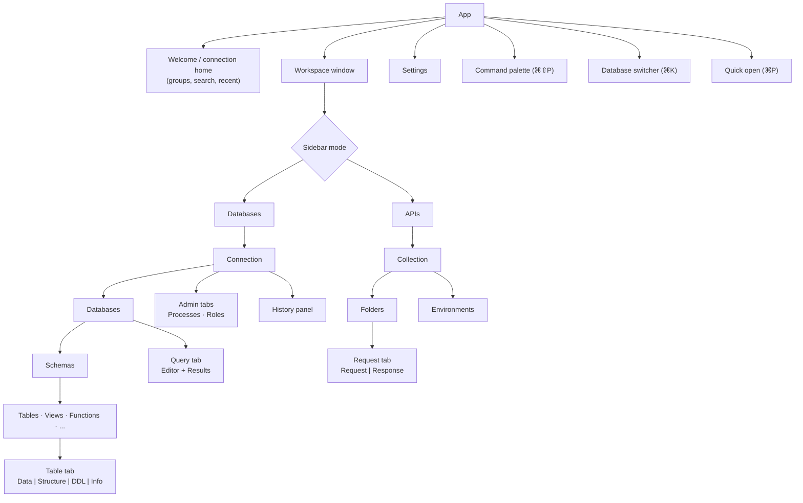

# 20 — UX Foundations

This document is the bridge into the UI design phase. It fixes the information architecture, interaction principles and layout skeleton; visual design (typography, colour, iconography, component styling) is produced in the design phase on top of it.

## 1. Design principles

1. **Content first, chrome second.** Data and SQL take the space; toolbars are compact and contextual.
2. **Calm density.** Dense enough for power users (compact rows, small chrome), with clear hierarchy and generous hit targets (≥ 24 px; ≥ 28 px default density).
3. **Always know where you are.** Connection, database/schema, environment tag and transaction state are visible at all times.
4. **Safe actions look safe; risky actions look risky.** Destructive actions use a distinct style and require deliberate confirmation; prod context is unmistakable.
5. **No modal dead-ends.** Prefer inline panels, popovers and non-blocking banners. Modals only for confirmations that need full attention.
6. **Fast paths everywhere.** Command palette, quick open, keyboard shortcuts, context menus, drag-and-drop — all routes to the same commands.
7. **Platform native.** Matches macOS conventions first (sidebar vibrancy, toolbar in titlebar, standard menus and shortcuts), adapts on Windows/Linux.
8. **Progressive disclosure.** Beginners see a simple connection form and table view; advanced options (SSH, TLS, session modes, startup commands) are one click away, not in the way.

## 2. Information architecture

**Workspace = connection** to one server/host. A workspace contains multiple
databases; opened databases have their own schemas and tab sets. **Project =
git-friendly folder** of saved queries, API collections and shared connection
definitions, opened via **Open Project Folder** (`.openrows/project.yaml`).
Project trust and files are independent of the connection workspace.




## 3. Window layout skeleton

```text
┌──────────────────────────────────────────────────────────────────────────────┐
│ ● ● ●  [◧]  ⟨ orders-staging ▾ ⟩ [STAGING]  db: orders ▾  schema: public ▾  🔍 ⌘K │  ← toolbar in titlebar
├──────────────┬───────────────────────────────────────────────────────────────┤
│ DATABASES│APIs│  orders ×  │ query 1 ● │ customers ×  │ + │                   │  ← tab strip
│ 🔍 Filter     ├───────────────────────────────────────────────────────────────┤
│ ▾ orders-stg  │  Data   Structure   DDL   Info        Filter ▾  ⟳  + Row  ⌘S │  ← tab toolbar
│   ▾ public    ├───────────────────────────────────────────────────────────────┤
│     ▸ Tables  │ id │ customer_id │ status    │ total   │ created_at          │
│       orders  │  1 │        1042 │ shipped   │  120.50 │ 2026-09-30 10:12:01 │
│       items   │  2 │        1043 │ pending ✎ │   48.00 │ 2026-09-30 10:15:44 │  ← edited cell
│     ▸ Views   │  3 │        1044 │ NULL      │    9.99 │ 2026-09-30 10:20:03 │
│     ▸ Funcs   │ …                                                             │
│ ▸ analytics   │                                                               │
│ ▸ redis-cache ├──────────────────────────────────────────────┬────────────────┤
│               │ (results / editor split when in query tab)   │ Inspector      │  ← optional right panel
│               │                                              │ status: pending│
├──────────────┴──────────────────────────────────────────────┴────────────────┤
│ ● Connected  PG 16.4 · SSH  │ 1,000 of ~2.4M rows · 38 ms │ 1 pending change │ ← status bar
└──────────────────────────────────────────────────────────────────────────────┘
```

Regions:

| Region | Purpose | Notes |
| --- | --- | --- |
| Toolbar (titlebar) | Context: connection switcher, env tag badge, database/schema pickers, global search | Env tag colour also tints a thin strip under the toolbar. |
| Sidebar | Databases ↔ APIs mode switch; tree; filter | Collapsible (⌘0 style shortcut), resizable. |
| Tab strip | Open tabs with type icon, dirty dot, tx badge | Overflow menu; drag to reorder/move window. |
| Tab content | Per tab type | Query tab: editor top, results bottom (resizable, flippable to side-by-side). |
| Inspector | Cell/row details, object info, request details | Toggle; remembers per tab type. |
| Status bar | Connection health, server version, row counts, timing, pending changes, transaction state | Clickable items open relevant panels. |

### 3.1 Revised layout (visual direction v2, 2026-10-05)

The approved direction refines the skeleton above:

| Region | v2 decision |
| --- | --- |
| **Workspace rail** (far left, 64 px in the mock) | Connections: 36 px engine-tinted tiles, 10 px corners, 13 px semibold name monograms and an 8 px **connection-status** dot (green connected, amber connecting, red failed, none when disconnected; the environment shows in the badge, tooltip and context bar). Under the active connection, its opened databases as small database-icon tiles with truncated names (see *Databases per connection* below). A left-edge pill marks selection (4 × 20 px) or hover (4 × 8 px), with a 160 ms token-eased height transition; reduced motion disables it. Hover/focus glass tooltips show workspace, environment, engine and host. Tab and ↑/↓ navigate; ⌘1–4 switch. Borderless `+`, API and settings controls sit at the bottom. |
| **Sidebar header** | Truncating workspace name, environment badge and a mock actions menu (Connection settings…, Duplicate, Disconnect). Below, a database icon/name/chevron opens a glass menu of opened databases: active check, hover/focus close (the last one too), wrapping ↑/↓, Home/End, Enter, Esc/Tab dismissal and opener focus return; the menu takes the selector's width and never leaves the sidebar, long names truncate with a full-name tooltip. Open database… (⌘K) opens the Open database panel. Database and workspace changes preserve per-database tabs. |
| **Sidebar** (floating rounded panel) | Header above segmented **Items / Queries / History**, search and object tree; schema picker and "create object" at the bottom. |
| **Toolbar** | One unified, full-width titlebar row that never wraps: traffic lights → sidebar toggle → back/forward → safe mode → context bar (flexes, truncates) → actions → inspector toggle pinned at the far right above the inspector. Contents: back/forward (per-tab navigation history), **Safe mode** toggle (always on for prod), **context bar** like TablePlus: `ENV | PostgreSQL 14.17 : connection : database : schema.object` (route and live latency later). |
| **Tabs** | Chrome-style tabs for every table, query, structure view and API request; drag to reorder or tear off into a new window; middle-click closes. |
| **Table view switcher** | Data · Structure · Indexes · Triggers · DDL inside each table tab; filter chips and "+ Row" next to it. |
| **Right panel** (floating) | Segmented **Details / Assistant**: row/object details, or the AI assistant with provider switcher, policy chips, tool trace and proposal cards. |
| **Commit bar** | Floating glass capsule over the grid whenever a change set is pending. |
| **Footer** | Pagination and query timing. |

Visual language: macOS-native — system font, rounded window and compact 12 px panels, capsule controls, flat full-row selection, soft status pills, light and dark themes.

### M0-T4b workspace mock

The desktop app now defaults to a hard-coded workspace in `apps/desktop/src/mock/`;
all sample connections, rows, schema metadata and transcripts live in `mock/data/`.
The rail gear opens the M0-T4 component gallery; Back or Escape returns with the
workspace state intact. These controls only change local preview state. No
connection, query, write or assistant call is made; Copy SQL uses the clipboard.

Reusable document tabs, split panels, disclosure sections, object rows and review
sheets live in `@openrows/ui`. Sidebar widths clamp to 200–360 px (reset 228),
inspector widths to 280–440 px (reset 316). Drag the panel edge, double-click to
reset, or focus the divider and use arrows/Home/End/Enter. Widths persist in local
storage under `openrows.mock.sidebar` and `openrows.mock.inspector`.

Below 1100 CSS px, the inspector automatically collapses; its toolbar button or
⌥⌘I reopens it as a trailing overlay above the content. Crossing back to 1100 px
restores the inline inspector. The titlebar never wraps: address and engine text
truncate first. Tabs shrink to 90 px then scroll; the 712 px grid scrolls
horizontally. At the 900×600 minimum, the rail and sidebar stay inline.

Panel collapse uses the approved 360 ms easing; disclosure uses 220 ms. Reduced
motion disables both. Width previews use direct CSS updates and persist once on
release, with no React updates per pointer move. Unlike the eventual canvas grid,
this forty-row mock deliberately animates split layout dimensions to reproduce
the approved prototype; the render-count benchmark protects the grid from React
work throughout dragging and collapse. This scoped mock exception does not alter
the production performance policy in docs/13. Actual frame time and visual polish
remain maintainer checks on native hardware.

The connection tile colours are tokens; ClickHouse gold is darkened to meet AA
for its white initials. SQL syntax uses the tested semantic foregrounds. System
light/dark, increased contrast, reduced motion and solid transparency fallbacks
reuse ThemeProvider and the existing token system. Native material setup is
specified in [docs/16 §3](16-platform-and-distribution.md#3-macos-specifics).

### M0-T4c database navigation and search

⌘K or the context bar database segment opens a glass database switcher. It lists
the selected workspace's hard-coded catalog, marks already-open databases and
hides system databases until **Show system databases** is enabled. Choosing an
entry opens/activates it. The sidebar header menu lists opened databases; its
close controls keep at least one database open. Switching workspaces
or databases retains tab sets and schema selection; object tooltips use
`database.schema.table`. Sidebar objects follow the active database/schema.

Sidebar search filters live, underlines matched characters, forces matching
sections open, displays **No matches**, and clears with Esc. ⌘F focuses search
only when focus is within the sidebar. ⌘P fuzzy-searches tables/views/functions
across every schema in the active database, with kind, schema and row estimates;
Enter opens a descriptor or focuses its existing tab. ⌘⇧P opens twelve mock
commands and their shortcuts. Refresh announces a mock refresh; other commands
change panel, safe-mode, tab, schema, search, gallery or palette state.

All three palettes share `@openrows/ui` combobox/listbox semantics: input focus,
↑/↓ wrapping, Home/End, Enter, Esc, a trapped Tab cycle and restored opener focus.
IME composition does not execute or navigate commands. Palette selection stays
visible when scrolling. Glass uses the existing solid/reduced-transparency
fallback and 12 px corners. Open/close scale + fade lasts **160 ms** via
`motion-popover`; rail indicator height lasts **160 ms** via the same token,
with `cubic-bezier(0.32, 0.72, 0, 1)`. Reduced motion removes both and closes
palettes without an animation delay. The fixed-size rail pill height transition
is a scoped exception to docs/13 layout animation policy, alongside the bounded
forty-row panel mock above; production performance policies remain unchanged. Search ranking has a
Performance API benchmark with a **16 ms p95 per 1,000 objects** budget.
Native toolbar geometry is documented in [docs/16 §3](16-platform-and-distribution.md#3-macos-specifics).
These interactions use mock/data only; no catalog, query or command contacts a server.

### D-05 real connections in the workspace

The rail now lists saved PostgreSQL connections (monogram tiles, environment
dot from tokens; custom tags use their stored colour via `--env-color`), with
`+` opening the **New connection** sheet. ⌘1–4 select the
first four saved connections. Selecting a tile opens a session; the sidebar
header shows the real name, environment badge, a live status
(Not connected / Connecting… / Connected · PostgreSQL x.y / Connection failed
plus the message) and a **Connection menu**: Connect/Disconnect, Connection
settings…, Duplicate, Delete… (always confirmed in a sheet). The toolbar
context bar shows the real connection name, environment and status; Safe mode
is forced on for prod-tagged connections.

The connection sheet has: paste-URL (Enter or **Fill from URL**; the core parses
it, the password never returns to the webview), name, group, host, port,
database, user, password (keychain; "Forget saved password" when editing), TLS
mode, environment segmented control (local/dev/staging/prod/custom with label
and colour), Read-only and Confirm writes switches (choosing Prod turns
Confirm writes on), **Test** (server version and latency, or the typed error),
Cancel/Save, and Delete…/Duplicate when editing. Validation messages appear
after the first Test or Save.

Everything below the header is still the M0-T4b sample catalog, tabs and rows,
marked with a **Sample data** badge next to the database selector. D-06
replaces the sample database selector, object tree and schema picker; D-07
replaces the sample tabs, SQL editor and grid. The removed mock pieces are the
mock rail, the mock workspace menu and the four sample connections.

### D-06 real schema tree

The sidebar now browses the selected connection's real catalog
(`apps/desktop/src/features/schema/`). Before a connection is selected or while
it is not connected, the tree says why (**Select a connection to browse its
objects**, **Connecting…**, **Connect to browse objects**). Once connected:

- **Database selector** (below the connection header) starts with the
  session's database and lists opened databases with ✓, close (the last one
  stays) and **Open database… ⌘K**. The **Sample data** badge is gone.
- **⌘K / context-bar database segment** lists the server's databases
  (templates and closed databases never appear; `postgres` and provider
  maintenance databases only with **Show system databases**), marks open ones
  and shows a loading or error line in the footer. Choosing one opens it; its
  catalog loads on its own metadata session.
- **Schema picker** (sidebar footer) defaults to `public` (else the first user
  schema). The gear button (**Show system schemas**) adds `pg_catalog` and
  `information_schema`. **Next schema** in ⌘⇧P cycles visible schemas.
- **Object tree**: Tables (with foreign tables), Views, Materialized views,
  Functions (with procedures) and Sequences. Tables load at once; every other
  section loads the first time it is expanded and shows **Loading…**, an error
  line with **Retry**, or "No views" and the like. Counts appear once a section
  has loaded. Rows show the kind glyph, `~` row estimates (planner estimates,
  never exact) and a `database.schema.name · Kind · comment` tooltip; routines
  show identity arguments, e.g. `calc_tax(total numeric)`.
- **Selection and opening**: click selects; double-click or Enter opens the
  object in a (still placeholder) tab with the real path, so the tab title is
  `database.schema.name`.
- **Search** filters loaded names live, underlines matches, forces sections
  open (which loads them), hides empty sections, shows **No matches**, clears
  with Esc; ⌘F focuses it when focus is in the sidebar.
- **Refresh**: ⌘R while focus is in the sidebar, the toolbar Refresh button or
  ⌘⇧P **Refresh catalog** forget everything read for the active database and
  read it again (announced as "Catalog refreshed").
- **⌘P** fuzzy-searches the database's bulk name index (tables, views,
  sequences, routines in every non-system schema) with kind, schema and row
  estimate; choosing an entry switches the schema picker to its schema and
  opens it.

Tab sets are kept per connection and database. Since D-07 they hold real
query tabs; opening an object opens (or refocuses) its `SELECT … LIMIT 1000`
tab. Saved queries and the sidebar history segment remain sample data. Catalog reads are
cached in memory only (no snapshot, no fingerprint); see
[docs/10 §2.1](10-schema-and-data-editing.md#21-implementation-notes-d-06-postgresql-schema-tree).

### UX-B databases per connection

PostgreSQL cannot switch databases on a connection, so a connection now holds
**several opened databases, each with its own user session** (plus its own
metadata session). Selecting a connection reaches the server first
(`connection_open`, on the profile's database or `postgres`); the profile's
database, when set, opens right away.

- **Open database panel (⌘K)**, a sheet like TablePlus: title *Open database*,
  focused search field, database list with icons (system databases only with
  **Show system databases**, already opened ones marked *Open*), ↑/↓ select,
  Return or double-click opens, Esc or **Cancel** dismisses, **New…** is
  disabled with the tooltip "Creating databases is coming soon" (FR-SCHEMA-12).
  It opens by itself after connecting a connection without a database; until a
  database is open the sidebar says *No database selected, press ⌘K to select
  a database*. ⌘⇧P's command is now *Open database…*.
- **Rail**: the tile dot shows connection status (green/amber/red/none). Under
  the active connection its opened databases appear as tiles (database icon,
  truncated name, active one highlighted, tooltip with the full name and any
  open failure, context menu *Close database*). Clicking one switches the
  sidebar, schema picker and tab set.
- **Tabs and running**: tab sets are per connection and database; every tab
  runs on its database's own session (no browse-only tabs). Closing a database
  closes its sessions; its tabs stay and say how to reopen it.
- **Context bar**: `ENV | PostgreSQL 17.2 : connection : database : schema.object`
  (the selected schema when no object tab is active); the database segment
  opens the panel.
- Native feel: arrow cursor on rail tiles, database selector, menus and the
  panel; tokens only.

### 3.2 macOS-native design methodology (macOS 26 era)

The app must feel like it was designed for the current macOS, not merely ported to it.

| Principle | How we apply it |
| --- | --- |
| **Everything collapsible** | Sidebar (⌃⌘S, standard "Show/Hide Sidebar"), inspector/assistant panel (⌥⌘I), connection rail, results pane, and every sidebar section (disclosure triangles). Panels animate with a spring-like ease (≈360 ms, `cubic-bezier(0.32, 0.72, 0, 1)`), remember their state per window, and can also be collapsed by dragging the divider past a threshold — like `NSSplitView` sidebars. Toolbar toggle buttons reflect state (tinted when open). |
| **Liquid Glass materials** | Sidebar, inspector and toolbar controls use translucent "glass" panels (blur + saturation, bright top edge highlight, soft shadow) floating above content, with content allowed to scroll beneath the toolbar edge. Implemented natively where possible (window vibrancy / glass effect behind a transparent webview on macOS 26; `NSVisualEffectView` on older versions) with semi-transparent tone tokens on persistent webview surfaces. CSS `backdrop-filter` is reserved for mounted transient palettes, sheets and tooltips to avoid redundant Retina backdrop textures (issue #17). |
| **Concentric geometry** | Corner radii nest: window 26 px → floating panels and sheets 12 px → controls 7 px (compact 6 px, see §3.3). Nothing has sharp corners next to a rounded container. |
| **Grouped controls** | Toolbar buttons are grouped in capsules. Segmented controls, fields and push buttons share the control radius (§3.3). Primary actions use the accent fill. |
| **Toolbar in the titlebar** | Unified titlebar/toolbar; traffic lights stay native; toolbar is user-customisable (add/remove/reorder items, icon/text modes) like `NSToolbar`. |
| **Native tabs behaviour** | Tabs reorder, tear off to new windows, merge windows (Window → Merge All Windows), ⌘⇧[ / ⌘⇧] to switch, ⌘W closes, "Reopen closed tab" ⌘⇧T. |
| **Menu bar parity** | Every command in the native menu bar with its shortcut; Help menu search finds commands. |
| **System iconography** | SF Symbols-style line icons at consistent weight; original artwork (no Apple-proprietary glyphs bundled). |
| **Appearance** | Light, dark and follow-system; respects accent colour, "Reduce transparency" (glass becomes solid), "Increase contrast" (stronger borders), "Reduce motion" (no slide animations), larger text. |
| **Window behaviour** | Full screen with auto-hiding toolbar, Stage Manager and Split View friendly, window state restoration, multiple windows per workspace. |
| **Interaction details** | Hover-reveal controls, context menus everywhere, drag-and-drop (tables into the editor, rows out as CSV), Quick Look (space) on cells and files, inline rename, type-to-select in lists. |
| **App icon** | Layered icon compatible with macOS light, dark, clear and tinted icon modes. |

### 3.3 Control consistency rules

These rules are enforced by `packages/ui/src/tokens/controls.test.ts`. Follow them for every new control:

| Size | Height | Corner radius | Text | Used by |
| --- | --- | --- | --- | --- |
| Regular (default) | `--or-control-height` 28 px | `--or-radius-control` 7 px | 13 px | text fields, search fields, selects (`SelectField`), push buttons, segmented controls |
| Compact | `--or-control-height-compact` 24 px | `--or-radius-control-compact` 6 px | 12 px | toolbar/table controls, inline buttons (`Button size="sm"`, `controlSize="compact"`) |

- One height and one radius per size. Inputs, selects, buttons and segmented controls of the same size never differ. A select uses the text-field frame, so it is exactly the size of a text input. Do not set heights or radii in feature CSS. Use the shared components or the tokens.
- Segments sit inside their control with a 2 px inset (`--or-segment-inset`). Their radius is the control radius minus the inset, so the corners are concentric.
- Switches are macOS-sized: 26 × 15 px track and 13 px knob (`--or-switch-*`).
- Concentric geometry: window 26 px → panels and sheets 12 px → controls 7 / 6 px. Capsules (`--or-radius-capsule`) are only for pills, badges and switch tracks, not for push buttons or fields.
- Arrow cursor everywhere: never use `cursor: pointer` on buttons, rows or tabs. Text inputs keep the I-beam, and disabled controls dim instead of changing the cursor.
- Sheets (`Sheet` + `SheetActions`) have a compact, centred 13 px semibold title and no close button. Push buttons are right-aligned: Cancel, then the default action in blue. Return runs the default action, Escape cancels, and focus starts in the first text field. Destructive confirmations use the native macOS alert (`confirmDestructive`), with Cancel as the safe choice.
- `control-sm`, `control-md` and `control-compact` are aliases of the regular and compact heights, kept for older styles.

## 4. Key flows to design

| Flow | Notes for design phase |
| --- | --- |
| First run | Welcome screen, theme preview, crash-report opt-in, "add your first connection" with URL paste detection. |
| New connection | Database type picker (searchable grid of logos as neutral glyphs), form generated from driver param schema, SSH/TLS sections collapsed, live URL preview, Test button with staged diagnostics. |
| Browse table | Open, page/infinite toggle, filter builder (column, operator, value; raw `WHERE` mode), sort by header click, column menu. |
| Edit & commit | Pending state visuals, review panel listing changes with SQL preview, commit/discard, conflict display. |
| Query | Run current statement feedback, multiple results tabs, error squiggles, cancel, history recall. |
| Prod guard | Confirm dialog design for writes and dangerous statements; typing-name confirmation. |
| Explain | Plan tree/flame views, hotspot list. |
| MongoDB documents | List ↔ tree ↔ table views; JSON editor. |
| Redis keys | Key browser with type badges, TTL, value editors by type. |
| API request | URL bar with method picker, tabs (Params, Headers, Body, Auth, Scripts, Tests, Docs), response panel with status/time/size and timing waterfall. |
| WebSocket/gRPC | Stream console. |
| Command palette & quick open | Fuzzy search UI with categories and shortcuts shown. |
| Settings | Searchable settings with JSON view toggle. |

## 5. Visual language guidance (inputs to the design phase)

- **Typography:** system UI font for chrome (SF Pro on macOS), user-selectable monospace for grid/editor (default to a bundled open-licence monospace such as JetBrains Mono or IBM Plex Mono — both OFL).
- **Colour:** neutral greys for chrome; one accent colour; semantic colours for success/warning/danger; environment tag palette (local=grey, dev=green, staging=amber, prod=red, custom) chosen to remain distinguishable for common colour-vision deficiencies and paired with text labels.
- **Iconography:** single consistent line icon set; database "logos" rendered as neutral, original glyphs or official marks only where their trademark guidelines permit use in tooling (checked per vendor).
- **Motion:** functional opacity/transform only; approved panel timing 360 ms and disclosure 220 ms with `cubic-bezier(0.32, 0.72, 0, 1)`. Palette scale/fade uses 160 ms; other small feedback stays ≤ 150 ms. Animations and transitions are disabled under reduced motion.
- **Density modes:** compact / default / comfortable.

### M0-T4 token values and accessibility adjustments

`packages/ui/src/tokens/` supplies both themes and the component gallery. UI labels
remain 13 px; workspace grid and tree text are 12.5 px, secondary metadata is
11–11.5 px, context text is 12 px, and environment labels are 10 px. Rail monograms are 13 px semibold. Grid rows
and headers are 26 px, tree rows 24 px, tabs and titlebar controls 28 px, table
controls 24 px (see §3.3 for the control height/radius rules), and rail tiles 36 px with 10 px corners. Status pills use 11 px
text in an 18 px box with 6 px corners. Floating panels use 12 px corners.

| Surface token | Dark | Light |
| --- | --- | --- |
| Grid/content (`window`) | `#242424` | `#FAFAFA` |
| Sidebar/inspector fallback (`panel-solid`) | `#222222` | `#EDEDED` |
| Sidebar/inspector glass (`panel`) | `rgba(34,34,34,0.9)` | `rgba(237,237,237,0.9)` |
| Window/rail (`page`) | `#1B1B1B` | `#DADADA` |

Rail and workspace panels have no outline strokes. Surface tone separates the
window/rail, sidebar/inspector and content; the dark content is the lightest
base surface. Panel radii and glass/transparency fallbacks remain. Inactive
rail tiles use 90% opacity, included in the contrast report. Keyboard focus
underlines the rail monogram and reveals its pill; other controls use focus indicators.

Rows are flat and edge-to-edge with a faint zebra tint. Edited cells use an 18%
amber tint and an accessible edited-cell label; inserted rows show a gutter plus;
deleted rows use a faint red tint, muted text and strikethrough. Selected rows
use the existing `#0B6BD6` accent and white text. Inactive tab close controls appear
on hover or keyboard focus; active tabs merge into the content surface.

The table toolbar stays on one line: the filter text and Add Filter action yield
space before the view labels and trailing Add Row action. In very narrow content
panes, the view labels scroll on one line while Add Row remains pinned. Assistant SQL wraps
long lines and its action area follows the code without overlapping scrollbars.
The 38 px floating change capsule uses 28 px controls; the grid reserves its
height plus 24 px in both bottom padding and keyboard scroll padding, keeping
the final row clear when scrolled to the bottom.

Search fields use a quiet fill and transparent border, with a focus ring on focus.
Default separators are 5.5% black/white; control fills are 3.5%. Secondary text is
`#B8B8B8` in dark and `#505050` in light. `just contrast-report` covers glass,
nested controls, row states, edited cells and semantic badges; text requires 4.5:1
and focus indicators 3:1. Increased contrast uses stronger neutral separators
and opaque fills; reduced transparency and reduced motion retain their fallbacks.
All palettes and measurements originate in tokens; the reference was used only
for density and visual weight, with no copied colours, assets, icons or text.

## 6. Accessibility requirements for design

- All colour pairings meet WCAG 2.2 AA (4.5:1 text, 3:1 UI components and focus indicators).
- Focus ring visible on every interactive element, including grid cells and tree items.
- State never conveyed by colour alone (edited/inserted/deleted rows also use icons/patterns).
- Screen-reader names for all icon-only buttons.
- Supports macOS "Increase contrast" and "Reduce transparency" (disable vibrancy).

## 7. Deliverables of the design phase

1. Design tokens (colour, type scale, spacing, radius, elevation, motion) for light/dark/high-contrast.
2. Component library spec (buttons, inputs, selects, tabs, tree, toolbar, menus, dialogs, popovers, toasts, badges, split panes, status bar).
3. High-fidelity screens for every flow in §4, in both themes, at compact and default density.
4. Grid visual spec: cell states, header, selection, edit states, NULL/boolean/JSON/binary renderings.
5. Prototype of core interactions (open table → edit → commit; run query → explain).
6. App icon and database glyph set (original artwork).
