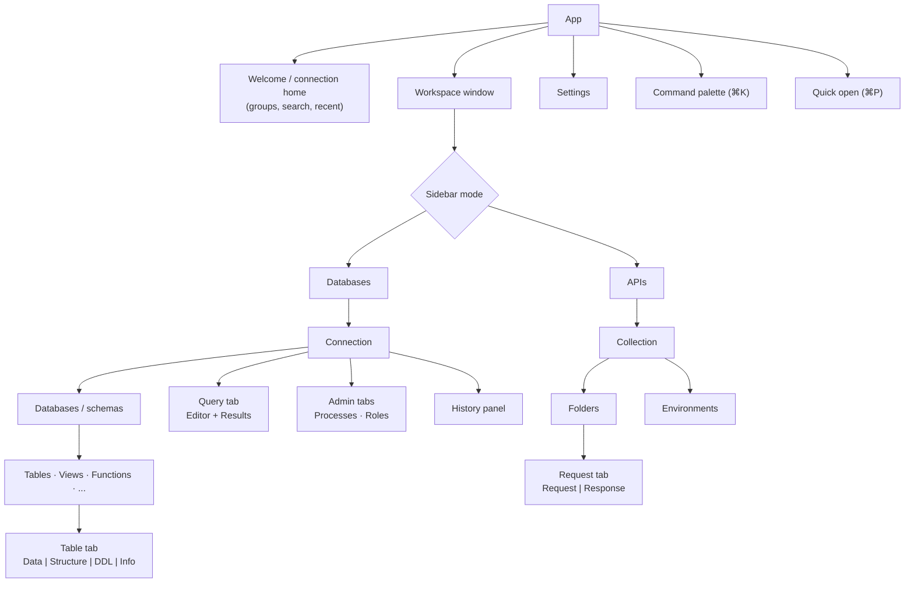

# 20 — UX Foundations

This document is the bridge into the UI design phase. It fixes the information architecture, interaction principles and layout skeleton; visual design (typography, colour, iconography, component styling) is produced in the design phase on top of it.

## 1. Design principles

1. **Content first, chrome second.** Data and SQL take the space; toolbars are compact and contextual.
2. **Calm density.** Dense enough for power users (compact rows, small chrome), with clear hierarchy and generous hit targets (≥ 24 px; ≥ 28 px default density).
3. **Always know where you are.** Connection, database/schema, environment tag and transaction state are visible at all times.
4. **Safe actions look safe; risky actions look risky.** Destructive actions use a distinct style and require deliberate confirmation; prod context is unmistakable.
5. **No modal dead-ends.** Prefer inline panels, popovers and non-blocking banners. Modals only for confirmations that need full attention.
6. **Fast paths everywhere.** Command palette, quick open, keyboard shortcuts, context menus, drag-and-drop — all routes to the same commands.
7. **Platform native.** Matches macOS conventions first (sidebar vibrancy, toolbar in titlebar, standard menus and shortcuts), adapts on Windows/Linux.
8. **Progressive disclosure.** Beginners see a simple connection form and table view; advanced options (SSH, TLS, session modes, startup commands) are one click away, not in the way.

## 2. Information architecture



## 3. Window layout skeleton

```text
┌──────────────────────────────────────────────────────────────────────────────┐
│ ● ● ●  [◧]  ⟨ orders-staging ▾ ⟩ [STAGING]  db: orders ▾  schema: public ▾  🔍 ⌘K │  ← toolbar in titlebar
├──────────────┬───────────────────────────────────────────────────────────────┤
│ DATABASES│APIs│  orders ×  │ query 1 ● │ customers ×  │ + │                   │  ← tab strip
│ 🔍 Filter     ├───────────────────────────────────────────────────────────────┤
│ ▾ orders-stg  │  Data   Structure   DDL   Info        Filter ▾  ⟳  + Row  ⌘S │  ← tab toolbar
│   ▾ public    ├───────────────────────────────────────────────────────────────┤
│     ▸ Tables  │ id │ customer_id │ status    │ total   │ created_at          │
│       orders  │  1 │        1042 │ shipped   │  120.50 │ 2026-09-30 10:12:01 │
│       items   │  2 │        1043 │ pending ✎ │   48.00 │ 2026-09-30 10:15:44 │  ← edited cell
│     ▸ Views   │  3 │        1044 │ NULL      │    9.99 │ 2026-09-30 10:20:03 │
│     ▸ Funcs   │ …                                                             │
│ ▸ analytics   │                                                               │
│ ▸ redis-cache ├──────────────────────────────────────────────┬────────────────┤
│               │ (results / editor split when in query tab)   │ Inspector      │  ← optional right panel
│               │                                              │ status: pending│
├──────────────┴──────────────────────────────────────────────┴────────────────┤
│ ● Connected  PG 16.4 · SSH  │ 1,000 of ~2.4M rows · 38 ms │ 1 pending change │ ← status bar
└──────────────────────────────────────────────────────────────────────────────┘
```

Regions:

| Region | Purpose | Notes |
| --- | --- | --- |
| Toolbar (titlebar) | Context: connection switcher, env tag badge, database/schema pickers, global search | Env tag colour also tints a thin strip under the toolbar. |
| Sidebar | Databases ↔ APIs mode switch; tree; filter | Collapsible (⌘0 style shortcut), resizable. |
| Tab strip | Open tabs with type icon, dirty dot, tx badge | Overflow menu; drag to reorder/move window. |
| Tab content | Per tab type | Query tab: editor top, results bottom (resizable, flippable to side-by-side). |
| Inspector | Cell/row details, object info, request details | Toggle; remembers per tab type. |
| Status bar | Connection health, server version, row counts, timing, pending changes, transaction state | Clickable items open relevant panels. |

### 3.1 Revised layout (visual direction v2, 2026-10-05)

The approved direction refines the skeleton above:

| Region | v2 decision |
| --- | --- |
| **Connection rail** (far left, ~64 px) | One rounded tile per open connection (engine initials, env-colour dot, health). Click to switch instantly; `+` opens a new connection. Settings at the bottom. |
| **Sidebar** (floating rounded panel) | Segmented **Items / Queries / History**; search; object tree; schema picker and "create object" at the bottom. |
| **Toolbar** | One unified, full-width titlebar row that never wraps: traffic lights → sidebar toggle → back/forward → safe mode → context bar (flexes, truncates) → actions → inspector toggle pinned at the far right above the inspector. Contents: back/forward (per-tab navigation history), **Safe mode** toggle (always on for prod), **context bar** like a browser address bar: env badge · connection › database › schema › object · engine · route (SSH, proxy…) · live latency. |
| **Tabs** | Chrome-style tabs for every table, query, structure view and API request; drag to reorder or tear off into a new window; middle-click closes. |
| **Table view switcher** | Data · Structure · Indexes · Triggers · DDL inside each table tab; filter chips and "+ Row" next to it. |
| **Right panel** (floating) | Segmented **Details / Assistant**: row/object details, or the AI assistant with provider switcher, policy chips, tool trace and proposal cards. |
| **Commit bar** | Floating glass capsule over the grid whenever a change set is pending. |
| **Footer** | Pagination and query timing. |

Visual language: macOS-native — system font, rounded window and panels (16–22 px), capsule controls, Finder-style rounded row selection, soft status pills, light and dark themes.

### 3.2 macOS-native design methodology (macOS 26 era)

The app must feel like it was designed for the current macOS, not merely ported to it.

| Principle | How we apply it |
| --- | --- |
| **Everything collapsible** | Sidebar (⌃⌘S, standard "Show/Hide Sidebar"), inspector/assistant panel (⌥⌘I), connection rail, results pane, and every sidebar section (disclosure triangles). Panels animate with a spring-like ease (≈360 ms, `cubic-bezier(0.32, 0.72, 0, 1)`), remember their state per window, and can also be collapsed by dragging the divider past a threshold — like `NSSplitView` sidebars. Toolbar toggle buttons reflect state (tinted when open). |
| **Liquid Glass materials** | Sidebar, inspector and toolbar controls use translucent "glass" panels (blur + saturation, bright top edge highlight, soft shadow) floating above content, with content allowed to scroll beneath the toolbar edge. Implemented natively where possible (window vibrancy / glass effect behind a transparent webview on macOS 26; `NSVisualEffectView` on older versions) and with CSS `backdrop-filter` inside the webview. |
| **Concentric geometry** | Corner radii nest: window 26 px → floating panels 18 px (window radius − 8 px inset) → controls capsules/10 px. Nothing has sharp corners next to a rounded container. |
| **Capsule controls** | Toolbar buttons grouped into capsules; segmented controls are pills; primary actions use the accent fill. |
| **Toolbar in the titlebar** | Unified titlebar/toolbar; traffic lights stay native; toolbar is user-customisable (add/remove/reorder items, icon/text modes) like `NSToolbar`. |
| **Native tabs behaviour** | Tabs reorder, tear off to new windows, merge windows (Window → Merge All Windows), ⌘⇧[ / ⌘⇧] to switch, ⌘W closes, "Reopen closed tab" ⌘⇧T. |
| **Menu bar parity** | Every command in the native menu bar with its shortcut; Help menu search finds commands. |
| **System iconography** | SF Symbols-style line icons at consistent weight; original artwork (no Apple-proprietary glyphs bundled). |
| **Appearance** | Light, dark and follow-system; respects accent colour, "Reduce transparency" (glass becomes solid), "Increase contrast" (stronger borders), "Reduce motion" (no slide animations), larger text. |
| **Window behaviour** | Full screen with auto-hiding toolbar, Stage Manager and Split View friendly, window state restoration, multiple windows per workspace. |
| **Interaction details** | Hover-reveal controls, context menus everywhere, drag-and-drop (tables into the editor, rows out as CSV), Quick Look (space) on cells and files, inline rename, type-to-select in lists. |
| **App icon** | Layered icon compatible with macOS light, dark, clear and tinted icon modes. |

## 4. Key flows to design

| Flow | Notes for design phase |
| --- | --- |
| First run | Welcome screen, theme preview, crash-report opt-in, "add your first connection" with URL paste detection. |
| New connection | Database type picker (searchable grid of logos as neutral glyphs), form generated from driver param schema, SSH/TLS sections collapsed, live URL preview, Test button with staged diagnostics. |
| Browse table | Open, page/infinite toggle, filter builder (column, operator, value; raw `WHERE` mode), sort by header click, column menu. |
| Edit & commit | Pending state visuals, review panel listing changes with SQL preview, commit/discard, conflict display. |
| Query | Run current statement feedback, multiple results tabs, error squiggles, cancel, history recall. |
| Prod guard | Confirm dialog design for writes and dangerous statements; typing-name confirmation. |
| Explain | Plan tree/flame views, hotspot list. |
| MongoDB documents | List ↔ tree ↔ table views; JSON editor. |
| Redis keys | Key browser with type badges, TTL, value editors by type. |
| API request | URL bar with method picker, tabs (Params, Headers, Body, Auth, Scripts, Tests, Docs), response panel with status/time/size and timing waterfall. |
| WebSocket/gRPC | Stream console. |
| Command palette & quick open | Fuzzy search UI with categories and shortcuts shown. |
| Settings | Searchable settings with JSON view toggle. |

## 5. Visual language guidance (inputs to the design phase)

- **Typography:** system UI font for chrome (SF Pro on macOS), user-selectable monospace for grid/editor (default to a bundled open-licence monospace such as JetBrains Mono or IBM Plex Mono — both OFL).
- **Colour:** neutral greys for chrome; one accent colour; semantic colours for success/warning/danger; environment tag palette (local=grey, dev=green, staging=amber, prod=red, custom) chosen to remain distinguishable for common colour-vision deficiencies and paired with text labels.
- **Iconography:** single consistent line icon set; database "logos" rendered as neutral, original glyphs or official marks only where their trademark guidelines permit use in tooling (checked per vendor).
- **Motion:** subtle, ≤ 150 ms, functional only (panel open, tab move); disabled under reduced motion.
- **Density modes:** compact / default / comfortable.

## 6. Accessibility requirements for design

- All colour pairings meet WCAG 2.2 AA (4.5:1 text, 3:1 UI components and focus indicators).
- Focus ring visible on every interactive element, including grid cells and tree items.
- State never conveyed by colour alone (edited/inserted/deleted rows also use icons/patterns).
- Screen-reader names for all icon-only buttons.
- Supports macOS "Increase contrast" and "Reduce transparency" (disable vibrancy).

## 7. Deliverables of the design phase

1. Design tokens (colour, type scale, spacing, radius, elevation, motion) for light/dark/high-contrast.
2. Component library spec (buttons, inputs, selects, tabs, tree, toolbar, menus, dialogs, popovers, toasts, badges, split panes, status bar).
3. High-fidelity screens for every flow in §4, in both themes, at compact and default density.
4. Grid visual spec: cell states, header, selection, edit states, NULL/boolean/JSON/binary renderings.
5. Prototype of core interactions (open table → edit → commit; run query → explain).
6. App icon and database glyph set (original artwork).
