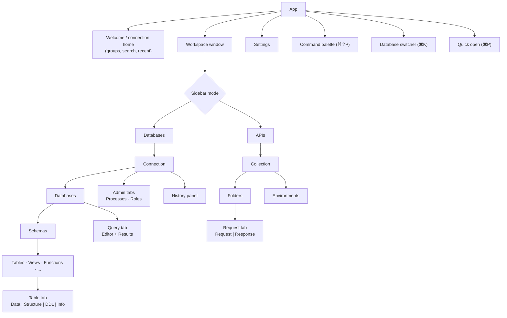

# 20 — UX Foundations

This document is the bridge into the UI design phase. It fixes the information architecture, interaction principles and layout skeleton; visual design (typography, colour, iconography, component styling) is produced in the design phase on top of it.

## 1. Design principles

1. **Content first, chrome second.** Data and SQL take the space; toolbars are compact and contextual.
2. **Calm density.** Dense enough for power users (compact rows, small chrome), with clear hierarchy and generous hit targets (≥ 24 px; ≥ 28 px default density).
3. **Always know where you are.** Connection, database/schema, environment tag and transaction state are visible at all times.
4. **Safe actions look safe; risky actions look risky.** Destructive actions use a distinct style and require deliberate confirmation; prod context is unmistakable.
5. **No modal dead-ends.** Prefer inline panels, popovers and non-blocking banners. Modals only for confirmations that need full attention.
6. **Fast paths everywhere.** Command palette, quick open, keyboard shortcuts, context menus, drag-and-drop — all routes to the same commands.
7. **Platform native.** Matches macOS conventions first (sidebar vibrancy, toolbar in titlebar, standard menus and shortcuts), adapts on Windows/Linux.
8. **Progressive disclosure.** Beginners see a simple connection form and table view; advanced options (SSH, TLS, session modes, startup commands) are one click away, not in the way.

## 2. Information architecture

**Workspace = connection** to one server/host. A workspace contains multiple
databases; opened databases have their own schemas and tab sets. **Project =
git-friendly folder** of saved queries, API collections and shared connection
definitions, opened via **Open Project Folder** (`.openrows/project.yaml`).
Project trust and files are independent of the connection workspace.




## 3. Window layout skeleton

```text
┌──────────────────────────────────────────────────────────────────────────────┐
│ ● ● ●  [◧]  ⟨ orders-staging ▾ ⟩ [STAGING]  db: orders ▾  schema: public ▾  🔍 ⌘K │  ← toolbar in titlebar
├──────────────┬───────────────────────────────────────────────────────────────┤
│ DATABASES│APIs│  orders ×  │ query 1 ● │ customers ×  │ + │                   │  ← tab strip
│ 🔍 Filter     ├───────────────────────────────────────────────────────────────┤
│ ▾ orders-stg  │  Data   Structure   DDL   Info        Filter ▾  ⟳  + Row  ⌘S │  ← tab toolbar
│   ▾ public    ├───────────────────────────────────────────────────────────────┤
│     ▸ Tables  │ id │ customer_id │ status    │ total   │ created_at          │
│       orders  │  1 │        1042 │ shipped   │  120.50 │ 2026-09-30 10:12:01 │
│       items   │  2 │        1043 │ pending ✎ │   48.00 │ 2026-09-30 10:15:44 │  ← edited cell
│     ▸ Views   │  3 │        1044 │ NULL      │    9.99 │ 2026-09-30 10:20:03 │
│     ▸ Funcs   │ …                                                             │
│ ▸ analytics   │                                                               │
│ ▸ redis-cache ├──────────────────────────────────────────────┬────────────────┤
│               │ (results / editor split when in query tab)   │ Inspector      │  ← optional right panel
│               │                                              │ status: pending│
├──────────────┴──────────────────────────────────────────────┴────────────────┤
│ ● Connected  PG 16.4 · SSH  │ 1,000 of ~2.4M rows · 38 ms │ 1 pending change │ ← status bar
└──────────────────────────────────────────────────────────────────────────────┘
```

Regions:

| Region | Purpose | Notes |
| --- | --- | --- |
| Toolbar (titlebar) | Context: connection switcher, env tag badge, database/schema pickers, global search | Env tag colour also tints a thin strip under the toolbar. |
| Sidebar | Databases ↔ APIs mode switch; tree; filter | Collapsible (⌘0 style shortcut), resizable. |
| Tab strip | Open tabs with type icon, dirty dot, tx badge | Overflow menu; drag to reorder/move window. |
| Tab content | Per tab type | Query tab: editor top, results bottom (resizable, flippable to side-by-side). |
| Inspector | Cell/row details, object info, request details | Toggle; remembers per tab type. |
| Status bar | Connection health, server version, row counts, timing, pending changes, transaction state | Clickable items open relevant panels. |

### 3.1 Revised layout (visual direction v2, 2026-10-05)

The approved direction refines the skeleton above:

| Region | v2 decision |
| --- | --- |
| **Workspace sidebar** (far left, 220 px, full height under the traffic lights; compact 60 px) | Named server rows use 20 px engine-tinted monograms with a presence dot on the tile's bottom-right corner (grey, amber connecting, green connected, red failed), normal-font connection names and visually hidden status text (failures show it). Environment/folder headings show counts and collapse independently; each connection has a separate disclosure next to its selection control. Its opened databases are indented horizontal rows with database icons. Solid blue selection identifies the active database. Compact mode works like Slack: the toolbar spans the window, the rail sits below it with one 36 px tile per connection (the selected one ringed), short separators between groups and `+` below the tiles; databases are reached from ⌘K and the toolbar. Right-click opens the connection menu at the pointer; the hover ⋯ opens it under the button. Tooltips show the name, environment, address, status and ⌘ shortcut. Both width mode and collapse state persist locally. Tab and ↑/↓ navigate; ⌘1–9 switch, in rail order. New connection, API and settings controls remain available. |
| **Sidebar header** | Truncating workspace name, environment badge and a mock actions menu (Connection settings…, Duplicate, Disconnect). Below, a database icon/name/chevron opens a glass menu of opened databases: active check, hover/focus close (the last one too), wrapping ↑/↓, Home/End, Enter, Esc/Tab dismissal and opener focus return; the menu takes the selector's width and never leaves the sidebar, long names truncate with a full-name tooltip. Open database… (⌘K) opens the Open database panel. Database and workspace changes preserve per-database tabs. |
| **Sidebar** (floating rounded panel) | Header above segmented **Items / Queries / History**, search and object tree; schema picker and "create object" at the bottom. |
| **Toolbar** | One unified, full-width titlebar row that never wraps: traffic lights → sidebar toggle → back/forward → safe mode → context bar (flexes, truncates) → actions → inspector toggle pinned at the far right above the inspector. Contents: back/forward (per-tab navigation history), **Safe mode** toggle (always on for prod), **context bar** like TablePlus: `ENV | PostgreSQL 14.17 : connection : database : schema.object` (route and live latency later). |
| **Tabs** | Chrome-style tabs for every table, query, structure view and API request; drag to reorder or tear off into a new window; middle-click closes. |
| **Table view switcher** | Data · Structure · Indexes · Triggers · DDL inside each table tab; filter chips and "+ Row" next to it. |
| **Right panel** (floating) | Segmented **Details / Assistant**: row/object details, or the AI assistant with provider switcher, policy chips, tool trace and proposal cards. |
| **Commit bar** | Floating glass capsule over the grid whenever a change set is pending. |
| **Footer** | Pagination and query timing. |

Visual language: macOS-native — system font, rounded window and compact 12 px panels, capsule controls, flat full-row selection, soft status pills, light and dark themes.

### M0-T4b workspace mock

The desktop app now defaults to a hard-coded workspace in `apps/desktop/src/mock/`;
all sample connections, rows, schema metadata and transcripts live in `mock/data/`.
The rail gear opens the M0-T4 component gallery; Back or Escape returns with the
workspace state intact. These controls only change local preview state. No
connection, query, write or assistant call is made; Copy SQL uses the clipboard.

Reusable document tabs, split panels, disclosure sections, object rows and review
sheets live in `@openrows/ui`. Sidebar widths clamp to 200–360 px (reset 228),
inspector widths to 280–440 px (reset 316). Drag the panel edge, double-click to
reset, or focus the divider and use arrows/Home/End/Enter. Widths persist in local
storage under `openrows.mock.sidebar` and `openrows.mock.inspector`.

Below 1100 CSS px, the inspector automatically collapses; its toolbar button or
⌥⌘I reopens it as a trailing overlay above the content. Crossing back to 1100 px
restores the inline inspector. The titlebar never wraps: address and engine text
truncate first. Tabs shrink to 90 px then scroll; the 712 px grid scrolls
horizontally. At the 900×600 minimum, the rail and sidebar stay inline.

Panel collapse uses the approved 360 ms easing; disclosure uses 220 ms. Reduced
motion disables both. Width previews use direct CSS updates and persist once on
release, with no React updates per pointer move. Unlike the eventual canvas grid,
this forty-row mock deliberately animates split layout dimensions to reproduce
the approved prototype; the render-count benchmark protects the grid from React
work throughout dragging and collapse. This scoped mock exception does not alter
the production performance policy in docs/13. Actual frame time and visual polish
remain maintainer checks on native hardware.

The connection tile colours are tokens; ClickHouse gold is darkened to meet AA
for its white initials. SQL syntax uses the tested semantic foregrounds. System
light/dark, increased contrast, reduced motion and solid transparency fallbacks
reuse ThemeProvider and the existing token system. Native material setup is
specified in [docs/16 §3](16-platform-and-distribution.md#3-macos-specifics).

### M0-T4c database navigation and search

⌘K or the context bar database segment opens a glass database switcher. It lists
the selected workspace's hard-coded catalog, marks already-open databases and
hides system databases until **Show system databases** is enabled. Choosing an
entry opens/activates it. The sidebar header menu lists opened databases; its
close controls keep at least one database open. Switching workspaces
or databases retains tab sets and schema selection; object tooltips use
`database.schema.table`. Sidebar objects follow the active database/schema.

Sidebar search filters live, underlines matched characters, forces matching
sections open, displays **No matches**, and clears with Esc. ⌘F focuses search
only when focus is within the sidebar. ⌘P fuzzy-searches tables/views/functions
across every schema in the active database, with kind, schema and row estimates;
Enter opens a descriptor or focuses its existing tab. ⌘⇧P opens twelve mock
commands and their shortcuts. Refresh announces a mock refresh; other commands
change panel, safe-mode, tab, schema, search, gallery or palette state.

All three palettes share `@openrows/ui` combobox/listbox semantics: input focus,
↑/↓ wrapping, Home/End, Enter, Esc, a trapped Tab cycle and restored opener focus.
IME composition does not execute or navigate commands. Palette selection stays
visible when scrolling. Glass uses the existing solid/reduced-transparency
fallback and 12 px corners. Open/close scale + fade lasts **160 ms** via `motion-popover`, with `cubic-bezier(0.32, 0.72, 0, 1)`. Reduced motion removes the animation and closes palettes without delay. Workspace selection uses a static tinted row and focus ring; it no longer animates a rail pill. Production performance policies remain unchanged. Search ranking has a
Performance API benchmark with a **16 ms p95 per 1,000 objects** budget.
Native toolbar geometry is documented in [docs/16 §3](16-platform-and-distribution.md#3-macos-specifics).
These interactions use mock/data only; no catalog, query or command contacts a server.

### D-05 real connections in the workspace

The rail now lists saved PostgreSQL connections (monogram tiles, environment
dot from tokens; custom tags use their stored colour via `--env-color`), with
`+` opening the **New connection** sheet. ⌘1–9 select the
first nine connections in rail order. Selecting a tile opens a session; the sidebar
header shows the real name, environment badge, a live status
(Not connected / Connecting… / Connected · PostgreSQL x.y / Connection failed
plus the message) and a **Connection menu**: Connect/Disconnect, Connection
settings…, Duplicate, Delete… (always confirmed in a sheet). The toolbar
context bar shows the real connection name, environment and status; Safe mode
is forced on for prod-tagged connections.

The connection sheet has: paste-URL (Enter or **Fill from URL**; the core parses
it, the password never returns to the webview), name, group, host, port,
database, user, password (keychain; "Forget saved password" when editing), TLS
mode, environment segmented control (local/dev/staging/prod/custom with label
and colour), Read-only and Confirm writes switches (choosing Prod turns
Confirm writes on), **Test** (server version and latency, or the typed error),
Cancel/Save, and Delete…/Duplicate when editing. Validation messages appear
after the first Test or Save.

Everything below the header is still the M0-T4b sample catalog, tabs and rows,
marked with a **Sample data** badge next to the database selector. D-06
replaces the sample database selector, object tree and schema picker; D-07
replaces the sample tabs, SQL editor and grid. The removed mock pieces are the
mock rail, the mock workspace menu and the four sample connections.

### D-06 real schema tree

The sidebar now browses the selected connection's real catalog
(`apps/desktop/src/features/schema/`). Before a connection is selected or while
it is not connected, the tree says why (**Select a connection to browse its
objects**, **Connecting…**, **Connect to browse objects**). Once connected:

- **Database selector** (below the connection header) starts with the
  session's database and lists opened databases with ✓, close (the last one
  stays) and **Open database… ⌘K**. The **Sample data** badge is gone.
- **⌘K / context-bar database segment** lists the server's databases
  (templates and closed databases never appear; `postgres` and provider
  maintenance databases only with **Show system databases**), marks open ones
  and shows a loading or error line in the footer. Choosing one opens it; its
  catalog loads on its own metadata session.
- **Schema picker** (sidebar footer) defaults to `public` (else the first user
  schema). The gear button (**Show system schemas**) adds `pg_catalog` and
  `information_schema`. **Next schema** in ⌘⇧P cycles visible schemas.
- **Object tree**: Tables (with foreign tables), Views, Materialized views,
  Functions (with procedures) and Sequences. Tables load at once; every other
  section loads the first time it is expanded and shows **Loading…**, an error
  line with **Retry**, or "No views" and the like. Counts appear once a section
  has loaded. Rows show the kind glyph, `~` row estimates (planner estimates,
  never exact) and a `database.schema.name · Kind · comment` tooltip; routines
  show identity arguments, e.g. `calc_tax(total numeric)`.
- **Selection and opening**: click selects; double-click or Enter opens the
  object in a (still placeholder) tab with the real path, so the tab title is
  `database.schema.name`.
- **Columns** (TablePlus style): every table, view and materialized view row
  has a disclosure chevron, collapsed by default. Expanding (chevron click or
  →) lists the relation's columns indented below it: monospace name, data
  type right-aligned and muted, and a yellow (`warning-fg`) key icon before
  primary-key columns. Expanding never opens the object; column rows can be
  selected and double-click/Enter opens their table. Columns are read lazily
  with `table_structure` on first expand and cached per connection, database,
  schema and table until the catalog is refreshed; the group shows
  **Loading columns…** or an inline error line (expanding again retries).
  Expansion is remembered per connection and database while the app runs.
- **Keyboard and density**: each section is an ARIA `tree` with one Tab stop
  (roving `tabindex`); rows are `treeitem`s with `aria-level`,
  `aria-selected` and `aria-expanded`, columns sit in a nested `group`.
  ↑/↓/Home/End move (selection follows focus), → expands or enters the
  columns, ← collapses or returns to the table. Object tree rows are 20 px
  high (TablePlus density); the tree is not virtualised.
- **Search** filters loaded names live, underlines matches, forces sections
  open (which loads them), hides empty sections, shows **No matches**, clears
  with Esc; ⌘F focuses it when focus is in the sidebar.
- **Refresh**: ⌘R while focus is in the sidebar, the toolbar Refresh button or
  ⌘⇧P **Refresh catalog** forget everything read for the active database and
  read it again (announced as "Catalog refreshed").
- **⌘P** fuzzy-searches the database's bulk name index (tables, views,
  sequences, routines in every non-system schema) with kind, schema and row
  estimate; choosing an entry switches the schema picker to its schema and
  opens it.

Tab sets are kept per connection and database. Since D-07 they hold real
query tabs; opening an object opens (or refocuses) its `SELECT … LIMIT 1000`
tab. Saved queries and the sidebar history segment remain sample data. Catalog reads are
cached in memory only (no snapshot, no fingerprint); see
[docs/10 §2.1](10-schema-and-data-editing.md#21-implementation-notes-d-06-postgresql-schema-tree).

### UX-B databases per connection

PostgreSQL cannot switch databases on a connection, so a connection now holds
**several opened databases, each with its own user session** (plus its own
metadata session). Selecting a connection reaches the server first
(`connection_open`, on the profile's database or `postgres`); the profile's
database, when set, opens right away.

- **Open database panel (⌘K)**, a sheet like TablePlus: title *Open database*,
  focused search field, database list with icons (system databases only with
  **Show system databases**, already opened ones marked *Open*), ↑/↓ select,
  Return or double-click opens, Esc or **Cancel** dismisses, **New…** is
  disabled with the tooltip "Creating databases is coming soon" (FR-SCHEMA-12).
  It opens by itself after connecting a connection without a database; until a
  database is open the sidebar says *No database selected, press ⌘K to select
  a database*. ⌘⇧P's command is now *Open database…*.
- **Rail**: the tile dot shows connection status (green/amber/red/none). Under
  the active connection its opened databases appear as tiles (database icon,
  truncated name, active one highlighted, tooltip with the full name and any
  open failure, context menu *Close database*). Clicking one switches the
  sidebar, schema picker and tab set.
- **Tabs and running**: tab sets are per connection and database; every tab
  runs on its database's own session (no browse-only tabs). Closing a database
  closes its sessions; its tabs stay and say how to reopen it.
- **Context bar**: `ENV | PostgreSQL 17.2 : connection : database : schema.object`
  (the selected schema when no object tab is active); the database segment
  opens the panel.
- Native feel: arrow cursor on rail tiles, database selector, menus and the
  panel; tokens only.

### 3.2 macOS-native design methodology (macOS 26 era)

The app must feel like it was designed for the current macOS, not merely ported to it.

| Principle | How we apply it |
| --- | --- |
| **Everything collapsible** | Sidebar (⌃⌘S, standard "Show/Hide Sidebar"), inspector/assistant panel (⌥⌘I), connection rail, results pane, and every sidebar section (disclosure triangles). Panels animate with a spring-like ease (≈360 ms, `cubic-bezier(0.32, 0.72, 0, 1)`), remember their state per window, and can also be collapsed by dragging the divider past a threshold — like `NSSplitView` sidebars. Toolbar toggle buttons reflect state (tinted when open). |
| **Liquid Glass materials** | Sidebar, inspector and toolbar controls use translucent "glass" panels (blur + saturation, bright top edge highlight, soft shadow) floating above content, with content allowed to scroll beneath the toolbar edge. Implemented natively where possible (window vibrancy / glass effect behind a transparent webview on macOS 26; `NSVisualEffectView` on older versions) with semi-transparent tone tokens on persistent webview surfaces. CSS `backdrop-filter` is reserved for mounted transient palettes, sheets and tooltips to avoid redundant Retina backdrop textures (issue #17). |
| **Concentric geometry** | Corner radii nest: window 26 px → floating panels and sheets 12 px → controls 7 px (compact 6 px, see §3.3). Nothing has sharp corners next to a rounded container. |
| **Grouped controls** | Toolbar buttons are grouped in capsules. Segmented controls, fields and push buttons share the control radius (§3.3). Primary actions use the accent fill. |
| **Toolbar in the titlebar** | Unified titlebar/toolbar; traffic lights stay native; toolbar is user-customisable (add/remove/reorder items, icon/text modes) like `NSToolbar`. |
| **Native tabs behaviour** | Tabs reorder, tear off to new windows, merge windows (Window → Merge All Windows), ⌘⇧[ / ⌘⇧] to switch, ⌘W closes, "Reopen closed tab" ⌘⇧T. |
| **Menu bar parity** | Every command in the native menu bar with its shortcut; Help menu search finds commands. |
| **System iconography** | SF Symbols-style line icons at consistent weight; original artwork (no Apple-proprietary glyphs bundled). |
| **Appearance** | Light, dark and follow-system; respects accent colour, "Reduce transparency" (glass becomes solid), "Increase contrast" (stronger borders), "Reduce motion" (no slide animations), larger text. |
| **Window behaviour** | Full screen with auto-hiding toolbar, Stage Manager and Split View friendly, window state restoration, multiple windows per workspace. |
| **Interaction details** | Hover-reveal controls, context menus everywhere, drag-and-drop (tables into the editor, rows out as CSV), Quick Look (space) on cells and files, inline rename, type-to-select in lists. |
| **App icon** | Layered icon compatible with macOS light, dark, clear and tinted icon modes. |

### 3.3 Control consistency rules

These rules are enforced by `packages/ui/src/tokens/controls.test.ts`. Follow them for every new control:

| Size | Height | Corner radius | Text | Used by |
| --- | --- | --- | --- | --- |
| Regular (default) | `--or-control-height` 28 px | `--or-radius-control` 7 px | 13 px | text fields, search fields, selects (`SelectField`), push buttons, segmented controls |
| Compact | `--or-control-height-compact` 24 px | `--or-radius-control-compact` 6 px | 12 px | toolbar/table controls, inline buttons (`Button size="sm"`, `controlSize="compact"`) |

- One height and one radius per size. Inputs, selects, buttons and segmented controls of the same size never differ. A select uses the text-field frame, so it is exactly the size of a text input. Do not set heights or radii in feature CSS. Use the shared components or the tokens.
- Segments sit inside their control with a 2 px inset (`--or-segment-inset`). Their radius is the control radius minus the inset, so the corners are concentric.
- Segment labels centre horizontally and vertically, including when segments share the available width. Feature styles must not impose a minimum height that exceeds the inset track.
- Chrome and controls inherit the system UI font. Query action shortcuts use an inline, borderless system-font hint; standalone shortcut hints retain compact keycaps.
- Table identifiers and values use `font-mono` at `text-13`: object names, table document tabs, grid headers and cells, structure/index data and inspector values. Connection/database/schema selectors, rail labels, context paths, query tabs and inspector labels use the system UI font; inspector types and secondary metadata use 11–12 px. Table glyphs use the theme's soft blue `info-fg`; selected sidebar rows inherit their white selection foreground.
- Window chrome, navigation labels and opened-database tiles do not select as text. Inputs, editors, SQL previews, inspector values and query diagnostics remain selectable for copying.
- Switches are macOS-sized: 26 × 15 px track and 13 px knob (`--or-switch-*`).
- Concentric geometry: window 26 px → panels and sheets 12 px → controls 7 / 6 px. Capsules (`--or-radius-capsule`) are only for pills, badges and switch tracks, not for push buttons or fields.
- Arrow cursor everywhere: never use `cursor: pointer` on buttons, rows or tabs. Text inputs keep the I-beam, and disabled controls dim instead of changing the cursor.
- Scroll bars are quiet, like macOS overlay scroll bars: a faint thumb until the scrolling area is hovered, clearer then and strongest under the pointer (`app/global.css`).
- NULL, EMPTY and DEFAULT markers (grid, structure grid, inspector) use the `placeholder` token: quieter than tertiary text, held to a 3:1 contrast minimum in every theme instead of 4.5:1, like TablePlus's dim markers.
- Menus are solid, ringed `control-active` surfaces with 24 px rows, accent-filled highlight and destructive items last, after a separator.
- Sheets (`Sheet` + `SheetActions`) have a compact, centred 13 px semibold title and no close button. Push buttons are right-aligned: Cancel, then the default action in blue. Return runs the default action, Escape cancels, and focus starts in the first text field. Destructive confirmations use the native macOS alert (`confirmDestructive`), with Cancel as the safe choice.
- `control-sm`, `control-md` and `control-compact` are aliases of the regular and compact heights, kept for older styles.

## 4. Key flows to design

| Flow | Notes for design phase |
| --- | --- |
| First run | Welcome screen, theme preview, crash-report opt-in, "add your first connection" with URL paste detection. |
| New connection | Database type picker (searchable grid of logos as neutral glyphs), form generated from driver param schema, SSH/TLS sections collapsed, live URL preview, Test button with staged diagnostics. |
| Browse table | Open, page/infinite toggle, filter builder (column, operator, value; raw `WHERE` mode), sort by header click, column menu. |
| Edit & commit | Pending state visuals, review panel listing changes with SQL preview, commit/discard, conflict display. |
| Query | Run current statement feedback, multiple results tabs, error squiggles, cancel, history recall. |
| Prod guard | Confirm dialog design for writes and dangerous statements; typing-name confirmation. |
| Explain | Plan tree/flame views, hotspot list. |
| MongoDB documents | List ↔ tree ↔ table views; JSON editor. |
| Redis keys | Key browser with type badges, TTL, value editors by type. |
| API request | URL bar with method picker, tabs (Params, Headers, Body, Auth, Scripts, Tests, Docs), response panel with status/time/size and timing waterfall. |
| WebSocket/gRPC | Stream console. |
| Command palette & quick open | Fuzzy search UI with categories and shortcuts shown. |
| Settings | Searchable settings with JSON view toggle. |

## 5. Visual language guidance (inputs to the design phase)

- **Typography:** system UI font for chrome (SF Pro on macOS); system monospace (SF Mono) at 12 px, like TablePlus, for table identifiers, table display, SQL editors and inspector values. Appearance settings provide independent local font choices and 11–18 px sizes for interface and monospace content. Bundled open-licence fonts remain future work.
- **Colour:** neutral graphite surfaces (no hue tint) in dark mode and neutral light surfaces, blue `#2563EB` selection, brighter semantic colours for success/warning/danger; environment tag palette (local=emerald, dev=green, staging=amber, prod=coral, custom) chosen to remain distinguishable for common colour-vision deficiencies and paired with text labels.
- **Iconography:** single consistent line icon set; database "logos" rendered as neutral, original glyphs or official marks only where their trademark guidelines permit use in tooling (checked per vendor).
- **Motion:** functional opacity/transform only; approved panel timing 360 ms and disclosure 220 ms with `cubic-bezier(0.32, 0.72, 0, 1)`. Palette scale/fade uses 160 ms; other small feedback stays ≤ 150 ms. Animations and transitions are disabled under reduced motion.
- **Density modes:** compact / default / comfortable.

### M0-T4 token values and accessibility adjustments

`packages/ui/src/tokens/` supplies both themes and the component gallery. UI labels
remain 13 px; workspace grid, document tabs and tree text are 13 px, secondary metadata is
11–11.5 px, context paths use the system UI font, and environment labels are 10 px. Rail monograms are 13 px semibold. Grid rows
and headers are 26 px, tree rows 24 px, tabs and titlebar controls 28 px, table
controls 24 px (see §3.3 for the control height/radius rules), and workspace monograms 28 px with 9 px corners. Status pills use 11 px
text in an 18 px box with 6 px corners. Floating panels use 12 px corners.

| Surface token | Dark | Light |
| --- | --- | --- |
| Grid/content (`window`) | `#0C0C0E` | `#FFFFFF` |
| Sidebar/inspector fallback (`panel-solid`) | `#141416` | `#F4F4F5` |
| Sidebar/inspector glass (`panel`) | `rgba(20,20,22,0.95)` | `rgba(244,244,245,0.95)` |
| Window/rail (`page`) | `#141416` | `#F4F4F5` |

Panes are edge-to-edge like TablePlus: the toolbar, workspace list, sidebar,
content and inspector meet at 1 px separators with no gaps or rounded panel
corners. Chrome (toolbar, workspace list, sidebar, inspector) shares one surface;
the content and grid sit on the darker (dark mode) or white (light mode) `window`
surface. Document tabs are equal-width with centred titles; the active tab is a
raised control. Workspace selection is neutral (`control-active`), while object
tree and grid selection stay solid blue. Glass/transparency fallbacks remain. Inactive
rail tiles use 90% opacity, included in the contrast report. Keyboard focus uses a visible focus ring on workspace controls.

Rows are flat and edge-to-edge with a blue zebra tint. Edited cells use an amber tint (18% light, 12% dark) and an accessible edited-cell label; inserted rows show a gutter plus;
deleted rows use a faint red tint, muted text and strikethrough. Selected rows use the blue accent and white text. Inactive tab close controls appear
on hover or keyboard focus; active tabs merge into the content surface.

The table toolbar stays on one line: the filter text and Add Filter action yield
space before the view labels and trailing Add Row action. In very narrow content
panes, the view labels scroll on one line while Add Row remains pinned. Assistant SQL wraps
long lines and its action area follows the code without overlapping scrollbars.
The 38 px floating change capsule uses 28 px controls; the grid reserves its
height plus 24 px in both bottom padding and keyboard scroll padding, keeping
the final row clear when scrolled to the bottom.

Search fields use a quiet fill and transparent border, with a focus ring on focus.
Default separators are 8% black in light and 8% white in dark; control fills are 4% black and 5% white respectively. Secondary text is `#BABAC2` in dark and `#52525B` in light. `just contrast-report` covers glass,
nested controls, row states, edited cells and semantic badges; text requires 4.5:1
and focus indicators 3:1. Increased contrast uses stronger neutral separators
and opaque fills; reduced transparency and reduced motion retain their fallbacks.
All palettes and measurements originate in tokens; the reference was used only
for density and visual weight, with no copied colours, assets, icons or text.

## 6. Accessibility requirements for design

- All colour pairings meet WCAG 2.2 AA (4.5:1 text, 3:1 UI components and focus indicators).
- Focus ring visible on every interactive element, including grid cells and tree items.
- State never conveyed by colour alone (edited/inserted/deleted rows also use icons/patterns).
- Screen-reader names for all icon-only buttons.
- Supports macOS "Increase contrast" and "Reduce transparency" (disable vibrancy).

## 7. Deliverables of the design phase

1. Design tokens (colour, type scale, spacing, radius, elevation, motion) for light/dark/high-contrast.
2. Component library spec (buttons, inputs, selects, tabs, tree, toolbar, menus, dialogs, popovers, toasts, badges, split panes, status bar).
3. High-fidelity screens for every flow in §4, in both themes, at compact and default density.
4. Grid visual spec: cell states, header, selection, edit states, NULL/boolean/JSON/binary renderings.
5. Prototype of core interactions (open table → edit → commit; run query → explain).
6. App icon and database glyph set (original artwork).


### Workspace and table refinements (2026-10-07)

The installed TablePlus UI was inspected through its public interface: coloured object icons, collapsible sections, striped data rows with a fixed number gutter, compact field-name/type labels above values, and enabled filter rows with per-row Apply and combined Apply All. These observations informed the following OpenRows behaviour:

- Environment/folder groups and individual database lists collapse independently. Visibility preferences are stored locally; hiding a list never closes its sessions. Open databases remain under their owning connection, including inactive connections with identically named databases.
- Data pages default to stronger alternating row backgrounds and a pinned number gutter. Footer controls toggle both independently per tab. Numbers continue across pages and indicate positions in the current filtered/sorted view. The footer distinguishes a planner estimate (`~`) from an exact count; Count requests the latter. Narrow footers wrap so totals remain readable.
- Table identifiers/data use 12 px system monospace. Text uses the platform's native rendering (`-webkit-font-smoothing: auto`) so its weight matches AppKit apps such as TablePlus; `antialiased` drew it visibly thinner. Controls, connection labels, selectors and query tabs use the normal system font. Inspector labels are 12 px, types 11.5 px, and values 12 px monospace. Long values collapse to a preview and expand on demand; field edit controls appear on hover/focus.
- Click the number gutter to select a row; Shift-click a column header (or Ctrl+Space) to select its column. Arrows move the focus rectangle, Shift extends a range, and Enter or a cell double-click opens the row value editor. Regular header clicks retain server-side sorting.
- Supported PostgreSQL tables offer staged update, insert, duplicate and delete, explicit NULL versus DEFAULT, generated-column protection, undo/redo, per-row review, discard and SQL/bind preview. Stages survive tab switches; both mouse and keyboard tab closing require an explicit discard. Closing is blocked during a commit. No write occurs before the reviewed commit.
- A supported, non-null unique key is required, preferring the primary key. Keys currently support boolean, integer, UUID and text types; views, partial/expression/nullable/lossy keys are read-only. Hidden key columns must be shown to edit. The inspector/editor fetches exact PostgreSQL text snapshots instead of deriving writes from formatted grid values.
- Every commit is checked against the current saved read-only policy and session/database owner, and bound to its reviewed values. It runs on a short-lived separate transaction. Each operation must affect exactly one row; stale snapshots, missing rows, multi-row matches or statement errors roll back the batch and retain staged changes. A transport loss during COMMIT can leave the outcome unknown; reconnect/reload before retrying.
- Filtering provides enabled rows, single-row Apply, AND/OR Apply All and SQL preview. Added operators: NOT IN, NOT BETWEEN, LIKE/NOT LIKE patterns, PostgreSQL regex/not-regex and empty/non-empty strings. Values remain bind parameters. General SQL predicates remain available in query tabs.

This is the first usable table-editing slice of D-09. Crash recovery/journaling, asynchronous commit cancellation, bulk cell replacement, and full TablePlus filtering parity (nested groups/raw predicate editing in the filter bar) remain delivery-plan work. Staged values are currently held in memory and are lost if the application exits or crashes. No new dependency was introduced.

### Workspace hierarchy and native editing corrections (2026-10-07)

The workspace sidebar now defaults to a named 184 px hierarchy, with a persistent 54 px compact mode. It separates environment headings, server rows and indented opened databases, with independent collapse controls rather than duplicated server/database group labels. The stronger navy palette, emerald Local badge, blue database selection and coral production marker retain system typography for controls and 13 px monospace for table identifiers and values.

Native editing requires registration in both the application command manifest and main-window capabilities. All three edit commands are now included; a registry test checks generated IPC commands against both lists so browser stubs cannot mask missing native access. Native verification uses only a disposable PostgreSQL database.

Right-clicking a cell opens value edit/copy/filter, nullable NULL and text EMPTY actions, plus row edit/copy/add/duplicate/delete. Right-clicking the number gutter offers row actions; a header offers name copy, ascending/descending sort and hide. Right-click does not trigger header sorting. Shift+F10 opens the focused cell menu; arrows navigate, Escape dismisses and restores grid focus. Menus fit inside the window. Mutations use the same exact snapshots and staged review/commit path as the row editor. Opening a cell editor focuses that field (or its NULL checkbox), and a reloaded page refreshes the inspector selection. Unsupported/read-only tables and hidden unique keys disable mutation actions.

These interactions follow the installed TablePlus public UI and its [documented row actions](https://docs.tableplus.com/gui-tools/working-with-table/row), while retaining explicit staging and SQL review in OpenRows. Full inline-cell editing, bulk replacement and the remaining D-09 recovery/filtering work above are still separate delivery-plan items.

### Structure, Index, Triggers and DDL (2026-10-08)

Modelled on the TablePlus table view:

- **Footer:** accent segmented Data | Structure | Index, then a `+` button for the mode (+ Row, + Column, + Index). Structure and Index modes replace Filters, Columns and paging with a centred count, **Triggers** and **DDL**.
- **Structure:** a header strip (`Name` field that stages a table rename, `Primary` key chips, `Search for column…`) above an editable column grid with the Data grid's metrics: 26 px rows, stripes, sticky header and 13 px monospace. Columns: #, column_name, data_type, is_nullable, check, column_default, foreign_key, comment. NULL and EMPTY are muted. data_type, is_nullable and column_default show a small up/down glyph that opens a picker (common PostgreSQL types or another type; YES/NO; no default, SQL expression, text literal or a preset). foreign_key shows `table(column)` with an arrow that opens the referenced table. Arrow keys move the focused cell, Enter/F2 or a double-click edits inline, Tab commits and moves right, Escape cancels, Alt+↓ opens a picker, Delete stages the column's deletion and Shift+F10 opens the row menu (Delete/Restore column, Copy name, Open referenced table). The striped empty area continues below the last column; its first row adds a column.
- **Index:** the same grid for indexes (name, algorithm, unique, primary, columns, condition, include, comment). + Index opens a small sheet (name, key columns in click order, algorithm, unique). The row menu stages Delete index; constraint-backed indexes explain why they cannot be dropped.
- **Staging:** every change is staged and highlighted (changed cells tinted, new rows green, deleted rows struck through) in the shared pending-changes bar with Undo, Redo, Discard and Review & commit. The review sheet shows the exact DDL and warnings; destructive changes on production or confirm-writes connections also ask for the table name. Commit is one transaction.
- **Triggers:** a sheet listing each trigger's timing, events, level, function and state above its read-only, highlighted definition.
- **DDL:** a rounded, shadowed popover above the DDL button with the rebuilt definition in the read-only SQL editor (highlighting and line numbers), Copy and `Estimated rows N`. Escape or a click outside closes it.
- **Inspector:** in Structure and Index modes the Details inspector shows total_size, data_size and index_size (e.g. `81 KB`, `1 MB`), estimated rows and an editable comment that stages `COMMENT ON TABLE`.

### Appearance preferences

Open Appearance from the workspace gear or ⌘, / Ctrl+,. It opens a modal over the mounted workspace: sessions, SQL text, pending edits and grid selection/scroll remain in place. The UI follows the independent scheme/palette pattern described in [T3 Code appearance preferences](https://github.com/pingdotgg/t3code/blob/main/docs/user/appearance.md); the OpenRows implementation, palettes and database previews are original.

- **Scheme:** System, Light and Dark preview cards. System responds to OS changes.
- **Theme library:** OpenRows, Graphite, Ocean, Forest, Ember and Iris. Select a different palette for each appearance using the light/dark preview inside a card.
- **Custom themes:** create or duplicate, name and choose light/dark background and accent colors; derived surfaces keep status colors distinct. Edit, remove, export/copy or import OpenRows JSON. The device library holds up to 24 custom themes. Import creates a new identity. Hex colors and canvas/label contrast are validated; arbitrary CSS is never accepted. This format does not import T3 Code or VS Code theme files.
- **Interface:** contrast 80–150% (secondary text stays within readable bounds), glass opacity 50–100% with reset, red/green or blue/orange inserted/deleted row colors with text labels, and panel animation duration 0–400 ms. The default duration is instant.
- **Typography:** separate UI and monospace fonts and 11–18 px sizes with previews. System, Helvetica Neue, Arial and Verdana for controls; system monospace, Menlo, Consolas and Courier New for database content. Unavailable local faces fall back to system fonts. No fonts are downloaded. Table names, columns, values, SQL and inspector values share the monospace size. Other chrome follows the UI scale.
- **Persistence:** preferences are local to the device/webview, stored under `openrows.appearance.v1`; existing `openrows.theme` scheme choices migrate unchanged. Invalid fields fall back to defaults and unavailable storage does not block interaction. Reset restores the default scheme/settings and retains custom themes.
- **Accessibility:** increased contrast keeps strong separators and opaque panels; reduced transparency overrides opacity; reduced motion disables animations. Canvas themes receive the same contrast overrides and update without discarding tile caches.
