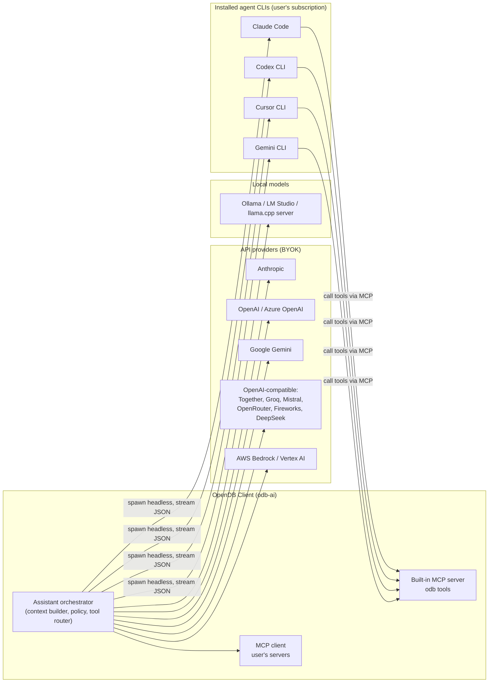
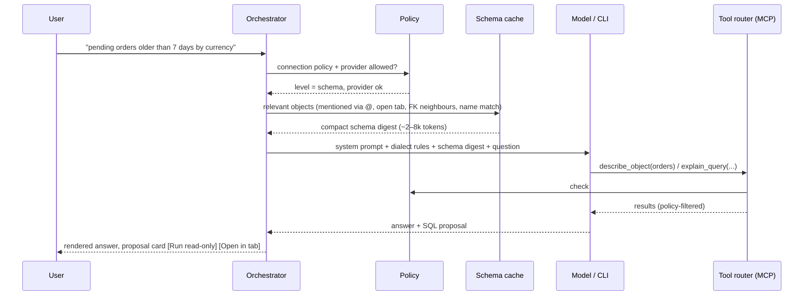

# 23 — AI Assistant, Agents and MCP

AI is a first-class, **native** part of the app — not a cloud add-on. Three principles shape it:

1. **Bring your own intelligence.** No AI account with us. Users connect what they already have: an API key, a local model, or an AI coding CLI they already pay for.
2. **The database is never exposed blindly.** The assistant sees only what the per-connection data-sharing policy allows, and it can never write to a database without an explicit human approval.
3. **Open protocols.** The assistant uses tools through MCP; the app is both an MCP **client** (use the user's MCP servers) and an MCP **server** (let external agents use the app's connections safely).

## 1. Capabilities

| Feature | Where | Notes |
| --- | --- | --- |
| Ask in natural language → SQL / MQL / Redis commands | Assistant panel, ⌘I inline in editor | Dialect-aware, uses schema context and indexes. |
| Explain a query | Editor context menu | Plain-language explanation + risks (full scans, missing `WHERE`). |
| Fix an error | Error banner "Fix with assistant" | Gets the error, statement and relevant schema. |
| Optimise | Plan view "Analyse plan" | Reads `EXPLAIN` output; suggests indexes/rewrites as DDL **proposals**. |
| Describe a table / schema | Details panel | Summaries, relationships, suspicious columns. |
| Generate test data | Table context menu | Produces `INSERT` script into a new tab — never auto-runs. |
| Chat over results | Result tab | Only if the policy allows sending result rows. |
| API client help | Request tab | Generate requests/tests from OpenAPI, explain responses, write scripts. |
| Agent mode (multi-step) | Assistant panel | The model calls tools (read schema, run read-only query, explain) in a loop with a visible trace. |

## 2. Provider types

### 2.1 API providers (bring your own key)

- Native adapters: Anthropic Messages API, OpenAI (Responses/Chat Completions), Google Gemini, AWS Bedrock, Google Vertex AI, Azure OpenAI.
- A generic **OpenAI-compatible** adapter covers Together AI, Groq, Mistral, Fireworks, DeepSeek, OpenRouter and self-hosted gateways (base URL + key + model id).
- Keys stored in the OS keychain (`odb/ai/<provider-id>`); never in settings files, never logged.
- Model list fetched from the provider when it offers a models endpoint; otherwise free-text model id.
- Streaming responses, tool calling, prompt caching where the provider supports it (schema context is a large, stable prefix → big cost/latency win).
- Per-provider usage meter (tokens in/out, estimated cost from user-editable price table) shown in Settings.

### 2.2 Local models

- Ollama, LM Studio and any llama.cpp/vLLM server via the OpenAI-compatible adapter on `localhost`.
- Marked "on-device": the only provider type allowed by default on prod-tagged connections.

### 2.3 Agent CLI bridges (use existing subscriptions)

Many users already pay for an AI coding tool. Instead of asking for a second API key, the app can drive the user's **installed CLI** in its non-interactive mode. The CLI authenticates with the user's own account; we never see or store those credentials.

| CLI | Detection | Invocation model |
| --- | --- | --- |
| Claude Code | `claude` on PATH, version check | Headless print mode with streaming JSON output; our MCP server passed via its MCP config flag; tool allowlist limited to our `odb` tools. |
| Codex CLI | `codex` on PATH | Non-interactive exec mode with JSON event output; MCP server registered for the run. |
| Cursor CLI | `cursor-agent` on PATH | Print/headless mode with JSON output; MCP config for the run. |
| Gemini CLI | `gemini` on PATH | Non-interactive prompt mode; MCP server configured for the run. |

Exact flags differ per CLI and change across versions, so each bridge is a small adapter (`odb-ai/bridges/<cli>.rs`) with:

- **Detection & health:** path, version, "logged in?" probe; shown in Settings → AI with a status light.
- **Sandboxing:** the CLI runs in an empty temporary working directory, with its own file-editing and shell tools **disabled or denied** where the CLI supports it, and only our MCP tools allowed. The CLI therefore cannot read the user's files or run commands — it can only use the database tools we expose, under the same policy as any other provider.
- **Streaming:** we parse the CLI's JSON event stream into the same assistant event model (text deltas, tool calls, tool results, final answer) so the UI is identical regardless of provider.
- **Lifecycle:** one process per conversation turn (or a long-lived session where the CLI supports resume), killed on cancel; timeouts apply.
- **Compliance:** the bridge only automates the user's own locally installed CLI for the user's own requests; it never extracts tokens, proxies the CLI for other users, or bypasses the vendor's terms. If a vendor disallows headless use, the bridge is disabled for that CLI.

## 3. MCP support

### 3.1 App as MCP server (`odb-mcp`)

Exposes a curated tool set over MCP (stdio for spawned CLIs; optional local Streamable HTTP endpoint bound to `127.0.0.1` with a per-session token for external agents such as Claude Desktop or Cursor IDE).

| Tool | Behaviour | Policy gate |
| --- | --- | --- |
| `list_connections` | Names, engines, env tags of connections the user exposed to AI | Only connections with AI enabled |
| `list_objects` / `describe_object` | Schema metadata from the schema cache | `schema` level or above |
| `sample_rows` | Up to N rows (default 20) with column redaction rules | `samples` level or above |
| `run_read_query` | Executes a statement classified as read-only, inside a read-only transaction where supported, with row/time limits | `results` level; never on write-classified SQL |
| `explain_query` | `EXPLAIN` (never `ANALYZE` on writes) | `schema` level |
| `propose_sql` | Returns SQL to the UI as a proposal card; **does not execute** | Always allowed |
| `open_tab` | Opens a query tab with given SQL for the user | Always allowed |
| `api_send_request` | (API client) send a saved request in a chosen environment | Opt-in per collection |

Writes are impossible through MCP by design: there is no write tool. The model can only *propose*; a human runs it through the normal safe-mode path.

### 3.2 App as MCP client

- Users add MCP servers (stdio command or HTTP URL) in Settings → AI → MCP servers, globally or per workspace.
- Tools from those servers are available to API-provider and local-model conversations (CLI bridges use their own MCP config plus ours).
- Each server shows its tool list; tools can be disabled individually; first use of a server's tool asks for confirmation; servers from workspace files require the workspace to be trusted (same rule as collection scripts).

## 4. Data-sharing policy (per connection)

| Level | What the model may receive | Default for |
| --- | --- | --- |
| **Off** | Nothing; assistant disabled for this connection | — |
| **Schema** | Object names, columns, types, keys, indexes, comments, row estimates | `prod` tag |
| **Samples** | Schema + small redacted samples | `staging` tag |
| **Results** | Schema + query results the user explicitly attaches or `run_read_query` returns (limited) | `dev`, `local` tags |

Additional controls:

- **Column redaction rules**: patterns (`*password*`, `*token*`, `*secret*`, `ssn`, `email`…) and per-column overrides; redacted values replaced with `‹redacted›` before leaving the core.
- **Provider allowlist per connection** (e.g. prod → local models only).
- **Context preview**: "What will be sent" drawer shows the exact payload before the first message of a conversation.
- **Audit log**: every AI request records provider, model, connection, sharing level, tool calls and token counts (not payload content unless the user enables it) in the local store.

## 5. Context building

- **Schema digest**: compact DDL-like text of relevant tables (columns, types, PK/FK, indexes, enum values, row estimates), ranked by relevance; stable ordering to maximise prompt caching.
- **Dialect guardrails** in the system prompt: target engine and version, quoting rules, "never produce DDL/DML unless asked", "prefer index-friendly predicates", "always LIMIT exploratory queries".
- Proposed SQL is parsed by `odb-sql`; classification (read/write/DDL) is shown on the proposal card and decides which run button appears (writes → "Open in tab" only).

## 6. UX surfaces

- **Assistant panel** (right panel tab next to Details): provider switcher, policy chips, conversation, tool-call trace, proposal cards.
- **Inline (⌘I)** in the SQL editor: prompt bar above the cursor; result appears as a diff to accept/reject.
- **Error assist**: "Fix" button on query errors.
- **Settings → AI**: providers (keys, base URLs, models), CLI bridges (detected, health), MCP servers (client), MCP server mode (on/off, port, token, which connections are exposed), data-sharing defaults per env tag, redaction rules, usage.
- AI features are **off until the user configures a provider**; no nagging.

## 7. Architecture and crates

| Crate | Responsibility |
| --- | --- |
| `odb-ai` | Orchestrator, provider adapters, CLI bridges, context builder, event model, usage accounting |
| `odb-mcp` | MCP server (tools above) and MCP client (connect to user servers), transports: stdio, Streamable HTTP |
| `odb-sql` | Classification of proposed SQL (reused) |

Provider HTTP traffic uses `odb-net` (proxy, custom CA, timeouts) so corporate proxies work the same for AI and databases.

## 8. Testing

- Provider adapters tested against recorded fixtures (streaming, tool calls, errors, rate limits).
- CLI bridges tested with fake CLIs that emit recorded JSON streams; nightly smoke tests against real CLIs where CI credentials exist.
- Policy tests: for every level, assert exactly which fields leave the core (golden payloads); redaction property tests.
- Safety tests: prompts that attempt writes (`DROP`, `DELETE`) must never execute; `run_read_query` rejects write-classified SQL and runs inside read-only transactions.
- Evaluation set: NL→SQL tasks over fixture schemas per dialect, scored by result equivalence; tracked per provider/model to guide defaults.
