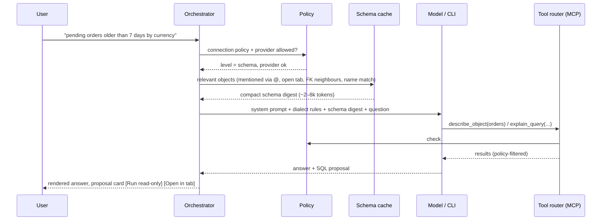

# 23 — AI Assistant, Agents and MCP

AI is a first-class, **native** part of the app — not a cloud add-on. Three principles shape it:

1. **Bring your own intelligence.** No AI account with us. Users connect what they already have: an API key, a local model, or an AI coding CLI they already pay for.
2. **The database is never exposed blindly.** The assistant sees only what the per-connection data-sharing policy allows, and it can never write to a database without an explicit human approval.
3. **Open protocols.** The assistant uses tools through MCP; the app is both an MCP **client** (use the user's MCP servers) and an MCP **server** (let external agents use the app's connections safely).

## 1. Capabilities

| Feature | Where | Notes |
| --- | --- | --- |
| Ask in natural language → SQL / MQL / Redis commands | Assistant panel, ⌘I inline in editor | Dialect-aware, uses schema context and indexes. |
| Explain a query | Editor context menu | Plain-language explanation + risks (full scans, missing `WHERE`). |
| Fix an error | Error banner "Fix with assistant" | Gets the error, statement and relevant schema. |
| Optimise | Plan view "Analyse plan" | Reads `EXPLAIN` output; suggests indexes/rewrites as DDL **proposals**. |
| Describe a table / schema | Details panel | Summaries, relationships, suspicious columns. |
| Generate test data | Table context menu | Produces `INSERT` script into a new tab — never auto-runs. |
| Chat over results | Result tab | Only if the policy allows sending result rows. |
| API client help | Request tab | Generate requests/tests from OpenAPI, explain responses, write scripts. |
| Agent mode (multi-step) | Assistant panel | The model calls tools (read schema, run read-only query, explain) in a loop with a visible trace. |
| Investigate database health | Monitor → Ask assistant | Read permitted health/query/lock history, cite evidence and propose fixes; FR-AI-11. |
| Generate reports and graphs | Monitor / results / assistant | Validated report and chart/board proposals from evidence, preview and export; FR-AI-12. |
| Scheduled read-only checks | Monitor settings | Explicit provider/sharing/budget selection; no model call on every metric tick; FR-AI-13. |

## 2. Provider types


### 2.1 API providers (bring your own key)

- Native adapters: Anthropic Messages API, OpenAI (Responses/Chat Completions), Google Gemini, AWS Bedrock, Google Vertex AI, Azure OpenAI.
- A generic **OpenAI-compatible** adapter covers Together AI, Groq, Mistral, Fireworks, DeepSeek, OpenRouter and self-hosted gateways (base URL + key + model id).
- Keys stored in the OS keychain (`openrows/ai/<provider-id>`); never in settings files, never logged.
- Model list fetched from the provider when it offers a models endpoint; otherwise free-text model id.
- Streaming responses, tool calling, prompt caching where the provider supports it (schema context is a large, stable prefix → big cost/latency win).
- Per-provider usage meter (tokens in/out, estimated cost from user-editable price table) shown in Settings.

### 2.2 Local models

- Ollama, LM Studio and any llama.cpp/vLLM server via the OpenAI-compatible adapter on `localhost`.
- Marked "on-device": eligible for an explicit local-only allowlist; production sharing still defaults to None.

### 2.3 Agent CLI bridges (use existing subscriptions)

Many users already pay for an AI coding tool. Eligible integrations reuse the
user's installed tool through its official account or non-interactive APIs.
Authentication stays owned by that tool; the app never copies subscription
tokens. Eligibility is provider-specific, not implied by installation.

| CLI | Detection | Invocation model |
| --- | --- | --- |
| Claude installed tool | Explicit discovery and version/authentication check | Official headless/SDK integration only after third-party eligibility and isolation are verified; API-key support is the baseline. |
| Codex CLI | Explicit discovery and version check | Official app-server account/turn/event APIs; managed login, only approved application tools. |
| Cursor CLI | Explicit discovery of `cursor-agent` | Candidate versioned bridge; disabled until current terms and isolation tests pass. |
| Gemini CLI | Explicit discovery of `gemini` | Candidate versioned bridge; disabled until current terms and isolation tests pass. |

Exact flags differ per CLI and change across versions, so each bridge is a small adapter (`openrows-ai/bridges/<cli>.rs`) with:

- **Detection & health:** opt-in executable/version/authentication probes; installation, login, plan/entitlement when reported, and unknown/unsupported are separate states. Never scan browser logins or credential files, infer a paid plan, or send DB context during a health check.
- **Sandboxing:** deny unapproved shell/filesystem/network and external tools, verify configuration isolation and pass only approved app tools. An empty temporary working directory or allowlist alone is insufficient. A bridge without an enforceable boundary stays disabled.
- **Streaming:** we parse the CLI's JSON event stream into the same assistant event model (text deltas, tool calls, tool results, final answer) so the UI is identical regardless of provider.
- **Lifecycle:** one process per conversation turn (or a long-lived session where the CLI supports resume), killed on cancel; timeouts apply.
- **Compliance:** the bridge only automates the user's own locally installed CLI for the user's own requests; it never extracts tokens, proxies the CLI for other users, or bypasses the vendor's terms. If a vendor disallows headless use, the bridge is disabled for that CLI.

Current provider eligibility evidence and the conditional Claude subscription
boundary are recorded in [28 §6](28-database-monitoring-and-ai-harness.md#6-ai-provider-setup-and-existing-subscriptions).
Installed-tool access and API billing are separate choices; one never silently
falls back to the other.

## 3. MCP support

### 3.1 App as MCP server (`openrows-mcp`)

**Implemented (M45-03/08).** Seven fixed tools use the existing sharing gate,
metadata paths and SafetyPlan. Stdio clients spawn the Tauri-free `openrows-mcp`
CLI, which forwards to the authenticated running app. Direct Streamable HTTP
is separately opt-in. Both settings default off; the listener binds only to
`127.0.0.1`. See [§12](#12-implemented-m45-0308-built-in-mcp-and-execution-safety)
for setup, bounds and engine restrictions.

| Tool | Behaviour | Policy gate |
| --- | --- | --- |
| `list_connections` | Scoped, currently open connection IDs | SchemaOnly or above; provider allowlist and production consent |
| `list_schemas` | Schema names from dedicated metadata sessions | SchemaOnly or above |
| `list_objects` | Names and object kinds, at most 128 | SchemaOnly or above |
| `describe_object` | Up to 200 column names and types; no comments | SchemaOnly or above |
| `run_read_query` | Conservative base-table SELECT in a disposable protected session | SampleRows; normal SafetyPlan must permit execution without confirmation/authentication |
| `explain_query` | Normalised plan only, never ANALYZE | SchemaAndStats and separate telemetry consent |
| `propose_sql` | Open an ordinary editor tab; never submit SQL for execution | SchemaOnly or above; scoped open connection |

Tool descriptions are static. Database content remains JSON data; it cannot
supply instructions or register tools. Proposed writes require the user's
ordinary editor execution path, including ReadOnly, confirmation and OS auth.
The separate `sample_rows`, `open_tab` and API request tools are not implemented;
bounded samples and editor proposals cover this task's read/propose contract.

### 3.2 App as MCP client

- Users add MCP servers (stdio command or HTTP URL) in Settings → AI → MCP servers, globally or per Project.
- Tools from those servers are available to API-provider and local-model conversations (CLI bridges use their own MCP config plus ours).
- Each server shows its tool list; tools can be disabled individually; first use of a server's tool asks for confirmation; servers from Project files require the Project to be trusted (same rule as collection scripts).

## 4. Data-sharing policy (per connection)

| Level | What the model may receive | Default for |
| --- | --- | --- |
| **None** | Nothing; all database context is refused | Every connection, including production/imports/duplicates |
| **SchemaOnly** | Object names/types and literal-free DDL/query text; no rows, estimates or statistics | Explicit opt-in |
| **SchemaAndStats** | Schema plus typed numeric aggregates and normalised plans; also requires separate telemetry permission | Explicit opt-in |
| **SampleRows** | Above plus bounded per-column-redacted samples | Explicit opt-in |

Additional controls:

- **Column redaction rules**: patterns (`*password*`, `*token*`, `*secret*`, `ssn`, `email`…) and per-column overrides; redacted values replaced with `‹redacted›` before leaving the core.
- **Provider allowlist per connection** (e.g. prod → local models only).
- **Context preview**: "What will be sent" drawer shows the exact payload before the first message of a conversation.
- **Audit log**: every AI request records provider, model, connection, sharing level, tool calls and token counts (never payload content or keys) in the local store.

## 5. Context building



- **Schema digest**: compact DDL-like text of relevant tables (columns, types, PK/FK, indexes, enum values, row estimates), ranked by relevance; stable ordering to maximise prompt caching.
- **Dialect guardrails** in the system prompt: target engine and version, quoting rules, "never produce DDL/DML unless asked", "prefer index-friendly predicates", "always LIMIT exploratory queries".
- Proposed SQL is parsed by `openrows-sql`; classification (read/write/DDL) is shown on the proposal card and decides which run button appears (writes → "Open in tab" only).

## 6. UX surfaces

- **Assistant panel** (right panel tab next to Details): provider switcher, policy chips, conversation, tool-call trace, proposal cards.
- **Inline (⌘I)** in the SQL editor: prompt bar above the cursor; result appears as a diff to accept/reject.
- **Error assist**: "Fix" button on query errors.
- **Settings → AI**: providers (keys, base URLs, models), CLI bridges (detected, health), MCP servers (client), MCP server mode (on/off, port, token, which connections are exposed), per-connection data sharing, redaction rules, usage.
- AI features are **off until the user configures a provider**; no nagging.

## 7. Architecture and crates

| Crate | Responsibility |
| --- | --- |
| `openrows-ai` | Orchestrator, provider adapters, CLI bridges, context builder, event model, usage accounting |
| `openrows-mcp` | MCP server (tools above) and MCP client (connect to user servers), transports: stdio, Streamable HTTP |
| `openrows-sql` | Classification of proposed SQL (reused) |

Provider HTTP traffic uses `openrows-net` (proxy, custom CA, timeouts) so corporate proxies work the same for AI and databases.

## 8. Testing

- Provider adapters tested against recorded fixtures (streaming, tool calls, errors, rate limits).
- CLI bridges tested with fake CLIs that emit recorded JSON streams; nightly smoke tests against real CLIs where CI credentials exist.
- Policy tests: for every level, assert exactly which fields leave the core (golden payloads); redaction property tests.
- Safety tests: prompts that attempt writes (`DROP`, `DELETE`) must never execute; `run_read_query` rejects write-classified SQL and runs inside read-only transactions.
- Evaluation set: NL→SQL tasks over fixture schemas per dialect, scored by result equivalence; tracked per provider/model to guide defaults.

## 9. Monitoring and investigation delivery

The **M4.5 database AI harness** follows M2.5 monitoring/analytics; API help follows M4. [Accepted ADR-0011](adr/0011-performance-monitor.md) owns the monitoring privacy/advisor/source/budget contracts, with implementation validation pending. [M45-10..12](27-delivery-plan.md#8-m45--native-ai-and-mcp) add the separately reviewed harness; M45-09 validates it. [28](28-database-monitoring-and-ai-harness.md) specifies
health/history/query/lock tools, structured report/chart artifacts and the
end-to-end acceptance criteria for FR-AI-11..13. Provider settings support
multiple saved API/local/eligible-account choices with explicit selection,
capabilities, authentication state and usage. Every switch rechecks policy.

Telemetry sharing is a separate per-connection permission; schema-only does not
implicitly disclose activity, timings, users or client addresses. Scheduled
investigations are opt-in, in-app, read-only and bounded by steps/time/tokens/cost.
Lock, disconnect or policy revocation cancels active reads and provider work.
Reports reference measured evidence and retain gaps/limitations; model text is
an interpretation, not a measured fact. Board/report generation does not execute
writes or arbitrary HTML/scripts.

## 10. Implemented (M45-01): API-key and local provider settings

`openrows-ai` is Tauri-free and supplies Anthropic Messages, OpenAI Responses,
OpenRouter and generic Chat Completions, Gemini REST, Ollama native chat, and
local compatible endpoints (including LM Studio). Settings → AI is lazy-loaded:
add/edit/remove, explicit default provider/model, metadata-only Verify, typed
configured/verified/failed/unknown states, reported capabilities and OpenRouter
key usage/limits. The global **AI features off** switch defaults on (network
permission defaults off), including after saving a provider. Disabling it or
locking cancels active provider work. Nothing auto-verifies on mount.

Key entry uses a one-way `ai_key_set` IPC request from the password field;
keys are never returned in replies or events. Fully eliminating keys from IPC
request payloads requires native credential entry, which is not implemented.
The task's literal no-key-in-any-IPC-payload criterion therefore remains unmet.

Keys use the existing OS keychain under `ai/<provider-id>/api-key`; settings
contain canonical references only. No reveal-key command exists. Portable preference export/import excludes device AI
credentials/endpoints; resetting preferences disables AI and clears defaults while
retaining provider references so keychain entries remain removable. Native
settings validation rejects secret fields. Fixed errors discard URLs, raw
responses, headers and keychain backend messages. Hyper marks auth headers
sensitive; credential-echoing JSON frames are refused before metadata reaches
IPC. Providers reuse Hyper HTTP/1.1 over `openrows-net` dialers and its full
rustls/system trust verifier, with explicit route/custom-CA support at the crate
boundary. No redirects, retries or alternate-provider fallback are followed.
Endpoint URLs reject userinfo/query/fragment. Local adapters require loopback;
other remote endpoints require HTTPS unless the warning checkbox is acknowledged.

Native OpenAI uses [Responses](https://developers.openai.com/api/docs/guides/migrate-to-responses),
recommended for new integrations in the official documentation checked
2026-10-11, with `store: false`. Compatible servers retain Chat Completions.
Model lists are fetched (Anthropic/Gemini pagination bounded to 20 pages/2,000
models; each metadata response ≤2 MiB). Explicitly unavailable Anthropic model
endpoints offer `claude-opus-5-5`, `claude-sonnet-5-5`, `claude-haiku-5-5` as
**unknown/unverified** fallback identifiers; no success is inferred. Unreported
model limits, capabilities and usage remain unknown. Local reachability does
not attest where the server itself performs inference.

Streaming SSE/NDJSON is incremental with bounded framing (256 KiB), a 16 MiB
total response cap, bounded consumer channels, cancellation and a total 30 s
default deadline covering backpressure. The crate's text-only generation API
is tested but deliberately has **no app generation command or assistant UI**:
DB context/policy, tools, structured generation, vision inputs, account/CLI
bridges, MCP and assistant conversations remain separately scheduled tasks.
Capability metadata describes the model, not implementation of those later flows.

Verification: `cargo nextest run -p openrows-ai` runs loopback mock fixtures per
adapter, including secret/permission/endpoint/timeout tests. UI fixtures:
`pnpm exec vitest run apps/desktop/src/features/settings/ai --maxWorkers=2`.
Manual live metadata smoke (never generation): set `OPENROWS_AI_LIVE=1`, choose
`OPENROWS_AI_PROVIDER=anthropic|openai|openrouter|gemini|ollama`, supply the matching
`ANTHROPIC_API_KEY`, `OPENAI_API_KEY`, `OPENROUTER_API_KEY` or `GEMINI_API_KEY` in the
process environment, then run `cargo nextest run -p openrows-ai --test live --run-ignored all`.
No live key or paid generation is required by CI.

## 11. Implemented (M45-02): connection context sharing

The Tauri-free `openrows-ai::sharing` gate reads a device-local policy and
returns either a fixed typed refusal or a non-serializable `GatedPayload`.
Every `TextRequest` requires that type; its fields are private, it has no public
constructor/Deserialize implementation, and previews cannot be promoted into
requests. Compile-fail doctests cover the boundary. Transport checks the exact
saved provider configuration, live global permission and policy revision;
revocation cancels active exchanges and invalidates old payloads.

All connections start at **None**. Production sharing requires a fresh visible
confirmation when saving. Imports/duplicates get new IDs without copied consent;
changing a connection's target or environment resets its policy. Saved-provider
allowlists and local-only controls are checked natively. Local-only requires a
local-model protocol and loopback URL; this does not attest inference location.
Plan/statistics sharing additionally requires the independent telemetry switch.
Plan nodes use whitelisted operators, qualified relations, literal-free predicates
and numeric estimates; statistics carry normalised query text and numeric
aggregates only, with no raw vendor properties/users/client addresses.

The gate reuses `openrows-sql::redact_literals` (the history boundary) and shared
identifier lexing, removes comments, hides boolean/NULL literals and ambiguous
SQLite double quotes or unterminated identifiers, and applies sensitive-name rules and
up to 32 case-insensitive glob/regex rules. Built-ins cover password, passphrase,
token, secret, SSN, email, phone, card, API/private key and credentials. Qualified
column rules also apply to unqualified identifiers of selected objects. Caps:
20 sample rows, 200 cells, 512 UTF-8 bytes per field, 64 KiB JSON and 16,384
conservatively estimated tokens (one per byte, including JSON escaping).
Caller bounds may tighten these caps. Requested input is limited to 1 MiB;
object/plan/statistics/sample/column counts are also bounded. Truncation removes
whole items deterministically and is visible in the exact preview.

Settings → AI → **Data sharing**, and Edit connection → **AI data sharing**, are
lazy-loaded compact editors for levels, allowlists, local-only, telemetry and
redaction. The offline preview accepts selected definitions/SQL without reading
or connecting to a database; the reusable component/API accepts typed selected
plans/statistics/samples from later assistant/tool producers. It renders the exact
JSON used as provider input, bytes, conservative tokens and retained categories.
Unsaved policies cannot preview. No assistant/chat or generation IPC is added.

Policies and audit metadata live in `ai-sharing.sqlite` beside the existing
local store (0600 on Unix), outside portable settings/profile exports. Every
outbound context attempt must append time, provider/connection IDs, level, exact
size, SHA-256 and enum categories **before** any network I/O; audit failure
refuses transport. SQLite writes run off the async network runtime. Audit rows
are immutable until oldest-entry retention (last 1,000) or explicit confirmed
purge. No payload text, endpoint, model text or keys can enter this record type.
The settings viewer refreshes/purges metadata only; previews do not create entries.

Evidence: `cargo nextest run -p openrows-ai` covers golden payloads at each
level, refusals, bounds, audit/persistence and real loopback transport equality,
revocation and rerouting. `cargo test -p openrows-ai --doc` checks the structural
boundary. Vitest `features/settings/ai/Sharing.test.tsx` covers editing,
production consent, preview/refusal and audit purge. Full assistant/MCP execution
and real provider/database attachment journeys remain their scheduled tasks.

## 12. Implemented (M45-03/08): built-in MCP and execution safety

### Transport and credentials

`crates/openrows-mcp` has no Tauri dependency. The app owns the listener and
resolves saved profiles, provider identities, sharing policies and current open
databases. The CLI requires an explicit `--port`; it never discovers app files,
credentials or databases. Its token comes only from `OPENROWS_MCP_TOKEN`.
`/bridge` is the authenticated local channel for stdio; `/mcp` is available only
when direct HTTP is enabled. All browser Origin headers are refused, requests
are capped at 32 KiB, sockets at 16, concurrent requests per token at four, and
tool calls at five seconds. Native HTTP clients use JSON responses with no
persistent MCP sessions. The official Apache-2.0-licensed `rmcp` **3.4.0** implements
[current stable MCP 2026-07-28](https://modelcontextprotocol.io/specification/2026-07-28)
and legacy initialize negotiation (tested with 2025-11-25). Using the official
SDK keeps transport/framing/schema behavior out of a handwritten protocol.

Settings → AI → MCP is lazy. Enable AI and the server, choose a random port
(default 0) or a fixed free port, then create a token for one saved provider,
an explicit connection set and expiry. At most 32 tokens and 32 connections
per token are supported; expiry is at most 30 days (UI: hour/day/week).
A 256-bit random bearer value is shown once. Only its SHA-256 hash, random ID,
provider/connection scope and expiry are stored in private `mcp-tokens.sqlite`
(mode 0600 on Unix), separately from settings/exports. There is no reveal API.
Use separate tokens for separate agents. Connected clients are logical
credential identities; disconnect cancels current requests but allows a later
reconnect. Revoke also deletes the credential. The shared Data sharing audit
viewer records successful disclosures with provider, connection, categories,
bytes and payload hash; no token, SQL, rows, comments or vendor error text.

Bearer holders are trusted to use the provider selected when creating the
token; the server cannot attest an external agent's model location. Consequently
**Local only policies are refused for external MCP**, even for a loopback client.
Normal allowlists and explicit production sharing consent remain mandatory.
ConfirmAll/AuthenticateAll connections refuse every database tool until reviewed
through the ordinary human path; MCP never prompts for or accepts OS-auth tokens.
AI-off, app lock, transport stop and app exit cancel admitted work; closing any
connection cancels current MCP work conservatively. Subsequent calls require a
currently open saved connection/database. Unlock restores the saved enable
setting, without resuming cancelled reads.

### Shared execution rules

`openrows_sql::validate_ai_read` and `openrows_mcp::protected_read` are reusable
by the future assistant. They accept one SELECT (maximum 16 KiB), conservative
constant projections or direct columns from one **schema-qualified base table**.
Aliases, functions (including qualified/quoted names), custom operators, casts, variables, CTEs,
subqueries, joins/unions, SELECT INTO, locking clauses, executable comments,
DDL/DML and multiple statements are refused. Views/foreign/materialised views
are refused by a live catalog check. Column/table provenance therefore survives
into the sharing gate, so aliases cannot launder per-column redaction rules.
For example `SELECT id, email FROM public.customers LIMIT 20` is eligible;
`SELECT count(*) FROM public.customers` requires a human editor review.

PostgreSQL uses BEGIN READ ONLY, 5 s statement timeout, 1 s lock timeout and a
fixed pg_catalog-only search path. Tables are held under an AccessShare lock
while validating and reading, closing metadata/DDL races. PostgreSQL tables with RLS, inheritance,
partitioning, generated expressions, custom types, arrays or custom collations
are refused because these can invoke user code implicitly. MySQL uses a read-only transaction and 5 s
MAX_EXECUTION_TIME; MariaDB uses a read-only transaction and 5 s
max_statement_time. SQLite and libSQL file use PRAGMA query_only and BEGIN.
Every read uses a fresh connection with user startup SQL removed, then rollback
and close. Cancellation drops/interrupts the driver connection without replay;
cancelled shared catalog reads discard their metadata connection too.
Remote libSQL, SQL Server, ClickHouse and hosted DuckDB reads/plans are explicitly
refused until equivalent execution protection is validated; catalog tools use
existing capability paths (DuckDB's additional metadata session is unavailable).

Rows are collected as bounded Arrow text: at most 20 rows, 200 cells, 512 bytes
per cell and 64 KiB before the sharing gate. The gate applies the same redaction
and final 16 KiB conservative token cap as M45-02. Larger results are sampled;
this is not a complete result export. Plans are normalised to whitelisted
operations, relations, parent links and estimates, never raw vendor properties
or activity identities. Truncated plans are refused. Proposal queues are capped
at 16; `propose_sql` has no execution method and opens a tab titled SQL proposal
— review. The user's normal SafetyPlan runs if they choose to execute it.

### Connect an external client

Build the CLI with `cargo build -p openrows-mcp --bin openrows-mcp --locked`
using the shared Cargo target. Select a fixed port such as **32123**, or replace
it in the snippets with the current port shown in MCP settings. Supply the
one-time token in the client's launch environment using a private credential
entry mechanism; keep it out of shell arguments, history and project files.
The running OpenRows app must remain unlocked with the scoped database open.

[Claude Code's MCP configuration](https://code.claude.com/docs/en/mcp) accepts
this stdio server entry; its environment reference avoids a literal credential:

```json
{
  "mcpServers": {
    "openrows": {
      "type": "stdio",
      "command": "/absolute/path/to/openrows-mcp",
      "args": ["--port", "32123"],
      "env": { "OPENROWS_MCP_TOKEN": "${OPENROWS_MCP_TOKEN}" }
    }
  }
}
```

[Codex MCP configuration](https://developers.openai.com/codex/mcp/) can forward
the existing environment variable to the same CLI:

```toml
[mcp_servers.openrows]
command = "/absolute/path/to/openrows-mcp"
args = ["--port", "32123"]
env_vars = ["OPENROWS_MCP_TOKEN"]
```

For native Streamable HTTP clients, enable direct HTTP and use
`http://127.0.0.1:32123/mcp` with `Authorization: Bearer` from their private token
source. The listener supports no remote bind, OAuth, browser-origin access or
write scope. Connection IDs come from `list_connections`; database is the open
database name (`main` for local files). The port may change after restart when
using port 0. Release installer packaging of the standalone CLI is separate;
the tested Cargo binary is the current entry point.

Evidence: `crates/openrows-mcp/tests/protocol.rs` covers initialize/list/call
for HTTP and a spawned stdio CLI, fixed tool schemas, injection/redaction and
audit. `tests/security.rs` covers scoped/hash-only credentials, defaults/Origin,
sharing levels and cancellation. `tests/read_safety.rs`, `tests/postgres.rs`
and `tests/mysql.rs` verify persistent database state after smuggling attempts,
plus an independently injected write proving engine protection. SQLite/libSQL
file run normally; PG/MySQL/MariaDB are included in the sequential container
suites. UI fixtures cover once-only tokens, transport settings, revoke/disconnect
and editor-only proposals. No live third-party agent session is automated here.
