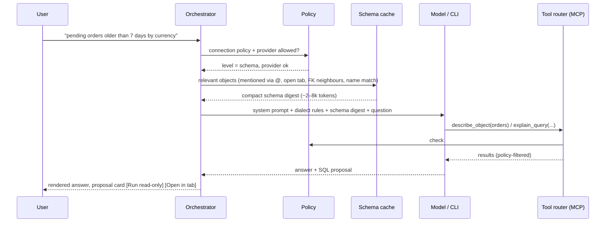

# 23 — AI Assistant, Agents and MCP

AI is a first-class, **native** part of the app — not a cloud add-on. Three principles shape it:

1. **Bring your own intelligence.** No AI account with us. Users connect what they already have: an API key, a local model, or an AI coding CLI they already pay for.
2. **The database is never exposed blindly.** The assistant sees only what the per-connection data-sharing policy allows, and it can never write to a database without an explicit human approval.
3. **Open protocols.** The assistant uses tools through MCP; the app is both an MCP **client** (use the user's MCP servers) and an MCP **server** (let external agents use the app's connections safely).

## 1. Capabilities

| Feature | Where | Notes |
| --- | --- | --- |
| Ask in natural language → SQL / MQL / Redis commands | Assistant panel, ⌘I inline in editor | Dialect-aware, uses schema context and indexes. |
| Explain a query | Editor context menu | Plain-language explanation + risks (full scans, missing `WHERE`). |
| Fix an error | Error banner "Fix with assistant" | Gets the error, statement and relevant schema. |
| Optimise | Plan view "Analyse plan" | Reads `EXPLAIN` output; suggests indexes/rewrites as DDL **proposals**. |
| Describe a table / schema | Details panel | Summaries, relationships, suspicious columns. |
| Generate test data | Table context menu | Produces `INSERT` script into a new tab — never auto-runs. |
| Chat over results | Result tab | Only if the policy allows sending result rows. |
| API client help | Request tab | Generate requests/tests from OpenAPI, explain responses, write scripts. |
| Agent mode (multi-step) | Assistant panel | The model calls tools (read schema, run read-only query, explain) in a loop with a visible trace. |
| Investigate database health | Monitor → Ask assistant | Read permitted health/query/lock history, cite evidence and propose fixes; FR-AI-11. |
| Generate reports and graphs | Monitor / results / assistant | Validated report and chart/board proposals from evidence, preview and export; FR-AI-12. |
| Scheduled read-only checks | Monitor settings | Explicit provider/sharing/budget selection; no model call on every metric tick; FR-AI-13. |

## 2. Provider types

### 2.1 API providers (bring your own key)

- Native adapters: Anthropic Messages API, OpenAI (Responses/Chat Completions), Google Gemini, AWS Bedrock, Google Vertex AI, Azure OpenAI.
- A generic **OpenAI-compatible** adapter covers Together AI, Groq, Mistral, Fireworks, DeepSeek, OpenRouter and self-hosted gateways (base URL + key + model id).
- Keys stored in the OS keychain (`openrows/ai/<provider-id>`); never in settings files, never logged.
- Model list fetched from the provider when it offers a models endpoint; otherwise free-text model id.
- Streaming responses, tool calling, prompt caching where the provider supports it (schema context is a large, stable prefix → big cost/latency win).
- Per-provider usage meter (tokens in/out, estimated cost from user-editable price table) shown in Settings.

### 2.2 Local models

- Ollama, LM Studio and any llama.cpp/vLLM server via the OpenAI-compatible adapter on `localhost`.
- Marked "on-device": the only provider type allowed by default on prod-tagged connections.

### 2.3 Agent CLI bridges (use existing subscriptions)

Many users already pay for an AI coding tool. Eligible integrations reuse the
user's installed tool through its official account or non-interactive APIs.
Authentication stays owned by that tool; the app never copies subscription
tokens. Eligibility is provider-specific, not implied by installation.

| CLI | Detection | Invocation model |
| --- | --- | --- |
| Claude installed tool | Explicit discovery and version/authentication check | Official headless/SDK integration only after third-party eligibility and isolation are verified; API-key support is the baseline. |
| Codex CLI | Explicit discovery and version check | Official app-server account/turn/event APIs; managed login, only approved application tools. |
| Cursor CLI | Explicit discovery of `cursor-agent` | Candidate versioned bridge; disabled until current terms and isolation tests pass. |
| Gemini CLI | Explicit discovery of `gemini` | Candidate versioned bridge; disabled until current terms and isolation tests pass. |

Exact flags differ per CLI and change across versions, so each bridge is a small adapter (`openrows-ai/bridges/<cli>.rs`) with:

- **Detection & health:** opt-in executable/version/authentication probes; installation, login, plan/entitlement when reported, and unknown/unsupported are separate states. Never scan browser logins or credential files, infer a paid plan, or send DB context during a health check.
- **Sandboxing:** deny unapproved shell/filesystem/network and external tools, verify configuration isolation and pass only approved app tools. An empty temporary working directory or allowlist alone is insufficient. A bridge without an enforceable boundary stays disabled.
- **Streaming:** we parse the CLI's JSON event stream into the same assistant event model (text deltas, tool calls, tool results, final answer) so the UI is identical regardless of provider.
- **Lifecycle:** one process per conversation turn (or a long-lived session where the CLI supports resume), killed on cancel; timeouts apply.
- **Compliance:** the bridge only automates the user's own locally installed CLI for the user's own requests; it never extracts tokens, proxies the CLI for other users, or bypasses the vendor's terms. If a vendor disallows headless use, the bridge is disabled for that CLI.

Current provider eligibility evidence and the conditional Claude subscription
boundary are recorded in [28 §6](28-database-monitoring-and-ai-harness.md#6-ai-provider-setup-and-existing-subscriptions).
Installed-tool access and API billing are separate choices; one never silently
falls back to the other.

## 3. MCP support

### 3.1 App as MCP server (`openrows-mcp`)

Exposes a curated tool set over MCP (stdio for spawned CLIs; optional local Streamable HTTP endpoint bound to `127.0.0.1` with a per-session token for external agents such as Claude Desktop or Cursor IDE).

| Tool | Behaviour | Policy gate |
| --- | --- | --- |
| `list_connections` | Names, engines, env tags of connections the user exposed to AI | Only connections with AI enabled |
| `list_objects` / `describe_object` | Schema metadata from the schema cache | `schema` level or above |
| `sample_rows` | Up to N rows (default 20) with column redaction rules | `samples` level or above |
| `run_read_query` | Executes a statement classified as read-only, inside a read-only transaction where supported, with row/time limits | `results` level; never on write-classified SQL |
| `explain_query` | `EXPLAIN` (never `ANALYZE` on writes) | `schema` level |
| `propose_sql` | Returns SQL to the UI as a proposal card; **does not execute** | Always allowed |
| `open_tab` | Opens a query tab with given SQL for the user | Always allowed |
| `api_send_request` | (API client) send a saved request in a chosen environment | Opt-in per collection |

Writes are impossible through MCP by design: there is no write tool. The model can only *propose*; a human runs it through the normal safe-mode path.

### 3.2 App as MCP client

- Users add MCP servers (stdio command or HTTP URL) in Settings → AI → MCP servers, globally or per Project.
- Tools from those servers are available to API-provider and local-model conversations (CLI bridges use their own MCP config plus ours).
- Each server shows its tool list; tools can be disabled individually; first use of a server's tool asks for confirmation; servers from Project files require the Project to be trusted (same rule as collection scripts).

## 4. Data-sharing policy (per connection)

| Level | What the model may receive | Default for |
| --- | --- | --- |
| **Off** | Nothing; assistant disabled for this connection | — |
| **Schema** | Object names, columns, types, keys, indexes, comments, row estimates | `prod` tag |
| **Samples** | Schema + small redacted samples | `staging` tag |
| **Results** | Schema + query results the user explicitly attaches or `run_read_query` returns (limited) | `dev`, `local` tags |

Additional controls:

- **Column redaction rules**: patterns (`*password*`, `*token*`, `*secret*`, `ssn`, `email`…) and per-column overrides; redacted values replaced with `‹redacted›` before leaving the core.
- **Provider allowlist per connection** (e.g. prod → local models only).
- **Context preview**: "What will be sent" drawer shows the exact payload before the first message of a conversation.
- **Audit log**: every AI request records provider, model, connection, sharing level, tool calls and token counts (not payload content unless the user enables it) in the local store.

## 5. Context building

- **Schema digest**: compact DDL-like text of relevant tables (columns, types, PK/FK, indexes, enum values, row estimates), ranked by relevance; stable ordering to maximise prompt caching.
- **Dialect guardrails** in the system prompt: target engine and version, quoting rules, "never produce DDL/DML unless asked", "prefer index-friendly predicates", "always LIMIT exploratory queries".
- Proposed SQL is parsed by `openrows-sql`; classification (read/write/DDL) is shown on the proposal card and decides which run button appears (writes → "Open in tab" only).

## 6. UX surfaces

- **Assistant panel** (right panel tab next to Details): provider switcher, policy chips, conversation, tool-call trace, proposal cards.
- **Inline (⌘I)** in the SQL editor: prompt bar above the cursor; result appears as a diff to accept/reject.
- **Error assist**: "Fix" button on query errors.
- **Settings → AI**: providers (keys, base URLs, models), CLI bridges (detected, health), MCP servers (client), MCP server mode (on/off, port, token, which connections are exposed), data-sharing defaults per env tag, redaction rules, usage.
- AI features are **off until the user configures a provider**; no nagging.

## 7. Architecture and crates

| Crate | Responsibility |
| --- | --- |
| `openrows-ai` | Orchestrator, provider adapters, CLI bridges, context builder, event model, usage accounting |
| `openrows-mcp` | MCP server (tools above) and MCP client (connect to user servers), transports: stdio, Streamable HTTP |
| `openrows-sql` | Classification of proposed SQL (reused) |

Provider HTTP traffic uses `openrows-net` (proxy, custom CA, timeouts) so corporate proxies work the same for AI and databases.

## 8. Testing

- Provider adapters tested against recorded fixtures (streaming, tool calls, errors, rate limits).
- CLI bridges tested with fake CLIs that emit recorded JSON streams; nightly smoke tests against real CLIs where CI credentials exist.
- Policy tests: for every level, assert exactly which fields leave the core (golden payloads); redaction property tests.
- Safety tests: prompts that attempt writes (`DROP`, `DELETE`) must never execute; `run_read_query` rejects write-classified SQL and runs inside read-only transactions.
- Evaluation set: NL→SQL tasks over fixture schemas per dialect, scored by result equivalence; tracked per provider/model to guide defaults.

## 9. Monitoring and investigation delivery

The **M4.5 database AI harness** follows M2.5 monitoring/analytics; API help follows M4. [Accepted ADR-0011](adr/0011-performance-monitor.md) owns the monitoring privacy/advisor/source/budget contracts, with implementation validation pending. [M45-10..12](27-delivery-plan.md#8-m45--native-ai-and-mcp) add the separately reviewed harness; M45-09 validates it. [28](28-database-monitoring-and-ai-harness.md) specifies
health/history/query/lock tools, structured report/chart artifacts and the
end-to-end acceptance criteria for FR-AI-11..13. Provider settings support
multiple saved API/local/eligible-account choices with explicit selection,
capabilities, authentication state and usage. Every switch rechecks policy.

Telemetry sharing is a separate per-connection permission; schema-only does not
implicitly disclose activity, timings, users or client addresses. Scheduled
investigations are opt-in, in-app, read-only and bounded by steps/time/tokens/cost.
Lock, disconnect or policy revocation cancels active reads and provider work.
Reports reference measured evidence and retain gaps/limitations; model text is
an interpretation, not a measured fact. Board/report generation does not execute
writes or arbitrary HTML/scripts.

## 10. Implemented (M45-01): API-key and local provider settings

`openrows-ai` is Tauri-free and supplies Anthropic Messages, OpenAI Responses,
OpenRouter and generic Chat Completions, Gemini REST, Ollama native chat, and
local compatible endpoints (including LM Studio). Settings → AI is lazy-loaded:
add/edit/remove, explicit default provider/model, metadata-only Verify, typed
configured/verified/failed/unknown states, reported capabilities and OpenRouter
key usage/limits. The global **AI features off** switch defaults on (network
permission defaults off), including after saving a provider. Disabling it or
locking cancels active provider work. Nothing auto-verifies on mount.

Key entry uses a one-way `ai_key_set` IPC request from the password field;
keys are never returned in replies or events. Fully eliminating keys from IPC
request payloads requires native credential entry, which is not implemented.
The task's literal no-key-in-any-IPC-payload criterion therefore remains unmet.

Keys use the existing OS keychain under `ai/<provider-id>/api-key`; settings
contain canonical references only. No reveal-key command exists. Portable preference export/import excludes device AI
credentials/endpoints; resetting preferences disables AI and clears defaults while
retaining provider references so keychain entries remain removable. Native
settings validation rejects secret fields. Fixed errors discard URLs, raw
responses, headers and keychain backend messages. Hyper marks auth headers
sensitive; credential-echoing JSON frames are refused before metadata reaches
IPC. Providers reuse Hyper HTTP/1.1 over `openrows-net` dialers and its full
rustls/system trust verifier, with explicit route/custom-CA support at the crate
boundary. No redirects, retries or alternate-provider fallback are followed.
Endpoint URLs reject userinfo/query/fragment. Local adapters require loopback;
other remote endpoints require HTTPS unless the warning checkbox is acknowledged.

Native OpenAI uses [Responses](https://developers.openai.com/api/docs/guides/migrate-to-responses),
recommended for new integrations in the official documentation checked
2026-10-11, with `store: false`. Compatible servers retain Chat Completions.
Model lists are fetched (Anthropic/Gemini pagination bounded to 20 pages/2,000
models; each metadata response ≤2 MiB). Explicitly unavailable Anthropic model
endpoints offer `claude-opus-5-5`, `claude-sonnet-5-5`, `claude-haiku-5-5` as
**unknown/unverified** fallback identifiers; no success is inferred. Unreported
model limits, capabilities and usage remain unknown. Local reachability does
not attest where the server itself performs inference.

Streaming SSE/NDJSON is incremental with bounded framing (256 KiB), a 16 MiB
total response cap, bounded consumer channels, cancellation and a total 30 s
default deadline covering backpressure. The crate's text-only generation API
is tested but deliberately has **no app generation command or assistant UI**:
DB context/policy, tools, structured generation, vision inputs, account/CLI
bridges, MCP and assistant conversations remain separately scheduled tasks.
Capability metadata describes the model, not implementation of those later flows.

Verification: `cargo nextest run -p openrows-ai` runs loopback mock fixtures per
adapter, including secret/permission/endpoint/timeout tests. UI fixtures:
`pnpm exec vitest run apps/desktop/src/features/settings/ai --maxWorkers=2`.
Manual live metadata smoke (never generation): set `OPENROWS_AI_LIVE=1`, choose
`OPENROWS_AI_PROVIDER=anthropic|openai|openrouter|gemini|ollama`, supply the matching
`ANTHROPIC_API_KEY`, `OPENAI_API_KEY`, `OPENROUTER_API_KEY` or `GEMINI_API_KEY` in the
process environment, then run `cargo nextest run -p openrows-ai --test live --run-ignored all`.
No live key or paid generation is required by CI.
