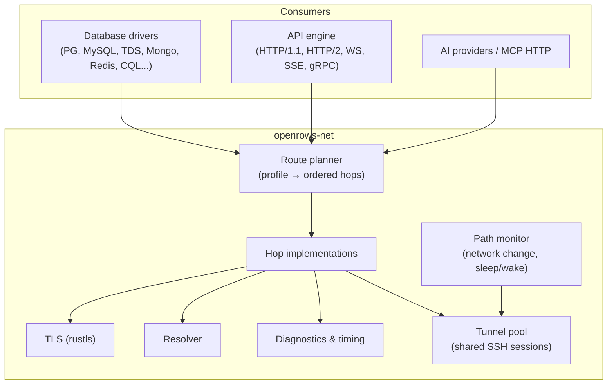
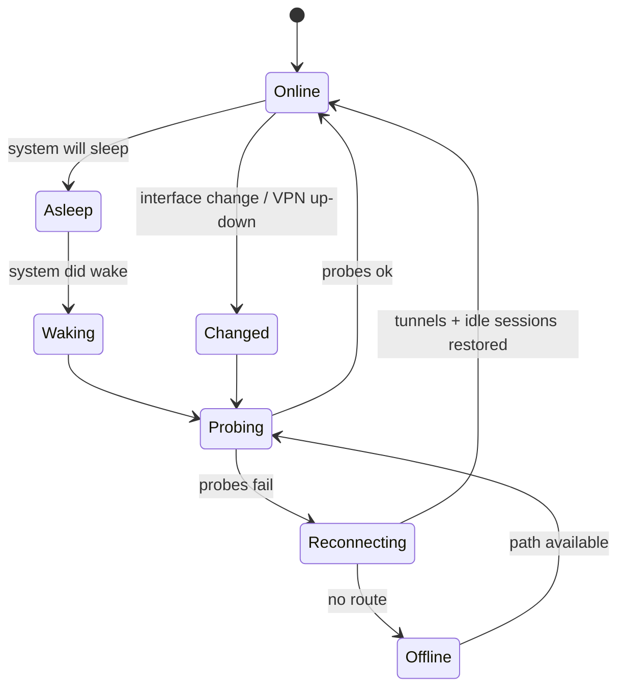

# 24 — Networking and Protocol Handling

Every feature of a database or API client sits on top of the network layer. Users connect through bastions, VPNs, proxies, cloud IAM tunnels, flaky Wi-Fi and laptop sleep cycles. This layer must be **correct, observable and resilient**, and identical for databases, API requests and AI providers.

## 1. Layering

Drivers never open sockets themselves. They ask `openrows-net` for a **stream** (`AsyncRead + AsyncWrite`) to a logical endpoint; `openrows-net` builds it from the profile's route.

## 2. Routes and hops

A route is an ordered list of hops resolved from the connection profile:

| Hop | Purpose | Implementation |
| --- | --- | --- |
| Direct TCP | Default | tokio `TcpStream`, Happy Eyeballs (RFC 8305) for dual-stack hosts |
| Unix socket / named pipe | Local PG/MySQL/Redis sockets | tokio `UnixStream` / Windows named pipes |
| SOCKS5 proxy | Corporate / dev proxies | Own client; remote DNS option |
| HTTP CONNECT proxy | Corporate proxies, incl. auth | Own client; Basic/NTLM (later) auth |
| SSH tunnel | Bastions | `russh` `direct-tcpip` channel; multi-hop `ProxyJump` chains |
| AWS SSM port forwarding | Private RDS/EC2 without bastion | Spawn user's `aws ssm start-session` (Session Manager plugin) to a local port, managed lifecycle |
| Kubernetes port-forward | DBs inside clusters | Spawn `kubectl port-forward` (user's kubeconfig/context) or native API later |
| Cloud SQL / AlloyDB connector | GCP IAM auth | Spawn user's `cloud-sql-proxy` / `alloydb-auth-proxy`, or native connector later |
| Cloudflare Access / Tunnel | Zero-trust DBs | Spawn user's `cloudflared access tcp` |
| Custom command | Anything else (Teleport `tsh proxy db`, Tailscale, internal tools) | User-defined command template with `{local_port}` placeholder; health-checked |
| TLS | Encryption + auth | rustls with platform verifier, SNI, ALPN, mTLS |

Rules:

- Spawned helper processes (SSM, kubectl, cloud proxies, custom) are **children of the app**, bound to `127.0.0.1` on an ephemeral port, health-checked before the driver connects, restarted on failure, and killed when the last session using them closes or the app quits.
- The route and each hop's state are visible in the connection's status popover ("Route: SOCKS5 → jump.example.com → db-bastion → TLS 1.3 → PostgreSQL").

## 3. SSH in depth

- **Session sharing (multiplexing):** all sessions of a profile (metadata + per-tab sessions) share one SSH connection with multiple channels, like OpenSSH `ControlMaster`. Saves handshakes, MFA prompts and bastion connection limits.
- **Auth:** agent (`SSH_AUTH_SOCK`, macOS launchd agent, 1Password/Secretive), key files (OpenSSH/PEM/PKCS#8, ed25519/ecdsa/rsa-sha2-256/512), FIDO2 `sk-` keys via agent, password, keyboard-interactive (MFA/OTP prompts surface as native dialogs), certificates (`*-cert.pub`).
- **Config:** parse `~/.ssh/config` (`Host`, `Match host`, `HostName`, `User`, `Port`, `IdentityFile`, `IdentitiesOnly`, `ProxyJump`, `ServerAliveInterval`, `Include`); profile fields override.
- **Host keys:** `known_hosts` (hashed entries supported) + app store; TOFU dialog with SHA256 fingerprint; changed key = hard stop.
- **Keepalive:** SSH-level keepalive (default 30 s) independent of DB keepalive.
- **Reconnect:** if the SSH transport drops, all its channels' sessions move to `Reconnecting`; the tunnel is re-established once and sessions reattach.

## 4. TLS

- `rustls` + `rustls-platform-verifier` (macOS Security framework, Windows CryptoAPI, Linux system roots).
- Per-connection: mode (`disable` … `verify-full`), custom CA bundle, client cert/key (files or keychain), SNI override, minimum version, optional certificate pinning (SHA-256 SPKI).
- Protocol-specific TLS negotiation handled by drivers: PG `SSLRequest` and direct TLS (PG 17 `sslnegotiation=direct`), MySQL capability-flag upgrade, TDS pre-login encryption negotiation, Mongo/Redis/HTTP direct TLS.
- Cloud CA bundles shipped for convenience (AWS RDS, Azure, GCP Cloud SQL server CAs) and updatable, so `verify-full` works out of the box.
- Certificate details visible in the status popover; expiring/invalid certificates produce actionable errors.

## 5. DNS

- System resolver by default (respects VPN/split-DNS on macOS).
- Optional per-profile host override (`/etc/hosts`-like) and resolver choice (system / DoH) for API requests.
- DNS SRV for `mongodb+srv://`; TXT options parsing.
- Resolution results and timing shown in diagnostics.

## 6. Network change, sleep and wake

- macOS: `NWPathMonitor` (Network framework) + `NSWorkspace` sleep/wake notifications via `openrows-platform`; Windows: Network List Manager + power events; Linux: NetworkManager D-Bus / netlink.
- On wake or path change, the app **proactively probes** sessions instead of waiting for TCP timeouts (which can take minutes), reconnecting idle sessions and tunnels immediately.
- Busy/in-transaction sessions are never silently replayed (see [14-reliability-and-observability.md](14-reliability-and-observability.md)).
- UI: connection health dot in the rail and context bar (green / amber reconnecting / red offline) with last-latency.

## 7. Protocol handling

| Protocol | Notes |
| --- | --- |
| PostgreSQL v3 | Extended query protocol, binary format, pipelining for metadata queries, `COPY` in/out streaming, notices, `LISTEN/NOTIFY` viewer, cancel via cancel key on a separate connection (through the same route) |
| MySQL | Compression (zlib/zstd) negotiated when bandwidth is low, `caching_sha2_password` with TLS or RSA key exchange, multi-result sets, `LOAD DATA LOCAL` only on explicit user import |
| TDS (SQL Server) | Pre-login, encryption modes, MARS off, attention-based cancel, `GO` batches split client-side |
| MongoDB OP_MSG | SRV discovery, replica-set/sharded topology monitoring, compression (zstd/snappy/zlib), read preference per connection |
| Redis RESP2/3 | Cluster slot routing, Sentinel discovery, pub/sub on dedicated connection, TLS |
| CQL | Token-aware routing, paging state, compression |
| ClickHouse HTTP | `ArrowStream` output, HTTP compression, `query_id` for cancel |
| HTTP/1.1, HTTP/2 | ALPN, connection pooling per origin, HTTP/2 multiplexing, gzip/br/zstd |
| WebSocket | RFC 6455, permessage-deflate, ping/pong |
| SSE | Reconnect with `Last-Event-ID` |
| gRPC | HTTP/2, reflection, deadlines, compression |
| HTTP/3 (QUIC) | Post-1.0 for API client (`quinn`/`h3`) |

**Adaptive behaviour:** measured RTT and throughput per route feed the driver: first-batch size, prefetch depth and compression are tuned (high latency → larger batches + pipelined metadata; low bandwidth → compression on).

## 8. Diagnostics

- **Test connection** walks every hop with timings (see [14-reliability-and-observability.md](14-reliability-and-observability.md#5-connection-diagnostics)).
- **Network inspector** (developer panel): per-session bytes in/out, round trips, latency histogram, TLS details, route.
- **API timing waterfall**: DNS, connect, TLS, TTFB, download — shared implementation.
- Optional **packet-free protocol trace** (logged protocol messages without values) for bug reports.

## 9. Security notes

- Local listeners only on loopback, ephemeral ports, single expected client where possible; prefer in-process streams (no listener at all).
- Helper commands are executed without a shell (argument vectors, no interpolation of untrusted strings); custom command templates show the final command before first use.
- Proxy and SSH credentials live in the keychain like all secrets.

## 10. Testing

- toxiproxy scenarios: latency, jitter, bandwidth caps, resets mid-stream, black-holed packets (half-open), DNS failures.
- SSH matrix: OpenSSH container with key/password/MFA/cert auth, 2-hop jump, host-key change.
- Sleep/wake and network-change simulations through `openrows-platform` test hooks.
- Helper-process lifecycle tests (crash, slow start, port conflict) with fake binaries.

## 11. Implementation notes (M0-S4 SSH spike)

The spike in `crates/openrows-net` proves `russh` for the SSH hop. It is a prototype of §3, not the M1-06 route builder: no multiplexing pool, reconnect, keepalive policy beyond russh's own, or non-SSH hops yet.

| Area | What the spike does |
| --- | --- |
| Library | `russh` 0.64 with the `ring` backend and **without** its `rsa` feature: the `rsa` crate carries RUSTSEC-2023-0071 (Marvin timing side channel, no fix). RSA *user* keys are signed by ring (constant time, `rsa-sha2-256/512`; SHA-1 `ssh-rsa` refused). RSA *host* keys are not offered during negotiation because verifying them needs the `rsa` crate; ed25519 and ECDSA host keys are. |
| Stream | `SshTunnel::open_stream(host, port)` returns a `TunnelStream` (`AsyncRead + AsyncWrite`) over a `direct-tcpip` channel; no local listener (docs/12 §4.2). |
| Hops | `SshTunnel::connect(&[SshHop])`: TCP to the first hop, each later hop over a channel of the previous one. `resolve_route` expands `ProxyJump` like OpenSSH (first jump's own `ProxyJump` applies, later ones are overridden; ≤ 8 hops, loops rejected). `SshHop::from_settings` uses OpenSSH's method order: agent (unless `IdentitiesOnly`), each `IdentityFile`, keyboard-interactive. |
| Auth | Password, key files (OpenSSH ed25519/ECDSA/RSA incl. passphrase-encrypted; unencrypted PEM: PKCS#1 RSA, SEC1 ECDSA; unencrypted PKCS#8 RSA; other formats get an error suggesting `ssh-keygen -p`), ssh-agent (`SSH_AUTH_SOCK` or explicit socket), keyboard-interactive via the `KeyboardInteractivePrompter` callback. Partial success (key then OTP) continues with the next method. Local method failures (missing agent, locked key) do not stop later methods; if nothing succeeds the first one is returned as a typed error (`PassphraseRequired`, `AgentNotConfigured`, …), otherwise `AuthFailed`. |
| Secrets | `SecretString` (zeroized on drop, redacted `Debug`, no `Display`); key file text and DER are zeroized. Once handed to russh (password, OTP answers) the copies are russh's to manage. |
| `~/.ssh/config` | Pure parser over a `ConfigSource` (fuzz-friendly, property-tested): `Host` patterns with `*`, `?`, `!`; `HostName` (`%h`, `%%`), `User`, `Port`, `IdentityFile` (accumulates, `~` expanded), `IdentitiesOnly`, `ProxyJump` (`none`, `user@host:port`, `[v6]:port`, `ssh://`), `Include` (relative to `~/.ssh`, globs, OpenSSH activation rules, depth 16). First value wins. `Match` blocks never apply; other keywords are ignored. |
| Host keys | Pure `known_hosts` checker: plain, wildcard/negated and hashed (`\|1\|salt\|hmac`) hosts, `[host]:port`, `@revoked` (hard stop), `@cert-authority` skipped, malformed lines skipped. Outcome `Trusted` / `Unknown { SHA256 fingerprint, other algorithms }` / `Changed` (hard stop, never reaches the UI) / `Revoked`. Unknown keys go to the `HostKeyPolicy` callback (`Reject`, `AcceptOnce`, `AcceptAndRemember`). The user's `known_hosts` is read-only; accepted keys are appended (0600) to an app-managed file. Known algorithms for a host are preferred during negotiation, as OpenSSH does. |
| Timeouts | docs/14 §4 per stage: DNS 5 s, TCP 10 s, handshake + auth 20 s excluding time spent in host-key and keyboard-interactive prompts, channel open 10 s, keepalive 30 s. Errors name the stage. |
| Tests | Unit and property tests for parsing, matching, timeouts, key formats and ring signatures; `just test-ssh` runs the OpenSSH container matrix (`crates/openrows-net/tests/ssh_container`): password + first use + hashed `known_hosts`, eight key formats incl. encrypted, agent, keyboard-interactive, key + OTP, wrong credentials, rejected and changed host keys, and a 2-hop jump on a Docker network built from an SSH config alias. Keys, passwords and the agent are created at test time. Tests skip when Docker is unavailable (`OPENROWS_REQUIRE_DOCKER=1` fails instead). |
| Manual probe | `cargo run -p openrows-net --example ssh_probe -- <alias> [<host> <port>]` resolves an alias from `~/.ssh/config`, asks on the terminal for first-use and keyboard-interactive answers, prints per-hop timings and optionally opens a tunnel. |

Measured on the container matrix (debug build, Docker Desktop on macOS, loopback): handshake + auth ≈ 40–60 ms per hop (≈ 0.6 s with an encrypted key, dominated by bcrypt-pbkdf in a debug build); the first channel open after authentication ≈ 42 ms on every hop, later opens ≈ 0.3–2 ms; echo round trip ≈ 0.3–2 ms. The OpenSSH client (`ssh -W`) shows the same ≈ 42 ms first-open delay against this server, so it is server-side behaviour, not russh.

Follow-ups for M1-06: session multiplexing and reconnect (§3), RSA host-key verification without the `rsa` crate (or an advisory fix upstream), host and user certificates, `Match`, `%` tokens beyond `%h`, passphrase-encrypted PEM (PKCS#1/PKCS#8) and PKCS#8 ECDSA keys, passphrase prompts through the prompter, Windows agents (Pageant / named pipe), Happy Eyeballs for the first hop.

## 12. Implementation notes (D-10 SSH routes, D-11 TLS)

D-10 and D-11 promote the spike into the connect path of the desktop app for PostgreSQL. This is the dogfood slice of M1-06/M1-07, not the full route builder.

| Area | What is implemented |
| --- | --- |
| Planner | `plan_route(SshRouteSpec, PlanContext)` turns a profile's `ssh` settings into hops: the host may be a `~/.ssh/config` alias (its `HostName`, `User`, `Port`, `IdentityFile`, `IdentitiesOnly`, `ProxyJump` apply); the profile's port, user and jump hosts override them. Destination auth: password (+ keyboard-interactive for MFA), key file (+ passphrase, then keyboard-interactive), agent (then the alias's identity files) or keyboard-interactive only. Jump hosts authenticate the OpenSSH way and also try the profile's key file. |
| Streams | Drivers get a `Dialer` (`TunnelDialer`): every `dial()` opens a `direct-tcpip` channel; no local listener. The PostgreSQL driver takes it as `ConnectOptions::via`; cancel requests use the same route. Every stream holds the tunnel, so it closes after the last session using it. |
| Sharing | The app keeps one tunnel per saved connection (`connections/tunnels.rs`): the metadata session, every per-database user session and table-edit sessions share it; concurrent connects wait for one attempt, so prompts appear once. A closed tunnel is replaced on the next connect; editing, deleting or disconnecting a connection stops sharing it. Test connection opens its own throwaway tunnel. |
| Prompts | Unknown host keys and keyboard-interactive challenges are `ssh-prompt-changed` events answered with `ssh_prompt_answer`; unanswered prompts cancel after 5 minutes. Trusted keys go to the app-managed `known_hosts` next to the profiles (0600); `~/.ssh/known_hosts` is read-only. Changed or revoked keys are a hard `hostKey` error that names the file and line; they never reach the UI as a question. |
| TLS | `openrows-net::tls::TlsClient`: rustls (ring provider, TLS 1.2/1.3) with libpq semantics. `disable`/`allow`/`prefer`/`require` do not verify the certificate, except `require` with a CA file, which verifies the chain; `verify-ca` checks the chain against the CA file (required); `verify-full` also checks the host name, against the CA file or the macOS trust store (`rustls-platform-verifier`). Client certificate and key (PKCS#8 incl. encrypted, PKCS#1, SEC1). Over SSH the certificate is checked against the profile's database host, not the tunnel. The driver sends `SSLRequest`, reads exactly one byte (CVE-2021-23222) and retries `allow` with TLS after a rejection. |
| Diagnostics | Test connection reports steps: SSH connect and login per hop, tunnel (or DNS and TCP when direct), TLS handshake (protocol, cipher, certificate subject, verification level; a warning when the certificate of a remote host is not verified or TLS is off), authentication and server version, each timed. The failing step carries the typed error and a hint on what to change. |
| Tests | Unit tests for planning, TLS verification levels and certificate files, diagnostics step mapping and hints, prompt flow and secret handling; `just test-ssh` adds `route::profile_route_dials_streams_through_one_shared_tunnel`; `just test-pg` runs PostgreSQL with TLS on (generated CA, server and client certificates) for every mode, client-certificate login, wrong CA, host-name mismatch and a routed stream. |

Still pending for M1-06: SOCKS5 and HTTP CONNECT hops, Unix-socket routes over SSH, cloud and zero-trust hops (M2-24), bundled cloud CA bundles, keepalive-driven reconnect of a dropped tunnel while sessions are open (a closed tunnel is only replaced on the next connect), the status popover with the route and certificate details, the insecure-route badge outside the connection sheet, and the spike follow-ups above (RSA host keys, certificates, encrypted PEM keys, passphrase prompts through the prompter). TLS for PostgreSQL only; other drivers arrive with D-12.
