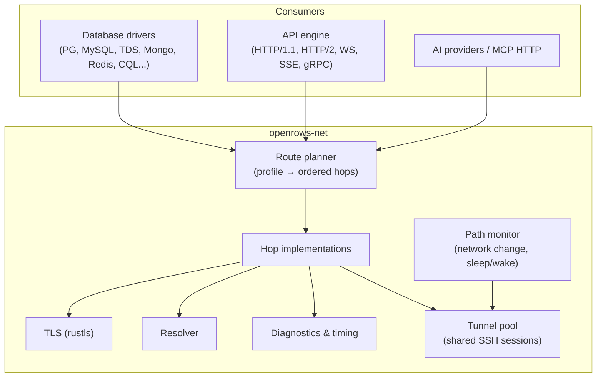
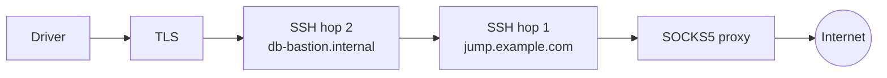
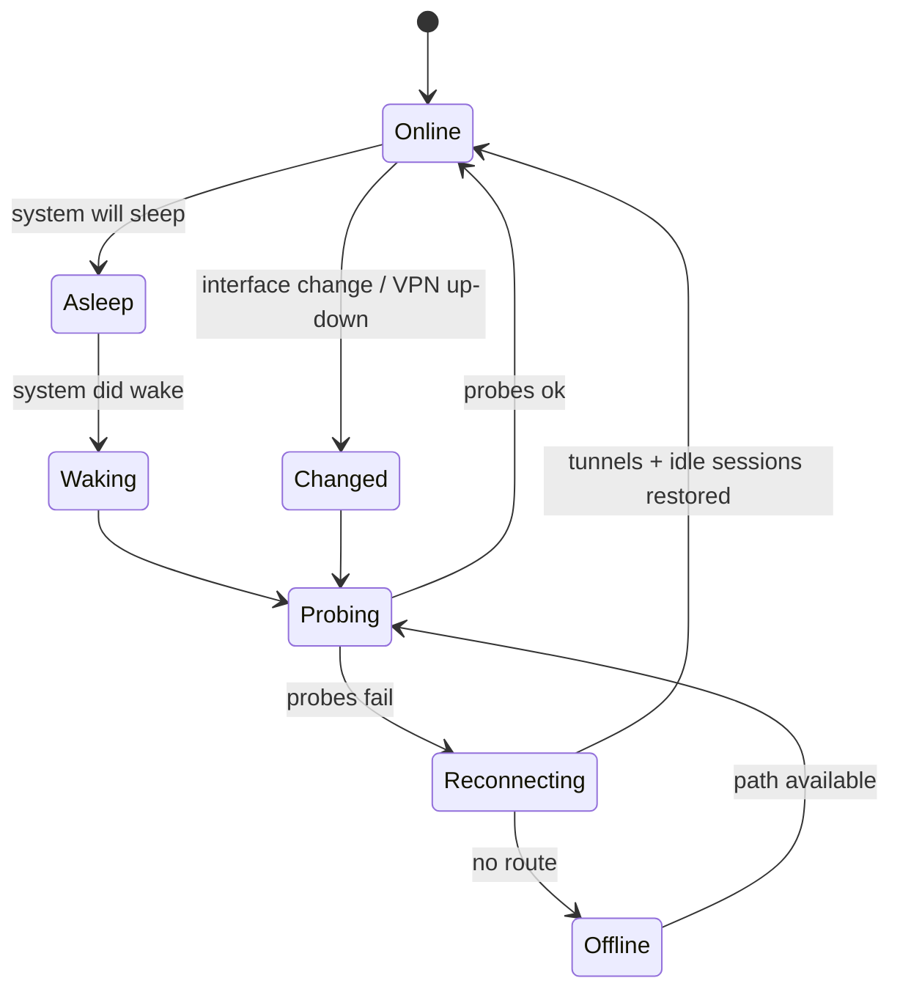

# 24 — Networking and Protocol Handling

Every feature of a database or API client sits on top of the network layer. Users connect through bastions, VPNs, proxies, cloud IAM tunnels, flaky Wi-Fi and laptop sleep cycles. This layer must be **correct, observable and resilient**, and identical for databases, API requests and AI providers.

## 1. Layering

Drivers never open sockets themselves. They ask `openrows-net` for a **stream** (`AsyncRead + AsyncWrite`) to a logical endpoint; `openrows-net` builds it from the profile's route.

## 2. Routes and hops

A route is an ordered list of hops resolved from the connection profile:

| Hop | Purpose | Implementation |
| --- | --- | --- |
| Direct TCP | Default | tokio `TcpStream`, Happy Eyeballs (RFC 8305) for dual-stack hosts |
| Unix socket / named pipe | Local PG/MySQL/Redis sockets | tokio `UnixStream` / Windows named pipes |
| SOCKS5 proxy | Corporate / dev proxies | Own client; remote DNS option |
| HTTP CONNECT proxy | Corporate proxies, incl. auth | Own client; Basic/NTLM (later) auth |
| SSH tunnel | Bastions | `russh` `direct-tcpip` channel; multi-hop `ProxyJump` chains |
| AWS SSM port forwarding | Private RDS/EC2 without bastion | Spawn user's `aws ssm start-session` (Session Manager plugin) to a local port, managed lifecycle |
| Kubernetes port-forward | DBs inside clusters | Spawn `kubectl port-forward` (user's kubeconfig/context) or native API later |
| Cloud SQL / AlloyDB connector | GCP IAM auth | Spawn user's `cloud-sql-proxy` / `alloydb-auth-proxy`, or native connector later |
| Cloudflare Access / Tunnel | Zero-trust DBs | Spawn user's `cloudflared access tcp` |
| Custom command | Anything else (Teleport `tsh proxy db`, Tailscale, internal tools) | User-defined command template with `{local_port}` placeholder; health-checked |
| TLS | Encryption + auth | rustls with platform verifier, SNI, ALPN, mTLS |

Rules:

- Spawned helper processes (SSM, kubectl, cloud proxies, custom) are **children of the app**, bound to `127.0.0.1` on an ephemeral port, health-checked before the driver connects, restarted on failure, and killed when the last session using them closes or the app quits.
- The route and each hop's state are visible in the connection's status popover ("Route: SOCKS5 → jump.example.com → db-bastion → TLS 1.3 → PostgreSQL").

## 3. SSH in depth

- **Session sharing (multiplexing):** all sessions of a profile (metadata + per-tab sessions) share one SSH connection with multiple channels, like OpenSSH `ControlMaster`. Saves handshakes, MFA prompts and bastion connection limits.
- **Auth:** agent (`SSH_AUTH_SOCK`, macOS launchd agent, 1Password/Secretive), key files (OpenSSH/PEM/PKCS#8, ed25519/ecdsa/rsa-sha2-256/512), FIDO2 `sk-` keys via agent, password, keyboard-interactive (MFA/OTP prompts surface as native dialogs), certificates (`*-cert.pub`).
- **Config:** parse `~/.ssh/config` (`Host`, `Match host`, `HostName`, `User`, `Port`, `IdentityFile`, `IdentitiesOnly`, `ProxyJump`, `ServerAliveInterval`, `Include`); profile fields override.
- **Host keys:** `known_hosts` (hashed entries supported) + app store; TOFU dialog with SHA256 fingerprint; changed key = hard stop.
- **Keepalive:** SSH-level keepalive (default 30 s) independent of DB keepalive.
- **Reconnect:** if the SSH transport drops, all its channels' sessions move to `Reconnecting`; the tunnel is re-established once and sessions reattach.

## 4. TLS

- `rustls` + `rustls-platform-verifier` (macOS Security framework, Windows CryptoAPI, Linux system roots).
- Per-connection: mode (`disable` … `verify-full`), custom CA bundle, client cert/key (files or keychain), SNI override, minimum version, optional certificate pinning (SHA-256 SPKI).
- Protocol-specific TLS negotiation handled by drivers: PG `SSLRequest` and direct TLS (PG 17 `sslnegotiation=direct`), MySQL capability-flag upgrade, TDS pre-login encryption negotiation, Mongo/Redis/HTTP direct TLS.
- Cloud CA bundles shipped for convenience (AWS RDS, Azure, GCP Cloud SQL server CAs) and updatable, so `verify-full` works out of the box.
- Certificate details visible in the status popover; expiring/invalid certificates produce actionable errors.

## 5. DNS

- System resolver by default (respects VPN/split-DNS on macOS).
- Optional per-profile host override (`/etc/hosts`-like) and resolver choice (system / DoH) for API requests.
- DNS SRV for `mongodb+srv://`; TXT options parsing.
- Resolution results and timing shown in diagnostics.

## 6. Network change, sleep and wake

- macOS: `NWPathMonitor` (Network framework) + `NSWorkspace` sleep/wake notifications via `openrows-platform`; Windows: Network List Manager + power events; Linux: NetworkManager D-Bus / netlink.
- On wake or path change, the app **proactively probes** sessions instead of waiting for TCP timeouts (which can take minutes), reconnecting idle sessions and tunnels immediately.
- Busy/in-transaction sessions are never silently replayed (see [14-reliability-and-observability.md](14-reliability-and-observability.md)).
- UI: connection health dot in the rail and context bar (green / amber reconnecting / red offline) with last-latency.

## 7. Protocol handling

| Protocol | Notes |
| --- | --- |
| PostgreSQL v3 | Extended query protocol, binary format, pipelining for metadata queries, `COPY` in/out streaming, notices, `LISTEN/NOTIFY` viewer, cancel via cancel key on a separate connection (through the same route) |
| MySQL | Compression (zlib/zstd) negotiated when bandwidth is low, `caching_sha2_password` with TLS or RSA key exchange, multi-result sets, `LOAD DATA LOCAL` only on explicit user import |
| TDS (SQL Server) | Pre-login, encryption modes, MARS off, attention-based cancel, `GO` batches split client-side |
| MongoDB OP_MSG | SRV discovery, replica-set/sharded topology monitoring, compression (zstd/snappy/zlib), read preference per connection |
| Redis RESP2/3 | Cluster slot routing, Sentinel discovery, pub/sub on dedicated connection, TLS |
| CQL | Token-aware routing, paging state, compression |
| ClickHouse HTTP | `ArrowStream` output, HTTP compression, `query_id` for cancel |
| HTTP/1.1, HTTP/2 | ALPN, connection pooling per origin, HTTP/2 multiplexing, gzip/br/zstd |
| WebSocket | RFC 6455, permessage-deflate, ping/pong |
| SSE | Reconnect with `Last-Event-ID` |
| gRPC | HTTP/2, reflection, deadlines, compression |
| HTTP/3 (QUIC) | Post-1.0 for API client (`quinn`/`h3`) |

**Adaptive behaviour:** measured RTT and throughput per route feed the driver: first-batch size, prefetch depth and compression are tuned (high latency → larger batches + pipelined metadata; low bandwidth → compression on).

## 8. Diagnostics

- **Test connection** walks every hop with timings (see [14-reliability-and-observability.md](14-reliability-and-observability.md#5-connection-diagnostics)).
- **Network inspector** (developer panel): per-session bytes in/out, round trips, latency histogram, TLS details, route.
- **API timing waterfall**: DNS, connect, TLS, TTFB, download — shared implementation.
- Optional **packet-free protocol trace** (logged protocol messages without values) for bug reports.

## 9. Security notes

- Local listeners only on loopback, ephemeral ports, single expected client where possible; prefer in-process streams (no listener at all).
- Helper commands are executed without a shell (argument vectors, no interpolation of untrusted strings); custom command templates show the final command before first use.
- Proxy and SSH credentials live in the keychain like all secrets.

## 10. Testing

- toxiproxy scenarios: latency, jitter, bandwidth caps, resets mid-stream, black-holed packets (half-open), DNS failures.
- SSH matrix: OpenSSH container with key/password/MFA/cert auth, 2-hop jump, host-key change.
- Sleep/wake and network-change simulations through `openrows-platform` test hooks.
- Helper-process lifecycle tests (crash, slow start, port conflict) with fake binaries.
