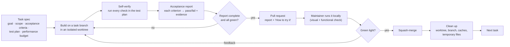

# 25 — Engineering Standards and Delivery Process

How every change in OpenRows is specified, built, verified, accepted and cleaned up. These rules apply to all contributors and all code, regardless of who or what writes it.

## 0. Current delivery mode: feature-first (until the PostgreSQL dogfood alpha)

From 2026-10-07 the project optimises for **shipping usable features fast** and for maintainer feedback from real databases. The maintainer dogfoods each feature against their own PostgreSQL databases (local first, then SSH/TLS and the other databases) and the next tasks follow that feedback. Feature-first changes order and testing depth only: TablePlus parity (docs/26), including every connection type, remains the 1.0 target. Until the dogfood alpha in [docs/27 §3a](27-delivery-plan.md#3a-dogfood-track-postgresql-first) is usable, these rules **override** the stricter parts of §1–§5:

| Area | Feature-first rule |
| --- | --- |
| Spec | Short: goal, scope, a few user-visible acceptance criteria, how to try it. No full template needed. |
| Tests | Basic tests at the lowest useful layer: unit tests for logic and one happy-path integration test against a local PostgreSQL container for driver/query features. No property tests, fuzzing or golden matrices unless a bug shows they are needed. |
| Data safety (keep strict) | Anything that can change or delete user data keeps thorough tests: change-set SQL generation and commit/rollback, safe-mode classification, read-only and confirm-before-write. Bugs here are still release blockers. |
| Performance | No per-task budgets, benchmarks or benchmark runs, no mac-low runs and no regression comparison. Keep the existing architecture (Arrow tiles, canvas grid, workers) and avoid obvious anti-patterns (docs/13 §6). Budgets and regression benchmarks are checked at milestone checkpoints instead (dogfood alpha, M1 exit, beta). |
| Gates | `just check` before pushing stays mandatory (it is fast and catches lint, type, test and dead-code failures). CI runs only on `main` (docs/18 §4). |
| Report | Short PR description: what, how tested, how to try it, known gaps. The full §3 acceptance report is only needed at milestone checkpoints. |
| Code quality | §4 limits stay: they are lint-enforced and cheap, and they keep fast iteration maintainable. |

When the dogfood alpha is usable and stable, the maintainer decides when to switch back to the full process below.

## 1. Delivery loop



Rules:

1. **Acceptance criteria and the test plan are written before any code.** Review effort goes into the criteria, not into reading every line afterwards.
2. **Every criterion is objectively checkable**: a command, a test name, a benchmark threshold, or a precise manual step with an expected result.
3. **Nothing merges without the maintainer's local green light.** Each PR says exactly how to run and try the change.
4. **One task = one branch = one PR**, small enough to verify in one sitting.
5. **A task is not done until its clean-up is done** (§7).

## 2. Task spec template

Every task starts as an issue (or PR description draft) in this shape:

```markdown
## Goal
One or two sentences: the outcome, not the implementation.

## Context
Links: requirement IDs (FR-/NFR-), docs sections, ADRs.

## Scope
- In: …
- Out: … (explicitly not part of this task)

## Acceptance criteria
- [ ] AC1 — <observable behaviour> — verified by <command / test name / manual step>
- [ ] AC2 — …
- [ ] PERF — <metric> ≤ <budget> on <hardware> — verified by <benchmark name>

## Test plan
- Unit: …
- Integration: … (databases/versions)
- UI: … (Playwright / manual steps)
- Benchmarks: … (baseline → target)

## How to try it
Commands and click-path the maintainer will use locally.
```

## 3. Acceptance report

Produced at the end of every task and pasted into the PR description:

```markdown
## Acceptance report
| Criterion | Result | Evidence |
| --- | --- | --- |
| AC1 … | ✅ pass | `cargo nextest run -p openrows-sql split::` — 48 passed |
| AC2 … | ✅ pass | Playwright `grid-scroll.spec.ts` — 0 frames > 32 ms |
| PERF … | ✅ 0.81 ms (budget 1 ms) | `cargo bench -p openrows-results window_encode` |

## Quality gates
fmt ✅ · clippy ✅ · eslint ✅ · tsc ✅ · tests ✅ (n passed) · dead-code scan ✅ · licence check ✅

## Benchmarks (vs main)
| Benchmark | main | this PR | Δ |

## Files changed
Short list with one-line purpose each.

## Clean-up
Temporary files removed · no new TODOs without issues · no unused deps.

## How to try it
…
```

A report with any ❌, missing evidence, or "not run" is not ready for review.

## 4. Code quality rules

Code must read like it was written by a senior engineer who will maintain it for years.

### 4.1 Design

- **Single responsibility**: each module, type and function has one reason to change. Split I/O, parsing, business rules and presentation.
- **Explicit boundaries**: crates and feature folders expose small public APIs; internals stay private (`pub(crate)` by default in Rust).
- **Composition over inheritance**; small traits/interfaces with focused methods.
- **No speculative generality**: build what the current task needs; extension points only where the docs require them.
- **Make illegal states unrepresentable**: enums and newtypes over loose strings, booleans and `Option` soup.
- **Errors are values**: typed errors (`thiserror`) with context; no `unwrap`/`expect` on external data; no swallowed errors.
- **Pure core, effects at the edges**: logic that can be pure is pure and unit-tested without I/O.

### 4.2 Size and complexity limits (enforced by lints)

| Metric | Target | Hard limit (CI fails) |
| --- | --- | --- |
| Function / method length | ≤ 40 lines | 80 lines |
| File length | ≤ 300 lines | 600 lines (generated files exempt) |
| Cognitive complexity per function | ≤ 10 | 20 |
| Function parameters | ≤ 4 | 6 (use a params struct beyond that) |
| Nesting depth | ≤ 3 | 4 |
| React component | one concern; ≤ 150 lines | 250 lines |

Enforcement: `clippy::too_many_lines`, `clippy::cognitive_complexity`, `clippy::too_many_arguments` (thresholds in `clippy.toml`); ESLint `max-lines-per-function`, `max-lines`, `complexity`, `max-depth`, `max-params`. Exceptions need an inline justification and reviewer approval.

### 4.3 Naming and style

- Names say what, not how: `decode_numeric`, `ResultWindow`, `useSessionState`.
- No abbreviations beyond well-known ones (`id`, `url`, `sql`, `ipc`, `tls`).
- Comments explain *why* (constraints, invariants, links to specs), not *what* the code already says.
- Public Rust items have doc comments; public TS exports have TSDoc.
- Formatting is never debated: `rustfmt`, `prettier`.

### 4.4 No dead code, no debris

- Zero unused code, imports, dependencies, feature flags, files or assets. Enforced by: `rustc`/`clippy` dead-code warnings as errors, `cargo-machete` (unused crates), `knip` (unused TS files/exports/deps).
- No commented-out code. No `TODO`/`FIXME` without an issue link (`// TODO(#123): …`).
- No debug output (`println!`, `dbg!`, `console.log`) outside designated logging.
- Experiments and spikes live on their own branch; only their conclusions (ADR, benchmark numbers) and any code we keep land on `main`.

### 4.5 Tests

- Every behaviour change has tests at the lowest effective layer (see [17-testing-strategy.md](17-testing-strategy.md)).
- Tests are deterministic, isolated and fast; no sleeps; no reliance on test order.
- Bug fixes start with a failing test.

### 4.6 Dependencies

- Each new dependency is justified in the PR (why, licence, maintenance status, size, alternatives).
- Prefer the standard library and existing workspace dependencies.
- Licence allowlist in [22-governance-and-licensing.md](22-governance-and-licensing.md#2-dependency-licence-policy).

## 5. Performance engineering policy

Speed is the product's main differentiator ([13-performance.md](13-performance.md)). Performance is designed in, measured continuously, and never traded away silently.

### 5.1 Rules

While §0's feature-first mode applies, these rules are checked at milestone checkpoints, not per task.

1. **Budgets first.** Every performance-relevant task states its budget in the acceptance criteria.
2. **Measure, then optimise.** Profile (`samply`, Instruments, `cargo flamegraph`, WebKit inspector) before changing code; attach the before/after numbers.
3. **Benchmarks are code.** Hot paths get `criterion` benchmarks (Rust) or Performance-API harnesses (UI) in the same PR.
4. **No regressions.** CI compares against `main`; > 5 % regression on a gated benchmark fails the PR unless explicitly accepted with justification.
5. **Reference hardware decides.** Budgets are verified on the reference machines, not only on CI runners.

### 5.2 Techniques we expect at the core

| Layer | Techniques |
| --- | --- |
| Memory | Zero-copy slicing (Arrow buffers, `bytes::Bytes`); pre-sized and reused buffers; arena/bump allocation for short-lived parse trees; no per-cell heap allocation; `mimalloc` global allocator (benchmarked) |
| CPU | Columnar processing; vectorised Arrow compute kernels (SIMD); branch-light decoders; `#[inline]` only where measured; avoid dynamic dispatch on per-row paths; `smallvec`/`arrayvec` for small collections |
| Concurrency | Actor-owned state instead of locks; bounded channels with back-pressure; Rayon for CPU-bound bulk work; never block the async runtime |
| I/O | Streaming everywhere; binary wire formats; pipelined round trips; compression only when bandwidth-bound; batched fsyncs |
| IPC/UI | Binary Arrow tiles; viewport-driven pulls; canvas rendering; work in Web Workers; no layout thrash |
| Build | Release profile with `lto = "fat"`, `codegen-units = 1`, `panic = "unwind"` (needed for session isolation), `opt-level = 3`; per-architecture CPU baselines (`apple-m1` for arm64, `x86-64-v2` for x86_64) chosen so binaries still run on all supported machines; profile-guided optimisation (PGO) for release builds once the benchmark suite is representative |

### 5.3 Unsafe code for speed

`unsafe` is allowed only in designated crates, only with a benchmark proving the gain, a `// SAFETY:` comment per block, Miri/fuzz coverage where applicable, and two reviewers.

## 6. Local verification gate

- Every PR includes **How to try it**: the exact commands (`just dev`, `just bench <name>`, test commands) and a click-path with expected results.
- The maintainer runs it locally (visual and functional check). Feedback goes back into the same branch.
- Only an explicit green light leads to merge. The next task starts after the merge, so feedback from one step shapes the next.

## 7. Clean-up policy

A task is complete only when it leaves nothing behind:

| Item | Action at task end |
| --- | --- |
| Task worktree | `git worktree remove <path>` and `git worktree prune` |
| Task branch | Deleted on merge (repository setting) and locally (`git branch -d`) |
| Build output | Task-specific target directories removed; a single shared Cargo target directory and `sccache` are used across worktrees to avoid duplicate multi-GB builds |
| Temporary files | Spike data, generated fixtures, logs, screenshots and reports outside the repo are deleted |
| Containers | Test database containers and volumes stopped and removed |
| Repository debris | No dead code, unused deps, stray files (§4.4) |

Periodic housekeeping (each milestone): `cargo clean` of stale profiles, `pnpm store prune`, prune unused Docker images, review disk usage of shared caches.
